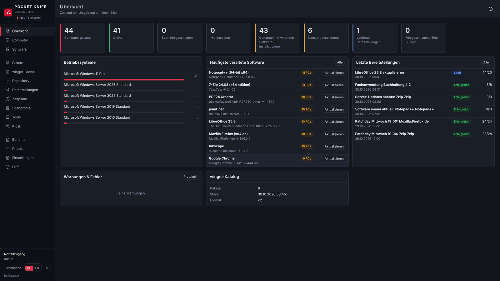
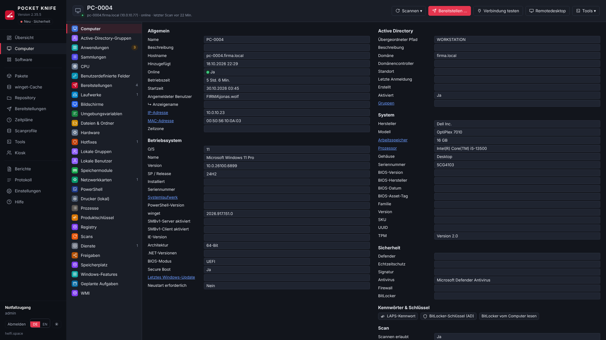
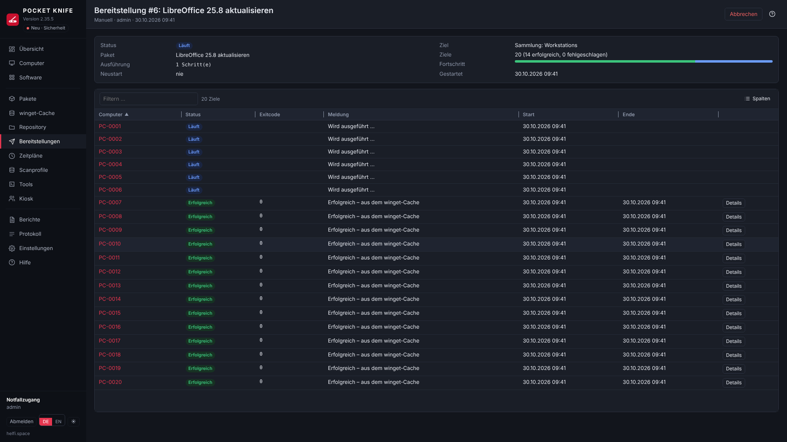

Deutsche Fassung: [README.md](README.md)

# POCKET KNIFE

Current version: **pocketknife-2.38.6-s1** – see `CHANGELOG.md` (German).

Website: [helfi.space](https://helfi.space)

Web application for **inventory** and **software deployment** for Windows computers in an Active Directory domain (Microsoft AD or Samba AD).

- Runs as a Docker container; data (SQLite, logs, certificate, winget index) is stored under `/data`
- Sign-in with domain accounts via **LDAPS**; only members of a specified AD group have access
- The DCs' LDAPS certificate is **trusted automatically**; its SHA-256 fingerprint is stored and any change is logged
- The interface loads **nothing from the internet** (no fonts, CDNs or libraries; strict Content Security Policy)

## Screenshots

**Overview** – online status, outdated software, recent deployments



**Computer** – inventory with 28 categories, security, passwords & keys



**Deployment** – live progress per computer, here from the winget cache



<sub>Demo data (firma.local, PC-0001 …), German interface.</sub>

## Help, manual and language

- **Help** in the program (Navigation → Help, or the **?** at the top right of every page and in the most important dialogs) with table of contents, search and examples.
- **Manual as PDF** in German and English: `app/static/help/POCKET-KNIFE-Handbuch.pdf` and `POCKET-KNIFE-Manual.pdf` – also downloadable from the help.
- **German and English**: switch **DE / EN** at the bottom left and on the sign-in page (applies per browser).

For developers: the manual texts are in `app/static/help/de.md` and `en.md`; `python3 tools/build_manual.py` generates the PDFs from them (requires pandoc and Playwright). The English interface comes from the dictionary `app/i18n/en.json`; `python3 tools/i18n_extract.py` lists new, not yet translated texts, `python3 tools/build_i18n.py` builds `app/static/i18n.js` from it. **Type check:** `python3 tools/typcheck.py` (mypy, baseline in `tools/mypy-baseline.txt`; only new findings fail the check on GitHub, after fixes `--update`).

## Features

| Area | Content |
|---|---|
| Computers | Automatic sync from AD, heartbeat (online/offline – only if this computer really answers at the address; outdated DNS addresses are detected, DNS cache configurable), scans via WinRM. Hardware, BIOS, OS with version/build, drives, network, installed software (computer + user), hotfixes, services, local administrators, Defender, BitLocker, TPM, pending restart, App Installer version |
| Computer view | Clear layout with 28 categories: Computer, Active Directory groups, Applications, Collections, CPU, Custom Fields, Deployments, Drives, Displays, Environment Variables, Files & Folders, Hardware, Hotfixes, Local groups, Local users, Memory Modules, Network Adapters, PowerShell, Printers (local), Processes, Product key, Registry, Scans, Services, Shares, Windows Features, Scheduled Tasks, WMI |
| Scan profiles | Freely combine 20 standard scanners and custom scanners (Registry, Files, WMI, PowerShell) into profiles, apply them to collections or individual computers and control them with triggers (Once, Interval, Daily, Weekly, Monthly, Scan age with time window, Heartbeat). Custom fields (e.g. asset number) under Settings |
| Collections | Static and dynamic collections with nested filter groups (All / Any / Not all / None) across all scan data, version comparison, patterns, RegEx, date filters, live preview, templates, folder structure; create directly from inventory data via right-click (e.g. "Computers with printer XY", "Software XY older than version …") |
| Software | Overview of all programs, automatic matching against the official **winget repository** (index `source2.msix`), marking of outdated versions, manual assignment or ignoring; optionally via a **proxy server** (also for winget on the clients) |
| Packages | Built from **steps** (Preparation, Steps, Finalize): Install (winget or file from the repository: MSI, MSP, MSU, EXE, CMD/BAT, PS1, REG – with MSI auto-detection), Command, PowerShell, nested package, file copy, Registry (set and delete values/keys, .reg import), Scan, Restart, Wait, Message, Sign out. Conditions (operating system, architecture, PowerShell, sign-in status, file, registry, collection), run as service account/System/logged-on user, error behavior, preview of the actual command line; after a successful installation/update optionally a **Windows notification** for the logged-on user ("7-Zip has been updated. Installed version: 26.00"); repository search while building packages (instant, via an in-memory directory); **export/import** of packages as a file (e.g. into a second installation – without IDs, repository paths relative); **break detection**: size, date and fingerprint of the repository files used are recorded – if a file is missing or the installation file changes, deployments and schedules are interrupted until someone accepts the new state (quick check every 5 minutes, weekly full check at night) |
| Deployments | Immediately or scheduled, for a selection or collection, list with target (collection/computer), live progress, result per step and computer, "Retry failed" and **retry individual failed steps** ("Only this step" / "From this step", for all affected computers or a single one) |
| Schedules | **Everything automatic in one place** – kind "Deploy packages" (several packages in sequence) or "winget updates" (all or specific IDs, exclusions); triggers incl. **Heartbeat**, optional time window (weekdays, also across midnight), targets, queue offline computers, wait time after failure, re-serve after X hours, preview, target history |
| News | discreetly in the sidebar: what is new (security, new, improved, fixed) and – for main admins – whether a new version is available (the server checks GitHub once a day) |
| Repository | Manage installation files directly in the web interface: **upload** (files and whole folders, also by dragging from the desktop, in pieces with resume), create folders, rename, **move with automatic adjustment of the paths in all packages** (preview, backup first, rollback on error), delete only what no package uses; wizard "Restructure repository"; **duplicate block** (same winget ID, MSI product code or file by SHA-256 only once – central or with one tenant); **find file** by fingerprint when something was moved outside |
| Tenants | Packages and schedules per customer/site, optionally restricted to a collection; **OU admins**: members of a tenant's AD group sign in and manage only that tenant's computers (deploy central and own packages – packages of other tenants are not visible to them –, change only their own – what the main admin created is read-only and can be copied as a template; own packages, schedules and collections only with approval, collections never larger than the tenant; reports and central schedules read-only with own computers; repository folder `Mandanten\<Name>` is created automatically, upload with quota) – checked server-side at every interface |
| Reports | 19 reports (including software, outdated software, operating systems, disk space, Windows updates, security status, local admins, software changes, deployment history) – table, CSV export (Excel-compatible), print view |
| Custom reports | Build your own reports: data source (computers, applications, drives, printers, services, custom scanners …), columns, row and computer filters as with collections, grouping/counting, sorting, templates, preview – usable in report e-mails and as a notification ("e-mail as soon as the report returns rows") |
| Software kiosk | Users install approved software themselves under `/kiosk` – only on the computer they are signed in to (checked live); access via AD groups and/or OUs, approval per package (with e-mail), per package only for specific AD groups, uninstall, status, plan restart; optional **sign-in with Windows (Kerberos SSO)**, off by default; no access to the administration |
| E-mail | **Reports by e-mail** at fixed times (several reports in one e-mail, table + CSV attachment, optionally only if not empty) and optional **notifications** on events (low disk space, offline for a long time, scan/deployment/backup failed, service account protection) – SMTP with STARTTLS/SSL, password encrypted |
| Remote sessions | RDP and VNC directly in the browser (Apache Guacamole), optionally with your own POCKET KNIFE sign-in or a central VNC password, clipboard, Ctrl+Alt+Del, full screen |
| Log | All events in the database (filterable, CSV) and as a rotating file in `/data/logs/` |

## How access to the clients works

```
 POCKET KNIFE (Docker)
   │  LDAPS 636 ───────────────► Domain controller (sign-in, group, computer list)
   │  WinRM 5985/5986 ─────────► Client: inventory script, start/query steps
   │  SMB 445 (ADMIN$) ────────► Client: package files to C:\Windows\Temp\PocketKnife\…
   │  SMB 445 ─────────────────► Repository share (read custom packages)
   └  HTTPS ───────────────────► cdn.winget.microsoft.com (winget index only, optional)
```

By default, installations run **directly as the service account**: POCKET KNIFE starts the step via WinRM as a separate process (Win32_Process), which also survives a dropped connection – **without a scheduled task and without a password on the client** (from 2.14). Only "Local System" and "Logged-on user" use a temporary scheduled task (`\POCKETKNIFE\…`), likewise without a stored password. There is no double-hop problem, because the container copies the package files via SMB beforehand. After execution, the process, task and files are removed again. If POCKET KNIFE is restarted in the meantime (e.g. update), it cleans up on the computer afterwards as soon as it is reachable – an installer that is still running is waited for, not aborted (from 2.18).

### Where do the installation files come from?

| Package type | Source of the installation file |
|---|---|
| Custom package | Your repository. The container copies the package folder via SMB to the client (`ADMIN$\Temp\PocketKnife`); afterwards it is deleted again. The client needs no internet access. |
| winget | The internet. Each client downloads the installer itself from the vendor address in the winget manifest. Nothing is stored in the repository. |

The container only downloads the winget **catalog** (index for version comparison), no installers.

## Domain prerequisites

1. Create a **service account**, e.g. `svc-pocketknife` (normal user account, password does not expire).
2. Add the service account via GPO to the local **Administrators** group of all clients
   (*Computer Configuration → Preferences → Control Panel Settings → Local Users and Groups*).
3. Enable **WinRM** via GPO (*Windows Remote Management → Allow remote server management through WinRM*, start the "WinRM" service automatically).
4. Open the firewall on the clients for the IP of the Docker host: **TCP 5985** (or 5986) and **TCP 445**.
5. For remote access with a local admin token, nothing else is needed for domain accounts. Only if you use a *local* account would `LocalAccountTokenFilterPolicy=1` be required (not recommended).
6. Create the AD group **POCKETKNIFE-Admins** and add the operators (nested groups are taken into account).
7. **LDAPS** must be active on the DCs. Samba AD provides it by default (also with a self-signed certificate). With Microsoft AD, the DC needs a server certificate (e.g. from AD CS); since POCKET KNIFE trusts the certificate automatically, a self-signed one is also sufficient.
8. For winget: the **App Installer** (Microsoft.DesktopAppInstaller) must be present on the clients (Windows 10 21H2+ / Windows 11 / Server 2025). The computer view shows whether it was found.
9. For custom packages: create a share, e.g. `\\fs01\PAKETE`, with read permission for the service account (or a separate repository account). For uploading, renaming, moving and deleting through the web interface (from 2.27) additionally **write permission**; other admins then no longer need direct access to the share.

## System requirements and sizing

**Docker host**

- Linux (e.g. Debian 12/13 or Ubuntu 22.04/24.04), 64-bit (amd64 or arm64), as a VM, physical or a NAS with Docker
- Docker Engine 24 or newer
- **SSD storage** for the data directory (`PK_DATA_PATH`) – the SQLite database writes many small changes during scans
- DNS of the domain (`PK_DNS_1`), network access to the clients (WinRM 5985/5986, SMB 445, for remote sessions 3389/5900), the domain controllers (LDAPS 636) and the repository share
- Internet is optional: only for the winget index (`cdn.winget.microsoft.com`) – or the index is uploaded offline; the clients download winget packages themselves

**Clients:** Windows 10/11 or Windows Server 2016–2025 with PowerShell 5.1, WinRM active, service account as local administrator. winget from Windows 10 1809 / Server 2019.

**Guideline values by size of the environment**

> The values are estimates derived from the program's design (one process, SQLite, parallel WinRM connections), not measured in large environments. Start small, observe under **Settings → Maintenance** and with `docker stats`, and increase if needed.

| Computers | vCPU | RAM (total, incl. guacd) | Storage (SSD) | Parallel scans / installations | Heartbeat |
|---|---|---|---|---|---|
| up to 250 | 2 | 2 GB | 10 GB | 6 / 8 (default) | 5 min |
| 250 – 1,000 | 2 – 4 | 4 GB | 20 GB | 10 / 12 | 5 min |
| 1,000 – 3,000 | 4 | 8 GB | 40 GB | 15 – 20 / 15 – 25 | 10 min |
| 3,000 – 5,000 | 8 | 16 GB | 80 GB | 20 – 30 / 25 – 40 | 15 min |
| over 5,000 | – | – | – | several instances (e.g. per site/tenant) | – |

The number of parallel scans and installations as well as the heartbeat interval are under **Settings → Schedules & Performance** (changes to parallelism take effect after a restart of the container).

**What the resources are needed for**

| Area | Requirement |
|---|---|
| Database | roughly 0.5 – 2 MB per computer (software, services, hotfixes, processes, hardware, tasks, history). 1,000 computers ≈ 1 – 2 GB. Shorter retention (log, scan log, deployments) keeps it small. |
| winget index | approx. 0.5 – 1 GB in the data directory, plus additional RAM briefly while importing |
| Scans | The work runs on the client; the server mostly waits for WinRM. A full scan takes about 20 – 60 s per computer – with 6 parallel scans, that is roughly 400 – 1,000 computers per hour. More parallelism = faster, but more RAM and more load on DCs and network. |
| Heartbeat | checks with 48 parallel connections; a computer that is switched off costs up to approx. 4.5 s. With many computers, choose a longer interval so that one pass finishes before the next one starts. |
| Deployments | Files from the repository travel **through the Docker host** to the client (SMB read → ADMIN$ write). 100 computers × 500 MB = 50 GB of network load through the host – for large packages plan for 1 Gbit/s or more, limit parallelism or use winget (the clients then download themselves). |
| Remote sessions (guacd) | about 50 – 150 MB RAM per concurrent RDP/VNC session and noticeable CPU when the image moves; 10 concurrent sessions ≈ 1 – 1.5 GB and 1 – 2 additional vCPUs |

**Tips for large environments**

- Stagger scans with **scan profiles**: the full profile e.g. weekly, "Applications" daily; "Scan age" instead of a fixed time spreads the load.
- Schedules with a **time window** and heartbeat instead of all computers at once.
- Adjust retention under **Settings → Schedules & Performance** (log, scan log, deployments).
- Optionally limit resources in the Compose file, e.g. `mem_limit: 8g` and `cpus: 4` for the `pocketknife` service.
- **Backup:** put the automatic backup (Settings → Backup) on another drive (`PK_BACKUP_PATH`) and plan per backup with about the database size (compressed usually considerably less) × number of versions.

### Automatic backup

POCKET KNIFE backs itself up – under **Settings → Backup**:

- **daily** at the configured hour (default 02:00) and **before every update** (on the first start of a new version, before the database changes)
- **Versions to keep:** default 10; older backups are deleted automatically (including manual and "before update" ones)
- **Back up now**, list with download and delete
- Contents of each ZIP: the database (consistent copy while running), `pocketknife.key` and the HTTPS certificate. This also allows stored passwords to be restored – so protect the backup folder.
- Location: `PK_BACKUP_PATH` from the `.env` (default `<PK_DATA_PATH>-backup`, e.g. `/opt/pocketknife/data-backup`). Preferably another drive or a mounted network share; if the folder is on the same drive as the database, the page points this out.

**Restore:** `docker compose down` → delete `pocketknife.db-wal` and `pocketknife.db-shm` in the data directory → extract the contents of the ZIP file there → `docker compose up -d`.


**Database cleanup:** Old entries are deleted every hour – log (default 90 days), scan log (14 days), deployments including output (180 days), software changes (365 days), expired sessions and orphaned remnants. The retention periods are under **Settings → Schedules & Performance**. Once a day (default 03:00) the **database maintenance** follows: update statistics, write back the WAL file and – if more than 20 % of the file is free – `VACUUM`, which shrinks the file. Size, free share and last maintenance are shown under **Settings → Maintenance**; there, **Clean up now** starts the maintenance immediately. Deleted computers lose their inventory data immediately. The log files under `/data/logs` are rotated at 10 MB (at most 10 files).

## Installation

The detailed step-by-step guide – Docker host, ports, every line of the `.env`, start, first sign-in, container managers (NAS, Portainer, Dockhand) and common errors – is in the manual under **Installation** (in the app: Help → Installation and Update). In short:

```bash
mkdir -p /opt/pocketknife && cd /opt/pocketknife
sudo docker login ghcr.io -u <GitHub user>  # only for a private registry; password = token with read:packages
# take the three files for the host from the image (or download them in the browser from the release: save env.example as .env.example)
sudo sh -c 'docker pull ghcr.io/soleil0815/pocketknife:latest && docker run --rm --entrypoint sh ghcr.io/soleil0815/pocketknife:latest -c "cd /opt/pocketknife/host && tar cf - ." | tar xf -'
cp .env.example .env
nano .env                 # required: PK_DOMAIN, PK_NETBIOS, PK_DNS_1, PK_LDAP_SERVERS, PK_ACCESS_GROUP, PK_PUBLIC_HOSTNAME
docker compose up -d      # pulls the ready-made images (amd64/arm64) and starts
docker compose ps         # "healthy" after about a minute → https://<PK_PUBLIC_HOSTNAME>:8443
```

The host only holds `docker-compose.yml`, `.env`, `update.sh` and the data (`data/`, `data-backup/` are created next to them at the first start) – the program lives in the image. Enter the service account in the interface after the first sign-in (stored encrypted) – not in the `.env`.

**Image:** ready-made from the GitHub Container Registry, `ghcr.io/soleil0815/pocketknife:latest` and `ghcr.io/soleil0815/pocketknife-guacd:latest`. **Updating** like any container – with a container manager (Dockhand, Watchtower …, preferably at night) or `sudo sh update.sh` (see [Update](#updating-to-a-new-version)); before a new version starts, POCKET KNIFE backs up its database itself. **Stay on a version:** `sudo sh update.sh <version>`.

**Reproducible build:** the base image (Python version and digest), Debian packages (via a fixed point in time on snapshot.debian.org) and all Python packages including dependencies are pinned exactly (`Dockerfile`, `requirements.lock`, `build-requirements.txt`, `docker/apt-*.txt`). Pin or deliberately update with `./tools/pin-versions.sh` (current state) or `./tools/pin-versions.sh --update` (newest versions) – the tool then rebuilds as a check and runs the self-test. If `requirements.lock` is empty, the image is built from `requirements.txt` with a notice.

**Without root (from 2.14):** The service runs as user `pocketknife` (UID/GID 10001, changeable with `PK_UID`/`PK_GID`), with a read-only program file system, without capabilities and with `no-new-privileges`. On start, it hands `/data` and `/backup` over to this user once and then drops its root privileges. A mounted repository folder (`PK_REPO_MOUNT`) must be readable for UID 10001. **NAS with share permissions of its own (e.g. Synology):** create a user of its own there, give it read/write on the data and backup folders and enter its IDs as `PK_UID`/`PK_GID` – step by step in the manual under Installation → On a NAS.

All configurable values – including DNS servers (`PK_DNS_1`, `PK_DNS_2`, `PK_DNS_SEARCH`), port, time zone, data path (`PK_DATA_PATH`) and repository folder (`PK_REPO_MOUNT`) – are in the `.env`. The `docker-compose.yml` is not edited. Without `PK_DNS_1`, `docker compose` aborts with a clear message; `PK_DNS_2` is optional (leave it empty if there is only one DNS server).

## Updating to a new version

From 2.33 you update POCKET KNIFE like any other container – the program lives completely in the image, the host only holds `docker-compose.yml`, `.env` and the data. **Before a new version starts, POCKET KNIFE backs up its database itself** (backup "vor-<version>", see [Data & backup](#data--backup)) and then extends it if necessary – no matter who swapped the image.

**With a container manager (recommended):** Dockhand, Watchtower, Tugtainer & co. update both containers (`pocketknife` and `pocketknife-guacd`) as soon as a new image is available. Preferably set the update time to **night** – a restart in the middle of a deployment interrupts it (POCKET KNIFE cleans up afterwards, see "Restart during a deployment" in the help). Every Monday a security update is published (`<version>-s<n>`: same program, updated packages).

**By hand** in the folder with the `docker-compose.yml`:

```bash
sudo sh update.sh               # newest version (or the one pinned in the .env)
sudo sh update.sh 2.33.1        # a specific version – pinned in the .env
sudo sh update.sh latest        # back to "always the newest"
```

`update.sh` remembers the running images, pulls the new ones (POCKET KNIFE and guacd), starts and waits for the health check. If the new version does not start, it offers to start the previous one again – without a download. If the new image brings a newer `docker-compose.yml`, it puts it in place and keeps the previous one as `docker-compose.yml.alt`. It unpacks nothing and builds nothing. `-y` answers all questions with "yes". It also works without the script: `docker compose pull && docker compose up -d`.

**docker-compose.yml:** it changes only rarely. If a new version needs a newer file, POCKET KNIFE shows main admins **⚠ Notice** in the sidebar – a `sudo sh update.sh` then puts it in place (if you only use a container manager, take it from the image as during installation). Since 2.33 guacd comes as `ghcr.io/soleil0815/pocketknife-guacd` – the same official version, checked by POCKET KNIFE and published with the security updates; the file no longer has to change for it.

**Stay on a version or go back:** `sudo sh update.sh <version>` (or in the `.env` `PK_IMAGE=ghcr.io/soleil0815/pocketknife:<version>` and `PK_GUACD_IMAGE=ghcr.io/soleil0815/pocketknife-guacd:<version>`, then `docker compose up -d`). If the newer version already extended the database, restore the backup "vor-<newer version>" (see [Data & backup](#data--backup)). If an older version starts on a database that a newer one has already used, POCKET KNIFE says so in the sidebar.

**Without internet:** every release contains an archive of both images per platform (`pocketknife-<version>-amd64.tar.gz`, `-arm64.tar.gz`, checksums in `pocketknife-<version>.sha256`). Copy it to the Docker host and run `sudo sh update.sh pocketknife-<version>-amd64.tar.gz` – it loads the images (`docker load`), checks the checksum, pins the version in the `.env` and starts.

**Private registry:** log in once on the Docker host as the user running the updates (root with `sudo`, the container manager's user otherwise): `docker login ghcr.io -u <GitHub user>`, password = **personal access token** with `read:packages`. The token is not stored in the `.env`.

**Where the images come from:** for every version GitHub (workflow `.github/workflows/release.yml`) builds the image for amd64 and arm64, runs the self-test in both, checks both with **Trivy** for known vulnerabilities and only then publishes it, together with guacd under its own name; every Monday additionally with updated packages ("Wöchentliches Sicherheitsupdate").

### Switching from an installation with the program ZIP (up to 2.32)

Up to 2.32 the program ZIP was unpacked on the host. That is no longer needed – switch like this:

1. Take the new `update.sh` from the image and run it once (the old one does not know the new way – it would build locally as before) – it switches to the ready-made image, puts the new `docker-compose.yml` in place (the old one stays as `docker-compose.yml.alt`) and removes the update helper of 2.32.9–2.32.12 if it was set up:

```bash
cd /opt/pocketknife
sudo sh -c 'docker pull ghcr.io/soleil0815/pocketknife:latest && docker run --rm --entrypoint cat ghcr.io/soleil0815/pocketknife:latest /opt/pocketknife/host/update.sh > update.sh.neu && sh update.sh.neu'
```

Everything in one command as root: if pulling the image fails (e.g. `denied` – then first `sudo docker login ghcr.io -u <GitHub user>`), nothing else happens. At the end the new script puts itself in place as `update.sh`; `--cleanup` removes the file `update.sh.neu`.

2. Clean up – shows what can go and asks:

```bash
sudo sh update.sh --cleanup
```

Only known program files of earlier versions are deleted (`app/`, `tools/`, `Dockerfile`, `.pk-vorher/`, old ZIPs, version folders like `pocketknife-2.24/` …) and the folder `data/update/` of the former helper. **Never** database, backups, repository, `.env` or `docker-compose.yml` – not even if a folder points to them through a link or data is still inside a version folder. Afterwards `docker-compose.yml`, `.env`, `update.sh` and your data folders remain.

3. From now on update with the container manager or `sudo sh update.sh`, as you like.

## Publishing a new version (GitHub)

The source code lives on GitHub; GitHub builds the images. Steps for a new version:

1. Increase `VERSION`, add a section `## pocketknife-<version> (date)` to `CHANGELOG.md` and the version's news to `app/news.json` (short, German and English; kind `security`/`new`/`improved`/`fixed`) – if one is missing, the build stops.
2. Commit and push – `Test` builds the image (amd64) and runs the self-test in it.
3. Set a tag: `git tag v<version> && git push origin v<version>`. `Release` then builds for **amd64 and arm64**, runs the self-test in both (arm64 emulated, takes longer), uploads the image as `ghcr.io/<owner>/pocketknife:<version>` and `:latest`, publishes guacd as `…/pocketknife-guacd` and creates a release – with `docker-compose.yml`, `.env.example`, `update.sh`, an archive of both images per platform for installations without internet, checksums and image digests (no program ZIP any more). If a step fails, nothing is published.

With a private repository the image is private too; the Docker hosts sign in once with `docker login ghcr.io` (token with `read:packages`).

### Vulnerability check (Trivy)

An image with known vulnerabilities is not published. `tools/trivy-scan.sh` checks the Debian and Python packages in the image for vulnerabilities of severity **HIGH and CRITICAL that have a fix** (without an available fix nothing can be done – that would block every release):

| Workflow | When | Effect |
|---|---|---|
| `Release` | before uploading, amd64 and arm64 | finding → **nothing is published**; table in the run summary |
| `Test` | every push | finding → run red (early warning before a release fails) |
| `Wöchentliches Sicherheitsupdate` | Mondays 03:23 UTC and manually | update base image, Debian and Python packages and guacd, build without cache, self-test, Trivy – **only if everything passes**: security update number **`<version>-s<n>`** (e.g. 2.29.7 → 2.29.7-s1 → 2.29.7-s2: same program, only new packages; a new program version starts again without `-s`) with an entry in CHANGELOG and news – **as a pull request** (from 2.37: nothing lands on main unreviewed, no release by itself). After merging, start *Release* (amd64/arm64, self-test and Trivy once more) – as `<version>` and `:latest`. If nothing changed, nothing happens; if something fails, no pull request is created (e-mail from GitHub) |
| `Sicherheits-Scan` | daily 05:17 UTC and manually | checks the published `:latest` – vulnerabilities often become known after a release; a red run makes GitHub send an e-mail |
| `Versionen aktualisieren` | manually | `tools/pin-versions.sh --update`: re-pin base image, Debian packages, Python packages and guacd, build without cache, self-test, Trivy – result as a pull request |

**What "up to date" means:** *all* Debian packages in the image (including those of the base image, via `apt-get upgrade` to the snapshot's state), all Python packages **within their major version** (before 1.0: minor version – e.g. cryptography 50.x, fastapi 0.155.x; `requirements.caps`, generated by `tools/caps.py`; calendar versions such as certifi always new; new major versions only deliberately with `PK_ALLOW_MAJOR=1`), the base image within the Python series and Debian version (e.g. 3.12 on Debian 13 "trixie") and guacd in its newest version. pip is not included in the finished image (not needed at runtime). **The foundation** (next Python series or Debian version) is never raised silently by the weekly run – it reports a notice from 12 months before the end of updates and a red run (e-mail) from 6 months, data from endoflife.date. Raising: `PK_PYTHON_BASE=python:<series>-slim-<debian> tools/pin-versions.sh --update` with a full test.

After merging and publishing, POCKET KNIFE shows the new security update like any version; it is installed with the container manager or `sudo sh update.sh`, even if nothing changes in the program. If you do not want this, pin the version (`PK_IMAGE=…:<version>`) or disable the workflow under *Actions → Wöchentliches Sicherheitsupdate → Disable workflow*.

**If Trivy finds something:** the weekly run picks up fixes by itself as soon as they exist. Immediately: *Actions → Wöchentliches Sicherheitsupdate → Run workflow* – or, to review first, *Versionen aktualisieren* (pull request only). Review and merge the pull request, then publish a new version as above. If the fix has not yet arrived in Debian or on PyPI, the pull request shows the open finding. Deliberately accepted, non-exploitable findings go into `.trivyignore` with a reason and an expiry date. For the pull request, *Settings → Actions → General* "Allow GitHub Actions to create and approve pull requests" must be enabled (otherwise only a branch).

Trivy is downloaded in exactly one version and verified by SHA-256 – no GitHub Action (in March 2026 trivy-action, setup-trivy and Trivy 0.69.4–0.69.6 were compromised, CVE-2026-33634). On a Docker host a local image can be checked the same way: `sh tools/trivy-scan.sh pocketknife:local`.

## Environment variables

| Variable | Meaning | Default |
|---|---|---|
| `PK_DOMAIN` | DNS name of the domain | – |
| `PK_NETBIOS` | NetBIOS name (for `DOMÄNE\konto` with WinRM/SMB) | – |
| `PK_LDAP_SERVERS` | DCs, comma-separated | `PK_DOMAIN` |
| `PK_LDAP_PORT` | LDAPS port | `636` |
| `PK_BASE_DN` | Search base | from domain |
| `PK_COMPUTER_BASE_DN` | Initial value for the search bases (from 2.2 maintainable under Settings → Active Directory) | `PK_BASE_DN` |
| `PK_ACCESS_GROUP` | Access group (name or DN) | `POCKETKNIFE-Admins` |
| `PK_SERVICE_USER` / `PK_SERVICE_PASSWORD` | Service account (`*_FILE` for Docker secrets). **Optional from 2.2** – better stored under Settings → "Service account & repository account" | – |
| `PK_WINRM_AUTH` | Authentication method for WinRM/SMB: `ntlm`, `negotiate`, `kerberos` (can be overridden in the interface; `credssp` is no longer supported since 2.29) | `ntlm` |
| `PK_LDAP_CA_FILE` | Domain CA (PEM) for full validation of the LDAPS certificate, e.g. `/data/ca.pem` | empty = remember the certificate on first contact |
| `PK_WINRM_CA_FILE` | CA (PEM) for validating the client certificates with WinRM over HTTPS, e.g. `/data/winrm-ca.pem` | empty = do not validate |
| `PK_KDC` | Domain controllers for Kerberos (comma-separated), if DNS SRV is not sufficient | DNS |
| `PK_KERBEROS_REALM` | Kerberos realm, if different from `PK_DOMAIN` | `PK_DOMAIN` in upper case |
| `PK_IMAGE` / `PK_GUACD_IMAGE` | images of the two containers (`sudo sh update.sh <version>` sets them) | `ghcr.io/soleil0815/pocketknife:latest` / `…/pocketknife-guacd:latest` |
| `PK_WINRM_HTTPS` / `PK_WINRM_PORT` | WinRM over HTTPS / port | `false` / `5985` |
| `PK_REPO_USER` / `PK_REPO_PASSWORD` | Account for the repository share | service account |
| `PK_HTTPS` / `PK_PORT` | Web interface via HTTPS / port | `true` / `8443` |
| `PK_PUBLIC_HOSTNAME` | Name in the self-signed certificate and default for the certificate signing request | `pocketknife` |
| `PK_SESSION_HOURS` | Maximum duration of a session (additionally sign-out when idle, configurable in the interface) | `10` |
| `PK_UID` / `PK_GID` | User/group ID under which the service runs in the container (owner of `/data` and `/backup`) | `10001` |
| `PK_DNS_1` / `PK_DNS_2` / `PK_DNS_SEARCH` | DNS servers and search domain for the container (`PK_DNS_2` optional: a second, different server) | – / empty / `PK_DOMAIN` |
| `PK_DATA_PATH` | Data directory on the host | `./data` |
| `PK_REPO_MOUNT` | Host folder mounted as `/repo` | `./repo` |
| `PK_BACKUP_PATH` | Host folder for the automatic backups (`/backup` in the container) | `<PK_DATA_PATH>-backup` |
| `PK_TIMEZONE` | Time zone | `Europe/Berlin` |
| `PK_TRUSTED_PROXIES` | IPs of a reverse proxy (X-Forwarded-For) | `127.0.0.1` |
| `PK_GUACD_HOST` / `PK_GUACD_PORT` | guacd for remote sessions (image version pinned with digest in the `docker-compose.yml` from 2.14.2) | `guacd` / `4822` |
| `PK_BREAKGLASS_USER` / `_PASSWORD` | Optional emergency access without AD | off |

Schedules, parallelism, retention, LDAP filters, repository path and winget options are maintained in the interface under **Settings** and stored in the database.

## Packages

Packages → **New package** (winget and file packages share one dialog). The structure is on the left, the settings of the selected entry on the right:

```
Package properties    Name, version, tenant, run as, time limit, restart at the end, scan afterwards
Conditions            apply to the whole package
Preparation           e.g. close program, remove old version
Steps                 Install, Command, PowerShell, nested package, file copy, Registry, Scan, Restart, Wait, Message, Sign out
Finalize              always runs – even after an error (e.g. cleanup)
```

Steps can be reordered, duplicated, disabled and moved between sections by dragging, ↑/↓ or right-click.

| Step | What happens |
|---|---|
| Install | **File from the repository** (MSI, MSP, MSU, EXE, CMD/BAT, PS1, REG – the folder is copied; `.reg` via `reg.exe import`) or **winget** (empty version = always the newest). For an MSI, POCKET KNIFE reads ProductName, version, manufacturer, product code and platform when it is selected and pre-fills name, version, detection and the architecture condition |
| Uninstall | at run time, searches "Programs and Features" live for the display name (wildcard `*`, optionally version) and uninstalls silently – MSI product code, vendor's silent command, known uninstallers or winget; user installations as the respective user. Quickly created by right-clicking a program → "Create uninstall package …" |
| Command / PowerShell | multi-line, custom success exit codes |
| Nested package | the steps of another package at this point (up to 5 levels, loops are detected) |
| File copy | file or folder from the repository to e.g. `%ProgramData%\Firma` (Robocopy, optionally without overwriting) |
| Registry | set values (all common types), delete values/keys, create keys; 64- or 32-bit view; "Import from .reg" takes over an exported .reg file as entries |
| Scan | inventory scan with a scan profile |
| Restart | restarts, waits until the computer is reachable again, and then continues |
| Wait / Message / Sign out | pause, message to all sessions (`msg *`), sign out user |

**Computer name & co. in packages:** The tool variables `$(Computer)` etc. apply only to tools. In package steps (Command, PowerShell, paths), use the client's Windows environment variables: `%COMPUTERNAME%`, `%USERDOMAIN%`, `%ProgramData%` in a command or `$env:COMPUTERNAME` in PowerShell. Note: `%USERNAME%` / `$env:USERNAME` is the **executing** account (service account or `SYSTEM`, computer account `PC-0815$`), not the logged-on user – except with *Run as: Logged-on user*. In PowerShell, `(Get-CimInstance Win32_ComputerSystem).UserName` returns the logged-on user.

**Conditions** (package and every step): operating system (Windows 10/11, Server 2016–2025), architecture (x86, x64, ARM64) – by default **everything is selected** and only deselected if needed –, minimum PowerShell version, sign-in status, file (present/missing/version), registry (present/missing/value/version) and collection membership. Not met = the package or step is skipped.

**Run as**: the default is the **Service account (deploy user)** – the step runs directly as a process of the service account with full administrator rights; no password is stored on the client (up to 2.13 it ran via a scheduled task with a stored password – the next scan removes such remnants). Network shares cannot be reached from within the step (no credentials on the client); POCKET KNIFE copies files from the repository beforehand anyway. If a custom command needs a share, choose "Local System" and give the computer account (e.g. "Domain Computers") read permission. Optionally **Local System** or **Logged-on user**, per package and per step. winget steps automatically run as System, because the App Installer is usually not registered for the service account. Packages from older versions keep "Local System" so that they behave as before.

**winget on servers**: Before every winget step, POCKET KNIFE checks whether winget is present. If it is missing (Windows Server, older Windows 10 builds), the App Installer including dependencies is installed – always from the repository folder "Offline source" (default `_winget`); POCKET KNIFE downloads the current [GitHub release](https://github.com/microsoft/winget-cli/releases) there once itself (checked daily, checksum from GitHub). The client never downloads from the internet itself (from 2.37). Before Windows 10 1809 / Server 2019 (e.g. Server 2016) there is no winget; winget steps are skipped there. The tool "Check / install winget" also does this without a package.

**Scan afterwards**: After every installation or uninstallation, the computer is re-inventoried with the "Applications" profile (changeable in the package, also "Do not scan").

**Command line** shows the actual call on the client for each step, e.g.

```
Direkt als Dienstkonto FIRMA\svc-pocketknife (eigener Prozess, keine geplante Aufgabe):
msiexec.exe /i "C:\Windows\Temp\PocketKnife\<Lauf>\7z2408-x64.msi" /qn /norestart ALLUSERS=1 /l*v "C:\Windows\Temp\PocketKnife\<Lauf>\pk_msi.log"
```

(The first line reads: "Directly as service account FIRMA\svc-pocketknife (separate process, no scheduled task):".)

`<Lauf>` is the working folder of the deployment (`<Bereitstellung>_<Ziel>_<Schritt>`, i.e. deployment, target, step), which is deleted afterwards. In the deployment, "Details" shows the result of every step per computer with exit code and the complete output.

Repository structure:

```
\\fs01\PAKETE
├── 7zip\24.08\7z2408-x64.msi
├── Greenshot\1.3\Greenshot-INSTALLER-1.3.exe
└── Firmen-Tools\2.0\install.ps1  (+ any other files)
```

- **MSI/MSP/MSU**: POCKET KNIFE sets `/qn` or `/quiet` and `/norestart` itself; without a custom `/log`, an MSI log is written whose error lines appear in the output if the installation fails.
- **Success exit codes**: default `0,3010,1641` for installations, `0` for commands (3010/1641 = restart required).
- **Detection**: If the software (display name pattern such as `7-Zip*`) is installed in this version or newer, the step is skipped.

## Schedules

Navigation → **Schedules** – this is where everything that is deployed or updated automatically lives (the former "rules" were automatically converted into schedules during the update to 2.5):

- **Kind**: "Deploy packages" (several packages, per computer one after the other in a fixed order) or "winget updates" (outdated software via `winget upgrade`, all or specific IDs, exclusions, scope; one deployment per program)
- **Trigger**: Once, Interval, Daily, Weekly, Monthly, **Heartbeat** (every target as soon as it is reachable and has not yet been served – after enabling, for new schedules or new collection members at the next heartbeat)
- **Time window** (optional): weekdays and time, also across midnight; due runs outside the window are caught up at the start of the window, computers coming online are queued. "Run now" ignores the window.
- **Targets**: collections (re-evaluated on every run, also "All computers") and individual computers
- **Options**: queue offline computers and serve them at heartbeat (or skip them); wait time after failure; **catch up on failures** (default from 2.14: failed computers are automatically served again after the wait time, at least 1 hour – at most "Max. failed attempts" times, three times if 0; a run that could not start at all is repeated every 15 minutes); for packages additionally: skip the remaining packages on error, do not re-serve successful targets or **re-serve after X hours**, maximum failed attempts
- **Preview**: what a run would do now (for winget: which programs on which computers)
- **Target history**: status, last run and success, failed attempts per computer; "Re-serve selected" and "Reset history"

## Tenants

Under **Settings → Tenants** (e.g. customers or sites). Packages and schedules can be assigned to a tenant, and the package list can be filtered by it. If a collection is assigned to the tenant, its packages are only deployed to that collection's computers (other targets are skipped and reported). If a tenant may build its own packages, it automatically gets the repository folder `Mandanten\<Name>` (or one of your choice); its OU admins see and edit only this folder in the repository, optionally with a storage quota. OU admins see and deploy central packages and those of their tenant, change only their own (what a main admin creates for the tenant is read-only for OU admins unless "OU admins may change" is enabled); the same software exists only once (duplicate block by winget ID, MSI product code, SHA-256).

## Actions on the clients

| Action | Where | Note |
|---|---|---|
| Uninstall software | Computer → Applications (single or selection), Software → program → selection | The silent command is determined automatically and can be changed beforehand. User-specific installations (HKEY_USERS) cannot always be removed as SYSTEM |
| Start / stop / restart service / startup type | Computer → Services | Stopping also ends dependent services |
| End process | Computer → Processes | First "Load live from computer" so that the list is current |
| LAPS password | Computer → Overview → Passwords & Keys | Reads `msLAPS-Password` (Windows LAPS) or `ms-Mcs-AdmPwd` (legacy). Windows LAPS passwords stored with encryption can only be decrypted under Windows |
| BitLocker key (AD) | same place | Reads the `msFVE-RecoveryInformation` objects under the computer account |
| BitLocker from the computer | same place | Reads the recovery passwords directly via WinRM (`Get-BitLockerVolume`) |

To allow the service account to read LAPS passwords and BitLocker keys (once, on the OU of the computers):

```powershell
# Windows LAPS
Set-LapsADReadPasswordPermission -Identity "OU=Clients,DC=firma,DC=local" -AllowedPrincipals "FIRMA\svc-pocketknife"
# Legacy LAPS
Set-AdmPwdReadPasswordPermission -OrgUnit "OU=Clients,DC=firma,DC=local" -AllowedPrincipals "FIRMA\svc-pocketknife"
# BitLocker: in "Delegate Control" grant "Read" + "Read all properties" for msFVE-RecoveryInformation objects
```

Every retrieval of passwords or keys is logged with the user name. The values are not stored.

## Tools

Select computers (or open a computer) → **Tools ▾** → choose a tool. The output appears per computer.

| Type | Runs | Example |
|---|---|---|
| PowerShell | on the client, as service account (WinRM) or as SYSTEM | `Get-Tpm \| Format-List` |
| Command (CMD) | on the client, multi-line like a .cmd file | `ipconfig /flushdns` |
| URL | in the operator's browser | `vnc://$(IP)`, `https://$(Host):8443` |

Variables (replaced by the computer's values before execution):

| Variable | Value | Example |
|---|---|---|
| `$(Computer)` | computer name (NetBIOS) | `PC-0815` |
| `$(Host)` | fully qualified DNS name; if unknown, the computer name | `pc-0001.firma.local` |
| `$(IP)` | first IP address from the last scan | `10.0.10.25` |
| `$(MAC)` | first MAC address from the last scan ("Network Adapters" scanner) | `00:11:22:33:44:55` |
| `$(User)` | most recently detected logged-on user (scan/heartbeat) | `FIRMA\mmuster` |
| `$(Domain)` | domain of the computer from the scan, otherwise the domain from the settings | `FIRMA` |

Variables are case-sensitive; unknown values are replaced by an empty text.

Built in are Ping & Ports, Remote Desktop and VNC in the browser, Wake-on-LAN, restart/shut down, gpupdate, "Scan with profile" and **Analyse disk space**.

**Analyse disk space:** folder sizes of a drive or folder as a ring chart (center = current folder, inner ring = contents, outer ring = one level deeper) with a list next to it. A click zooms into the folder; levels below the selected depth are scanned on demand with a click. The client counts with a small C# helper via WinRM (no installation, junctions are not followed); the last 8 results per computer are stored. The folder icon or "Open in Explorer" takes you directly to **Files** to clean up there.

**Wake-on-LAN via a relay computer**: Broadcasts do not leave their subnet. POCKET KNIFE therefore looks for a currently reachable computer (online + WinRM) in the same subnet as the target – determined from the IP and subnet mask of the network adapters from the last scan – and has it send the magic packet (up to 3 relays, ports 7 and 9, to 255.255.255.255 and the directed broadcast of the network). If none is online in the target network, any online client sends a directed broadcast (works if the router forwards it). In addition, the container sends itself. The output names the relay used. Prerequisite: the target has been scanned at least once with the "Network Adapters" scanner (MAC address). **From 2.31:** every packet several times, then a check whether the computer wakes up (with an automatic second attempt via other relays), optional **fixed relays** (Settings → Wake-on-LAN), **WoL readiness** in the inventory (network adapters, report, collection filter) and optionally "wake switched-off targets when running" in the schedule (off by default).

**Files (Explorer)** (Tools ▾ or on the computer under "Drives"): manages the client's files in the browser via the administrative shares (`\\PC\C$`) – browse, download and upload, copy, move, rename, delete, new folders, **search** (from the open folder in all subfolders – the search runs via WinRM on the client itself, also in Constrained Language Mode). No installation on the client, runs as the service account, everything is logged.

**Event log** (Tools ▾): reads the Windows event logs (System, Application, Security, Setup, Defender) live via WinRM, with filter by level and search. Also in the browser, without installation.

**Tool runs on the server:** Custom tools keep running as a job in the container, even if the browser is closed or the operator signs out. The result is in the log; deployments and scans have always run server-side.

## Software kiosk

Under `https://<docker-host>:8443/kiosk`, users install approved software themselves (sign-in with their Windows account). It is set up under **Kiosk**:

- **Access:** AD groups (also nested) and/or OUs (with sub-OUs) – either one is sufficient; convenient selection in the AD tree ("Choose from AD …") with group search
- **Catalog:** existing packages, per package "immediately" or "after approval" (e-mail to IT), icon (PNG/JPEG/GIF/WebP/ICO), category, description, optionally uninstall package and "only for collection" or "only for groups" (AD groups, also nested)
- **Requests:** approve or reject (with reason); history with link to the deployment
- **Security:** users only see the computer they are currently signed in to (checked live via WinRM), at most N requests in 24 hours; kiosk sign-ins have no access whatsoever to the administration or remote sessions
- **Plan restart:** now, in 1 hour or at a specific time – with a notice on the computer, can be cancelled again
- **Sign-in with Windows (SSO), optional – off by default:** users on domain PCs are signed in automatically via Kerberos; the form remains as a fallback. Always results only in a kiosk session, never in access to the administration. In short:
  1. A record `pocketknife.firma.local` → Docker host (no CNAME), HTTPS certificate for this name
  2. Account without rights, e.g. `svc-pk-http` ("Password never expires", AES 256 enabled) – not the service account
  3. `setspn -S HTTP/pocketknife.firma.local FIRMA\svc-pk-http`
  4. `ktpass -princ HTTP/pocketknife.firma.local@FIRMA.LOCAL -mapuser FIRMA\svc-pk-http -crypto AES256-SHA1 -ptype KRB5_NT_PRINCIPAL -pass * -out pocketknife-http.keytab`
  5. **Kiosk → Settings → Windows sign-in:** upload the keytab, enable, save, test (the keytab is stored encrypted)
  6. GPO: `https://pocketknife.firma.local` into the "Local intranet" zone (1), for Edge/Chrome additionally `AuthServerAllowlist`, for Firefox `Authentication → SPNEGO`
  7. Shortcut to `https://pocketknife.firma.local:8443/kiosk`

  In detail with troubleshooting: Help → Software kiosk → Sign-in with Windows (SSO).

## Remote sessions in the browser (RDP and VNC)

Open a computer → **Remote Desktop**, or in the computer list **Tools ▾ → Remote Desktop in browser / VNC in browser** (several computers = several tabs). The session runs in a separate browser tab, without a plugin and without resources from the internet – the Guacamole library (Apache 2.0) is bundled locally.

```
Browser ──WebSocket (HTTPS 8443)──► POCKET KNIFE ──TCP 4822──► pocketknife-guacd ──RDP 3389 / VNC 5900──► Client
```

| Sign-in | Meaning |
|---|---|
| With my POCKET KNIFE sign-in | Single sign-on with the account you used to sign in to POCKET KNIFE. At sign-in, the password is kept encrypted **only in memory** (never in the database or log) and discarded on sign-out, session expiry or restart. Can be turned off under Settings → Remote sessions. Not with emergency access |
| Other credentials | e.g. `DOMÄNE\admin-max` or `.\Administrator` (LAPS password from "Passwords & Keys") |
| Log on to the computer first | no preset – the computer or guacd asks (with NLA, a sign-in dialog appears in the browser) |

In the session: Ctrl+Alt+Del, Windows key, clipboard (text in both directions), fit to window/original size, full screen (the toolbar hides itself; keyboard shortcuts such as Alt+Tab are passed through in full screen if the browser supports it), sound, console session, dynamic resolution when the window size changes. Under "More settings": resolution, server keyboard layout, color depth, port, for VNC "View only". **VNC sign-in:** without password / server prompts, with password or with the **central VNC password** from **Settings → Remote sessions** (empty by default, stored encrypted; if it is set, it is preselected in the dialog). Every session is logged with operator, computer and sign-in account; active sessions can be ended under **Settings → Remote sessions**.

Prerequisites: Remote Desktop enabled on the client, firewall allows **TCP 3389** (VNC: 5900) from the Docker host, the sign-in account is an administrator or a member of "Remote Desktop Users". NLA, TLS and self-signed RDP certificates are negotiated automatically. The additional container `pocketknife-guacd` (image `guacamole/guacd`) is pulled automatically by `docker compose up -d` or `update.sh` and is only reachable internally. The browser must allow pop-ups for the site.


## Scan profiles

Navigation → **Scan profiles**. A profile consists of

- **Scanners:** any of the 20 standard scanners (Computer, Applications, CPU, Memory Modules, Drives, Displays, Environment Variables, Hardware, Hotfixes, Local groups, Local users, Network Adapters, Printers, Processes, Product key, Security, Services, Shares, Windows Features, Scheduled Tasks) and custom scanners, plus the optional **Disk space** scanner (folder sizes of the drives as a chart; not in the standard scan because it puts more load on the client – schedule it specifically via a trigger). A scan replaces only the data of the scanners contained in the profile – everything else is kept.
- **Targets:** which computers the triggers apply to – "All computers", collections (e.g. "Workstations" or a custom dynamic collection) and/or individual computers. New profiles initially target "All computers". Without a target, the profile only runs manually.
- **Triggers:**

| Trigger | Meaning |
|---|---|
| Once | at a fixed point in time |
| Interval | every n minutes/hours/days from the start time |
| Daily | every n-th day at hh:mm |
| Weekly | on selected weekdays, every n-th week |
| Monthly | on specific days (e.g. 1, 15, last) |
| Scan age | as soon as the last scan with this profile is older than d/h/m – optionally only within a time window (also across midnight) |
| Heartbeat | as soon as a computer is detected online (again) |

Time-based triggers scan the online members; with "catch up on offline computers", the remaining ones are scanned as soon as they come online. Every trigger can have an end date. If a scan is already running on a computer, the next one waits. The **default profile** is created after the update from the previous scan interval (Scan age + Heartbeat, collection "All computers"); after deployments, the leanest profile with "Applications" is used. Under "Scan ▾" (computer list and computer view) you choose the profile; a computer's **Scans** category shows the status per profile and the history with profile name.

## Dynamic collections and schedules

Example of a self-maintaining setup:

1. **Collection** "7-Zip missing or outdated": group *Any* with
   - group *None*: Applications · Name · starts with · `7-Zip`
   - group *All*: Applications · Name · starts with · `7-Zip` **and** Applications · Version · version less than · `24.08`
2. **Package** "7-Zip 24.08" (MSI from the repository, detection `7-Zip*`)
3. **Schedule** "Deploy packages": package 7-Zip, target collection "7-Zip missing or outdated", trigger Interval 1 h + Heartbeat, time window weekdays 7 AM–6 PM

New or returning computers end up in the collection at the next scan, receive the package and drop out again after the automatic scan.

Conditions on the same table in an *All* group apply to the **same** entry. "Computers without X" is built with a *None* group – "Name does not contain X" would match every computer that has any other program.

### Working with collections

- **Right-click** a collection: Open, Edit, New ▸ (dynamic/static/folder), Duplicate, Scan collection, Heartbeat, Deploy, Tools, Report, Cut/Copy/Paste, Rename, Delete. Keys: `Strg+X`, `Strg+C`, `Strg+V`, `F2`, `Entf` (Ctrl+X, Ctrl+C, Ctrl+V, F2, Del).
- **Drag & drop:** dragging a collection onto a folder or another collection moves it; holding the `Strg` (Ctrl) key copies it. Dragging computers from the list onto a **static** collection adds them.
- A dynamic collection *under* another collection (not under a folder) contains only computers that are also in the parent collection.
- Default and AD collections are read-only; "Duplicate" or "Edit as copy" creates a separate, editable copy.
- **Right-click computers** (also several, select with `Strg`/`Umschalt` – Ctrl/Shift): Details, Scan ▸ profile, Heartbeat, Deploy, Tools ▸, Remote Desktop, Add to collection ▸, Remove from collection, Copy name, CSV, "Scanning allowed" (blocks automatic scans for this computer), Delete.
- **Columns:** drag a column header to move it (left half = before, right half = after), drag the right edge of the header for the **width** (double-click = automatic), ▾ in the column header to filter by values or text, "Columns" opens a window for showing/hiding and reordering (drag ⠿ or ▲▼). The settings are remembered per view in the browser.

### Setting up Active Directory

Under **Settings → Active Directory**: **include or exclude** containers (the closest rule wins, e.g. include `Clients`, exclude `Clients/Ausgemustert`), sync interval in minutes/hours/days, what happens to computers that have disappeared (mark or delete), whether disabled computer accounts are taken over, as well as **AD collections**: the OU structure under an entry with the domain name and a "Groups" folder with all AD groups that contain computers. The sync maintains these collections itself.

## Automatic winget updates

Schedule of the kind **winget updates**, e.g. "Lunch break": *all outdated programs, except `Microsoft.Office`, target "Workstations", trigger Interval 24 h + Heartbeat, time window Mon–Fri 12:00–13:00.*
For every outdated program, a deployment `winget upgrade --id … --exact --silent` is created for the affected **online** computers; offline computers are queued and served at heartbeat (within the time window). After a failure, the same combination is only retried after the configured wait time. With **Preview** you can see in advance what would happen.

Note on version matching: the installed version comes from the Windows registry (Programs and Features), the current one from the winget index (including its ARP version, if present). If a program is matched incorrectly, the winget ID can be set manually under **Software**, or the program can be ignored.

**Exclusions from the up-to-date check:** a custom list (Software → *Exclusions …*, Settings → Repository & winget, or right-click on programs) with patterns by name, manufacturer or winget ID, e.g. `Microsoft Visual C++*`, `*Runtime*`, manufacturer `Datev*`. Matches are never considered outdated, do not appear in "Outdated software" and are not updated by winget schedules; when creating an exclusion, the preview shows the affected programs.

## E-mail: reports and notifications

Enter the SMTP server under **Settings → E-mail & notifications** (STARTTLS/SSL/none, with or without authentication; password encrypted) and check it with **Send test e-mail**.

- **Report e-mails** (Reports → E-mail delivery or "By e-mail …" in a report): put together one or more reports with parameters, schedule as with scan profiles (once, interval, daily, weekly, monthly), recipients. The e-mail contains each report as a table (number of rows configurable) and as a CSV attachment; optionally only send if not all reports are empty. Preview and "Send now" (also to a test address).
- **Custom reports** can be sent in the same way and enabled as a notification (e-mail as soon as the report returns rows; each row once).
- **Notifications** (each can be enabled individually, off by default): low disk space (GB/% per drive, collection), computer offline for a long time, scan failed, deployment failed, service account protection triggered, backup failed. Each case is reported once (collected per e-mail), optionally with a reminder after N hours and an all-clear when resolved. Checked every minute; at most 120 e-mails per hour.

## Kerberos instead of NTLM

By default, WinRM and SMB authenticate via **NTLM**; Microsoft has deprecated NTLM. From 2.6, the image contains Kerberos (MIT krb5 + gssapi), switchable under **Settings → Connection & Accounts → Authentication method**: *NTLM*, *Negotiate* (Kerberos, otherwise NTLM) or *Kerberos only* – effective immediately, without a restart. The **test** gets a ticket for the service account and service tickets `HTTP/` and `cifs/` for a chosen computer, signs in via WinRM and SMB and shows which method the client actually saw (`AuthenticationType`), plus the time offset.

Prerequisites: computers with DNS names (no IP addresses), time offset Docker host ↔ DC below 5 minutes, port 88 to the DCs, repository path with a DNS name. KDCs via DNS SRV or `PK_KDC`; realm from `PK_DOMAIN` or `PK_KERBEROS_REALM`; a custom `/data/krb5.conf` takes precedence. SPNs do not need to be created. Not affected: LDAPS (simple bind over TLS). RDP via guacd still uses NLA/NTLM. Recommended: Test → Negotiate → after a few days Kerberos only (details in the help, section "Kerberos instead of NTLM").

## Security

- Web interface only via HTTPS, session cookie `HttpOnly`, `Secure`, `SameSite=Strict`, CSRF header check, strict CSP without external sources
- Lockout after 8 failed sign-ins per user and IP or 30 per IP for 15 minutes (spellings of the user name count together)
- **Sign-out when idle** after 30 minutes without mouse/keyboard input (5–720 minutes, Settings → Connection & Accounts; automatic refreshes do not count, open remote sessions are ended as well)
- Active sessions are checked against AD in the background every 2 minutes (disabled / no longer in the access or tenant group → signed out, different group → matching scope); signing out also ends remote sessions
- LDAPS: certificate per DC remembered on first contact and compared before the password is sent; optionally strict (default for new installations from 2.13) or against the CA with `PK_LDAP_CA_FILE`
- Working folder `C:\Windows\Temp\PocketKnife` on the clients only for SYSTEM/Administrators; a folder created beforehand by users is moved aside
- Sign-in errors do not reveal whether the user name, password or group membership was the problem; requests are limited in size (default 2 MB)
- Backups for download do not contain key files; CSV exports are protected against formula injection
- Passwords (service account, repository account, VNC) are stored encrypted in the database, the key separately in `/data/pocketknife.key`; no password is ever stored on the clients
- A new repository server or new share only with confirmation by the password of the access account
- Container without root, read-only, without capabilities; all versions pinned (see Installation)
- WinRM over HTTP is protected by the message encryption of NTLM or Kerberos; WinRM over HTTPS is optionally possible
- The service account is a local administrator on all clients – treat it accordingly (long password, deny interactive sign-in to clients via GPO)

### Service account in the interface

Since 2.2, the service account (and optionally a separate repository account) is stored under **Settings → Service account & repository account**. Before saving, POCKET KNIFE checks the sign-in via LDAPS – so a typo does not lead to an account lockout through automatic access. The password is stored encrypted (Fernet/AES) in the database, the key in `/data/pocketknife.key` (root only). An account stored in the interface takes precedence; `PK_SERVICE_PASSWORD` can then be removed from the `.env`. Signing in to POCKET KNIFE itself does not require the service account.

## Data & backup

```
PK_DATA_PATH (e.g. /opt/pocketknife/data)
├── pocketknife.db     SQLite database (WAL mode)
├── pocketknife.key    key for the stored passwords – always include in backups
├── logs/              pocketknife.log (rotating, 10 × 10 MB)
├── tls/               server.crt / server.key, backup/ (certificate backups)
├── winget/index.db    winget catalog
└── reports/
```

Backup: stop the container briefly and copy `data/` – or, while running, `sqlite3 data/pocketknife.db ".backup sicherung.db"`.

## Troubleshooting

**Self-test:** `docker compose exec pocketknife python3 tools/selftest.py` checks with a temporary database that previously fixed bugs have not returned (e-mail/TLS, filters, reports, path validation …). It does not change any data.

**Diagnostics package:** **Settings → Maintenance → Diagnostics package** creates a ZIP with log, errors, statistics and settings of the last 1–30 days for passing on – anonymized by default (computers, users, domain, addresses → fixed placeholders such as PC-001), never with passwords or keys. Placeholders can be mapped back to the real names there. Every line carries the version under which it was created; the statistics separate the running version from older ones, and changes and fixed bugs are included. After an update, it is best to choose the period "Since the last update".


| Message | Cause / solution |
|---|---|
| `LDAPS-Verbindung … fehlgeschlagen` | Check DC names/port, DNS server in the .env (`PK_DNS_1`), is LDAPS active on the DC? |
| `Anmeldung des Dienstkontos am LDAP fehlgeschlagen` | Check user/password in `.env` |
| `Das Dienstkonto ist im AD gesperrt` / error 0xC0000234 | Unlock the account, check the password in the .env (see note on `$`), then "Check & continue" under Settings. Event 4740 on the PDC emulator (field "Caller Computer Name") shows the source of the failed sign-ins |
| `Access denied: you are not a member of the POCKET KNIFE group …` | Add the user to `PK_ACCESS_GROUP`, sign in again |
| `WinRM port 5985 not reachable.` | WinRM GPO, firewall, computer switched on? |
| `Zugriff verweigert` | Service account not in the local Administrators group |
| Copying fails | Port 445 / ADMIN$ share on the client, read permission on the repository share |
| `winget not found …` | Install/update the App Installer on the client |
| Step as service account: "Could not start the process as service account" | Check the WMI service (Winmgmt) on the client; the service account must be a local administrator – or set the step to "Local System" |
| Custom command as service account cannot reach `\\server\freigabe` | From 2.14, no password is stored on the client any more. Have the files copied via a "File from repository" step or run as "Local System" (read permission for the computer account) |
| Container does not start: "Rechte konnten nicht abgegeben werden" (log message: privileges could not be dropped) / error with `read_only` | Docker 20.10 or newer required; in special cases comment out `read_only: true` in the `docker-compose.yml` |
| `/repo` not readable (warning at start) | From 2.14, the service runs as UID 10001: `chmod -R o+rX` on the repository folder or `chown -R 10001` |
| Files & Folders scanner finds nothing with `%SYSTEMDRIVE%` or similar | From 2.5.15, environment variables (`%VAR%`, `$env:VAR`) are resolved on the client. `%USERPROFILE%`/`%APPDATA%` are those of the service account – for all users use `%SYSTEMDRIVE%\Users\*\…`. `**` = any number of levels (slower), `*` = one level |
| Custom scanner shows bytes instead of GB | Edit the scanner → **Sizes**: "detect automatically" applies to column names such as Size/Length/FreeSpace with plain numbers; otherwise choose "only these columns" and enter the columns. The byte value is still what is stored |
| PowerShell scanner returns nothing | Click "Test" in the scanner dialog – errors are in the "fehler" column. The scanner runs in the built-in "PowerShell" profile (set a trigger there) or in custom profiles, not in the default profile |
| winget `-1978335189` "No applicable update" although `winget upgrade` by hand works | Package without a scope in the winget catalogue (e.g. MobaXterm): from 2.30.1 repeated once without `--scope`; otherwise installation scope "Package default" |
| winget exit code `-1978335216` | No matching installer (scope/architecture) – in the package, set the installation scope to "Package default" |

## Technology

Python 3.12 (exact version in the `Dockerfile`), FastAPI, ldap3, pypsrp (PowerShell Remoting), smbprotocol, SQLite – interface in plain HTML/CSS/JavaScript; the only third-party library is guacamole-common-js (Apache 2.0, locally under `static/vendor/`) for the remote sessions.

```
app/
├── main.py          web API
├── ad.py            LDAPS, sign-in, group check, computer sync
├── inventory.py     scan process and storage (per standard scanner)
├── scan_modules.ps1 the 20 standard scanners (PowerShell)
├── profiles.py      scan profiles and triggers
├── scanners.py      custom scanners
├── tools.py         tools, Wake-on-LAN via relay
├── remote_desktop.py remote sessions: Guacamole tunnel (WebSocket ↔ guacd), credential vault in RAM
├── remote.py        WinRM/PSRP, SMB, execution as service account/SYSTEM/user
├── deploy.py        deployments
├── steps.py         package steps, conditions, flow per computer
├── schedules.py     schedules (packages and winget updates)
├── msi.py           read MSI properties (without Windows)
├── winget.py        winget index and version matching
├── collections_.py  collections and filters
├── reports.py       reports
├── scheduler.py     background tasks
├── privileges.py    start without root (hand over data folder, drop privileges)
├── kiosk.py         software kiosk (catalog, requests, approval, restart)
├── sso.py           kiosk: sign-in with Windows (Kerberos/SPNEGO, keytab)
└── static/          interface (index.html, app.css, app.js, logo.svg)
```

## Privacy

POCKET KNIFE runs entirely in your own network; all data is stored under `/data` on the Docker host. Stored are inventory, AD data, the log (with user names), deployments and kiosk requests – with configurable retention (default: log 90 days, deployments and kiosk requests 180 days). Passwords and keys only encrypted. Only what you enable goes to the internet (winget catalog/cache, App Installer from github.com, notice about new versions, e-mails to your recipients). Details: Help → Privacy.

## License

Copyright (C) 2026 soleil0815 ([helfi.space](https://helfi.space))

POCKET KNIFE is free software: you may use, redistribute and modify it under the terms of the **GNU Affero General Public License, version 3** (`AGPL-3.0-only`) – see [LICENSE](LICENSE). It comes without any warranty.

In short: use, including in companies, is free. Anyone who modifies POCKET KNIFE and distributes it **or makes it available to others over a network** must offer the modified source code under the same license.

Bundled third-party components keep their own licenses (e.g. Apache Guacamole: `app/static/vendor/guacamole-LICENSE.txt`, Python libraries: see `requirements.lock`).
