% POCKET KNIFE – Handbuch
% Inventarisierung und Softwareverteilung für Windows-Computer in einer Active-Directory-Domäne

# Überblick {#overview}

POCKET KNIFE ist eine Webanwendung, die Windows-Computer einer Active-Directory-Domäne (Microsoft AD oder Samba AD) inventarisiert und Software auf ihnen installiert, aktualisiert und entfernt. Sie läuft als Docker-Container; alle Daten liegen in einer SQLite-Datenbank im Datenverzeichnis `/data`. Die Oberfläche lädt nichts aus dem Internet – keine Schriften, Skripte oder Bilder von fremden Servern.

Webseite: [helfi.space](https://helfi.space)

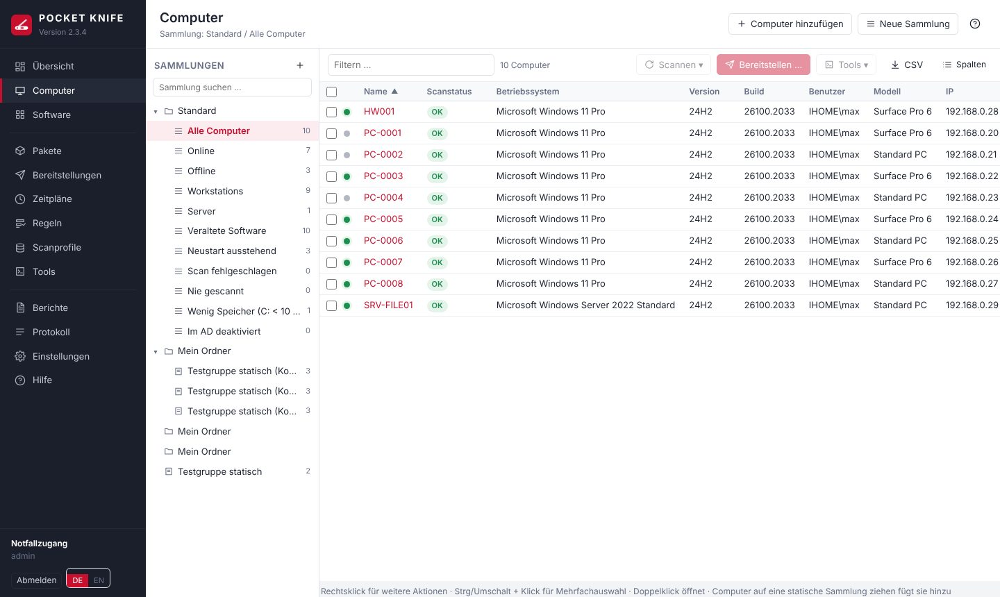

**So arbeitet POCKET KNIFE:**

- **Computer** kommen automatisch aus dem AD (Abgleich über LDAPS).
- **Scanprofile** lesen über WinRM aus, was auf den Computern installiert ist und welche Hardware sie haben.
- **Sammlungen** gruppieren Computer – statisch per Hand oder dynamisch über Filter (z. B. „Firefox veraltet“).
- **Pakete** beschreiben, was auf einem Computer ausgeführt wird: Installationen, Befehle, Skripte, Neustarts …
- **Bereitstellungen** führen ein Paket auf Computern aus – sofort, geplant, über **Zeitpläne** (Pakete oder winget-Updates).
- **Tools** sind schnelle Einzelaktionen (Ping, Neustart, gpupdate, eigene Skripte).

**Begriffe**

| Begriff | Bedeutung |
|---|---|
| Dienstkonto | Domänenkonto mit lokalen Administratorrechten auf den Clients. POCKET KNIFE nutzt es für LDAPS, WinRM und SMB. |
| Repository | Netzwerkfreigabe (oder eingebundener Ordner) mit Ihren Installationsdateien. |
| winget | Paketmanager von Microsoft; POCKET KNIFE gleicht installierte Software mit dem winget-Katalog ab und kann darüber installieren und aktualisieren. |
| Heartbeat | Regelmäßige Prüfung, welche Computer erreichbar sind. |
| Mandant | Optionale Trennung von Paketen und Zeitplänen, z. B. nach Kunden oder Standorten. |

# Installation und Update {#install}

## Voraussetzungen in der Domäne {#prereq}

1. **Dienstkonto** anlegen, z. B. `svc-pocketknife` (normales Benutzerkonto, Kennwort läuft nicht ab).
2. Das Dienstkonto per GPO in die lokale Gruppe **Administratoren** aller Clients aufnehmen (*Computerkonfiguration → Einstellungen → Systemsteuerungseinstellungen → Lokale Benutzer und Gruppen*).
3. **WinRM** per GPO aktivieren und absichern – Schritt für Schritt in [WinRM per Gruppenrichtlinie](#winrm-gpo).
4. In der Firewall der Clients **nur für den Docker-Host** **TCP 5985** (bzw. 5986 bei HTTPS) und **TCP 445** freigeben. Für Fernsitzungen zusätzlich **TCP 3389** (RDP) bzw. **5900** (VNC).
5. AD-Gruppe **POCKETKNIFE-Admins** anlegen und die Bediener aufnehmen (verschachtelte Gruppen werden berücksichtigt).
6. **LDAPS** muss auf den Domänencontrollern aktiv sein. Ein selbstsigniertes Zertifikat genügt – POCKET KNIFE vertraut ihm automatisch und protokolliert jede Änderung des Fingerabdrucks.
7. Für eigene Pakete eine Freigabe anlegen, z. B. `\\fs01\PAKETE`, mit Leserecht für das Dienstkonto.

## WinRM per Gruppenrichtlinie einrichten und absichern {#winrm-gpo}

POCKET KNIFE arbeitet auf den Clients über **WinRM** (Windows Remote Management, PowerShell-Remoting): Inventar, Bereitstellungen, Tools, Datei-Explorer und Ereignisanzeige laufen darüber. Auf dem Client wird nichts installiert – dafür muss WinRM überall gleich und **sicher** eingerichtet sein. Am einfachsten und nachvollziehbarsten geht das mit **einer eigenen Gruppenrichtlinie** (z. B. „WinRM-Clients“), verknüpft mit den OUs der Computer, die POCKET KNIFE verwalten soll. Die Anleitung gilt für Windows 10/11 und Windows Server ab 2016; die Namen stehen wie im deutschen Gruppenrichtlinienverwaltungs-Editor, der englische Name in Klammern hilft bei englischen Systemen.

> **Merksatz:** WinRM selbst ist nur so sicher wie seine Einstellungen. Die Richtlinie sorgt dafür, dass **nur der POCKET-KNIFE-Server** Port 5985/5986 erreicht, **nur verschlüsselt** und **nur mit Domänenanmeldung** (Kerberos/NTLM) gesprochen wird und niemand die Einstellungen lokal aufweicht.

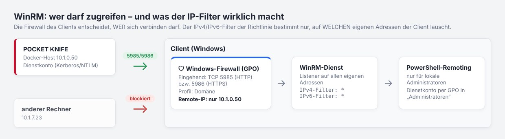

### Schritt 1: Gruppenrichtlinie anlegen

1. **Gruppenrichtlinienverwaltung** (`gpmc.msc`) öffnen → Rechtsklick auf die OU mit den Clients → **Gruppenrichtlinienobjekt hier erstellen und verknüpfen** → Name z. B. `WinRM-Clients`.
2. Für Server eine eigene OU bzw. eine eigene Richtlinie verwenden (andere Wartungsfenster, oft schon WinRM aktiv). **Domänencontroller** nur bewusst und mit eigener Richtlinie einbeziehen.
3. Zum Testen zuerst eine kleine OU mit ein paar Computern verknüpfen, prüfen (Schritt 8), dann ausrollen.

Alle folgenden Einstellungen liegen unter **Computerkonfiguration → Richtlinien**.

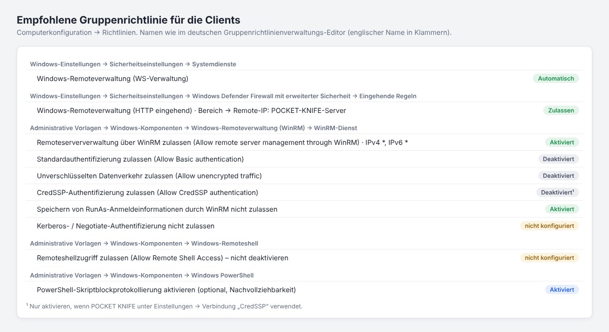

### Schritt 2: Dienst automatisch starten

*Windows-Einstellungen → Sicherheitseinstellungen → Systemdienste → **Windows-Remoteverwaltung (WS-Verwaltung)*** → „Diese Richtlinieneinstellung definieren“ → **Automatisch**. Berechtigungen nicht ändern.

### Schritt 3: WinRM-Listener einschalten

*Administrative Vorlagen → Windows-Komponenten → Windows-Remoteverwaltung (Windows Remote Management, WinRM) → WinRM-Dienst → **Remoteserververwaltung über WinRM zulassen*** (*Allow remote server management through WinRM*) → **Aktiviert**, IPv4-Filter `*`, IPv6-Filter `*`.

**Wichtig – häufiges Missverständnis:** Der IPv4-/IPv6-Filter legt fest, auf **welchen eigenen Adressen des Clients** WinRM lauscht – **nicht**, welche Rechner sich verbinden dürfen. `*` ist deshalb richtig (sonst funktioniert WinRM nach einem Adresswechsel per DHCP nicht mehr). Wer zugreifen darf, regelt allein die Firewall (Schritt 4). Ein leerer Filter bedeutet: WinRM lauscht nirgends.

### Schritt 4: Firewall – nur der POCKET-KNIFE-Server darf

*Windows-Einstellungen → Sicherheitseinstellungen → **Windows Defender Firewall mit erweiterter Sicherheit** → Eingehende Regeln* → **Neue Regel**:

1. **Vordefiniert** → „Windows-Remoteverwaltung“ → die Regel **Windows-Remoteverwaltung (HTTP eingehend)** wählen (bei HTTPS stattdessen eine **Port**-Regel für TCP 5986) → **Verbindung zulassen**.
2. Danach die Regel öffnen → Registerkarte **Bereich** → **Remote-IP-Adresse: Diese IP-Adressen** → die Adresse des **Docker-Hosts** von POCKET KNIFE eintragen (bei mehreren Instanzen alle). Die Clients sehen die Adresse des Docker-Hosts, nicht die des Containers.
3. Registerkarte **Erweitert** → nur Profil **Domäne**.

Dieselbe Einschränkung empfiehlt sich für **TCP 445** (SMB: Paketkopien über `ADMIN$`, Datei-Explorer) und – nur wenn genutzt – für **TCP 3389** (RDP) und **5900** (VNC). Wer verhindern will, dass lokale Administratoren eigene Freigaben in der Firewall öffnen, stellt unter *Eigenschaften der Windows Defender Firewall → Domänenprofil → Einstellungen anpassen* „Lokale Firewallregeln anwenden“ auf **Nein** – vorher prüfen, ob Anwendungen eigene Regeln brauchen.

### Schritt 5: WinRM-Dienst härten

Im selben Ordner wie Schritt 3 (*WinRM-Dienst*):

| Einstellung | Wert | Warum |
|---|---|---|
| Standardauthentifizierung zulassen (*Allow Basic authentication*) | **Deaktiviert** | Basic schickt Benutzer und Kennwort nur Base64-kodiert – POCKET KNIFE braucht es nie |
| Unverschlüsselten Datenverkehr zulassen (*Allow unencrypted traffic*) | **Deaktiviert** | POCKET KNIFE verschlüsselt auch über HTTP 5985 (Kerberos/NTLM-Nachrichtenverschlüsselung); unverschlüsselt wäre nur ein Risiko |
| CredSSP-Authentifizierung zulassen (*Allow CredSSP authentication*) | **Deaktiviert** – POCKET KNIFE nutzt CredSSP nicht | CredSSP gibt die Anmeldedaten an den Client weiter; ein Angreifer mit Administratorrechten auf dem Client könnte sie abgreifen |
| Speichern von RunAs-Anmeldeinformationen durch WinRM nicht zulassen (*Disallow WinRM from storing RunAs credentials*) | **Aktiviert** | keine gespeicherten Kennwörter in WinRM-Plugins |
| Kerberos-Authentifizierung nicht zulassen / Negotiate-Authentifizierung nicht zulassen | **nicht konfiguriert** | POCKET KNIFE meldet sich darüber an – aktiviert sperrt es sich selbst aus |
| Kompatibilitäts-HTTP-/HTTPS-Listener aktivieren | **nicht konfiguriert** | alte Ports 80/443, nicht nötig |

Unter *Windows-Komponenten → Windows-Remoteshell* die Einstellung **Remoteshellzugriff zulassen** (*Allow Remote Shell Access*) **nicht deaktivieren**: Sie sperrt auch PowerShell-Remoting – POCKET KNIFE erreicht die Clients dann nicht mehr.

Der Ordner *WinRM-Client* betrifft nur Verbindungen, die vom Client **ausgehen** (z. B. ein Admin-PC mit `Enter-PSSession`). Für POCKET KNIFE ist er unwichtig; „Digest-Authentifizierung nicht zulassen“ und „Standardauthentifizierung zulassen: Deaktiviert“ schaden dort aber nicht und sind gute Härtung. „Vertrauenswürdige Hosts“ (*TrustedHosts*) nicht auf `*` setzen – das schaltet die Prüfung der Gegenstelle bei NTLM ab.

### Schritt 6: Wer darf sich anmelden?

WinRM lässt standardmäßig nur **lokale Administratoren** (und die Gruppe „Remoteverwaltungsbenutzer“) zu. POCKET KNIFE braucht Administratorrechte; das Dienstkonto kommt per Gruppenrichtlinie in die lokale Gruppe **Administratoren** (siehe [Voraussetzungen](#prereq)), am besten über eine Domänengruppe, z. B. `PK-Clientadmins`.

- **Nicht** `LocalAccountTokenFilterPolicy` setzen: Das ist nur für lokale Konten nötig und weicht den UAC-Schutz für Fernzugriffe auf.
- Die Berechtigungen von WinRM (SDDL) nicht per Richtlinie verändern – die Firewall (Schritt 4) und die Gruppe Administratoren reichen.

### Schritt 7: Anmeldeverfahren wählen

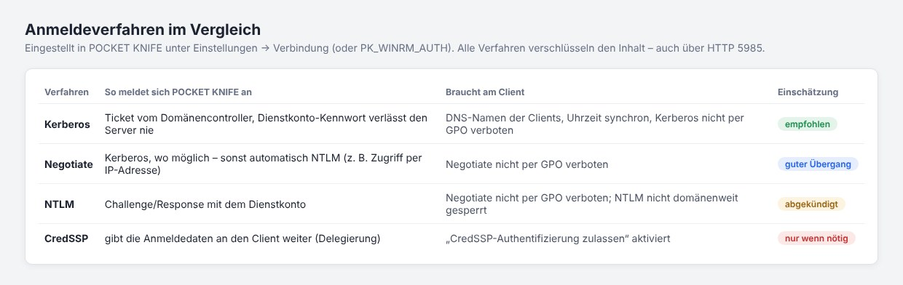

In POCKET KNIFE unter **Einstellungen → Verbindung & Konten → Anmeldeverfahren**. Für neue Installationen: **Negotiate** und nach ein paar Tagen **Nur Kerberos** (siehe [Kerberos statt NTLM](#kerberos)). Hinweise:

- **Kerberos** braucht die Computer per **DNS-Namen** (kommt aus dem AD-Abgleich), eine synchrone Uhrzeit und Port 88 zu den Domänencontrollern. SPNs müssen nicht angelegt werden.
- Gehört das Dienstkonto zur Gruppe **„Geschützte Benutzer“** (*Protected Users*) – sehr empfehlenswert –, ist **NTLM und CredSSP für das Konto gesperrt**. Dann muss POCKET KNIFE auf „Nur Kerberos“ stehen, das Repository mit DNS-Namen angegeben sein und das Konto AES unterstützen („Dieses Konto unterstützt Kerberos AES 256-Bit-Verschlüsselung“); sonst schlagen Anmeldungen fehl. Fernsitzungen per RDP mit dem Dienstkonto gehen dann nicht (sie nutzen NTLM).
- **CredSSP** unterstützt POCKET KNIFE nicht (mehr): Es gäbe das Kennwort des Dienstkontos an jeden Client weiter. Pakete brauchen es nicht – Installationsdateien kopiert POCKET KNIFE selbst auf den Client.

### Optional: WinRM über HTTPS (5986)

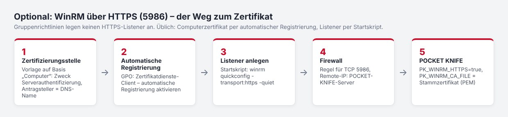

Über HTTP (5985) ist der Inhalt bereits verschlüsselt. HTTPS schützt zusätzlich die Anmeldung selbst und beweist dem Server die Identität des Clients per Zertifikat – sinnvoll in Netzen mit hohem Schutzbedarf. Die Gruppenrichtlinie kann keinen HTTPS-Listener anlegen; der übliche Weg:

1. In der Zertifizierungsstelle eine Zertifikatvorlage auf Basis „Computer“ mit Zweck **Serverauthentifizierung**, Antragsteller = DNS-Name; Leserecht und Registrieren für „Domänencomputer“.
2. Gruppenrichtlinie: *Windows-Einstellungen → Sicherheitseinstellungen → Richtlinien für öffentliche Schlüssel → Zertifikatdienstclient – Automatische Registrierung* → **Aktiviert**, „Abgelaufene Zertifikate erneuern …“ und „Zertifikate aktualisieren …“ ankreuzen.
3. Listener per **Startskript** (*Windows-Einstellungen → Skripts → Starten*), z. B. `winrm quickconfig -transport:https -quiet` – nimmt das passende Computerzertifikat. Nach einer Zertifikatserneuerung muss der Listener das neue Zertifikat bekommen (Skript erneut ausführen bzw. Listener neu anlegen).
4. Firewallregel für **TCP 5986** wie in Schritt 4.
5. In POCKET KNIFE (`.env`): `PK_WINRM_HTTPS=true` und `PK_WINRM_CA_FILE=/data/winrm-ca.pem` (Stammzertifikat der Zertifizierungsstelle im PEM-Format) – dann prüft POCKET KNIFE die Zertifikate der Clients.

### Optional: Protokollierung

- *Windows-Komponenten → Windows PowerShell → **PowerShell-Skriptblockprotokollierung aktivieren*** – im Ereignisprotokoll „Microsoft-Windows-PowerShell/Operational“ (Ereignis 4104) steht dann, welche Befehle per WinRM liefen. Das ist für die Nachvollziehbarkeit wertvoll; bedenken Sie, dass dort auch die Skripte von POCKET KNIFE und Ihrer Pakete stehen (keine Kennwörter in Paketskripte schreiben).
- „Microsoft-Windows-WinRM/Operational“ zeigt Verbindungen und Fehler, das Sicherheitsprotokoll (Ereignis 4624, Anmeldetyp 3) die Anmeldungen des Dienstkontos mit Verfahren (Kerberos/NTLM).
- Diese Protokolle eignen sich für eine zentrale Sammlung (Windows-Ereignisweiterleitung oder SIEM).

### Schritt 8: Prüfen

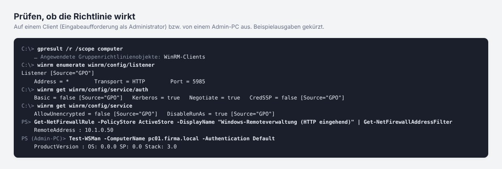

1. Auf einem Client: `gpupdate /force`, dann `gpresult /r /scope computer` – die Richtlinie muss unter „Angewendete Gruppenrichtlinienobjekte“ stehen.
2. `winrm enumerate winrm/config/listener` – ein Listener mit `Source="GPO"`; `winrm get winrm/config/service` – `AllowUnencrypted = false`, bei `auth` `Basic = false`, jeweils mit `[Source="GPO"]`.
3. Firewall: `Get-NetFirewallRule -PolicyStore ActiveStore -DisplayName "Windows-Remoteverwaltung (HTTP eingehend)" | Get-NetFirewallAddressFilter` zeigt die erlaubte Remote-Adresse.
4. Von einem **anderen** Rechner: `Test-NetConnection pc01 -Port 5985` muss **fehlschlagen** (Firewall wirkt).
5. In POCKET KNIFE: **Einstellungen → Wartung → Verbindung testen** mit einem Computernamen (WinRM, Administratorrechte, ADMIN$) und **Anmeldeverfahren → Testen**.

### Häufige Fehler

| Meldung / Verhalten | Ursache und Lösung |
|---|---|
| Zeitüberschreitung, „WinRM-Verbindung fehlgeschlagen“ | Firewall: Regel fehlt, falsches Profil (Netzwerk nicht als „Domäne“ erkannt) oder falsche Remote-IP (Adresse des Docker-Hosts eintragen) |
| „Der WinRM-Client kann die Anforderung nicht verarbeiten“ / Verbindung abgelehnt | kein Listener: Richtlinie aus Schritt 3 nicht angewendet oder IPv4-Filter leer |
| 401 / Zugriff verweigert | Dienstkonto ist kein lokaler Administrator, oder das Anmeldeverfahren ist am Client gesperrt (Kerberos/Negotiate „nicht zulassen“ aktiviert, CredSSP nicht erlaubt) |
| Kerberos: „kein SPN“, „Server nicht gefunden“ | Zugriff per IP-Adresse oder Kurzname, DNS-Eintrag fehlt oder zeigt auf einen anderen Rechner |
| Funktionierte, nach Aufnahme in „Geschützte Benutzer“ nicht mehr | NTLM/CredSSP sind für das Konto gesperrt – auf „Nur Kerberos“ umstellen |
| „Der Dienst ist so konfiguriert, dass keine Remoteshell-Anforderungen angenommen werden“ | *Windows-Remoteshell → Remoteshellzugriff zulassen* wurde deaktiviert – auf „nicht konfiguriert“ zurückstellen |

## Systemanforderungen und Größenplanung {#sizing}

**Docker-Host**

- Linux (z. B. Debian 12/13 oder Ubuntu 22.04/24.04), 64 Bit (amd64 oder arm64), als VM, physisch oder als NAS mit Docker
- Docker Engine 24 oder neuer
- **SSD-Speicher** für das Datenverzeichnis (`PK_DATA_PATH`) – die SQLite-Datenbank schreibt bei Scans viele kleine Änderungen
- DNS der Domäne (`PK_DNS_1`), Netzwerkzugriff auf die Clients (WinRM 5985/5986, SMB 445, für Fernsitzungen 3389/5900), die Domänencontroller (LDAPS 636) und die Repository-Freigabe
- Internet ist optional: nur für den winget-Index (`cdn.winget.microsoft.com`) – oder der Index wird offline hochgeladen; die Clients laden winget-Pakete selbst

**Clients:** Windows 10/11 bzw. Windows Server 2016–2025 mit PowerShell 5.1, WinRM aktiv, Dienstkonto als lokaler Administrator. winget ab Windows 10 1809 / Server 2019.

**Richtwerte nach Größe der Umgebung**

> Die Werte sind Schätzungen aus dem Aufbau des Programms (ein Prozess, SQLite, parallele WinRM-Verbindungen), nicht in großen Umgebungen gemessen. Erst klein beginnen, unter **Einstellungen → Wartung** und mit `docker stats` beobachten und bei Bedarf erhöhen.

| Computer | vCPU | RAM (gesamt, inkl. guacd) | Speicher (SSD) | Parallele Scans / Installationen | Heartbeat |
|---|---|---|---|---|---|
| bis 250 | 2 | 2 GB | 10 GB | 6 / 8 (Standard) | 5 Min. |
| 250 – 1 000 | 2 – 4 | 4 GB | 20 GB | 10 / 12 | 5 Min. |
| 1 000 – 3 000 | 4 | 8 GB | 40 GB | 15 – 20 / 15 – 25 | 10 Min. |
| 3 000 – 5 000 | 8 | 16 GB | 80 GB | 20 – 30 / 25 – 40 | 15 Min. |
| über 5 000 | – | – | – | mehrere Instanzen (z. B. je Standort/Mandant) | – |

Die Zahl der parallelen Scans und Installationen sowie das Heartbeat-Intervall stehen unter **Einstellungen → Zeitpläne & Leistung** (Änderungen an der Parallelität wirken nach einem Neustart des Containers).

**Wofür die Ressourcen gebraucht werden**

| Bereich | Bedarf |
|---|---|
| Datenbank | je Computer grob 0,5 – 2 MB (Software, Dienste, Hotfixes, Prozesse, Hardware, Aufgaben, Verlauf). 1 000 Computer ≈ 1 – 2 GB. Kürzere Aufbewahrung (Protokoll, Scan-Protokoll, Bereitstellungen) hält sie klein. |
| winget-Index | ca. 0,5 – 1 GB im Datenverzeichnis, beim Einlesen kurzzeitig zusätzlich RAM |
| Scans | Die Arbeit läuft auf dem Client; der Server wartet überwiegend auf WinRM. Ein vollständiger Scan dauert je Computer etwa 20 – 60 s – mit 6 parallelen Scans also rund 400 – 1 000 Computer pro Stunde. Mehr Parallelität = schneller, aber mehr RAM und mehr Last auf DCs und Netz. |
| Heartbeat | prüft mit 48 parallelen Verbindungen; ein ausgeschalteter Computer kostet bis ca. 4,5 s. Bei vielen Computern ein längeres Intervall wählen, damit ein Durchlauf fertig ist, bevor der nächste beginnt. |
| Bereitstellungen | Dateien aus dem Repository laufen **durch den Docker-Host** zum Client (SMB lesen → ADMIN$ schreiben). 100 Computer × 500 MB = 50 GB Netzlast über den Host – für große Pakete 1 Gbit/s oder mehr einplanen, die Parallelität begrenzen oder winget nutzen (die Clients laden dann selbst). |
| Fernsitzungen (guacd) | je gleichzeitiger RDP-/VNC-Sitzung etwa 50 – 150 MB RAM und spürbar CPU bei Bewegung im Bild; 10 gleichzeitige Sitzungen ≈ 1 – 1,5 GB und 1 – 2 vCPU zusätzlich |

**Tipps für große Umgebungen**

- Scans mit **Scanprofilen** staffeln: das vollständige Profil z. B. wöchentlich, „Anwendungen“ täglich; „Scan-Alter“ statt fester Uhrzeit verteilt die Last.
- Zeitpläne mit **Zeitfenster** und Heartbeat statt alle Computer gleichzeitig.
- Aufbewahrung unter **Einstellungen → Zeitpläne & Leistung** anpassen (Protokoll, Scan-Protokoll, Bereitstellungen).
- Optional Ressourcen im Compose begrenzen, z. B. `mem_limit: 8g` und `cpus: 4` beim Dienst `pocketknife`.
- **Sicherung:** die automatische Sicherung (Einstellungen → Sicherung) auf ein anderes Laufwerk legen (`PK_BACKUP_PATH`) und je Sicherung mit etwa der Datenbankgröße (komprimiert meist deutlich weniger) × Anzahl Versionen rechnen.

**Aufräumen der Datenbank:** Stündlich werden alte Einträge gelöscht – Protokoll (Standard 90 Tage), Scan-Protokoll (14 Tage), Bereitstellungen samt Ausgabe (180 Tage; dieselbe Frist gilt für entschiedene Kiosk-Anfragen mit Benutzername und Computer), Softwareänderungen (365 Tage), abgelaufene Sitzungen und Reste ohne Bezug. Die Fristen stehen unter **Einstellungen → Zeitpläne & Leistung**. Einmal täglich (Standard 03:00 Uhr) folgt die **Datenbankwartung**: Statistiken aktualisieren, WAL-Datei zurückschreiben und – wenn mehr als 20 % der Datei frei sind – `VACUUM`, das die Datei verkleinert. Größe, freier Anteil und letzte Wartung zeigt **Einstellungen → Wartung**; dort startet **Jetzt aufräumen** die Wartung sofort. Gelöschte Computer verlieren ihre Inventardaten sofort, ihre Kiosk-Anfragen beim nächsten Aufräumen. Die Protokolldateien unter `/data/logs` werden bei 10 MB rotiert (höchstens 10 Dateien); für sie gilt keine Frist in Tagen.

## Installation {#setup}

Diese Anleitung führt Schritt für Schritt von einem leeren Docker-Host bis zur ersten Anmeldung. Sie gilt für jeden Docker-Host unter Linux: eine VM, einen Server oder ein NAS mit Docker. Die [Voraussetzungen in der Domäne](#prereq) sollten erfüllt sein; WinRM auf den Clients ([per Gruppenrichtlinie](#winrm-gpo)) können Sie auch danach einrichten – für die Installation und die erste Anmeldung braucht es das noch nicht.

POCKET KNIFE besteht aus zwei Containern: **pocketknife** (Programm und Weboberfläche) und **pocketknife-guacd** (Fernsitzungen im Browser). Beide startet eine Datei `docker-compose.yml`; alles, was Sie einstellen, steht in der Datei `.env` daneben.

### Schritt 1: Docker-Host vorbereiten

- **Docker Engine 24 oder neuer mit Docker Compose v2** – prüfen mit `docker version` und `docker compose version`. Prozessor amd64 (x86_64) oder arm64; Docker lädt das passende Image.
- **Feste IP-Adresse und ein DNS-Name** für den Host, z. B. `pocketknife.firma.local` (A-Eintrag im DNS der Domäne). Unter diesem Namen öffnen Sie später die Oberfläche; der Kiosk mit Windows-Anmeldung braucht genau diesen Namen.
- **Uhrzeit synchron** mit der Domäne (NTP) – sonst scheitern Kerberos und die Prüfung von Zertifikaten.
- **Speicher:** das Datenverzeichnis auf einer SSD (Größe siehe [Systemanforderungen](#sizing)), die Sicherungen möglichst auf einem anderen Laufwerk.
- **Netzwerk:** Der Docker-Host muss Folgendes erreichen (eingehend nur Port 8443 von den Arbeitsplätzen der Bediener):

| Ziel | Port | Wofür |
|---|---|---|
| DNS-Server der Domäne | 53 TCP/UDP | Namen der Computer und Domänencontroller auflösen |
| Domänencontroller | 636 TCP (LDAPS); 88 TCP/UDP bei Kerberos | Anmeldung, AD-Abgleich |
| Clients | 5985 TCP (5986 bei HTTPS), 445 TCP | Inventar, Bereitstellungen, Dateien |
| Clients (optional) | 3389 TCP (RDP), 5900 TCP (VNC) | Fernsitzungen |
| Dateiserver mit dem Repository | 445 TCP | Installationsdateien |
| Internet (optional) | 443 TCP | fertiges Image (`ghcr.io`), winget-Index (`cdn.winget.microsoft.com`), Hinweis auf neue Versionen (`api.github.com`) |

Ohne Internet geht es auch: die Images aus dem Archiv des Releases laden (siehe [Update](#update)) und den winget-Index offline hochladen.

### Schritt 2: Ordner und Dateien anlegen

Alles liegt in **einem** Ordner, z. B. `/opt/pocketknife` (auf einem NAS z. B. `/volume1/docker/pocketknife`). Dorthin kommen nur drei Dateien – das Programm selbst steckt im Image. Am einfachsten holen Sie sie aus dem Image der neuesten Version (bei einer privaten Registry vorher einmal `sudo docker login ghcr.io -u <GitHub-Benutzer>`, Kennwort = Token mit `read:packages`):

```bash
mkdir -p /opt/pocketknife && cd /opt/pocketknife
sudo sh -c 'docker pull ghcr.io/soleil0815/pocketknife:latest && docker run --rm --entrypoint sh ghcr.io/soleil0815/pocketknife:latest -c "cd /opt/pocketknife/host && tar cf - ." | tar xf -'
cp .env.example .env
```

Alternativ laden Sie `docker-compose.yml`, `env.example` (als `.env.example` speichern) und `update.sh` im Browser vom Release herunter (mit Prüfsummen in `pocketknife-<Version>.sha256`).

Danach sieht der Ordner so aus – `data/` und `data-backup/` entstehen beim ersten Start von selbst:

```
/opt/pocketknife/
├── docker-compose.yml     startet beide Container – wird nicht bearbeitet
├── .env.example           Vorlage
├── .env                   Ihre Einstellungen
├── update.sh              Update von Hand (optional)
├── data/                  Datenbank, Protokolle, Zertifikat, Schlüssel
└── data-backup/           automatische Sicherungen
```

> **Wichtig:** `docker-compose.yml` und `.env` müssen im **selben Ordner** liegen – die Compose-Datei liest die `.env` von dort. Die `docker-compose.yml` bitte nicht ändern: Ihre Werte gehören in die `.env`, eigene Ergänzungen in eine `docker-compose.override.yml`.

### Schritt 3: Die .env ausfüllen

Öffnen Sie die `.env` (z. B. `nano .env`). Jede Zeile hat die Form `NAME=Wert`, ohne Leerzeichen um das `=`; Zeilen mit `#` am Anfang sind Kommentare. **Diese Werte müssen stimmen:**

| Variable | Beispiel | Bedeutung |
|---|---|---|
| `PK_DOMAIN` | `firma.local` | DNS-Name der Domäne. Daraus entstehen die Such-Basis im AD und der Anmeldename (`benutzer@firma.local`). |
| `PK_NETBIOS` | `FIRMA` | NetBIOS-Name der Domäne (für `FIRMA\konto`). |
| `PK_DNS_1` | `10.0.10.5` | IP-Adresse eines **DNS-Servers der Domäne** (meist ein Domänencontroller) – nicht der Router und kein öffentlicher DNS, sonst findet POCKET KNIFE die Computer nicht. |
| `PK_DNS_2` | `10.0.10.6` | Optional: ein **zweiter, anderer** DNS-Server. Gibt es nur einen, leer lassen oder die Zeile löschen. |
| `PK_LDAP_SERVERS` | `dc1.firma.local,dc2.firma.local` | Domänencontroller mit LDAPS, kommagetrennt. Leer = `PK_DOMAIN`. |
| `PK_ACCESS_GROUP` | `POCKETKNIFE-Admins` | AD-Gruppe, deren Mitglieder POCKET KNIFE bedienen dürfen (verschachtelte Gruppen zählen mit). |
| `PK_PUBLIC_HOSTNAME` | `pocketknife.firma.local` | DNS-Name des Docker-Hosts aus Schritt 1 – steht im Zertifikat. |

**Diese Werte sind meist richtig, lassen sich aber anpassen:**

| Variable | Standard | Wann ändern? |
|---|---|---|
| `PK_DATA_PATH` | `/opt/pocketknife/data` | anderer Ordner, z. B. auf einem NAS `/volume1/docker/pocketknife/data`. Ein relativer Pfad (`./data`) gilt ab dem Ordner der `docker-compose.yml`. |
| `PK_BACKUP_PATH` | `<PK_DATA_PATH>-backup` | Sicherungen besser auf ein anderes Laufwerk oder eine eingebundene Freigabe. |
| `PK_PORT` | `8443` | wenn der Port auf dem Host schon belegt ist. |
| `PK_TIMEZONE` | `Europe/Berlin` | andere Zeitzone. |
| `PK_WINRM_AUTH` | `ntlm` | lässt sich später in der Oberfläche umstellen und testen (Kerberos wird empfohlen, siehe [Kerberos statt NTLM](#kerberos)). |
| `PK_REPO_MOUNT` | leer | nur, wenn das Software-Repository als Ordner auf dem Host eingebunden ist (im Container `/repo`). Sonst tragen Sie später in der Oberfläche einen UNC-Pfad ein, z. B. `\\fs01.firma.local\PAKETE`. |
| `PK_UID` / `PK_GID` | `10001` | nur, wenn eingebundene Ordner einem bestimmten Benutzer gehören müssen (z. B. auf einem NAS mit Freigabe-Rechten). |
| `PK_BREAKGLASS_USER` / `PK_BREAKGLASS_PASSWORD` | leer | Notfallzugang ohne AD – nur bei Bedarf, mit langem, zufälligem Kennwort. |

**Das Dienstkonto** (`PK_SERVICE_USER`, `PK_SERVICE_PASSWORD`) gehört **nicht** in die `.env`: Löschen Sie die beiden Zeilen und tragen Sie das Konto nach der ersten Anmeldung unter **Einstellungen → Verbindung & Konten** ein – dort wird es geprüft und verschlüsselt gespeichert. Für die erste Anmeldung wird es nicht gebraucht.

Alle weiteren Variablen stehen in der `.env.example` mit Erklärung; Zeitpläne, Parallelität, Aufbewahrung, Repository und winget stellen Sie in der Oberfläche ein.

### Schritt 4: Starten

```bash
cd /opt/pocketknife
docker compose up -d      # lädt das Image, startet beide Container
docker compose ps         # nach etwa 1 Minute „healthy“
```

Nach etwa einer Minute zeigt `docker compose ps` bei **pocketknife** „healthy“ und bei **pocketknife-guacd** „Up“. Liegt das Image in einer privaten Registry, vorher einmal `docker login ghcr.io -u <GitHub-Benutzer>` (Kennwort = Token mit `read:packages`).

Beim ersten Start legt POCKET KNIFE `data/` und `data-backup/` an, erzeugt die Datenbank, den Schlüssel für gespeicherte Kennwörter und ein selbstsigniertes Zertifikat (`data/tls/`). Zeigt `docker compose ps` nicht „healthy“, steht der Grund im Protokoll:

```bash
docker compose logs -f pocketknife   # Strg+C beendet die Anzeige
```

Optional können Sie den eingebauten Selbsttest laufen lassen (dauert einige Minuten, ändert nichts an Ihren Daten):

```bash
docker compose exec -T -e HOME=/nonexistent pocketknife \
  python3 -I /opt/pocketknife/tools/selftest.py | tail -n 1
```

**Image:** Standard ist das fertige Image `ghcr.io/soleil0815/pocketknife:latest` (dazu `…/pocketknife-guacd:latest`). Bei einer Version bleiben: `sudo sh update.sh <Version>`. Ohne Internet: das Archiv aus dem Release, siehe [Update](#update).

### Schritt 5: Erste Anmeldung

1. Im Browser `https://pocketknife.firma.local:8443` öffnen (Ihr `PK_PUBLIC_HOSTNAME` und `PK_PORT`). Beim ersten Mal warnt der Browser vor dem selbstsignierten Zertifikat – bestätigen; ein eigenes Zertifikat laden Sie später unter **Einstellungen → Zertifikat (HTTPS)** hoch (siehe [Eigenes Zertifikat](#certificate)).
2. Mit einem AD-Konto aus der Zugriffsgruppe anmelden – als `benutzer`, `FIRMA\benutzer` oder `benutzer@firma.local`. Dafür reichen DNS und LDAPS; das Dienstkonto ist noch nicht nötig.
3. Weiter mit den [ersten Schritten](#firststeps): Dienstkonto eintragen, AD abgleichen, Verbindung zu einem Computer testen, Repository einrichten.

### Mit einer Container-Verwaltung (NAS, Portainer, Dockhand …)

Container-Verwaltungen arbeiten mit derselben `docker-compose.yml`. Darauf kommt es an:

- **Projekt aus dem Ordner anlegen:** Legen Sie zuerst den Ordner aus Schritt 2 mit `docker-compose.yml` und ausgefüllter `.env` an und wählen Sie ihn als Projekt- bzw. Stack-Ordner („vorhandene docker-compose.yml verwenden“). Wird die Compose-Datei nur in ein Eingabefeld kopiert, legt das Werkzeug sie oft in einem eigenen Ordner ab – dann fehlt dort die `.env` (Fehler `env file … not found`): die `.env` in genau diesen Ordner legen.
- **Pfade absolut angeben**, z. B. `PK_DATA_PATH=/volume1/docker/pocketknife/data` – so ist eindeutig, wo die Daten liegen.
- **Rechte:** Der Dienst läuft im Container als Benutzer mit der ID 10001. Auf einem normalen Linux-Server übergibt er sich Daten- und Sicherungsordner beim Start selbst. Ein eingebundener Repository-Ordner (`PK_REPO_MOUNT`) muss für ihn **lesbar** sein. Auf einem NAS mit eigenen Freigabe-Rechten (z. B. Synology) reicht das nicht – siehe den nächsten Abschnitt.
- **Port:** Ist 8443 belegt (z. B. durch eine andere Anwendung auf dem NAS), `PK_PORT` ändern.
- **Updates:** einfach über die Container-Verwaltung, am besten nachts (siehe [Update](#update)). Vor dem Start einer neuen Version sichert POCKET KNIFE die Datenbank selbst.
- **Ältere Compose-Versionen** (wie sie manche NAS-Pakete mitbringen) melden doppelte DNS-Einträge als Fehler. Seit 2.30 ist der zweite DNS-Server echt optional; mit einer älteren `docker-compose.yml` die aktuelle nehmen (siehe Schritt 2).

### Auf einem NAS (z. B. Synology) {#setup-nas}

Ein NAS prüft auf seinen Freigaben **eigene Zugriffsrechte** (Synology: Berechtigungen in der File Station). Einen Benutzer mit der ID 10001 kennt es nicht – POCKET KNIFE darf dann nicht in seinen Datenordner schreiben und bricht beim Start mit „Start abgebrochen – Benutzer 10001:10001 darf hier nicht schreiben“ ab. Abhilfe: POCKET KNIFE läuft als **eigener Benutzer des NAS**.

1. **Ordner anlegen**, z. B. in der Freigabe `docker`: `pocketknife` mit den Unterordnern `data`, `data-backup` und – nur wenn die Installationsdateien auf dem NAS liegen – `repo`. Die Unterordner **in** `data` (`tls`, `logs` …) legt POCKET KNIFE selbst an; bitte nicht von Hand.
2. **Benutzer anlegen** (Synology: Systemsteuerung → Benutzer und Gruppe → Erstellen), z. B. `pocketknife`: kein Administrator, langes zufälliges Kennwort, alle Anwendungen verweigern, Lesen/Schreiben auf die Freigabe `docker`.
3. **Ordnerrechte** (File Station → Rechtsklick → Eigenschaften → Berechtigung → Erstellen, jeweils „auf diesen Ordner, Unterordner und Dateien anwenden“): Benutzer `pocketknife` mit **Lesen und Schreiben** auf `data` und `data-backup`, mit **Lesen** auf `repo`.
4. **IDs herausfinden:** per SSH `id pocketknife` → z. B. `uid=1027(pocketknife) gid=100(users)`.
5. **In die `.env`** (Pfade absolut, auf das Volume des NAS – sonst landen die Daten auf der Systempartition):

```
PK_DATA_PATH=/volume1/docker/pocketknife/data
PK_BACKUP_PATH=/volume1/docker/pocketknife/data-backup
PK_REPO_MOUNT=/volume1/docker/pocketknife/repo
PK_UID=1027
PK_GID=100
```

`PK_REPO_MOUNT` nur, wenn die Installationsdateien auf dem NAS liegen (in der Oberfläche dann Repository-Pfad `/repo`); liegen sie auf einem Windows-Dateiserver, die Zeile weglassen und dort den UNC-Pfad eintragen.

6. **Projekt anlegen** (Synology: Container Manager → Projekt → Erstellen, Pfad `/volume1/docker/pocketknife`, vorhandene `docker-compose.yml` verwenden) und starten.

> **Tipp:** Der Gruppe „Jeder“ Schreibrecht auf `data` zu geben, funktioniert auch, ist aber nicht zu empfehlen – dort liegen die Datenbank und der Schlüssel für die gespeicherten Kennwörter.

### Häufige Fehler bei der Installation {#setup-errors}

| Meldung oder Verhalten | Ursache und Lösung |
|---|---|
| `set PK_DNS_1 in the .env (DNS server of the domain)` | `PK_DNS_1` fehlt – oder die `.env` liegt nicht neben der `docker-compose.yml`. |
| `env file …/.env not found` | Im Projektordner gibt es keine `.env` – siehe Container-Verwaltung oben. |
| `services.guacd.dns array items[0,1] must be unique` | Ältere Compose-Version und `docker-compose.yml` vor 2.30 mit nur einem DNS-Server: die neue `docker-compose.yml` verwenden (oder `PK_DNS_2` auf einen zweiten, anderen DNS-Server setzen). |
| `port is already allocated` / `address already in use` | Der Port ist auf dem Host belegt: `PK_PORT` ändern. |
| `denied`, `unauthorized` oder `not found` beim Laden des Images | Bei einer privaten Registry vorher `docker login ghcr.io`; sonst Internetzugang bzw. Proxy des Docker-Hosts prüfen. |
| Container startet immer wieder neu, im Protokoll „Start abgebrochen – Benutzer … darf hier nicht schreiben“ (ältere Versionen: `PermissionError … /data/…`) | Der Dienst darf nicht in den Datenordner schreiben. NAS (z. B. Synology): siehe [Auf einem NAS](#setup-nas). Linux-Server: `chown -R 10001:10001` auf `PK_DATA_PATH` und `PK_BACKUP_PATH` oder einen lokalen Ordner statt einer Netzfreigabe verwenden. Unterordner in `data` nicht von Hand anlegen. |
| Seite nicht erreichbar | Port in der Firewall des Hosts freigeben; `https://` verwenden (nicht `http://`). |
| Anmeldung schlägt fehl, obwohl das Kennwort stimmt | Konto nicht in `PK_ACCESS_GROUP`; anderer UPN-Suffix als `PK_DOMAIN` (dann `FIRMA\benutzer` verwenden); LDAPS (636) auf den DCs nicht aktiv oder gesperrt; `PK_DNS_1` zeigt nicht auf das DNS der Domäne. Den genauen Grund zeigt `docker compose logs pocketknife`. |
| Computer „nicht auflösbar“ | `PK_DNS_1`/`PK_DNS_2` sind keine DNS-Server der Domäne. Nach einer Änderung in der `.env`: `docker compose up -d` (übernimmt die neuen Werte). |

## Update {#update}

Ab 2.33 aktualisiert man POCKET KNIFE wie jeden anderen Container – das Programm steckt komplett im Image, auf dem Host liegen nur `docker-compose.yml`, `.env` und die Daten. **Vor dem Start einer neuen Version sichert POCKET KNIFE seine Datenbank selbst** (Sicherung „vor-<Version>“, siehe [Sicherung](#backup)) und erweitert sie danach bei Bedarf – egal, wer das Image getauscht hat.

**Mit einer Container-Verwaltung (empfohlen):** Dockhand, Watchtower, Tugtainer & Co. aktualisieren beide Container (`pocketknife` und `pocketknife-guacd`), sobald ein neues Image da ist. Stellen Sie die Update-Zeit möglichst **nachts** ein – ein Neustart mitten in einer Verteilung unterbricht sie (POCKET KNIFE räumt danach auf, siehe [Neustart während einer Bereitstellung](#deploy-restart)). Einmal im Monat am Patchday (zweiter Dienstag) erscheint ein Sicherheitsupdate (`<Version>-s<n>`: gleiches Programm, aktualisierte Pakete).

**Von Hand** im Ordner mit der `docker-compose.yml`:

```bash
sudo sh update.sh               # neueste Version (bzw. die in der .env festgelegte)
sudo sh update.sh 2.33.1        # bestimmte Version – wird in der .env festgelegt
sudo sh update.sh latest        # wieder „immer die neueste“
```

`update.sh` merkt sich die laufenden Images, zieht die neuen (POCKET KNIFE und guacd), startet und wartet auf den Gesundheitscheck. Startet die neue Version nicht, bietet es an, die vorherige wieder zu starten – ohne Download. Bringt das neue Image eine neuere `docker-compose.yml` mit, legt es sie hin und behält die bisherige als `docker-compose.yml.alt`. Es entpackt nichts und baut nichts. `-y` beantwortet alle Fragen mit „ja“. Ganz ohne Skript geht es auch: `docker compose pull && docker compose up -d`.

**docker-compose.yml:** Sie ändert sich nur selten. Braucht eine neue Version eine neuere Datei, zeigt POCKET KNIFE Hauptadmins in der Seitenleiste **⚠ Hinweis** – ein `sudo sh update.sh` legt sie dann hin (wer nur mit einer Container-Verwaltung arbeitet, holt sie wie bei der Installation aus dem Image). guacd kommt seit 2.33 als `ghcr.io/soleil0815/pocketknife-guacd` – dieselbe offizielle Version, von POCKET KNIFE geprüft und mit den Sicherheitsupdates veröffentlicht; die Datei muss sich dafür nicht mehr ändern.

**Bei einer Version bleiben oder zurückgehen:** `sudo sh update.sh <Version>` (oder in der `.env` `PK_IMAGE=ghcr.io/soleil0815/pocketknife:<Version>` und `PK_GUACD_IMAGE=ghcr.io/soleil0815/pocketknife-guacd:<Version>`, dann `docker compose up -d`). Hat die neuere Version die Datenbank schon erweitert, die Sicherung „vor-<neuere Version>“ zurückspielen (siehe [Sicherung](#backup)). Startet eine ältere Version auf einer Datenbank, die schon eine neuere benutzt hat, sagt POCKET KNIFE das in der Seitenleiste.

**Ohne Internet:** Jedes Release enthält je Plattform ein Archiv beider Images (`pocketknife-<Version>-amd64.tar.gz`, `-arm64.tar.gz`, Prüfsummen in `pocketknife-<Version>.sha256`). Auf den Docker-Host kopieren und `sudo sh update.sh pocketknife-<Version>-amd64.tar.gz` – prüft die Prüfsumme (die `.sha256` muss im selben Ordner liegen, sonst bricht es ab), lädt die Images (`docker load`), legt die Version in der `.env` fest und startet.

**Private Registry:** einmal auf dem Docker-Host als der Benutzer, der die Updates ausführt (bei `sudo` root, bei einer Container-Verwaltung deren Benutzer), anmelden: `docker login ghcr.io -u <GitHub-Benutzer>`, Kennwort = **persönliches Zugriffstoken** mit `read:packages`. Das Token steht nicht in der `.env`.

**Woher die Images kommen:** Bei jeder Version baut GitHub (Workflow `.github/workflows/release.yml`) das Image für amd64 und arm64, lässt den Selbsttest in beiden laufen, prüft beide mit **Trivy** auf bekannte Schwachstellen und veröffentlicht es nur dann – zusammen mit guacd unter eigenem Namen; zusätzlich einmal im Monat am Patchday (zweiter Dienstag) mit aktualisierten Paketen („Security update (patch day)“).

### Umstieg von einer Installation mit der Programm-ZIP (bis 2.32) {#update-migrate}

Bis 2.32 wurde die Programm-ZIP auf dem Host entpackt. Das ist nicht mehr nötig – so stellen Sie um:

1. Das neue `update.sh` aus dem Image holen und einmal ausführen (das alte kennt den neuen Weg nicht – es würde wie früher vor Ort bauen) – es stellt auf das fertige Image um, legt die neue `docker-compose.yml` hin (die alte bleibt als `docker-compose.yml.alt`) und entfernt den Update-Helfer aus 2.32.9–2.32.12, falls eingerichtet:

```bash
cd /opt/pocketknife
sudo sh -c 'docker pull ghcr.io/soleil0815/pocketknife:latest && docker run --rm --entrypoint cat ghcr.io/soleil0815/pocketknife:latest /opt/pocketknife/host/update.sh > update.sh.neu && sh update.sh.neu'
```

Alles in einem Befehl als root: Schlägt das Laden des Images fehl (z. B. `denied` – dann zuerst `sudo docker login ghcr.io -u <GitHub-Benutzer>`), passiert nichts weiter. Das neue Skript legt sich am Ende selbst als `update.sh` ab; die Datei `update.sh.neu` entfernt `--cleanup`.

2. Aufräumen – zeigt, was weg kann, und fragt nach:

```bash
sudo sh update.sh --cleanup
```

Gelöscht werden nur bekannte Programmdateien früherer Versionen (`app/`, `tools/`, `Dockerfile`, `.pk-vorher/`, alte ZIPs, Versionsordner wie `pocketknife-2.24/` …) und der Ordner `data/update/` des früheren Helfers. **Nie** Datenbank, Sicherungen, Repository, `.env` oder `docker-compose.yml` – auch nicht, wenn ein Ordner über einen Link auf sie zeigt oder in einem Versionsordner noch Daten liegen. Danach bleiben `docker-compose.yml`, `.env`, `update.sh` und Ihre Datenordner.

3. Ab jetzt nach Belieben mit der Container-Verwaltung oder `sudo sh update.sh` aktualisieren.

## Erste Schritte {#firststeps}

1. **Einstellungen → Verbindung & Konten**: Dienstkonto eintragen und „Prüfen & speichern“, dann „LDAPS testen“.
2. **Einstellungen → Active Directory**: Container ein- oder ausschließen und „Jetzt abgleichen“.
3. **Einstellungen → Wartung → Verbindung testen** mit einem Computernamen (WinRM, Administratorrechte, ADMIN$).
4. **Einstellungen → Repository & winget**: Repository-Pfad eintragen, „Index jetzt laden“.
5. Die Computer werden nun automatisch gescannt, sobald sie online sind (Profil „Standard“).

# Bedienung {#ui}

## Navigation und Sprache {#navigation}

Links stehen die Bereiche Übersicht, Computer, Software, Pakete, Bereitstellungen, Zeitpläne, Scanprofile, Tools, Kiosk, Berichte, Protokoll, Einstellungen und Hilfe. Unten links wechseln Sie mit **DE / EN** die Sprache der Oberfläche und mit **☀ / ☾** zwischen heller und dunkler Darstellung; beides gilt für diesen Browser. „Wie System“ lässt sich unter **Einstellungen → Wartung → Darstellung** wieder einstellen.

Die Breite des Sammlungsbaums (und der Berichtsliste) ändern Sie, indem Sie den Rand rechts davon ziehen; Doppelklick auf den Rand = Standardbreite.

Fast jede Seite hat oben rechts ein **?**, das direkt zum passenden Kapitel dieser Hilfe springt.

## Neuigkeiten und Updates {#news}

Unter der Versionsnummer links oben steht nach einem Update dezent **Neu** – bei Sicherheitsupdates **Neu · Sicherheit** mit rotem Punkt. Ein Klick öffnet die Neuigkeiten: je Version kurze Punkte, gekennzeichnet als **Sicherheit**, **Neu**, **Verbessert** oder **Behoben** (Sicherheit immer oben). Danach verschwindet der Hinweis; die Neuigkeiten bleiben über **Neuigkeiten** an derselben Stelle erreichbar. POCKET KNIFE merkt sich je Benutzer, was er gesehen hat – wer mehrere Updates verpasst hat, sieht alle seither. Alle Einzelheiten stehen weiterhin im CHANGELOG.

**Neue Version verfügbar** (nur Hauptadmins): Der POCKET-KNIFE-Server fragt einmal täglich bei GitHub nach dem neuesten Release – nie der Browser, und über den Proxyserver, falls eingetragen. Gibt es eine neuere Version, steht dort **↑ 2.28.1 verfügbar** (rot, wenn sie Sicherheitsupdates enthält). Der Klick zeigt ihre Neuigkeiten und wie Sie aktualisieren (Container-Verwaltung oder `sudo sh update.sh`, siehe [Update](#update)); im Protokoll steht es einmal. Ebenfalls hier, als **⚠ Hinweis**: eine zu alte `docker-compose.yml` oder eine Datenbank, die schon von einer neueren Version benutzt wurde.

Einstellungen unter **Einstellungen → Wartung → Neuigkeiten und Updates**:

| Feld | Bedeutung |
|---|---|
| Prüfen | einmal täglich nach neuen Versionen fragen (abschaltbar) |
| Repository | GitHub-Repository mit den Releases, z. B. `soleil0815/pocketknife` (oder ein eigener Fork) |
| Lese-Token | nur bei einem privaten Repository: fein granulares Token mit Lesezugriff auf das Repository („Contents: Read“). Verschlüsselt gespeichert, nie angezeigt, nie im Diagnosepaket |
| Jetzt prüfen | sofort fragen; der Stand zeigt das Ergebnis oder den Grund (Token ungültig, Repository nicht gefunden, keine Verbindung) |

Ohne Internetzugang oder ohne Token passiert einfach nichts – kein Fehler in der Oberfläche.

## Tabellen {#tables}

Alle Listen funktionieren gleich:

- **Sortieren:** Klick auf den Spaltenkopf.
- **Spalten verschieben:** Spaltenkopf mit der Maus ziehen – auf die linke Hälfte einer Spalte = davor, auf die rechte = dahinter. Oder im Knopf **Spalten** die Zeile am ⠿ ziehen bzw. ▲▼ (links/rechts) – praktisch bei kleinen Bildschirmen, wenn die Tabelle seitlich scrollt.
- **Spalten ein-/ausblenden:** Knopf **Spalten** – das Fenster bleibt für mehrere Änderungen offen; „Alle einblenden“, „Zurücksetzen“ (Reihenfolge, Sichtbarkeit und Breiten).
- **Spaltenbreite:** am rechten Rand des Spaltenkopfs ziehen (zu lange Inhalte werden mit … gekürzt, der volle Text steht im Tooltip bzw. beim Filtern); **Doppelklick** auf den Rand = wieder automatische Breite.
- **Filtern:** ▾ im Spaltenkopf – nach Werten (Häkchen) oder Text; „(Leer)“ und „(Nicht leer)“ sind ebenfalls wählbar. Aktive Filter zeigt der Knopf „Spaltenfilter zurücksetzen“.
- **Suchen:** Feld „Filtern …“ über der Tabelle durchsucht alle Spalten.
- **Auswahl:** Klick wählt aus, **Strg**+Klick fügt hinzu, **Umschalt**+Klick wählt einen Bereich, **Strg+A** alles. **Doppelklick** öffnet.
- **Rechtsklick** zeigt alle Aktionen für die Auswahl.
- **Wert kopieren:** Rechtsklick auf eine Zelle → **„<Spalte> kopieren“** kopiert den vollständigen Wert – auch wenn er in der Tabelle abgeschnitten ist (z. B. der Deinstallationsbefehl in der Softwareliste). Bei mehreren markierten Zeilen werden alle Werte kopiert, je einer pro Zeile. Das geht in jeder Tabelle.

Spaltenreihenfolge, -breiten, ausgeblendete Spalten und Sortierung merkt sich der Browser je Ansicht.

## Tastenkürzel {#keys}

| Taste | Wirkung |
|---|---|
| Strg+A | alles auswählen |
| Entf | Auswahl löschen (mit Rückfrage) |
| Strg+C | Namen der Auswahl kopieren (Computerliste) |
| Strg+H | Heartbeat für die Auswahl (Computerliste) |
| Strg+X / Strg+C / Strg+V | Sammlung ausschneiden / kopieren / einfügen (Sammlungsbaum) |
| F2 | Sammlung umbenennen |
| Esc | Dialog oder Menü schließen |

# Computer und Sammlungen {#computers}

## Computerliste {#computerlist}

Links steht der **Sammlungsbaum**, rechts die Computer der gewählten Sammlung. Der grüne Punkt zeigt, dass ein Computer online ist. Über **Rechtsklick** auf einen oder mehrere Computer erreichen Sie: Details, Scannen ▸ Profil, Heartbeat, Bereitstellen, Tools ▸, Remotedesktop, Zur Sammlung ▸, Aus Sammlung entfernen, Namen kopieren, CSV, „Scannen erlaubt“ und Löschen.

„Scannen erlaubt“ abwählen sperrt automatische Scans für einen Computer (z. B. für empfindliche Server); manuelle Scans bleiben möglich.

**Gelber Punkt – Adresse nicht bestätigt:** POCKET KNIFE zeigt einen Computer nur als online, wenn unter seiner Adresse wirklich dieser Computer antwortet. Bei einer neuen Adresse (und spätestens nach 24 Stunden) fragt es ihn über WinRM nach Name und Domäne. Antwortet ein anderes Gerät (z. B. weil DHCP die Adresse eines ausgeschalteten PCs inzwischen einem Drucker oder Handy gegeben hat), ein Gerät außerhalb der Domäne oder unter einer zuvor anderen Adresse ein Gerät ohne WinRM, gilt der Computer als offline. Der Punkt wird gelb, die Computeransicht nennt den Grund (z. B. „Unter 10.0.10.77 antwortet ‚DRUCKER-3OG‘ statt PC-0004“) und bietet „Jetzt erneut prüfen“. Scans und Bereitstellungen laufen dann nicht – sie würden sonst das falsche Gerät treffen. Alle betroffenen Computer zeigt die Standardsammlung **„Falsche Adresse“**; die Spalte „DNS-Adresse“ (einblendbar) zeigt die aktuell aufgelöste Adresse.

Ursache ist fast immer ein veralteter Eintrag im DNS der Domäne. Abhilfe: Computer einschalten (er registriert sich neu), den Eintrag korrigieren und dauerhaft die **DNS-Bereinigung (Scavenging)** auf den Domänencontrollern einschalten. Einstellungen dazu: **Einstellungen → Namensauflösung**:

- **DNS-Cache (Min.):** so lange gilt eine aufgelöste Adresse in POCKET KNIFE; **„DNS-Cache leeren“** verwirft alle sofort (0 = bei jedem Heartbeat neu auflösen).
- **DNS direkt fragen:** die DNS-Server der Domäne (Standard: die Domänencontroller) direkt fragen – an Zwischenspeichern auf dem Docker-Host vorbei. „Auflösung testen“ zeigt, was herauskommt, und warnt, wenn das System eine andere Adresse liefert.
- **Identität prüfen** (Standard an) und **Erneut bestätigen nach (Std.)**. Geräte mit Problem werden höchstens stündlich erneut gefragt; „Jetzt erneut prüfen“ bzw. der Heartbeat von Hand prüft sofort.

## Sammlungen {#collections}

Es gibt drei Arten:

- **Ordner** gliedern den Baum.
- **Statische Sammlungen** enthalten von Hand gewählte Computer. Computer lassen sich aus der Liste auf eine statische Sammlung **ziehen**.
- **Dynamische Sammlungen** füllen sich selbst über Filter auf alle Scan-Daten.

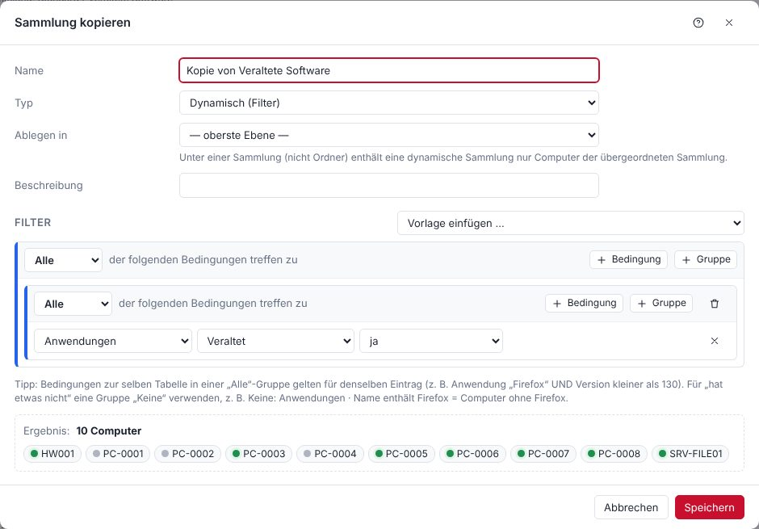

Filter bestehen aus verschachtelten Gruppen: **Alle** (UND), **Eine** (ODER), **Nicht alle**, **Keine**. Bedingungen derselben Tabelle innerhalb einer *Alle*-Gruppe beziehen sich auf **denselben** Eintrag.

**Beispiel – „7-Zip fehlt oder veraltet“**

```
Eine
├── Keine:  Anwendungen · Name · beginnt mit · 7-Zip
└── Alle:   Anwendungen · Name · beginnt mit · 7-Zip
            Anwendungen · Version · Version kleiner als · 24.08
```

**Beispiel – „Windows 10 mit wenig Speicher“**

```
Alle
├── Computer · Betriebssystem · enthält · Windows 10
└── Laufwerke · Laufwerk · ist · C:   und   Laufwerke · Frei (GB) · kleiner als · 15
```

Eine dynamische Sammlung *unter* einer anderen Sammlung (nicht unter einem Ordner) enthält nur Computer, die auch in der übergeordneten Sammlung sind.

**Schneller Weg – direkt aus den Inventardaten:** Rechtsklick auf einen Eintrag (z. B. ein Programm, einen Drucker, einen Dienst oder einen Hotfix in der Computeransicht, ein Programm in der Softwareübersicht, eine Zelle in der Computerliste oder einen Wert auf der Seite *Allgemein* wie Modell oder Betriebssystem) → **Dynamische Sammlung erstellen**. Zur Wahl stehen u. a.:

- bei Programmen ganz oben **„Name“ installiert** und **„Name“ nicht installiert** – die Sammlung heißt dann gleich passend, z. B. „PdfCraft installiert“ / „PdfCraft nicht installiert“ (ohne Präfix wie „Anwendungen:“). Steht im Namen eine Versionsnummer, gilt das für jede Version (`7-Zip*`); „Computer mit genau …“ nimmt den vollständigen Namen,
- *Computer mit „Name“* – bei Programmen auch **jede Version** (der Name ohne Versionsnummer als Muster, z. B. `7-Zip*`), eine bestimmte Version oder **älter als** diese Version,
- die angeklickte Spalte (z. B. Treiber eines Druckers) allein oder zusammen mit dem Namen,
- *Computer ohne …* (Gruppe *Keine*),
- bei mehreren markierten Einträgen: mit mindestens einem, mit allen oder ohne diese Einträge.

Danach öffnet sich der normale Sammlungsdialog mit dem fertigen Filter – Name, Ablageort und Bedingungen lassen sich vor dem Speichern anpassen.

**Bedienen:** Rechtsklick im Baum bietet Öffnen, Bearbeiten, Neu ▸, Duplizieren, Sammlung scannen, Heartbeat, Bereitstellen, Tools, Bericht, Ausschneiden/Kopieren/Einfügen, Umbenennen und Löschen. Ziehen verschiebt eine Sammlung, mit gedrückter **Strg**-Taste wird sie kopiert. Standard- und AD-Sammlungen sind schreibgeschützt und fest an ihrem Platz – sie lassen sich nur auf- und zuklappen, nicht ziehen; „Duplizieren“ bzw. Kopieren/Einfügen erzeugt eine änderbare Kopie.

**Löschschutz:** Eine Sammlung, die noch von einer anderen Sammlung (Filter „Mitglied von“), einem Zeitplan, Scanprofil, Mandanten, eigenen Bericht, Berichtsversand oder einer Benachrichtigung verwendet wird, lässt sich nicht löschen – die Meldung nennt die Stellen. Gleiches gilt für benutzerdefinierte Felder. Zirkelbezüge (A verweist auf B, B auf A) werden beim Speichern abgelehnt.

**Sammlungen, die aufeinander aufbauen:** Bis zu 12 Verweise hintereinander sind möglich (Sammlung A ist „Mitglied von“ B, B von C … – untergeordnete Sammlungen zählen mit); innerhalb einer Sammlung sind bis zu 10 Ebenen Filtergruppen möglich – beides wird getrennt gezählt. Beim Speichern oder Verschieben prüft POCKET KNIFE auch alle Sammlungen, die auf der geänderten aufbauen: Würde eine davon dadurch nicht mehr funktionieren, wird nicht gespeichert, und die Meldung nennt die betroffene Sammlung. So verliert kein Scanprofil oder Zeitplan still seine Ziele.

**Reguläre Ausdrücke** im Filter: höchstens 200 Zeichen; verschachtelte Wiederholungen wie `(a+)+` oder `(a|b)*` und Rückverweise sind nicht erlaubt, weil sie die Auswertung extrem verlangsamen können.

## AD-Sammlungen {#adcollections}

Ist es unter **Einstellungen → Active Directory** eingeschaltet, legt der Abgleich die OU-Struktur unter einem Eintrag mit dem Domänennamen an und einen Ordner „Gruppen“ mit allen AD-Gruppen, die Computer enthalten. Diese Sammlungen pflegt POCKET KNIFE selbst; im Baum lassen sie sich nur auf- und zuklappen, nicht verschieben.

## Computeransicht {#computerview}

Ein Doppelklick auf einen Computer öffnet seine Detailansicht. Links stehen die Kategorien (Computer, Anwendungen, Hardware, Dienste, Laufwerke, Netzwerkkarten, Scans, Bereitstellungen …), rechts die Daten. Die Übersicht zeigt Betriebssystem, Hardware, Sicherheit (Defender, BitLocker, TPM, Firewall) und den Scanstatus.

**Angemeldete Benutzer (ab 2.32.6):** Neben jedem angemeldeten Benutzer steht, ob seine Sitzung **gesperrt** ist (Sperrbildschirm) oder **getrennt** (Remotedesktop geschlossen oder Benutzer gewechselt – seine Programme laufen weiter). Ohne Zusatz ist die Sitzung aktiv. Bei Online-Computern fragt POCKET KNIFE das beim Öffnen live ab, sonst gilt der Stand des letzten Scans; die Computerliste zeigt es in der Spalte „Benutzer“. Grundlage sind `quser` (getrennt) und der Sperrbildschirm-Prozess in der Sitzung (gesperrt); auf Windows Home ohne `quser` fehlt „getrennt“.

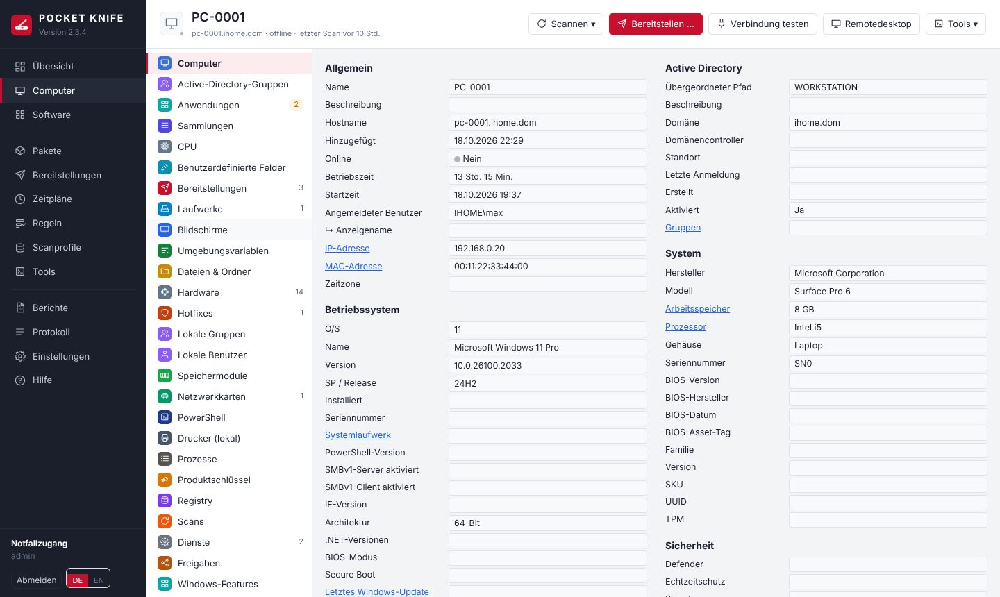

Aktionen direkt beim Computer:

| Wo | Aktion |
|---|---|
| Anwendungen | Aktualisieren (winget), Jetzt deinstallieren, Deinstallationspaket erstellen (Rechtsklick) |
| Dienste | Starten, Stoppen, Neu starten, Starttyp ändern |
| Prozesse | Live laden und beenden |
| Übersicht → Kennwörter & Schlüssel | LAPS-Kennwort und BitLocker-Wiederherstellungsschlüssel anzeigen (jeder Abruf wird protokolliert) |
| Kopfzeile | Scannen, Bereitstellen, Tools, Remotedesktop |

# Scanprofile und Scanner {#scanning}

## Scanprofile {#profiles}

Ein Scanprofil legt fest, **was** gescannt wird (Scanner), **bei welchen Computern** (Ziele: Sammlungen und/oder einzelne Computer) und **wann** (Auslöser). Mitgeliefert sind feste Profile für jeden Scanner (Active Directory, Anwendungen, Computer-Details, Laufwerke, Bildschirme, Umgebungsvariablen, Dateien & Ordner, Hardware, Hotfixes, Speichermodule, Netzwerkkarten, PowerShell, Drucker, Registry, Dienste, Freigaben, Benutzer & Gruppen, Windows-Features, Geplante Aufgaben, WMI, Speicherplatz) sowie **Standard**.

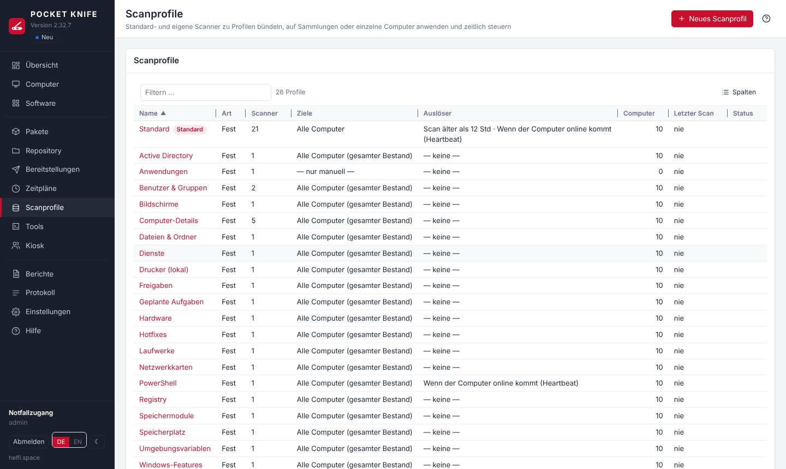

- Feste Profile lassen sich nicht löschen und ihre Scanner nicht ändern; **Auslöser und Ziele** sind frei einstellbar. Für eigene Zusammenstellungen: **Duplizieren**.
- **Ziele** (Reiter im Profil): **Alle Computer**, beliebige Sammlungen (auch dynamische) und/oder **einzelne Computer**. Die Sammlungen erscheinen wie im Baum links nach Ordnern gegliedert und alphabetisch (Standard, AD, eigene Ordner); **Sammlung suchen** filtert über alle Ordner, **nur ausgewählte** zeigt die gewählten, oben stehen sie als Liste zum Entfernen. Zugeklappte Ordner zeigen, wie viele darin gewählt sind. Gleiches gilt für die Ziele von Zeitplänen. Ziel-Computer sind die Mitglieder der gewählten Sammlungen plus die einzeln gewählten. Neue Profile zielen zunächst auf „Alle Computer“. Ohne Ziel läuft ein Profil nur manuell (Scannen → Profil wählen). Der Reiter **Computer** zeigt, welche Computer das Profil gerade erfasst.
- **Standard** enthält alle Scanner außer Dateien & Ordner, PowerShell, Registry, WMI und Speicherplatz. Neue Computer werden beim ersten Online-Sein damit gescannt.
- **Speicherplatz** (optionaler Scanner): ermittelt die Ordnergrößen der festen Laufwerke als Diagramm – wie das Tool „Speicherplatz analysieren“, aber planbar. Bewusst **nicht** im Standardscan, da er den Client stärker belastet; über einen eigenen Auslöser (z. B. monatlich, nachts) und Sammlungen gezielt einplanen. Die Tiefe stellt man unter **Einstellungen → Zeitpläne & Leistung** ein; die Ergebnisse stehen beim Computer unter **Speicherplatz** und im Diagramm.
- Nach jeder Installation oder Deinstallation läuft automatisch das Profil **Anwendungen** (im Paket änderbar).

**Auslöser**

| Auslöser | Bedeutung |
|---|---|
| Einmalig | zu einem festen Zeitpunkt |
| Intervall | alle n Minuten/Stunden/Tage |
| Täglich / Wöchentlich / Monatlich | zu einer Uhrzeit an bestimmten Tagen |
| Scan-Alter | sobald der letzte Scan älter als eine Zeitspanne ist, optional nur in einem Zeitfenster |
| Heartbeat | sobald ein Computer (wieder) online ist – ab 2.32.8 erst einige Minuten danach (Standard 3, **Einstellungen → Zeitpläne & Leistung → Scan nach dem Hochfahren**), damit Netzwerk, Dienste und Anmeldung fertig sind. Das gilt für alle automatischen Scans eines gerade hochgefahrenen oder aufgewachten Computers; manuelle Scans laufen sofort |

„Offline Computer nachholen“ scannt Computer, die zum Zeitpunkt offline waren, sobald sie online kommen.

## Eigene Scanner {#customscanners}

Unter **Scanprofile → Eigene Scanner** legen Sie Scanner vom Typ Registry, Dateien & Ordner, WMI oder PowerShell an. Jeder eigene Scanner läuft im festen Profil seines Typs (z. B. „PowerShell“) und zusätzlich in eigenen Profilen. Das Ergebnis steht beim Computer in der gleichnamigen Kategorie. Gibt es dort mehrere Scanner, wählt man oben per **Auswahlliste** (oder ‹ ›) einen aus oder zeigt mit „Alle Scanner“ alle untereinander; die Auswahl wird je Kategorie gemerkt. Mit **Testen** führen Sie einen Scanner sofort auf einem Computer aus und sehen das Ergebnis.

> **Wichtig:** Das feste Profil „PowerShell“ hat zunächst keinen Auslöser. Damit eigene PowerShell-Scanner regelmäßig laufen, dort einen Auslöser setzen (z. B. täglich) – oder den Scanner in ein eigenes Profil mit Auslöser aufnehmen.

**Beispiele**

| Typ | Eingabe | Ergebnis |
|---|---|---|
| Registry | `HKLM:\SOFTWARE\Firma\Agent` | alle Werte des Schlüssels |
| Dateien & Ordner | `C:\Program Files\Firma\*.exe` | Größe, Datum, Dateiversion |
| Dateien & Ordner | `%SYSTEMDRIVE%\Users\*\ntuser.dat` | ein Eintrag je Benutzerprofil |
| WMI | `SELECT Name, EstimatedChargeRemaining FROM Win32_Battery` | Akkustand |
| PowerShell | siehe unten | eine Zeile je ausgegebenem Objekt |

```powershell
# Version und Pfad einer Firmensoftware
Get-ItemProperty HKLM:\SOFTWARE\Firma\App | Select-Object Version, InstallPath

# Letzter Neustart als Text
"Letzter Start: " + (Get-CimInstance Win32_OperatingSystem).LastBootUpTime

# Lokale Administratoren
Get-LocalGroupMember -SID S-1-5-32-544 | Select-Object Name, PrincipalSource
```

Objekte werden zu Spalten, Texte zur Spalte „value“. Write-Host, Hashtables und Format-Table werden übernommen, Fehler erscheinen in der Spalte „fehler“.

**Pfade bei „Dateien & Ordner“:** Umgebungsvariablen werden auf dem Client aufgelöst – `%SYSTEMDRIVE%`, `%ProgramData%`, `%ProgramFiles%`, `%windir%` oder in PowerShell-Schreibweise `$env:SystemDrive`. Der Scan läuft als Dienstkonto bzw. SYSTEM, daher zeigen `%USERPROFILE%` und `%APPDATA%` auf dessen Profil, nicht auf das des angemeldeten Benutzers – für alle Benutzer `%SYSTEMDRIVE%\Users\*\…` verwenden. Platzhalter: `*` und `?` für einen Namen auf einer Ebene, `**` für beliebig viele Ordnerebenen (z. B. `%ProgramData%\Firma\**\*.log`). `**` durchsucht alles darunter und ist bei großen Ordnern wie `C:\Users` deutlich langsamer – wo die Tiefe bekannt ist, besser `*` nehmen. „Unterordner rekursiv durchsuchen“ liefert zusätzlich den gesamten Inhalt darunter.

**Größenangaben:** Werte in Bytes zeigt POCKET KNIFE lesbar als KB, MB, GB oder TB an (Tooltip: genauer Bytewert). Einstellung je Scanner unter **Größenangaben**:

| Einstellung | Wirkung |
|---|---|
| automatisch erkennen (Standard) | Spalten, deren Name auf eine Größe hindeutet (z. B. `Size`, `Length`, `FreeSpace`, `Capacity`, `Größe`), wenn alle Werte reine Zahlen sind und mindestens einer ≥ 1024 ist. Spalten wie `SizeGB`, `Count` oder `Percent` bleiben unverändert. |
| nur diese Spalten | genau die angegebenen Spalten (kommagetrennt, z. B. `Size, FreeSpace`) |
| nie umrechnen | Werte wie geliefert |

Das Skript sollte deshalb Bytes ausgeben, nicht schon gerundete GB-Werte – dann stimmen Sortierung, CSV-Export und Filter in dynamischen Sammlungen. Gilt auch für die Spalte `size` des Scanners „Dateien & Ordner“.

**Dynamische Sammlung aus einer Größe:** Rechtsklick auf einen Wert wie „28 GB“ → *Dynamische Sammlung erstellen* bietet „Size ≥ 27,8 GB“ und „Size ≤ 27,9 GB“ an (statt des exakten Bytewerts); den Wert kann man im Dialog anpassen, z. B. auf `20 GB`. Allgemein verstehen Zahlenvergleiche in Sammlungen Einheiten: `500 MB`, `20 GB`, `1,5 TB` (1 GB = 1024³ Bytes).

**Größen in Filtern und Berichten:** Im Filter-Editor (Sammlungen und eigene Berichte) haben Größenspalten die Vergleiche ≥, ≤, >, <, =, ≠ und nehmen Werte mit Einheit an (`10 GB`); die Vorschläge sind lesbare Schwellen. In eigenen Berichten erscheinen Größen als KB/MB/GB und werden nach Größe sortiert; der CSV-Export enthält den Bytewert.

```powershell
# Größe der Benutzerprofile in Bytes – Anzeige automatisch in GB/MB
Get-CimInstance Win32_UserProfile -Filter "Special=False" | ForEach-Object {
  [pscustomobject]@{
    Pfad  = $_.LocalPath
    Size  = (Get-ChildItem $_.LocalPath -Recurse -Force -File -ErrorAction SilentlyContinue | Measure-Object Length -Sum).Sum
    Zuletzt = $_.LastUseTime
  }
}
```

# Software {#software}

Die Softwareübersicht fasst alle installierten Programme aller Computer zusammen und zeigt, welche Version im **winget-Katalog** aktuell ist. „Veraltet“ zählt die Computer mit einer älteren Version.

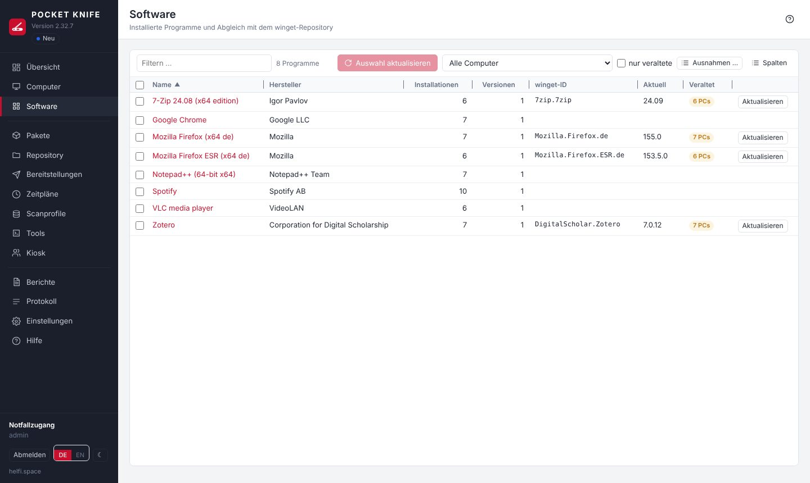

- **Auswahl aktualisieren:** Programme markieren (Strg/Umschalt) → Knopf oder Rechtsklick. Für jede winget-ID entsteht eine Bereitstellung `winget upgrade` für alle veralteten Installationen.
- **Detailansicht (Doppelklick):** alle Computer mit Version; Auswahl aktualisieren, bereitstellen oder deinstallieren; winget-Zuordnung von Hand festlegen oder das Programm ignorieren.
- **Deinstallationspaket erstellen:** Rechtsklick auf ein Programm. Das Paket entfernt das Programm auf beliebigen Computern, Sammlungen oder per Zeitplan (siehe Schritt „Deinstallieren“).

**Ausnahmen der Aktualitätsprüfung** (eigene Liste): Programme, die nie als „veraltet“ gelten sollen – z. B. Laufzeitbibliotheken, Treiber-Tools oder Fachanwendungen, deren Version der Hersteller vorgibt. Zu finden unter **Software → Ausnahmen …** und **Einstellungen → Repository & winget**; schneller per Rechtsklick auf ein oder mehrere Programme → *Von der Aktualitätsprüfung ausnehmen*.

| Feld | Beispiel-Muster | Wirkung |
|---|---|---|
| Name | `Microsoft Visual C++*` | alle Visual-C++-Laufzeitpakete |
| Name | `*Runtime*` | alles mit „Runtime“ im Namen |
| Hersteller | `Datev*` | alle Programme dieses Herstellers |
| winget-ID | `Oracle.JavaRuntimeEnvironment` | genau diese winget-Zuordnung |

`*` steht für beliebig viele Zeichen, `?` für genau eines; Groß-/Kleinschreibung spielt keine Rolle. Beim Anlegen zeigt eine Vorschau, welche installierten Programme betroffen sind. Ausgenommene Programme erscheinen in der Liste als **ausgenommen**, zählen nicht als veraltet (Übersicht, Sammlung „Veraltete Software“) und werden von winget-Zeitplänen nicht aktualisiert. Die winget-Zuordnung bleibt sichtbar; gezielt bereitstellen geht weiterhin. Entfernen über das Papierkorb-Symbol in der Liste – die Programme werden danach wieder geprüft.

Das ältere **Ignorieren** in den Details eines Programms entfernt dagegen nur dessen winget-Zuordnung; diese Programme stehen in der Ausnahmeliste unter „Einzeln ignorierte Programme“.
- **Paket aus winget anlegen:** Rechtsklick, wenn eine winget-ID zugeordnet ist.

Die winget-Zuordnung berücksichtigt Varianten wie ESR, Beta oder Sprachversionen. Unsichere Zuordnungen werden nicht automatisch aktualisiert.

## Neue winget-Versionen zurückstellen {#winget-release}

**Einstellungen → Repository & winget → winget → Neue Versionen** legt fest, wann eine neue Version aus dem winget-Katalog verteilt wird:

| Einstellung | Wirkung |
|---|---|
| sofort freigeben | wie bisher – die neueste Version (Standard) |
| zurückstellen um … Tage | eine neue Version wird erst nach der eingestellten Zahl an Tagen verteilt; vorher einzeln freigeben geht |
| nur nach Freigabe im Paket | eine neue Version wird erst verteilt, wenn sie freigegeben ist |

Der winget-Katalog nennt kein Erscheinungsdatum – gezählt wird ab dem Tag, an dem POCKET KNIFE die Version im Katalog **zum ersten Mal sieht** (beim Laden des winget-Index). Die beim ersten Mal vorgefundene Version gilt als freigegeben („Ausgangsstand“), damit nach dem Einschalten nichts stillsteht.

Solange die neueste Version nicht freigegeben ist:
- **Zeitpläne** (Software aktuell halten, Patchday) aktualisieren nur Computer, die eine ältere als die zuletzt freigegebene Version haben – und installieren genau diese.
- **winget-Schritte in Paketen, verschachtelten Paketen und im Kiosk** installieren die zuletzt freigegebene Version (`winget --version`). Ist dieselbe oder eine neuere Version schon installiert, wird der Schritt übersprungen (nie herunterstufen). Ein Schritt mit fester Version bleibt unverändert.
- Der **winget-Cache** lädt nur die freigegebene Version; liegt sie schon im Cache, bleibt er dabei. Einträge mit „Prüfsumme des Katalogs nicht verlangen“ behalten ihren Stand (der Hersteller liefert dort immer die neueste).
- Der Knopf **Aktualisieren** unter Software installiert bewusst die neueste Version – er wird von Hand ausgelöst. Eine **gesperrte** Version installiert er nie (dann die zuletzt freigegebene). Die Anzeige „veraltet“ richtet sich weiter nach dem Katalog.
- **Wechsel der Regel** (z. B. von „sofort freigeben“ auf „nur nach Freigabe im Paket“): Alle bis dahin freigegebenen Versionen bleiben freigegeben; erst danach erscheinende Versionen folgen der neuen Regel.

**Einzeln freigeben oder sperren:** Unter **Pakete** zeigt die Spalte **Freigabe** den Stand jedes winget-Pakets (z. B. „24.08 statt 24.09“). Rechtsklick → **Version … jetzt freigeben** gibt die neueste sofort frei; **Freigabe …** zeigt alle bekannten Versionen mit „zuerst gesehen“ und Stand und bietet **Freigeben**, **Sperren** (eine fehlerhafte Version nie verteilen – auch bei „sofort freigeben“), **Sperre aufheben** und **Freigabe zurücknehmen**. Nach einer Freigabe lädt der winget-Cache die Version gleich. Alles steht im Protokoll; nur Hauptadmins.

## winget-Cache – Updates für Computer ohne winget {#winget-cache}

winget gibt es erst ab Windows 10 1809 / Windows Server 2019. Für ältere Systeme (z. B. Server 2016, 2012 R2) hält POCKET KNIFE die **aktuelle Version** ausgewählter Programme im Repository bereit – ohne dass du Pakete selbst bauen musst: **winget-Cache** in der linken Leiste oder **Pakete → winget-Cache …** (nur Hauptadmins).

- **Aufnehmen:** auf der Paketseite per Rechtsklick auf ein winget-Paket **In den winget-Cache aufnehmen** (auch für mehrere; die Spalte „winget-Cache“ zeigt den Stand), im Paket beim winget-Schritt **In den winget-Cache aufnehmen**, oder auf der Seite des Caches **Hinzufügen …** (winget-Katalog durchsuchen) bzw. **Aus dem Bestand …** – zeigt Programme mit sicherer winget-Zuordnung, die auf Computern ohne winget installiert sind, veraltete zuerst.
- **Laden:** POCKET KNIFE holt das Manifest wie winget selbst aus dem winget-Katalog (geprüft mit den Prüfsummen aus dem Index), wählt den passenden Installer (Architektur, für alle Benutzer, bevorzugte Sprache), lädt ihn, prüft seine SHA-256 und legt ihn unter `winget-cache\<winget-ID>\<Version>_<Prüfsumme>\` im Repository ab (tauscht der Katalog bei gleicher Version die Datei, entsteht ein eigener Ordner). Daraus erzeugt POCKET KNIFE im Hintergrund ein Paket mit stillen Schaltern, Erfolgscodes und Erkennung („ist schon installiert“) – es steht nicht in der Paketliste; dort trägt das winget-Paket nur die Markierung in der Spalte „winget-Cache“.
- **Stille Schalter:** aus dem Manifest; fehlen sie, nimmt POCKET KNIFE dieselben Standards wie winget – MSI: `/qn /norestart` (dazu `ALLUSERS=1`), Inno Setup: `/VERYSILENT /SUPPRESSMSGBOXES /NORESTART /SP- /ALLUSERS`, Nullsoft: `/S`, WiX-Burn: `/quiet /norestart`. Liegt der Installer in einem ZIP (z. B. paint.net), entpackt POCKET KNIFE es und installiert die im Manifest genannte Datei. Reine EXE-Installer ohne Angaben, MSIX, ZIPs ohne Installer („portable“) und Store-Pakete gehen nicht („Nicht möglich“, mit Grund) – dafür ein eigenes Paket anlegen.
- **Prüfsumme stimmt nicht – Adressen ohne Version (z. B. Google Chrome):** Manche Hersteller liefern unter derselben Adresse immer die neueste Datei; die Prüfsumme im winget-Katalog passt dann oft nicht (auch winget selbst scheitert daran). Für solche Einträge per Rechtsklick **Prüfsumme des Katalogs nicht verlangen**: POCKET KNIFE lädt dann nur über HTTPS direkt vom Hersteller (auch eine Weiterleitung muss HTTPS bleiben; nur wenn sich die Datei unter der Adresse geändert hat), merkt sich die Prüfsumme der geladenen Datei für die Bruchprüfung und übernimmt bei MSI den Produktcode aus der Datei. Der Eintrag zeigt „ohne Katalog-Prüfsumme“. Ohne Abgleich mit dem Katalog verlässt du dich auf HTTPS und den Hersteller – deshalb nur je Eintrag.
- **Aktuell halten:** einmal täglich (Einstellungen → „Automatisch“) oder **Alle prüfen**. Kommt eine neue Version, wird sie geladen, das Paket umgestellt und die alte Version gelöscht – je Programm liegt immer nur die aktuelle im Cache. Stimmt die Prüfsumme nicht (Hersteller hat die Datei ausgetauscht), bleibt die bisherige Version und der Eintrag zeigt „Fehler“.
- **Benutzen:** Überall, wo ein winget-Schritt auf einem Computer ohne winget laufen würde – Pakete, Zeitpläne („Pakete verteilen“ und „winget-Updates“), verschachtelte Pakete, Kiosk, **Aktualisieren** in Softwareübersicht und Computeransicht –, nimmt POCKET KNIFE automatisch den Installer aus dem Cache (im Ergebnis steht „aus dem winget-Cache“). **Seit 2.35.2 auch auf Computern mit winget** (Einstellungen des Caches → „Auch mit winget“, Standard an): Die Datei kommt dann aus dem Repository im LAN statt je Computer aus dem Internet – deutlich schneller, und der Internetzugang lädt jedes Programm nur einmal. Bei eigenen winget-Argumenten, Installation nur für einen Benutzer, einem Schritt, der als angemeldeter Benutzer läuft, einer anderen Architektur, einer installierten Version, die nicht älter ist, oder wenn „Aktualisieren“ ein nicht installiertes Programm träfe, bleibt es bei winget. Hinweis: winget aktualisiert mit dem Installer-Typ, mit dem das Programm installiert wurde (MSI oder EXE); der Cache nimmt immer den gewählten – gibt es ein Programm in beiden Formen, kann es sonst doppelt in „Programme und Features“ stehen. Ist die Datei im Cache verändert, nimmt POCKET KNIFE sie nicht und schreibt das ins Protokoll („Neu laden“ hilft). Verlangt der Schritt eine feste andere Version, bleibt es bei „Übersprungen“. Die Clients brauchen dafür weder winget noch Internet. Ausgelassen werden Computer, für die das Paket nicht passt: Installer verlangt ein neueres Windows (MinimumOSVersion), 32-Bit-Windows bei einem x64-Installer, Programm in der anderen Architektur oder nur für einen Benutzer installiert, oder die installierte Version ist nicht älter. Solange eine neuere Version noch nicht geladen ist (Prüfung läuft, Fehler), gilt die bisherige.
- **Aufräumen:** **Entfernen** löscht Eintrag, Paket und Ordner (wird das Paket noch in einem Zeitplan, einem anderen Paket oder im Kiosk verwendet, sagt POCKET KNIFE wo). **Aufräumen …** löscht Ordner im Cache-Ordner, zu denen kein Eintrag mehr gehört und die nichts anderes benutzt – andere Ordner im Repository fasst der Cache nie an. Alte Versionen, die eine geplante oder laufende Bereitstellung noch braucht, bleiben bis danach liegen.
- **Abhängigkeiten** (z. B. eine Visual-C++-Laufzeit) nennt der Eintrag als Hinweis – nimm sie dann ebenfalls in den Cache auf.
- **Einstellungen:** Ordner im Repository (nur solange der Cache leer ist; ein eigener, neuer oder leerer Ordner, nie in einem Mandanten-Ordner), bevorzugte Sprache, größte Datei (Standard 2048 MB), täglich automatisch prüfen. Der POCKET-KNIFE-Server braucht dafür Zugriff auf `cdn.winget.microsoft.com` und die Download-Adressen der Hersteller (wie für den winget-Index, ggf. über den Proxy).

# Pakete {#packages}

Ein Paket besteht aus **Schritten** in drei Abschnitten:

| Abschnitt | Zweck |
|---|---|
| Vorbereitung | z. B. Programm beenden, alte Version entfernen |
| Schritte | die eigentliche Arbeit |
| Abschluss | läuft immer – auch nach einem Fehler (Aufräumen, Scan) |

Jeder Schritt lässt sich oben im Feld **Bezeichnung** benennen (z. B. „Wazuh-Agent installieren“). Die Bezeichnung erscheint in der Schrittliste und im Bereitstellungsprotokoll; leer bleibt die automatische Beschreibung. Ein neues Paket beginnt bei den **Paket-Eigenschaften** mit dem Namen.

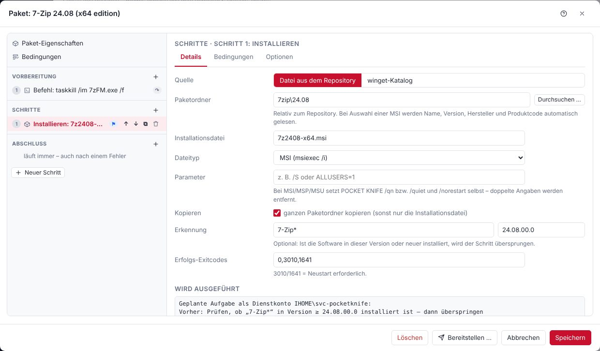

**Neues Paket:** Pakete → **Neues Paket**. Links steht der Aufbau, rechts die Einstellungen des gewählten Eintrags. Schritte lassen sich per Ziehen, ↑/↓ oder Rechtsklick sortieren, duplizieren, deaktivieren und zwischen den Abschnitten verschieben.

**Spalte „Benachrichtigung“:** Ein grünes ✓ in der Paketliste zeigt, dass der angemeldete Benutzer nach diesem Paket eine Windows-Benachrichtigung bekommt – nach derselben Regel wie am Client: im Paket „immer“, oder „wie in den Einstellungen“, die Benachrichtigung ist dort eingeschaltet und das Paket installiert bzw. aktualisiert wirklich ein Programm (keine Deinstallation, kein reines Skript). Der Tooltip nennt den Grund.

**Repository durchsuchen:** Bei „Datei aus dem Repository“ öffnet **Durchsuchen …** das Repository. Das Suchfeld oben findet Dateien und Ordner im ganzen Repository samt Unterordnern (OU-Admins: in ihrem Mandanten-Ordner) – ein Teil des Namens genügt (`7zip`), mit `*` und `?` als Muster (`7z*.msi`). Ein Klick auf eine Datei übernimmt Ordner und Datei. Gesucht wird in einem Verzeichnis des Repositorys im **Arbeitsspeicher des Servers** (nicht in der Datenbank; 10 000 Dateien ≈ 2–5 MB): Treffer kommen sofort, der Stand wird nach 5 Minuten im Hintergrund aufgefrischt und steht unter dem Suchfeld („Stand: vor 3 Min.“). **Neu einlesen** holt sofort den aktuellen Stand (nur Hauptadmins). Repositorys mit mehr als 200 000 Einträgen werden nicht zwischengespeichert – dann sucht jede Anfrage direkt auf der Freigabe (höchstens 15 Sekunden).

**Pakete zusammenfassen (ab 2.32):** In der Paketliste mehrere Pakete markieren → Rechtsklick → **Zu neuem Paket zusammenfassen …**. Reihenfolge festlegen (↑/↓), Name vergeben und die Art wählen:

- **Verschachtelt (empfohlen):** Das neue Paket ruft die Pakete nacheinander als Schritt „Verschachteltes Paket“ auf. Sie bleiben verbunden – ändern Sie ein Original, gilt das auch im zusammengefassten Paket. Bedingungen, „Ausführen als“ und Neustart der Einzelpakete gelten weiter.
- **Schritte kopieren:** Die Schritte werden kopiert und sind danach unabhängig von den Originalen; „Ausführen als“ bleibt je Schritt wie im Original. Pakete mit eigenen Bedingungen lassen sich so nicht zusammenfassen (die Bedingungen gingen verloren).

„Bei Fehler mit dem nächsten Paket weitermachen“ ist standardmäßig aus. Die stärkste Neustart-Einstellung der Pakete gilt für das neue Paket. Pakete verschiedener Mandanten lassen sich nicht zusammenfassen; zentrale Pakete gehen mit jedem Mandanten. Ein verschachteltes Paket lässt sich auch von Hand einbauen: im Paket **Neuer Schritt → Verschachteltes Paket**. Einen einzelnen Schritt schalten Sie per Rechtsklick → **Deaktivieren** (oder Häkchen **Aktiv**) aus, ohne ihn zu löschen – er erscheint dann grau und wird übersprungen.

**Exportieren und importieren:** **Exportieren** speichert die ausgewählten Pakete (ohne Auswahl: alle angezeigten; auch per Rechtsklick) als Datei `*.pkpackages.json` – z. B. für eine zweite POCKET-KNIFE-Installation oder als Sicherung einzelner Pakete. Verschachtelte Pakete werden mitgenommen. In der Datei stehen keine IDs: Sammlungen und Scanprofile werden über ihren Namen zugeordnet. **Importieren …** zeigt nach der Dateiwahl zuerst, was passiert (neu, als Kopie, übersprungen, Fehler) – erst **Importieren** legt an. Es gelten dieselben Prüfungen wie beim Speichern im Editor; bei einem Mandanten müssen Dateien in dessen Repository-Ordner liegen. Gibt es eine Sammlung aus einer Bedingung nicht, wird das Paket abgelehnt (die Bedingung einfach wegzulassen, würde es auf mehr Computern ausführen). Kennwörter enthalten Pakete nicht; Skripte und Befehle stehen so in der Datei, wie sie im Paket stehen.

**Bruchprüfung (Repository-Dateien):** POCKET KNIFE merkt sich beim Speichern eines Pakets Größe, Änderungsdatum und Fingerabdruck (SHA-256) jeder Repository-Datei, die das Paket benutzt (bei „ganzen Ordner kopieren“ auch die Dateiliste des Ordners). Pakete von vor 2.26 bekommen diesen Stand bei der ersten Prüfung. Geprüft wird alle 5 Minuten (aus dem Repository-Index, nur Name, Größe und Datum), vor **jeder** Bereitstellung, jedem Zeitplan-Lauf, jeder Kiosk-Installation und jeder Wiederholung (direkt auf der Freigabe) sowie mit **Jetzt prüfen** im Paket. Hat sich nur das Datum geändert, entscheidet der Fingerabdruck – gleicher Inhalt gilt nicht als Änderung.

| Zustand | Bedeutung | Folge |
|---|---|---|
| ✓ | Dateien unverändert | – |
| ! Abweichung | andere Dateien im Paketordner geändert oder neu hinzugekommen | Lauf geht weiter, Hinweis im Protokoll |
| ✕ Bruch | Datei oder Ordner fehlt, oder die Installationsdatei bzw. die Quelle einer Dateikopie hat sich geändert | Bereitstellungen und Zeitpläne werden **unterbrochen** (kein Computer wird angefasst), Warnung im Protokoll |
| ? | Repository nicht erreichbar | kein Bruch – der Lauf meldet den Fehler selbst |

Die Spalte **Zustand** in der Paketliste zeigt das Ergebnis (Tooltip mit den Dateien), die **Übersicht** eine Kachel „Pakete mit Bruch“. Im Paket listet **Repository-Dateien** jede Abweichung mit bisherigem und jetzigem Stand. War die Änderung gewollt (z. B. neue Version drübergelegt), bestätigt **Neuen Stand übernehmen** den aktuellen Inhalt – bei einer MSI weist POCKET KNIFE darauf hin, wenn die Version im Paket nicht mehr zur Datei passt. Fehlende Dateien behebt das nicht: wurden sie nur verschoben, findet sie **Datei suchen …** per Fingerabdruck ([Reparatur](#repair)), sonst das Paket anpassen. OU-Admins sehen Details nur zu Dateien in ihren Mandanten-Ordnern; ein zentrales Paket mit Bruch ist für sie „derzeit nicht verfügbar“, bestätigen kann es nur ein Hauptadmin. Kiosk-Nutzer sehen nur „derzeit nicht verfügbar“.

**Vollprüfung:** Einmal pro Woche wird zusätzlich jede benutzte Datei komplett gelesen und ihr Fingerabdruck verglichen – das findet auch einen Austausch mit gleicher Größe und gleichem Datum. Sie läuft nachts im Zeitfenster (Standard 1 bis 6 Uhr), gedrosselt (Standard 50 MB/s) und eine Datei nach der anderen; endet das Zeitfenster, geht es in der nächsten Nacht weiter. Einstellbar unter **Einstellungen → Repository & winget → Bruchprüfung der Pakete**. Last: etwa so, als würden die benutzten Paketordner einmal kopiert (Netz und Platten des Dateiservers); die Clients merken nichts.

**Repository umziehen:** Pakete speichern nur den Pfad **im** Repository (z. B. `7zip\24.08`), nie den Server. Liegt das Repository künftig auf einem anderen Server, genügt es, unter **Einstellungen → Repository & winget** den Pfad zu ändern – alle Pakete funktionieren weiter, auch importierte. Nur Pfade, die Sie selbst fest in einen Befehl oder ein Skript geschrieben haben (`\\server\freigabe\…`), bleiben stehen; der Export weist auf solche Stellen hin.

## Schritttypen {#steps}

| Schritt | Was passiert |
|---|---|
| Installieren | Datei aus dem Repository (MSI, MSP, MSU, EXE, CMD/BAT, PS1, REG) oder winget. Eine `.reg`-Datei wird mit `reg.exe import` eingespielt (wie `regedit /s`, aber mit Exitcode). Bei MSI werden Name, Version, Hersteller, Produktcode und Plattform beim Auswählen automatisch gelesen. |
| Deinstallieren | sucht live in „Programme und Features“ nach dem Anzeigenamen (Platzhalter `*`) und deinstalliert still |
| Befehl | mehrzeilig wie eine .cmd-Datei |
| PowerShell | beliebiges Skript; `exit 1` meldet einen Fehler |
| Verschachteltes Paket | die Schritte eines anderen Pakets an dieser Stelle |
| Dateikopie | Datei/Ordner aus dem Repository nach z. B. `%ProgramData%\Firma` |
| Registry | Werte setzen (REG_SZ, REG_EXPAND_SZ, REG_DWORD, REG_QWORD, REG_MULTI_SZ, REG_BINARY), Werte oder Schlüssel löschen, Schlüssel anlegen – direkt im Paket, ohne Datei. **Aus .reg importieren** übernimmt den Inhalt einer exportierten .reg-Datei als Einträge. 64- oder 32-Bit-Ansicht (WOW6432Node) wählbar. HKCU-Einträge gelten für das ausführende Konto – für Benutzereinstellungen *Ausführen als: Angemeldeter Benutzer*. Werte mit Namen wie `Password`, `Kennwort`, `Secret` oder `Token` stehen nicht in der Ausgabe der Bereitstellung (ab 2.38.2). |
| Scannen | Inventar-Scan mit einem Scanprofil |
| Neustart | startet neu, wartet, bis der Computer zurück ist, und macht weiter |
| Warten / Nachricht / Abmelden | Pause, Meldung an alle Sitzungen, Benutzer abmelden |

**Computername & Co. in Paketen:** Die Tool-Variablen `$(Computer)` usw. gelten nur für Tools. In Paketschritten (Befehl, PowerShell, Pfade) nimmt man die Windows-Umgebungsvariablen des Clients: `%COMPUTERNAME%`, `%USERDOMAIN%`, `%ProgramData%` im Befehl bzw. `$env:COMPUTERNAME` in PowerShell. Achtung: `%USERNAME%` / `$env:USERNAME` ist das **ausführende** Konto (Dienstkonto bzw. `SYSTEM`, Computerkonto `PC-0815$`), nicht der angemeldete Benutzer – außer bei *Ausführen als: Angemeldeter Benutzer*. Den angemeldeten Benutzer liefert in PowerShell `(Get-CimInstance Win32_ComputerSystem).UserName`.

## Bedingungen {#conditions}

Bedingungen gibt es für das ganze Paket und für jeden Schritt. Standardmäßig ist **alles ausgewählt**; wählen Sie nur ab, was nicht passt:

- **Betriebssystem:** Windows 10, Windows 11, Server 2016–2025
- **Architektur:** 32-Bit, 64-Bit, ARM64
- **PowerShell-Mindestversion**, **Anmeldestatus** (immer / nur angemeldet / nur nicht angemeldet)
- **Datei** vorhanden/fehlt/Version, **Registry** vorhanden/fehlt/Wert/Version, **Sammlung** Mitglied/nicht Mitglied

Ist eine Paket-Bedingung nicht erfüllt, wird der Computer **übersprungen**; bei einer Schritt-Bedingung nur dieser Schritt.

## Ausführen als {#runas}

| Option | Wann |
|---|---|
| Wie in den Einstellungen (Standard) | fast immer – mit dem Konto aus **Einstellungen → Repository & winget → Ausführung der Pakete**: **Lokales System** (Standard) oder das **Dienstkonto** |
| Angemeldeter Benutzer | für Programme und Einstellungen im Benutzerprofil (z. B. Benutzer-Installationen, HKCU) |

Bei einem Schritt gibt es zusätzlich **Wie Paket**. In Klammern steht immer das Konto, das wirklich läuft – POCKET KNIFE stellt nichts heimlich um. Im Ergebnis der Bereitstellung steht es in der Kopfzeile jedes Schritts („… (als Lokales System …)“).

**winget-Schritte** haben nur **Lokales System** (installiert für alle Benutzer, Bereich „Computer“) oder **Angemeldeter Benutzer** (nur im Profil). Als Dienstkonto läuft winget nie, weil der App-Installer für das Dienstkonto nicht registriert ist.

**Ausführung der Pakete (ab 2.39):** Eine Einstellung für alle Pakete – für Hauptadmins und Mandanten gleich:

- **Lokales System (empfohlen, Standard):** eine temporäre geplante Aufgabe als `SYSTEM`, ohne Kennwort auf dem Computer. Das ist eine lokale Anmeldung – damit funktionieren auch **Windows Update** (z. B. PSWindowsUpdate) und Installer, die eine Netzwerkanmeldung ablehnen. Greift ein eigener Befehl selbst auf eine Freigabe zu (`\\server\freigabe`), meldet sich dort das **Computerkonto** an (z. B. `PC-0001$`) – dafür der Gruppe „Domänencomputer“ Leserecht geben oder die Datei über einen Repository-Schritt kopieren lassen. Dateien aus dem Repository kopiert POCKET KNIFE immer selbst.
- **Dienstkonto:** eine kurzlebige geplante Aufgabe mit dem Dienstkonto **und seinem Kennwort** (lokale Anmeldung). Sie wird nach jedem Schritt gelöscht, auch bei Abbruch; was ein unterbrochener Lauf übrig lässt, entfernt der nächste Scan. Das Kennwort geht als Parameter an den Computer, nie im Skripttext. **Sicherheitskritisch:** Solange die Aufgabe existiert, liegt das Kennwort auf dem Computer – wer dort Administrator ist, kann es auslesen und ist dann überall Administrator, wo es das Dienstkonto ist. Deshalb fragt POCKET KNIFE vor dem Umstellen nach, nennt Mandanten mit eigenen Paketen und schreibt die Umstellung ins Protokoll. Das Dienstkonto braucht auf den Computern das Recht „Als Batchauftrag anmelden“ (Administratoren haben es standardmäßig).

Scans und Tools laufen davon unabhängig weiter über das Dienstkonto (WinRM). Tools lassen sich je Tool auf „SYSTEM“ stellen.

**Umstellung beim Update auf 2.39:** Bis 2.38 war das Dienstkonto der Standard und lief direkt über WinRM (Netzwerkanmeldung – Windows Update meldete dann „Zugriff verweigert“, 0x80070005). Beim ersten Start stellt POCKET KNIFE alle Pakete, die als Dienstkonto oder Lokales System liefen, auf **Wie in den Einstellungen** um, Schritte entsprechend auf **Wie Paket**; „Angemeldeter Benutzer“ bleibt. Wartende Bereitstellungen werden mit umgestellt, abgeschlossene bleiben als Verlauf unverändert. Pakete, deren eigene Befehle selbst einen Netzwerkpfad öffnen, stehen danach im Protokoll (Kategorie System) zum Prüfen.

**PowerShell** startet POCKET KNIFE immer mit vollem Pfad und festen Schaltern: `%SystemRoot%\System32\WindowsPowerShell\v1.0\powershell.exe -NoLogo -NonInteractive -NoProfile -ExecutionPolicy Bypass` – für PowerShell-Schritte, .ps1-Installer und Tools, gleich ob als Dienstkonto, Lokales System oder Benutzer. Eigene Skripte müssen sich darum nicht kümmern (keine Ausführungsrichtlinie, kein Profil, kein Wartedialog). PowerShell-Skripte (PowerShell-Schritte, .ps1-Dateien aus dem Repository, Tools, der Rahmen von POCKET KNIFE auf dem Client) startet POCKET KNIFE ab 2.32.2 erst ganz normal als Datei. **Verweigert Windows die Datei** – etwa weil eine GPO die Ausführungsrichtlinie festlegt (*MachinePolicy RemoteSigned*, die `-ExecutionPolicy Bypass` nicht aufheben kann) und Windows die Datei wegen der Sicherheitszonen für fremd hält –, lädt POCKET KNIFE ihren Inhalt und führt ihn aus. Parameter, `$PSScriptRoot`, `$PSCommandPath` und der Exitcode bleiben gleich; das Protokoll vermerkt es. Das Skript läuft dabei nie doppelt: geladen wird nur, wenn Windows den Start dieser Datei abgelehnt hat und noch nichts ausgeführt wurde – lehnt Windows erst ein Skript ab, das dieses Skript selbst aufruft, wird nicht nachgeladen. Eine Sperre durch Softwareeinschränkung oder AppLocker umgeht POCKET KNIFE nie. Hat der geladene Inhalt einen Syntaxfehler, endet der Schritt mit Exitcode 1 (wie mit `-File`). Virenschutz, AMSI, AppLocker/WDAC und der eingeschränkte Sprachmodus gelten unverändert.

**Gehärtetes Windows:** Schlägt ein Schritt oder Tool fehl, weil Windows die Ausführung verhindert hat, steht statt „Exitcode 1“ ein eigener Code mit Klartext im Ergebnis, der ursprüngliche Exitcode dahinter. Ein Schritt, der laut seinen Erfolgscodes gelungen ist, bleibt erfolgreich; Meldungen von winget gehen vor. **9013** Ausführungsrichtlinie/Signatur (z. B. ein Skript, das dieses Skript aufruft), **9014** Virenschutz (AMSI), **9015** eingeschränkter Sprachmodus (AppLocker/WDAC), **9016** Programm gesperrt (AppLocker/Softwareeinschränkung). Läuft PowerShell im eingeschränkten Sprachmodus, steht das außerdem als Hinweis am Anfang des Protokolls.

**Eingeschränkter Sprachmodus (Constrained Language Mode):** Mit Softwareeinschränkung, AppLocker-Skriptregeln oder App Control (WDAC) erlaubt PowerShell keine .NET-Aufrufe und kein `Add-Type`. Ab 2.38 kommt POCKET KNIFE ohne sie aus: Bereitstellungen und Tools schreiben ihre Skripte mit `Set-Content`, Registry-Schritte nutzen dort die Registry-Cmdlets (32-Bit-Ansicht über `WOW6432Node`), Bedingungen und Scanner lösen `%VARIABLEN%` selbst auf, das Inventar liest Programme über `Get-ItemProperty` und lokale Gruppen über CIM, eigene PowerShell-Scanner laufen über `Invoke-Expression`. Benachrichtigungen ermitteln die Konten der angemeldeten Benutzer über CIM und prüfen die Rechte ihres Ordners anhand der SDDL (ab 2.38.10). Nur die **Speicherplatz-Analyse** braucht volle PowerShell und sagt das dann deutlich. **Verbindung testen** zeigt den Sprachmodus des Computers. Eigene Skripte in Paketen und Tools müssen sich selbst an die Regeln des eingeschränkten Modus halten.

Die Einstellung gilt für das Paket und lässt sich je Schritt überschreiben. **Wird ausgeführt** zeigt für jeden Schritt den genauen Aufruf auf dem Client, z. B.:

```
Geplante Aufgabe (ohne Kennwort) als Lokales System (NT AUTHORITY\SYSTEM):
msiexec.exe /i "C:\Windows\Temp\PocketKnife\<Lauf>\7z2408-x64.msi" /qn /norestart ALLUSERS=1 /l*v "...\pk_msi.log"
```

## Beispiele {#packageexamples}

**7-Zip aus dem Repository (MSI)**

1. Neues Paket → Installieren → Quelle „Datei aus dem Repository“ → Durchsuchen → `7zip\24.08\7z2408-x64.msi`.
2. Name, Version, Erkennung und Architektur (ohne x86) werden aus der MSI übernommen.
3. Speichern → Bereitstellen.

**Firefox über winget, alte Version vorher beenden**

1. Vorbereitung → Befehl: `taskkill /im firefox.exe /f`, Optionen → Bei Fehler „weitermachen“.
2. Schritte → Installieren → Quelle „winget-Katalog“ → `Mozilla.Firefox` (Version leer = immer die neueste).

**Zotero deinstallieren (auch Benutzer-Installationen)**

Rechtsklick auf „Zotero“ in der Software → „Deinstallationspaket erstellen …“. Der Schritt findet Zotero auf jedem Computer und ruft `helper.exe /S` auf – bei Benutzer-Installationen als der jeweilige Benutzer.

**Firmenkonfiguration verteilen**

1. Dateikopie: Quelle `Config\Agent`, Ziel `%ProgramData%\Firma\Agent`.
2. Befehl: `reg add "HKLM\SOFTWARE\Firma" /v Konfiguriert /d 1 /f`.
3. Abschluss → Scannen mit dem Profil „Registry“.

**Archiv lässt sich nicht entpacken (Exitcode -1978335140):** Manche winget-Pakete (z. B. Microsoft GameInput) kommen als ZIP-Archiv. Als Lokales System scheitert das Entpacken über die Windows-Shell häufig. POCKET KNIFE wiederholt den Schritt dann einmal mit `tar.exe` und setzt dafür in den winget-Einstellungen des Kontos Lokales System (`…\systemprofile\AppData\Local\Microsoft\WinGet\Settings\defaultState\settings.json`) `installBehavior.archiveExtractionMethod = tar`; vorhandene Einstellungen bleiben erhalten. Eigene, nicht lesbare Einstellungsdateien bleiben unverändert.

## Proxyserver {#proxy}

Für Netze ohne direkten Internetzugang: **Einstellungen → Repository & winget → Proxyserver**.

| Feld | Bedeutung |
|---|---|
| Proxy-Adresse | z. B. `http://proxy.firma.local:8080` – immer mit `http://`, auch für HTTPS-Ziele (der Proxy baut die verschlüsselte Verbindung per CONNECT auf). Leer = kein Proxy |
| Benutzer / Kennwort | optional, nur für POCKET KNIFE selbst (Basic-Anmeldung am Proxy). Das Kennwort liegt verschlüsselt im Tresor und ist nie im Diagnosepaket |
| Clients | optional: auch winget auf den Clients lädt über den Proxy |

**POCKET KNIFE selbst** lädt über den Proxy den winget-Katalog. Ohne Eintrag gilt wie bisher die Netzwerkkonfiguration des Containers (Umgebungsvariable `HTTPS_PROXY` im Container, falls gesetzt). **Speichern & testen** lädt die ersten Bytes des Katalogs und zeigt, ob es klappt; bei „407“ verlangt der Proxy eine Anmeldung.

**Clients:** Mit dem Haken setzt POCKET KNIFE bei der nächsten winget-Bereitstellung auf dem Client die winget-Einstellung `DefaultProxy` (einmalig, danach nur bei einer Änderung) und nutzt den Proxy auch beim Nachinstallieren von winget. Nimmt man den Haken heraus, entfernt POCKET KNIFE die Einstellung wieder – aber nur, wenn es sie selbst gesetzt hat (Merker in der Registry: `HKLM\SOFTWARE\PocketKnife`, Wert `WingetProxy`). **Benutzer und Kennwort gehen nie an die Clients.** Verlangt der Proxy eine Anmeldung, melden sich die Clients mit ihrem Computerkonto an – der Proxy muss dafür die Windows-Anmeldung (Kerberos/NTLM) zulassen oder die Clients per IP-Bereich ohne Anmeldung durchlassen.

## winget auf Servern {#wingetbootstrap}

Vor jedem winget-Schritt prüft POCKET KNIFE, ob winget vorhanden ist. Fehlt es (Windows Server, ältere Windows-10-Builds), wird der App-Installer samt Abhängigkeiten nachinstalliert – **immer aus dem Repository**, nie per Download auf dem Client (ab 2.37). Den App-Installer lädt POCKET KNIFE selbst einmal in den Ordner **Offline-Quelle** (Standard `_winget`): beim ersten Bedarf, danach einmal täglich, aber nur bei einer neuen Version (aktuelles Release von microsoft/winget-cli, Prüfsumme aus GitHub; Windows prüft zusätzlich die Microsoft-Signatur). **Jetzt laden** in den Einstellungen holt ihn sofort. Ohne Internet: die Dateien `*.msixbundle`, `*License*.xml` und `DesktopAppInstaller_Dependencies.zip` selbst in den Ordner legen. Vor Windows 10 1809 bzw. Server 2019 gibt es kein winget; dort werden winget-Schritte **übersprungen**. Einstellbar unter **Einstellungen → Repository & winget**.

# Repository {#repository}

Unter **Repository** (links im Menü) verwalten Sie die Installationsdateien direkt in POCKET KNIFE – niemand braucht dafür Zugriff auf die Freigabe. Geschrieben wird immer mit dem Repository-Konto (Dienstkonto) auf dem Server, nie mit den Rechten des Bedieners. **Voraussetzung:** Das Konto hat auf der Freigabe **Lesen und Schreiben**.

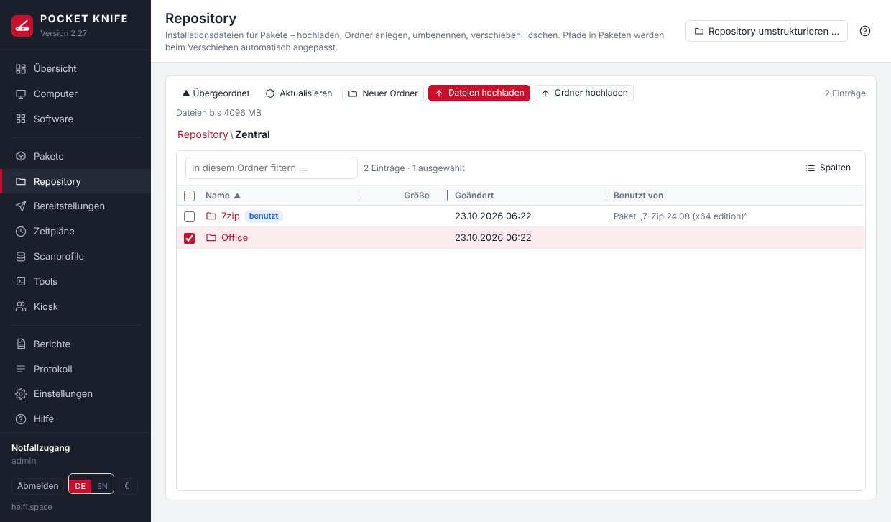

Die Ansicht bedient sich wie der Datei-Explorer für Clients:

- **Öffnen:** Doppelklick oder Klick auf den Ordnernamen; oben der Pfad zum Zurückspringen.
- **Auswählen:** Klick, Strg+Klick (dazu), Umschalt+Klick (Bereich), Strg+A.
- **Hochladen:** **Dateien hochladen**, **Ordner hochladen** (mit allen Unterordnern) – oder Dateien und Ordner einfach vom Desktop in die Liste bzw. auf einen Ordner ziehen. Große Dateien gehen in Stücken zu 8 MB; reißt die Verbindung ab, steht **Fortsetzen** in der Liste (auch nach einem Neuladen der Seite: dieselbe Datei erneut wählen, es geht an derselben Stelle weiter). Abgebrochene Uploads räumt POCKET KNIFE nach 24 Stunden auf. Die Daten laufen vom Browser über den POCKET-KNIFE-Server (Docker-Host) zum Dateiserver – große Dateien belasten beide Netzwege.
- **Verschieben:** Einträge auf einen Ordner oder auf ein Stück des Pfads oben ziehen, **Ausschneiden** und im Zielordner **Einfügen**, oder Rechtsklick → **Verschieben nach …**.
- **Rechtsklick:** Verschieben nach, Ausschneiden, Umbenennen, Neuer Ordner, Wer benutzt das?, Löschen, Pfad kopieren.

**Pfade in Paketen ziehen mit.** Beim Verschieben und Umbenennen passt POCKET KNIFE die Pfade in allen betroffenen Paketen an (auch ausgeschaltete Schritte), außerdem Mandantenordner, geplante Bereitstellungen, die winget-Offline-Kopie und den bestätigten Stand der Bruchprüfung – ein Paket bricht dadurch nicht. Betrifft es Pakete, zeigt eine **Vorschau** jedes Paket mit altem und neuem Pfad; vorher legt POCKET KNIFE automatisch eine **Sicherung** an, und geht unterwegs etwas schief, wird alles zurückgedreht (Dateien und Datenbank).

**Was gesperrt ist (Idiotensicherung):**

| Aktion | gesperrt, wenn … |
|---|---|
| Löschen, Überschreiben | ein Paket (auch ein ausgeschalteter Schritt oder ein verschachteltes), eine geplante oder laufende Bereitstellung, ein Mandant (sein Ordner) oder die winget-Offline-Kopie die Datei bzw. den Ordner benutzt – die Meldung nennt die Pakete |
| Umbenennen/Verschieben einer Datei **in** einem benutzten Paketordner | das würde das Paket still ändern (z. B. eine MST, die in den Argumenten steht) – den ganzen Ordner verschieben oder das Paket anpassen; die Installationsdatei selbst darf umbenannt werden |
| Verschieben eines zentralen Pakets in einen Mandantenordner | dort könnten die Admins des Mandanten die Dateien ändern (ebenso: ein zentrales Paket mit Dateien aus einem Mandantenordner speichern) |
| OU-Admin: Hochladen, Ordner anlegen, Hineinschieben in einen Ordner, den ein zentrales Paket oder ein anderer Mandant benutzt | sonst ließe sich z. B. eine DLL neben eine fremde Installationsdatei legen; legt jemand dort direkt auf der Freigabe etwas ab, meldet die Bruchprüfung das als **Bruch** |
| Verschieben von Mandantenpaketen aus ihrem Mandantenordner | Mandantenpakete dürfen nur Dateien aus ihrem Ordner benutzen |
| Namen | Zeichen wie `\ / : * ? " < > |`, reservierte Windows-Namen (`CON`, `NUL`, `COM1` …), Punkt oder Leerzeichen am Ende |
| Verknüpfungen (Junctions/Links) im Pfad | POCKET KNIFE schreibt nie durch eine Verknüpfung – der Dateiserver würde sie auf seiner Seite auflösen |

Neue Dateien in einem benutzten Paketordner sind erlaubt (z. B. eine zusätzliche Konfiguration); das Paket zeigt dann „neu im Paketordner“, bis jemand den neuen Stand übernimmt. **Wer benutzt das?** zeigt für jeden Eintrag die Pakete, die Spalte **Benutzt von** steht direkt in der Liste. Jede Aktion steht im Protokoll (Kategorie „Repository“) mit Benutzer und Mandant.

**Grenzen:** maximale Dateigröße (Standard 4096 MB) unter **Einstellungen → Repository & winget**; für OU-Admins zusätzlich die erlaubten Dateitypen (MSI, MSP, MSU, MST, EXE, CMD/BAT, PS1, REG, ZIP, 7Z, CAB, MSIX/APPX, INI/INF, XML/JSON/TXT/CFG, Zertifikate, ISO/WIM und ähnliche) und ein **Speicherkontingent** je Mandant (beim Mandanten, leer = Standard aus den Einstellungen, 0 = unbegrenzt).

**Mandanten:** OU-Admins sehen und bearbeiten nur den Ordner ihres Mandanten; den Ordner selbst können sie nicht umbenennen, verschieben oder löschen. Darf ein Mandant eigene Pakete bauen und hat noch keinen Repository-Ordner, legt POCKET KNIFE **`Mandanten\<Name>`** selbst an – ein Ordner je Mandant, alle seine Admins teilen ihn; darunter legen sie eigene Unterordner an. Zwei Mandanten können sich keinen Ordner teilen (auch nicht ineinander verschachtelt). Das Repository und sein Server bleiben OU-Admins verborgen.

## Repository umstrukturieren {#restructure}

Ein gewachsenes Repository vor der Einführung von Mandantenordnern aufräumen – Hauptadmins, Knopf **Repository umstrukturieren …** oben rechts. Empfohlene Struktur: ein Ordner für die zentralen Pakete (z. B. `Zentral`) und `Mandanten` mit je einem Unterordner pro Mandant.

1. **Neuer Hauptordner** – eintippen oder wählen; gibt es ihn nicht, wird er angelegt.
2. **Was soll hinein?** – die bisherigen Ordner markieren (**Alle markieren** lässt `Mandanten` aus).
3. **Vorschau** – jedes betroffene Paket mit altem und neuem Pfad; Probleme (siehe Tabelle oben) stehen oben, dann geht es nicht.
4. **Ausführen** – in einem Rutsch: vorher automatische Sicherung, bei einem Fehler wird alles zurückgedreht.

## Duplikatsperre {#duplicates}

Dieselbe Software soll es nur einmal geben – entweder zentral oder bei genau einem Mandanten. Beim Speichern, Kopieren und Importieren eines Pakets sowie beim Hochladen einer Datei vergleicht POCKET KNIFE:

- die **winget-ID** (Installieren oder Aktualisieren),
- den **MSI-Produktcode** (aus dem Schritt oder aus der MSI-Datei),
- den **Fingerabdruck (SHA-256)** der Installationsdatei – erkennt auch umbenannte Kopien.

Gibt es dieselbe Software in einem **anderen Bereich** (zentral, Mandant A, Mandant B – auch zwischen zwei Mandanten), wird abgelehnt, mit dem vorhandenen Paket in der Meldung: bitte dieses verwenden. OU-Admins sehen und verteilen zentrale Pakete und die ihres Mandanten; liegt das Duplikat bei einem anderen Mandanten, nennt die Meldung es nicht (der Hauptadmin kann es zentral bereitstellen). Im selben Bereich ist es erlaubt (z. B. zwei Varianten mit anderen Argumenten). Der Name allein zählt nicht. Hauptadmins können übersteuern (**Trotzdem speichern** bzw. **Trotzdem hochladen**); das steht im Protokoll. Ein schon vorhandenes Duplikat aus der Zeit vor 2.27 verhindert das Speichern anderer Änderungen nicht; findet POCKET KNIFE es später (z. B. sobald der Fingerabdruck berechnet ist), steht ein Hinweis im Protokoll.

## Datei suchen (Reparatur per Fingerabdruck) {#repair}

Wurde außerhalb von POCKET KNIFE verschoben oder umbenannt (z. B. im Windows-Explorer), zeigt das Paket „Datei fehlt“ bzw. „Ordner fehlt“. **Datei suchen …** im Bereich **Repository-Dateien** des Pakets sucht die Dateien im ganzen Repository – Kandidaten über die Größe (aus dem Index im Arbeitsspeicher), bestätigt über den Fingerabdruck; ein Ordner gilt als gefunden, wenn alle seine Dateien am neuen Ort liegen. **Pfade übernehmen** passt dann alle Pakete an, die den alten Pfad benutzen (mit Sicherung vorher). OU-Admins: nur in ihrem Mandantenordner. Neu abgelegte Dateien kennt der Index spätestens nach 5 Minuten.

# Bereitstellungen {#deployments}

**Mehrere Pakete auf einmal:** In **Pakete** mehrere Zeilen anhaken (oder mit Strg/Umschalt markieren) und oben rechts auf **„N Pakete bereitstellen …“** klicken – oder Rechtsklick → „N Pakete bereitstellen …“. Im Dialog lassen sich weitere Pakete dazunehmen und die Reihenfolge durch Ziehen der Einträge ändern. Alle Pakete laufen als **eine** Bereitstellung: je Computer nacheinander in dieser Reihenfolge, nie zwei Installationen gleichzeitig (sonst meldet Windows Installer gern 1618 „eine andere Installation läuft“). Optional werden nach einem Fehler die weiteren Pakete für diesen Computer ausgelassen.

Bereitstellen über den Knopf **Bereitstellen …** (Computerliste, Paket, Software) oder per Rechtsklick. Ziel sind ausgewählte Computer oder eine Sammlung; der Zeitpunkt ist sofort oder geplant.

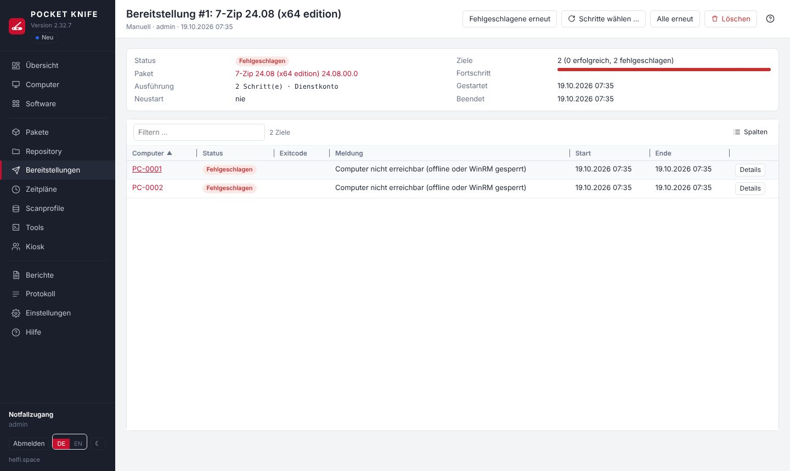

Die Bereitstellung zeigt den Fortschritt je Computer. **Details** öffnet das Ergebnis jedes Schritts mit Exitcode und der vollständigen Ausgabe. „Fehlgeschlagene erneut“ wiederholt das ganze Paket auf den nicht erfolgreichen Computern.

**Paket inzwischen geändert (ab 2.35.1):** Eine Bereitstellung merkt sich den Stand des Pakets beim Start. Hast du das Paket danach geändert (z. B. einen Schritt korrigiert), steht oben in der Bereitstellung ein Hinweis mit der Auswahl **mit dem aktuellen Stand des Pakets** (Standard) oder **mit dem Stand dieser Bereitstellung**. Sie gilt für „Fehlgeschlagene erneut“, „Alle erneut“, „Schritte wählen …“ und „Schritt wiederholen“ – ein erneutes Zuweisen des Pakets ist nicht nötig. „Schritte wählen …“ zeigt dann die Schritte des geänderten Pakets (neue Schritte ohne bisheriges Ergebnis). War die Bereitstellung selbst schon eine Wiederholung einzelner Schritte, bleibt es bei diesen Schritten – aus dem aktuellen Paket.

**Einzelne Schritte wiederholen:** Ist ein Schritt fehlgeschlagen, zeigt die Bereitstellung den Bereich **Fehlgeschlagene Schritte** – je Schritt mit den betroffenen Computern und zwei Knöpfen:

- **Nur diesen Schritt** – führt ausschließlich diesen Schritt erneut aus (z. B. ein Dienststart, der wegen eines Sperrvorgangs fehlschlug).
- **Ab diesem Schritt** – führt diesen und alle folgenden Schritte samt Abschluss aus, also auch die, die nach dem Fehler nicht mehr gelaufen sind. Erfolgreiche Schritte davor werden nicht wiederholt.

Für einen einzelnen Computer geht dasselbe in **Details** über **Wiederholen ▾** beim fehlgeschlagenen Schritt. Es entsteht jeweils eine neue Bereitstellung („… – ab „Schritt“ wiederholt“); Paket-Bedingungen, „Ausführen als“, Neustart- und Scan-Einstellungen bleiben wie im ursprünglichen Paket.

**Schritte selbst wählen:** **Schritte wählen …** (oben in der Bereitstellung) zeigt alle Schritte des Pakets mit ihrem bisherigen Ergebnis („2 OK“, „1 Fehler“). Häkchen setzen – vorausgewählt sind die fehlgeschlagenen und danach nicht mehr ausgeführten Schritte –, dann die Ziele wählen: nicht erfolgreiche, alle oder einzelne Computer. Es entsteht eine neue Bereitstellung nur mit diesen Schritten, in der Reihenfolge des Pakets und mit dessen Bedingungen und „Ausführen als“; im Paket ausgeschaltete Schritte laufen mit, wenn sie gewählt sind, Abschluss-Schritte nur, wenn sie gewählt sind. Hat das Paket „Neustart am Ende“, lässt sich der Neustart für die Wiederholung abwählen (Standard „nie“, außer es ist ein Installations- oder Neustart-Schritt gewählt). OU-Admins können das nur bei Bereitstellungen, die ausschließlich ihre eigenen Computer betreffen.

| Status | Bedeutung |
|---|---|
| Erfolgreich | alle Schritte erfolgreich |
| Übersprungen | eine Paket-Bedingung trifft nicht zu (z. B. falsches Betriebssystem) |
| Fehlgeschlagen | ein Schritt mit „Paket anhalten“ ist fehlgeschlagen oder der Computer war nicht erreichbar |

## Benachrichtigung am Client {#toast}

Nach einer **erfolgreichen Installation oder Aktualisierung** sieht der angemeldete Benutzer eine Windows-Benachrichtigung – z. B. **„7-Zip wurde aktualisiert.“** mit **„Installierte Version: 26.00“** darunter und einem grünen Häkchen, Absender „Softwareverteilung“ (änderbar).

- Gilt für Bereitstellungen von Hand, Zeitpläne, winget-Updates und den Kiosk.
- **Installiert** oder **aktualisiert**: winget-Aktualisierungen und Programme, die vorher schon (in älterer Version) im Inventar standen, gelten als „aktualisiert“. Name und Version nimmt POCKET KNIFE bei winget aus der Ausgabe („Found 7-Zip … Version 26.00“), sonst aus Paketname und -version.
- **Keine Meldung**, wenn niemand angemeldet ist, alles schon installiert bzw. aktuell war, bei Deinstallationen und bei reinen Skript-/Registry-Paketen.
- Mehrere angemeldete Benutzer (z. B. Terminalserver) sehen die Meldung jeweils in ihrer Sitzung.
- **Einstellungen → Zeitpläne & Leistung → Benachrichtigung am Client:** ein/aus, Absender (ein geänderter Absender gilt ab der nächsten Meldung), Sprache (Deutsch/Englisch), **Test-Benachrichtigung senden** an einen Computer. Je Paket unter *Paket-Eigenschaften → Benachrichtigung*: wie in den Einstellungen, immer (auch Skript-Pakete) oder nie.

**Technik:** Eine kurze WinRM-Verbindung startet je angemeldetem Benutzer eine geplante Aufgabe *als dieser Benutzer* (ohne Kennwort, ohne erhöhte Rechte, ohne sichtbares Fenster) – nur so erscheint die Meldung in seiner Sitzung; als Dienstkonto oder SYSTEM sähe sie niemand. Das Anzeigeskript liegt unter `C:\Program Files\PocketKnife` (nur Administratoren dürfen dort schreiben), Name und Version werden nur als Daten übergeben, nie als Befehl. Danach prüft das Skript im Benachrichtigungscenter, ob Windows die Meldung angenommen hat – wenn nicht, zeigt es sie mit dem Absender „Windows PowerShell“, den Windows immer kennt. Hat der Benutzer die Benachrichtigungen dieses Absenders in den Windows-Einstellungen selbst abgeschaltet, wird das respektiert (kein Ausweichen). Das Skript wird mit `-File` aus „Programme“ gestartet und läuft damit auch bei Softwareeinschränkung (SRP), AppLocker oder WDAC (eingeschränkter Sprachmodus) – sofern Skripte aus „Programme“ erlaubt sind, wie in den Standardregeln. Nur wenn eine GPO die Ausführungsrichtlinie auf AllSigned/Restricted festlegt, startet POCKET KNIFE es über einen kurzen kodierten Befehl. Das Ergebnis meldet das Skript selbst zurück; kommt keine Antwort, steht im Protokoll „Anzeigeskript ist beim Benutzer nicht gestartet“; die Rechte des Ordners setzt POCKET KNIFE bei jeder Meldung wieder auf den Standard von „Programme“. **Das Ergebnis je Benutzer steht im Protokoll** („gezeigt“, „gezeigt mit Absender Windows PowerShell“, „von Windows nicht angezeigt – Benachrichtigungen aus/Nicht stören/Richtlinie“ …), ebenso beim Test in den Einstellungen. Die Bereitstellung wartet nicht darauf.

> Erscheint trotz erfolgreichem Test keine Meldung: Prüfen, ob der Benutzer Benachrichtigungen bzw. „Nicht stören“ eingeschaltet hat und ob eine GPO Benachrichtigungen abschaltet. Als letzte Möglichkeit **Kompatibilität** einschalten (Absender „Windows PowerShell“, ist in Windows immer registriert).

## Meldung bei Neustart und Herunterfahren {#rebootmsg}

Bevor POCKET KNIFE einen Computer neu startet oder herunterfährt, zeigt Windows dem angemeldeten Benutzer eine Meldung. Deren Text stellen Sie unter **Einstellungen → Zeitpläne & Leistung → Meldung bei Neustart und Herunterfahren** ein:

- **Absender** – z. B. „Ihre IT-Abteilung“ statt „POCKET KNIFE“.
- Je Anlass ein eigener Text: **Neustart** und **Herunterfahren** aus dem Computer-Menü, **Neustart nach Bereitstellung**, Paketschritt **„Neustart“** und **Neustart aus dem Kiosk**. Leeres Feld = Standardtext; unter jedem Feld steht ein Beispiel, wie die Meldung aussehen wird.
- Platzhalter: `{absender}`, `{sekunden}`, `{minuten}`, `{benutzer}` (nur Kiosk: wer den Neustart angefordert hat). Beispiel: `{absender}: Ihr Computer startet in {minuten} Minuten neu. Bitte speichern Sie Ihre Arbeit.`
- Ein eigener Text im Paketschritt „Neustart“ hat Vorrang (dort sind dieselben Platzhalter erlaubt).
- Höchstens 400 Zeichen; doppelte Anführungszeichen werden zu einfachen (Windows begrenzt die Meldung auf 512 Zeichen).

## Windows Server {#windows-server}

POCKET KNIFE verwaltet Windows Server genauso wie Arbeitsplätze – über WinRM, das auf Windows Server ab Werk eingeschaltet ist (auch das Windows Admin Center setzt darauf). Einige Dinge laufen dort anders:

- **Rolle:** Der Scan liest, ob ein Computer Arbeitsplatz, Server oder Domänencontroller ist (Feld „Rolle“ in Sammlungen und Berichten). Die Standard-Sammlung **Domänencontroller** fasst die DCs zusammen – z. B. um sie von Neustart-Zeitplänen auszunehmen („ist nicht Mitglied von“).
- **Neustart/Herunterfahren:** Sind Server oder Domänencontroller dabei, fragt der Dialog ausdrücklich nach und nennt die Zahl der angemeldeten Benutzer.
- **Virenschutz:** Windows Server hat kein Sicherheitscenter – POCKET KNIFE zeigt dort Microsoft Defender direkt (auch ohne das PowerShell-Modul „Defender“). Ein anderer Virenschutz ist auf Servern nicht sichtbar.
- **Virtuelle Maschinen:** Der Scan erkennt Hyper-V, VMware, KVM/QEMU (z. B. Proxmox), Nutanix AHV, Xen, VirtualBox, Parallels und Cloud-VMs (Feld „Virtualisierung“). Auf VMs und Servern ohne Bildschirm erscheint keine Warnung mehr wegen der Bildschirme.
- **Terminalserver:** Die winget-Version liest POCKET KNIFE auf Servern aus der Registry statt über alle Benutzerprofile – der Scan bleibt auch bei vielen Profilen schnell.
- **Server Core:** Ohne Explorer erkennt POCKET KNIFE angemeldete Benutzer über `quser` (Name ohne Domäne).
- **Ältere Server:** Windows Server 2012 R2 (PowerShell 4) und 2016 werden gescannt; was dort fehlt (z. B. `Get-LocalUser`, Defender), ersetzt der Scan durch ältere Wege oder lässt das Feld leer. **winget gibt es erst ab Windows 10 1809 / Server 2019:** Auf älteren Systemen zeigt POCKET KNIFE veraltete Programme weiter an, bietet aber kein „Aktualisieren“ per winget an (Zeitpläne und Bereitstellungen lassen diese Computer aus bzw. melden „Übersprungen“), und der Kiosk zeigt dort keine Pakete, die per winget installieren. Solche Programme aktualisiert seit 2.35 der [winget-Cache](#winget-cache) – oder ein eigenes Paket aus dem Repository.

## Neustart von POCKET KNIFE während einer Bereitstellung {#deploy-restart}

Wird der Container neu gestartet (Update, Neustart des Docker-Hosts), während auf Computern noch etwas läuft, gelten diese Ziele als **„Unterbrochen (POCKET KNIFE wurde neu gestartet)“** (fehlgeschlagen – Zeitpläne holen sie wie gewohnt nach). Auf dem Computer räumt POCKET KNIFE danach selbst auf, sobald er erreichbar ist (Prüfung alle 5 Minuten):

- **Läuft der Installer noch**, wird er **nicht** abgebrochen, sondern abgewartet – ein mittendrin beendeter Installer richtet mehr Schaden an als einer, der zu Ende läuft. Erst wenn er länger läuft als die Zeitgrenze des Schritts, wird er beendet (wie bei einer normalen Zeitüberschreitung).
- Danach werden Arbeitsordner (`C:\Windows\Temp\PocketKnife\…` samt kopierter Installationsdateien) und geplante Aufgaben (`\POCKETKNIFE\PK_…`) entfernt.
- Die Meldung des Ziels zeigt das Ergebnis, z. B. „– auf dem Computer aufgeräumt (der unterbrochene Schritt lief noch zu Ende, Exitcode 0)“; das Protokoll (Kategorie „deploy“) nennt, was entfernt wurde.
- **Neue Bereitstellung auf denselben Computer:** Sie räumt vorher auf und **wartet**, solange der alte Installer noch läuft („Wartet: auf dem Computer läuft noch eine Installation aus einem unterbrochenen Lauf …“) – so laufen nie zwei Installationen gleichzeitig (Fehler 1618). Abbrechen ist währenddessen möglich.
- Bleibt ein Computer 14 Tage unerreichbar, gibt POCKET KNIFE den Auftrag auf; Reste älter als 2 Tage entfernt ohnehin der nächste Inventar-Scan.

Tipp: Updates möglichst dann einspielen, wenn keine Bereitstellung läuft (**Bereitstellungen** → Status „läuft“).

# Zeitpläne {#schedules}

Zeitpläne sind die eine Stelle für alles, was automatisch verteilt oder aktualisiert wird (die früheren „Regeln“ sind darin aufgegangen und wurden beim Update übernommen). Beim Anlegen wählen Sie die **Art**:

| Art | Was passiert |
|---|---|
| **Pakete verteilen** | ein oder mehrere gespeicherte Pakete, je Computer in fester Reihenfolge |
| **winget-Updates** | veraltete Software der Ziele per `winget upgrade` aktualisieren – alle veralteten oder nur bestimmte winget-IDs, mit Ausnahmen; je Programm eine Bereitstellung. IDs und Ausnahmen lassen sich mit **„Aus dem Inventar wählen …“** aus den installierten Programmen übernehmen, statt sie abzutippen |

Gemeinsam für beide Arten:

- **Auslöser:** Einmalig, Intervall, Täglich, Wöchentlich, Monatlich und **Heartbeat**: versorgt jedes Ziel, sobald es erreichbar ist (WinRM antwortet) und noch nicht versorgt wurde – nach dem Einschalten oder Wake-on-LAN, bei einem neuen Zeitplan oder neuen Mitgliedern einer Sammlung beim nächsten Heartbeat (Standard alle 5 Minuten; „Heartbeat“ von Hand prüft sofort). Bereits versuchte Ziele wiederholt der Heartbeat nicht laufend – dafür gibt es die Wartezeit nach Fehlschlag, weitere Auslöser oder „Auswahl erneut versorgen“. Ohne Auslöser läuft der Zeitplan nur über „Jetzt ausführen“. Ohne Heartbeat-Auslöser werden beim Einschalten nur Computer versorgt, die bei einem früheren Lauf offline waren und vorgemerkt wurden.
- **Zeitfenster** (optional): Wochentage und Uhrzeit, auch über Mitternacht (z. B. Mo–Fr 22:00–05:00). Fällige Läufe außerhalb des Fensters werden zu Beginn des Fensters nachgeholt; Computer, die außerhalb online kommen, werden vorgemerkt. „Jetzt ausführen“ ignoriert das Fenster.
- **Ziele:** Sammlungen (bei jedem Lauf neu ermittelt, auch „Alle Computer“) und einzelne Computer.
- **Offline Computer:** vormerken und versorgen, sobald sie online sind (Heartbeat) – oder überspringen.
- **Wartezeit nach Fehlschlag:** ein fehlgeschlagener Computer (bei winget: dasselbe Programm) wird frühestens nach X Stunden erneut versucht.
- **Fehlgeschlagene nachholen** (Standard): fehlgeschlagene Computer werden automatisch erneut versorgt, ohne auf den nächsten Termin zu warten – sobald sie erreichbar sind und die Wartezeit (mindestens 1 Stunde) um ist, im Zeitfenster, höchstens „Max. Fehlversuche“ Mal (bei 0 dreimal). Konnte ein Lauf gar nicht starten (z. B. Datenbank kurz gesperrt), wird er alle 15 Minuten wiederholt, bis er klappt.
- **Zielverlauf:** Status je Computer, „Auswahl erneut versorgen“, „Verlauf zurücksetzen“.
- **Vorschau:** zeigt vorab, was ein Lauf jetzt tun würde (bei winget: welche Programme auf welchen Computern).

Nur bei **Pakete verteilen**: bei Fehler die weiteren Pakete auslassen, erfolgreiche Ziele nicht erneut versorgen, **erneut versorgen nach X Stunden** (z. B. zusammen mit einer dynamischen Sammlung „7-Zip fehlt oder veraltet“ – die Umgebung pflegt sich selbst), maximale Fehlversuche.

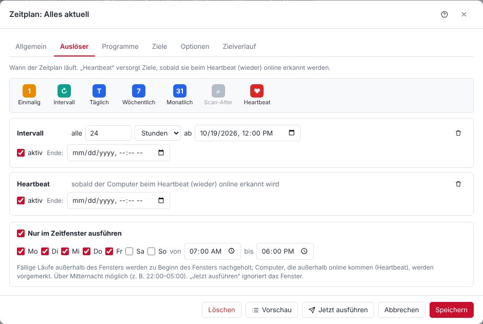

**Beispiel – Patchday am Abend:** Art „Pakete verteilen“, Auslöser „Wöchentlich, Mittwoch 19:00“, Ziel „Workstations“, Pakete „Firefox“, „7-Zip“, „Adobe Reader“, offline Computer vormerken. Wer am Abend aus ist, wird beim nächsten Einschalten versorgt.

**Beispiel – Software immer aktuell:** Art „winget-Updates“, alle veralteten, Ausnahme `Oracle.JavaRuntimeEnvironment`, Auslöser „Intervall alle 24 Std.“ **und** „Heartbeat“, Zeitfenster Mo–Fr 07:00–18:00, Ziel „Alle Computer“. Neu eingeschaltete Computer werden tagsüber sofort aktualisiert, alle anderen einmal täglich.

# Tools {#tools}

Computer auswählen → **Tools ▾** oder Rechtsklick → Tools.

**Befehl ausführen … (ab 2.34, Strg+Alt+C):** PowerShell- oder CMD-Befehl direkt auf den markierten Computern ausführen, ohne vorher ein Tool anzulegen. Typ wählen (PowerShell/CMD), „Ausführen als“ (Dienstkonto oder SYSTEM), Befehl eingeben – mehrzeilig, mit denselben Variablen wie bei Tools – und **Ausführen** (oder Strg+Enter). Die Ausgabe je Computer steht im selben Fenster; das Fenster bleibt offen, damit man den Befehl anpassen und erneut ausführen kann. Bei mehreren Computern fragt POCKET KNIFE vorher nach. **Als Tool speichern …** öffnet „Neues Tool“ mit Typ, Ausführung und Befehl – nur noch Name und Ordner eintragen. Unter **Verlauf** stehen die letzten 20 Befehle dieser Sitzung (bis zum Neuladen der Seite; sie werden nicht gespeichert, weil in einem Befehl ein Kennwort stehen kann). Jeder Aufruf steht mit Benutzer, Art (PowerShell/CMD) und Ergebnis je Computer im Protokoll – den Befehlstext selbst protokolliert POCKET KNIFE nicht. Wie Tools anlegen nur für Hauptadmins. **Exitcode (ab 2.38):** `exit 3` im PowerShell-Tool bzw. -Befehl kommt als Exitcode 3 an, ebenso der Exitcode eines zuletzt fehlgeschlagenen Programms; vorher meldete ein Tool als Dienstkonto dann „0“. Erzwingt eine Gruppenrichtlinie die Ausführungsrichtlinie AllSigned/Restricted, oder sperrt Softwareeinschränkung/AppLocker Skripte in `%TEMP%` (ein Probeskript zeigt es vorher), läuft das Tool wie bisher direkt (dann ohne `exit N`). Hat ein eigenes Tool schon Strg+Alt+C, bleibt es dabei; das Kürzel für „Befehl ausführen“ lässt sich unter **Tools → Tastenkürzel …** ändern.

**Dateien aus dem Repository, Zeitlimit, Erfolgscodes, Danach scannen (ab 2.32.7):** Braucht ein Tool ein Programm, das nicht auf dem Client liegt (z. B. `iperf3.exe`), trägt man unter **Dateien aus dem Repository** einen Ordner oder eine Datei aus dem Repository ein. POCKET KNIFE kopiert sie vor dem Ausführen selbst über die Admin-Freigabe auf den Computer, der Befehl läuft in diesem Ordner (`iperf3.exe -c server -i 1`), danach wird aufgeräumt. So braucht der Computer keinen Zugriff auf Freigaben: Ein Befehl wie `\\server\freigabe\programm.exe` scheitert in einer WinRM-Sitzung grundsätzlich („Double-Hop“ – die Sitzung hat keine Anmeldedaten für weitere Freigaben), und Leserechte für Computerkonten oder Kennwörter auf dem Client sind keine gute Idee. Ordner von Mandanten sind für Tools nicht wählbar – bekommt ein Mandant den Ordner später, läuft das Tool nicht mehr. **Zeitlimit** in Sekunden (leer = 30 Minuten), **Erfolgscodes** wie bei Paketen (leer = 0). **Danach scannen** (Standard: nicht): *Nach Erfolg* oder *Immer* mit einem Scanprofil – je Computer nach dem Tool; läuft gerade ein Scan, wird er danach nachgeholt.

**Tastenkürzel (ab 2.32.4):** Jedes Tool kann ein Kürzel haben – immer **Strg+Alt**, wahlweise mit **Umschalt**, dazu ein Buchstabe, eine Ziffer oder F1–F12. Bei eigenen Tools legst du es im Tool fest: Tool öffnen, ins Feld **Tastenkürzel** klicken und die Kombination drücken (Rücktaste oder Entf entfernt es). Ist sie schon vergeben, steht sofort darunter, an welches Tool. Die eingebauten Tools haben Vorgaben (z. B. Strg+Alt+P Ping & Ports, Strg+Alt+R Remotedesktop, Strg+Alt+E Ereignisanzeige, Strg+Alt+B Neustart/Herunterfahren), die du unter **Tools → Tastenkürzel …** ändern oder entfernen kannst; dort steht auch die Übersicht aller Kürzel. Ein Kürzel startet das Tool für die markierten Computer der Computerliste oder für den geöffneten Computer; bei mehreren Computern fragt POCKET KNIFE vorher nach. Die Kürzel gelten für alle Benutzer. In Eingabefeldern, Dialogen und geöffneten Menüs sind sie aus – AltGr-Zeichen wie `{ [ ] } @ €` starten also nie ein Tool. Menüs und die Tools-Seite zeigen das Kürzel neben dem Tool.

| Eingebaut | |
|---|---|
| Ping & Ports | Erreichbarkeit und offene Ports |
| Remotedesktop / VNC im Browser | Fernsitzung in einem eigenen Tab |
| Wake-on-LAN | über einen erreichbaren Computer im selben Subnetz (Relay), mehrfach, mit Prüfung, ob er aufwacht – siehe unten |
| Neustart / Herunterfahren … | ab 2.32.3 in einem Dialog: Neustart oder Herunterfahren wählen und die Wartezeit angeben (Sekunden oder Minuten, 0 = sofort bis 24 Stunden, Standard 60 Sekunden). Angemeldete Benutzer sehen solange die Meldung von Windows; der Standardtext nennt bei längeren Zeiten Minuten, ein eigener Text unter **Einstellungen → Zeitpläne & Leistung** gilt unverändert. Bei „sofort“ schließt Windows offene Programme ohne Rückfrage. Ab 2.34: Sind Server oder Domänencontroller dabei, nennt der Dialog sie samt Zahl der angemeldeten Benutzer und führt erst nach einem Häkchen „Ja, auch die Server“ aus |
| Neustart/Herunterfahren abbrechen | stoppt einen angekündigten Neustart bzw. ein Herunterfahren, solange die Wartezeit läuft |
| gpupdate /force | Gruppenrichtlinien aktualisieren: Computerrichtlinie und – in der Sitzung jedes angemeldeten Benutzers – dessen Benutzerrichtlinie (z. B. Browser-Lesezeichen, Laufwerke). Die Ausgabe zeigt jeden Teil einzeln. Ist niemand angemeldet, gilt die Benutzerrichtlinie bei der nächsten Anmeldung |
| winget prüfen / nachinstallieren | stellt winget bereit, wo es fehlt |
| Scannen mit Profil | sofortiger Scan |
| Speicherplatz analysieren | Ordnergrößen als Ringdiagramm – siehe unten |
| Dateien (Explorer) | Dateien des Clients im Browser verwalten – siehe unten |
| Ereignisanzeige | Windows-Ereignisprotokolle im Browser – siehe unten |


**Wake-on-LAN:** Broadcasts verlassen ihr Subnetz nicht. Das Magic Packet sendet deshalb ein Computer, der gerade läuft und im selben Subnetz wie das Ziel liegt (bis zu 3 „Relays“, ermittelt aus IP und Subnetzmaske des letzten Scans), zusätzlich der Container. Ab 2.31:

- **Mehrfach senden:** jedes Paket 3× im Abstand von knapp einer Sekunde (UDP kann verloren gehen), an alle bekannten MAC-Adressen – auch an die kabelgebundener Karten, die beim letzten Scan keine IP hatten (z. B. Dockingstation).
- **Aufwachen abwarten:** Danach prüft POCKET KNIFE den Computer alle 10 Sekunden. Das Fenster zeigt „wartet … 45 s“, dann „aufgewacht nach 70 s“ oder „nicht aufgewacht“; nach der halben Wartezeit wird automatisch noch einmal gesendet – über andere Computer, wenn es welche gibt. Das Ergebnis steht auch im Protokoll; ein aufgewachter Computer löst sofort die Heartbeat-Auslöser aus (Scans, Zeitpläne).
- **Feste Relays (optional):** unter **Einstellungen → Wake-on-LAN** Computer eintragen, die immer laufen (z. B. Server). Sie senden zuerst – so klappt es auch, wenn im Subnetz sonst niemand online ist. Dort lassen sich auch Anzahl der Pakete und Wartezeit einstellen.
- **Bereitschaft im Inventar:** Der Scanner „Netzwerkkarten“ liest je Karte, ob das Magic Packet erlaubt ist, ob sie den Computer wecken darf und die WoL-Einstellungen des Treibers, dazu den Windows-Schnellstart (weckt aus „Herunterfahren“ bei vielen Karten nicht). Zu sehen beim Computer unter **Netzwerkkarten**, im Bericht **Wake-on-LAN-Bereitschaft** und als Filter „Wake-on-LAN bereit“ für Sammlungen. Die Einstellung im BIOS/UEFI kann Windows nicht auslesen.
- **Vor Zeitplänen wecken (optional, Standard aus):** im Zeitplan unter Optionen → „ausgeschaltete Ziele beim Lauf wecken“. Gilt bei einem Termin, im Zeitfenster und bei „Jetzt ausführen“, nicht bei jedem Heartbeat; geweckte Computer werden versorgt, sobald sie hochgefahren sind. Heruntergefahren werden sie danach nicht.

**Speicherplatz analysieren** (Tools ▾ → *Speicherplatz analysieren …* oder beim Computer unter **Laufwerke**): zeigt, wo auf einem Laufwerk oder in einem Ordner der Platz bleibt – wie TreeSize oder WinDirStat, aber ohne Installation auf dem Client.

- **Pfad** wählen (Laufwerke aus dem letzten Scan vorgeschlagen, auch Ordner wie `D:\Daten` oder `%SystemDrive%\Users`) und **Tiefe** (3–6 Ebenen), dann **Analysieren**. Der Client durchsucht das Dateisystem als Dienstkonto über WinRM; ein Laufwerk mit einigen 100 000 Dateien dauert meist unter einer Minute. Der Lauf geht auf dem Server weiter, auch wenn Sie die Seite verlassen.
- **Ringdiagramm:** In der Mitte der aktuelle Ordner mit seiner Größe, der innere Ring zeigt seinen Inhalt, der äußere Ring eine Ebene tiefer (im selben Farbton, heller). Grau: zusammengefasste kleine Einträge („weitere Ordner/Dateien“) und Dateien.
- **Zoomen:** Klick auf ein Ringstück oder eine Zeile der Liste öffnet den Ordner; Klick in die Mitte, „Eine Ebene zurück“ oder der Pfad oben gehen zurück. Ordner unterhalb der gewählten Tiefe sind nur als Summe erfasst (▸ genauer) – ein Klick analysiert sie gezielt nach.
- **Liste** daneben mit genauer Größe, Anteil und Dateizahl; Rechtsklick: genauer analysieren, Pfad kopieren. Beim Überfahren zeigt ein Hinweis Pfad, Größe und Anteil.
- **Im Explorer öffnen:** das Ordnersymbol am Ende jeder Zeile, der Knopf über dem Diagramm oder der Rechtsklick springt direkt in **Dateien** – in den Ordner bzw. bei einer Datei in ihren Ordner, mit der Datei markiert. Dort lässt sich gleich aufräumen (löschen, verschieben, herunterladen).
- Ergebnisse werden gespeichert (die letzten 8 je Computer, Auswahl oben rechts).
- Verknüpfte Ordner (Junctions, symbolische Links) werden nicht verfolgt, damit nichts doppelt zählt. Nicht lesbare Ordner (z. B. *System Volume Information*) werden mitgezählt und gekennzeichnet. Hardlinks (z. B. in `C:\Windows\WinSxS`) zählen wie im Explorer bei jedem Vorkommen.

**Eigene Tools** (Tools → Neues Tool) sind PowerShell, Befehle (CMD) oder URLs. Tools laufen auf dem Server weiter, auch wenn der Browser geschlossen wird.

**Variablen** werden vor dem Ausführen durch die Werte des jeweiligen Computers ersetzt (in PowerShell, Befehl und URL):

| Variable | Wert | Beispiel |
|---|---|---|
| `$(Computer)` | Computername (NetBIOS) | `PC-0815` |
| `$(Host)` | vollständiger DNS-Name; falls unbekannt der Computername | `pc-0001.firma.local` |
| `$(IP)` | erste IP-Adresse aus dem letzten Scan | `10.0.10.25` |
| `$(MAC)` | erste MAC-Adresse aus dem letzten Scan (Scanner „Netzwerkkarten“) | `00:11:22:33:44:55` |
| `$(User)` | zuletzt erkannter angemeldeter Benutzer (Scan/Heartbeat) | `FIRMA\mmuster` |
| `$(Domain)` | Domäne des Computers aus dem Scan, sonst die Domäne aus den Einstellungen | `FIRMA` |

Groß-/Kleinschreibung beachten; unbekannte Werte werden durch einen leeren Text ersetzt. In einer **URL** werden die Werte URL-kodiert eingesetzt; Adressen mit `javascript:`, `data:`, `vbscript:` oder `blob:` werden abgelehnt.

**In PowerShell-Tools zusätzlich als Variablen:** `$PK_Computer`, `$PK_Host`, `$PK_IP`, `$PK_MAC`, `$PK_User`, `$PK_Domain` stehen sicher zitiert bereit – auch wenn ein Wert Apostrophe oder `$` enthält (z. B. ein Benutzername). Für Werte, die von Benutzern stammen (`$(User)`), besser `$PK_User` nehmen als `'$(User)'` in den Text einzusetzen.

```powershell
# Beispiel: DNS-Cache leeren und Gruppenrichtlinien neu laden
ipconfig /flushdns
gpupdate /target:computer /force
```

## Dateien (Explorer) {#files}

**Tools ▾ → Dateien (Explorer) …** oder beim Computer unter **Laufwerke**. Zugriff auf die Laufwerke des Clients über die administrativen Freigaben (`\\PC\C$`), ohne etwas auf dem Client zu installieren – das Dienstkonto ist dort ja lokaler Administrator.

- **Durchsuchen:** Laufwerk wählen (aus dem letzten Scan) oder oben einen Pfad eingeben; Doppelklick öffnet Ordner, der Pfad oben führt zurück.
- **Suchen:** Im geöffneten Ordner in das Suchfeld links über der Liste einen Namen oder ein Muster eingeben (`setup`, `*.log`) und **Suchen** bzw. Enter – durchsucht werden der Ordner und alle Unterordner (das Feld filtert nicht beim Tippen). Die Suche läuft **auf dem Client** selbst (per WinRM, auch bei Softwareeinschränkung/AppLocker im Constrained Language Mode); zurück kommen nur die Treffer, gespeichert wird nichts. Windows filtert die Namen dabei selbst – auch ein ganzes Laufwerk mit allen Unterordnern ist meist in Sekunden bis wenigen Minuten durchsucht (höchstens 5 Minuten, 300 Treffer). Treffer hinter Verknüpfungen erscheinen nicht doppelt, nicht lesbare Einträge werden übersprungen (die Anzahl steht oben). Klick auf einen Treffer öffnet den Ordner, bei einer Datei mit der Datei markiert; per Rechtsklick auch **Herunterladen** und **Pfad kopieren**. **Suche beenden** oder Esc kehrt zum Ordner zurück. Ist WinRM nicht erreichbar, wird langsamer über die Freigabe gesucht (höchstens 20 Sekunden).
- **Verwalten:** Rechtsklick auf Einträge – **Herunterladen** (Datei), **Kopieren**/**Ausschneiden** und im Zielordner **Einfügen** (auf demselben Computer, auch ganze Ordner), **Umbenennen**, **Löschen** (Mehrfachauswahl möglich; Ordner samt Inhalt). **Neuer Ordner** und **Hochladen** in der Werkzeugleiste.
- **Versteckte Einträge** (z. B. `ProgramData`, `$Recycle.Bin`, `desktop.ini`) sind wie im Windows-Explorer ausgeblendet; **Versteckte anzeigen** in der Werkzeugleiste blendet sie ein (die Wahl merkt sich der Browser), oben rechts steht, wie viele ausgeblendet sind. Die Suche findet auch versteckte Einträge.
- Verknüpfungen (Junctions/Symlinks), versteckte und gesperrte Einträge sind gekennzeichnet. Alles läuft als Dienstkonto und wird protokolliert. Löschen und Überschreiben lassen sich nicht rückgängig machen.

Verknüpfungen (Junctions/Symlinks, z. B. `C:\Users\All Users` → `C:\ProgramData`) sind mit ↗ markiert. Öffnen springt zum Ziel, Löschen entfernt nur die Verknüpfung, nicht das Ziel.

## Ereignisanzeige {#eventlog}

**Tools ▾ → Ereignisanzeige …**: liest die Windows-Ereignisprotokolle (System, Anwendung, Sicherheit, Setup, Defender) live über WinRM. Nach Stufe filtern (ab Warnung, ab Fehler, nur Kritisch), nach Text/Ereignis-ID/Quelle suchen, Anzahl wählen; Klick auf eine Zeile zeigt die vollständige Meldung.

# Software-Kiosk {#kiosk}

Im Kiosk installieren Nutzer freigegebene Software selbst – ohne Administratorrechte und ohne die IT anzurufen. Er ist eine eigene, einfache Seite: **`https://<pocketknife>:8443/kiosk`** (z. B. per GPO als Verknüpfung auf den Desktop). Die Anmeldung erfolgt mit dem normalen Windows-Konto – mit Benutzername und Passwort oder, wenn eingerichtet, automatisch per [Anmeldung mit Windows (SSO)](#kiosk-sso).

**Einrichten** unter **Kiosk** (Navigation):

1. **Einstellungen:** Kiosk einschalten und festlegen, wer ihn benutzen darf – **AD-Gruppen** (Name oder DN, auch verschachtelt, z. B. „Domänen-Benutzer“) und/oder **OUs** (mit allen Unter-OUs). Eins von beiden genügt. Mit **„Aus dem AD wählen …“** navigierst du in einem aufklappbaren Baum durch das AD und setzt Häkchen; Gruppen lassen sich zusätzlich nach Name suchen. Optional: Mail an die IT, wenn eine Anfrage auf Freigabe wartet; Höchstzahl Anfragen je Nutzer in 24 Stunden (Standard 10); [Anmeldung mit Windows (SSO)](#kiosk-sso) (Standard aus).
2. **Katalog → Software hinzufügen:** ein vorhandenes Paket wählen und festlegen
   - **Freigabe:** sofort installieren oder erst nach Freigabe durch einen Administrator
   - **Symbol** (PNG, JPEG, GIF, WebP oder ICO, höchstens 512 KB, am besten 128 × 128 Pixel; SVG wird aus Sicherheitsgründen nicht angenommen) – ohne Symbol zeigt der Kiosk die Anfangsbuchstaben
   - **Kategorie** und **Beschreibung** für Nutzer
   - **Deinstallieren:** ein Paket, das die Software wieder entfernt (z. B. per Rechtsklick in „Software“ → Deinstallationspaket erstellen) – ohne dieses Paket gibt es im Kiosk keinen Knopf „Deinstallieren“
   - **Nur für:** nur Computer einer Sammlung sehen die Software (z. B. Lizenzen einer Abteilung)
   - **Nur für Gruppen:** nur Mitglieder dieser AD-Gruppen (Name oder DN, auch verschachtelt; „Aus dem AD wählen …“) sehen und bestellen die Software – z. B. ein Grafikprogramm nur für das Grafik-Team. Leer = alle, die den Kiosk benutzen dürfen. Gilt zusätzlich zu „Nur für“; POCKET KNIFE prüft beim Anzeigen des Katalogs und beim Bestellen (Ergebnis 5 Minuten zwischengespeichert). Ist das AD gerade nicht erreichbar, bleibt solche Software ausgeblendet.
3. **Anfragen:** wartende Anfragen **freigeben** oder **ablehnen** (mit Begründung, die der Nutzer sieht); Verlauf aller Anfragen mit Link zur Bereitstellung.

**Was Nutzer sehen und dürfen:**

- **Nur den eigenen Computer:** POCKET KNIFE prüft live per WinRM, an welchem Computer der Nutzer angemeldet ist (über die Anmeldedaten aus dem Inventar, die Adresse des Browsers und den DNS-Namen). Für andere Computer lässt sich nichts anfordern – auch nicht über die Schnittstelle.
- **Nur den Katalog:** Installieren bzw. Anfordern, Deinstallieren (falls hinterlegt), Status je Software („Wartet auf Freigabe“, „Wird ausgeführt“, „Fertig“, „Fehlgeschlagen“), eigene Anfragen zurückziehen, solange sie noch nicht laufen.
- **Neustart planen:** Braucht eine Installation einen Neustart (oder meldet der letzte Scan einen ausstehenden Neustart), bietet der Kiosk „Jetzt (in 2 Minuten)“, „In 1 Stunde“ oder eine Uhrzeit am selben Tag an. Vor dem Neustart erscheint am Computer ein Hinweis; ein geplanter Neustart lässt sich wieder absagen. Nicht möglich bei **Servern** (auch Terminalservern) und solange **noch andere Benutzer** am Computer angemeldet sind.
- **Keine Verwaltung:** Kiosk-Anmeldungen haben auf die POCKET-KNIFE-Oberfläche keinerlei Zugriff (auch nicht auf Fernsitzungen). Mitglieder der Zugriffsgruppe können den Kiosk für ihren eigenen Rechner ebenfalls nutzen.

Installationen aus dem Kiosk sind normale Bereitstellungen (Name „Kiosk: …“) – mit Protokoll, dem Konto aus „Ausführen als“ und Scan danach wie gewohnt. Alles steht im Protokoll unter der Kategorie „Kiosk“. Die Abmeldung bei Inaktivität gilt auch im Kiosk.

## Anmeldung mit Windows (SSO) {#kiosk-sso}

Optional – **standardmäßig aus**. Eingeschaltet meldet der Kiosk Nutzer an Domänen-PCs **automatisch mit ihrem Windows-Konto** an (Kerberos, „Single Sign-on“): kein Benutzername, kein Passwort. Das Anmeldeformular bleibt als Rückfall, z. B. für Geräte außerhalb der Domäne.

Die Windows-Anmeldung gilt **nur für den Kiosk**. Auch Mitglieder der Zugriffsgruppe bekommen damit nur den Kiosk, nie die Verwaltung – dort bleiben Benutzername und Passwort Pflicht.

**Wie es funktioniert:** Der Browser holt sich beim DC ein Kerberos-Ticket für den Namen des Kiosks (`HTTP/pocketknife.firma.local`) und schickt es mit. POCKET KNIFE prüft das Ticket mit einer **Keytab** – dem Schlüssel des Kontos, auf dem dieser Name (SPN) eingetragen ist. Dafür braucht POCKET KNIFE keine Verbindung zum DC, und es wird kein Kennwort übertragen. Wer den Kiosk benutzen darf, prüft POCKET KNIFE danach wie bei der Anmeldung mit Passwort (Kiosk-Gruppen und -OUs, mit dem Dienstkonto per LDAP).

**Voraussetzungen**

- Der Kiosk wird über einen **festen DNS-Namen** aufgerufen, nicht über die IP-Adresse – mit HTTPS-Zertifikat auf diesen Namen (siehe [Eigenes Zertifikat](#certificate)).
- Die Uhrzeit von Docker-Host und DCs weicht höchstens 5 Minuten ab (NTP auf dem Docker-Host).
- Der Realm ist `PK_DOMAIN` in Großbuchstaben (abweichend: `PK_KERBEROS_REALM` in der `.env`).

### Einrichten Schritt für Schritt

Im Beispiel heißt die Domäne `firma.local` (NetBIOS `FIRMA`), der Kiosk `pocketknife.firma.local`.

1. **DNS:** einen **A-Eintrag** `pocketknife.firma.local` → IP des Docker-Hosts anlegen. Keinen CNAME – Browser fragen sonst ein Ticket für den Zielnamen an.
2. **Konto für den Namen anlegen:** ein neues, normales Benutzerkonto, z. B. `svc-pk-http` – **ohne Rechte**, „Kennwort läuft nie ab“, und unter *Konto → Kontooptionen* **„Dieses Konto unterstützt Kerberos AES 256-Bit-Verschlüsselung“** aktivieren. Nicht das Dienstkonto nehmen: `ktpass` setzt im nächsten Schritt ein neues Kennwort.
3. **SPN eintragen** (als Domänen-Admin):
   ```
   setspn -S HTTP/pocketknife.firma.local FIRMA\svc-pk-http
   setspn -Q HTTP/pocketknife.firma.local
   ```
   `-Q` muss genau **ein** Konto zeigen – ein doppelter SPN verhindert Kerberos.
4. **Keytab erzeugen** (auf einem DC):
   ```
   ktpass -princ HTTP/pocketknife.firma.local@FIRMA.LOCAL -mapuser FIRMA\svc-pk-http -crypto AES256-SHA1 -ptype KRB5_NT_PRINCIPAL -pass * -out pocketknife-http.keytab
   ```
   Der Realm hinter `@` steht in **Großbuchstaben**. `-pass *` fragt ein neues Kennwort ab und setzt es beim Konto. Die Keytab ist so geheim wie ein Kennwort.
5. **In POCKET KNIFE:** **Kiosk → Einstellungen → Windows-Anmeldung** → Keytab-Datei wählen → **Hochladen**. Häkchen „Anmeldung mit Windows anbieten“ setzen → **Speichern** → **Testen**. Der Test prüft die Keytab (Name, Realm, Verschlüsselung), lädt den Schlüssel und löst den Namen im DNS auf. Danach die Keytab-Datei auf dem DC löschen oder sicher wegschließen.
6. **Browser freigeben (GPO).** Browser schicken ein Ticket nur an Seiten, die sie als Intranet kennen:
   - **Edge und Chrome:** *Computerkonfiguration → Administrative Vorlagen → Windows-Komponenten → Internet Explorer → Internetsystemsteuerung → Sicherheitsseite → Liste der Site-zu-Zonen-Zuweisungen*: `https://pocketknife.firma.local` = `1` (Lokales Intranet). Zusätzlich die Richtlinie **„AuthServerAllowlist“** = `pocketknife.firma.local` (Edge: *HTTP-Authentifizierung → Liste der zulässigen Authentifizierungsserver*; Chrome entsprechend in den Chrome-Vorlagen).
   - **Firefox:** Richtlinie **Authentication → SPNEGO** = `https://pocketknife.firma.local` (oder `about:config` → `network.negotiate-auth.trusted-uris`).
7. **Verknüpfung** für Nutzer per GPO auf `https://pocketknife.firma.local:8443/kiosk` – genau dieser Name, nicht die IP.

### So verhält sich der Kiosk

- Beim Öffnen versucht der Kiosk **einmal automatisch** die Windows-Anmeldung. Klappt sie, ist der Nutzer sofort angemeldet.
- Klappt sie nicht, erscheint das Formular mit einem Hinweis; **„Mit Windows anmelden“** versucht es erneut.
- Nach **Abmelden** oder der **Abmeldung bei Inaktivität** meldet der Kiosk in diesem Tab nicht von selbst wieder an – dafür gibt es den Knopf.
- Wird der Kiosk über einen anderen Namen oder die IP geöffnet, zeigt er die richtige Adresse als Link.
- Deaktivierte Konten werden abgelehnt. Laufende Sitzungen werden wie immer automatisch im AD nachgeprüft (alle 2 Minuten).
- Im Protokoll (Kategorie „auth“) steht „Anmeldung … (Kiosk, Windows-Anmeldung benutzer@REALM)“ bzw. der Grund, warum sie scheiterte.

**Sicherheit:** Die Keytab liegt **verschlüsselt** in der Datenbank (wie die Kennwörter; in jeder Sicherung enthalten, lesbar nur mit `pocketknife.key`). Zur Prüfung wird sie nur entschlüsselt in den Arbeitsspeicher geschrieben (`/tmp` ist im Container ein tmpfs). Über `/api/settings` ist sie nie abrufbar. „Entfernen“ löscht sie sofort.

### Fehlersuche

| Beobachtung | Ursache und Lösung |
|---|---|
| Der Browser zeigt ein **eigenes Anmeldefenster** | Die Seite ist nicht als Intranet freigegeben → GPO aus Schritt 6 prüfen (`gpupdate /force`, Browser neu starten). „Abbrechen“ führt zum normalen Formular. |
| „Der Browser hat **kein Kerberos-Ticket** geschickt“ | Browser nicht freigegeben, oder Aufruf über IP/anderen Namen. |
| „Der Browser hat **NTLM statt Kerberos** geschickt“ | Kein Ticket für den Namen: SPN fehlt oder ist doppelt (`setspn -Q`), Aufruf per IP oder CNAME. Am Client prüfen: `klist get HTTP/pocketknife.firma.local`. |
| „Das Ticket **passt nicht zur Keytab**“ | Kennwort von `svc-pk-http` wurde nach `ktpass` geändert, oder AES ist beim Konto nicht aktiviert → Keytab neu erzeugen und hochladen. Am Client danach `klist purge`. |
| „Die **Uhrzeit** … weicht zu stark ab“ | NTP auf dem Docker-Host einrichten. |
| „Kein Zugriff: Sie gehören keiner Kiosk-Gruppe …“ | Ticket in Ordnung, aber der Nutzer steht in keiner Kiosk-Gruppe/-OU. |
| Hinter einem **Reverse-Proxy** klappt es nicht | Der Proxy muss den Header `Authorization` und die Antwort `WWW-Authenticate` unverändert durchreichen. |

# Fernsitzungen {#remote}

Computer → **Remotedesktop** (oder Tools → VNC im Browser) öffnet die Sitzung in einem eigenen Tab – ohne Plugin. Anmelden können Sie sich mit der eigenen POCKET KNIFE-Anmeldung (das Kennwort liegt nur verschlüsselt im Arbeitsspeicher), mit anderen Anmeldedaten oder erst auf dem Computer. Werden Anmeldedaten mitgegeben, verbindet POCKET KNIFE nur mit **NLA** (Network Level Authentication, ab 2.37) – Windows prüft die Anmeldung, bevor ein Desktop entsteht. Gehört der Computer zu einem Mandanten mit OU-Admins, warnt der Dialog vor der eigenen Anmeldung: Dort sind auch andere Administratoren und könnten ein gesendetes Kennwort abgreifen – besser ein Konto, das nur dort gilt. Bei **VNC** gibt es „Ohne Kennwort / Nachfrage vom Server“, „Mit Kennwort“ und – wenn unter **Einstellungen → Fernsitzungen** hinterlegt – das **zentrale VNC-Kennwort** (verschlüsselt gespeichert, im Dialog dann vorausgewählt; klassisches VNC nutzt nur die ersten 8 Zeichen). In der Sitzung: Strg+Alt+Entf, Windows-Taste, Zwischenablage, Vollbild, Anpassen an das Fenster. Voraussetzung ist der Container `pocketknife-guacd`, der mit `docker compose` automatisch startet.

# Berichte und Protokoll {#reports}

**Berichte** liefern Listen wie installierte Software, veraltete Software, Betriebssysteme, Speicherplatz, Windows-Updates, Sicherheitsstatus, lokale Administratoren, Softwareänderungen oder den Bereitstellungsverlauf – als Tabelle, CSV (Excel-kompatibel) oder Druckansicht.

Das **Protokoll** enthält alle Ereignisse (Anmeldungen, Scans, Bereitstellungen, Änderungen) mit Filter nach Stufe, Bereich und Text. Zusätzlich schreibt POCKET KNIFE eine rotierende Datei nach `/data/logs/`.

## Eigene Berichte {#customreports}

Unter **Berichte → Eigene Berichte → Neuer Bericht …** stellen Sie Berichte aus allen gesammelten Daten selbst zusammen – mit denselben Feldern wie bei den dynamischen Sammlungen.

| Reiter | Inhalt |
|---|---|
| Daten | **Vorlage** (z. B. Hardware-Übersicht, Software je Computer, Software zählen, Laufwerke unter 15 % frei, Windows 10 noch im Einsatz, Defender aus) als Startpunkt, Name, Beschreibung und die **Datenquelle**: wofür eine Zeile steht – ein Computer, eine Anwendung, ein Laufwerk, ein Drucker, ein Dienst, ein Hotfix, ein lokaler Benutzer, ein Eintrag eines eigenen Scanners … |
| Spalten | beliebige Spalten des Computers und der Datenquelle, Reihenfolge per ↑/↓, eigene Bezeichnung möglich |
| Filter | **Welche Zeilen** (z. B. nur Anwendungen mit „Adobe“ im Namen, nur Laufwerke unter 20 GB frei) und **welche Computer** (wie bei Sammlungen, mit Gruppen Alle/Eine/Nicht alle/Keine), optional nur eine Sammlung |
| Ausgabe | **Zusammenfassen**: gleiche Zeilen zählen (z. B. Anwendungen nach Name + Version → „Anzahl Computer“), Sortierung, Höchstzahl Zeilen |
| Vorschau | führt den Bericht mit den aktuellen Eingaben aus (erste 200 Zeilen), ohne zu speichern |

Eigene Berichte stehen in der Berichteliste wie die vorgegebenen – mit Sammlungsauswahl, CSV, Drucken und **Per E-Mail …** (auch im **Berichtsversand** zusammen mit anderen Berichten). Über **Benachrichtigung …** wird daraus eine Benachrichtigung: eine Mail, sobald der Bericht Zeilen liefert. Jede Zeile wird nur einmal gemeldet; ändern sich nur Zahlen oder Datumswerte einer Zeile (z. B. der freie Speicher), gilt sie als derselbe Fall. Geprüft wird in einstellbaren Abständen (Standard 15 Minuten). Beim Löschen eines eigenen Berichts wird er aus Berichtsversänden entfernt und seine Benachrichtigung gelöscht.

**Beispiele:** „Computer ohne BitLocker auf C:“ (Quelle Computer, Filter), „Wer hat Software X in welcher Version“ (Quelle Anwendungen, Zeilenfilter Name), „Drucker je Standort“ (Quelle Drucker, Spalten AD-Standort + Drucker, zusammengefasst), „Profilgrößen über 10 GB“ (Quelle eigener PowerShell-Scanner).

## Berichte per E-Mail {#mail}

Unter **Berichte → E-Mail-Versand** (oder mit **Per E-Mail …** direkt aus einem Bericht) stellen Sie einen oder mehrere Berichte zu einem **Berichtsversand** zusammen:

- **Berichte:** beliebig viele vorhandene Berichte mit ihren Parametern (Sammlung, Grenzwerte …), Reihenfolge per ↑/↓. Alle landen in **einer** Mail.
- **Zeitplan:** einmalig, Intervall, täglich, wöchentlich oder monatlich – wie bei Scanprofilen. Ohne Auslöser wird nur mit **Jetzt senden …** verschickt (dort auch an eine einzelne Testadresse).
- **Empfänger & Inhalt:** Empfänger (leer = Standard-Empfänger), Einleitungstext, wie viele Zeilen je Bericht als Tabelle im Mailtext stehen (0 = nur Anhang), **CSV-Anhang** je Bericht (Excel-kompatibel) und **„nicht senden, wenn alle Berichte leer sind“** – z. B. für „Wenig Speicherplatz“: eine Mail nur, wenn es etwas zu tun gibt.
- **Vorschau** zeigt die Mail genau so, wie sie verschickt wird.

Voraussetzung ist ein eingerichteter SMTP-Server (siehe unten). Der Versand läuft im Hintergrund; das Ergebnis steht in der Liste und im Protokoll (Kategorie **E-Mail**).

## Benachrichtigungen {#alerts}

Unter **Einstellungen → E-Mail & Benachrichtigungen** lassen sich Mails bei bestimmten Ereignissen einschalten – jede Art einzeln, standardmäßig sind alle **aus**:

| Benachrichtigung | Wann |
|---|---|
| Wenig Speicherplatz | Laufwerk unter einer GB- und/oder Prozentgrenze (optional nur bestimmte Laufwerke, nur eine Sammlung). Wert aus dem letzten Inventar-Scan. |
| Computer lange offline | seit mindestens N Tagen nicht mehr im Heartbeat gesehen (im AD deaktivierte/entfernte Computer zählen nicht) |
| Scan fehlgeschlagen | letzter Inventar-Scan eines Computers fehlgeschlagen |
| Bereitstellung fehlgeschlagen | eine Bereitstellung ganz (optional auch teilweise) fehlgeschlagen – eine Meldung je Bereitstellung |
| Dienstkonto-Schutz ausgelöst | automatische Zugriffe wurden pausiert, weil das Dienstkonto abgelehnt wurde |
| Sicherung fehlgeschlagen | die automatische Datenbanksicherung ist fehlgeschlagen |
| Bruch im Repository | eine Datei eines Pakets hat sich geändert oder fehlt ([Bruchprüfung](#packages)) – Bereitstellungen und Zeitpläne des Pakets stehen, bis ein Hauptadmin **Neuen Stand übernehmen** klickt. Entwarnung, sobald bestätigt. Optional auch Abweichungen. |
| Notfallzugang benutzt | jede Anmeldung über den Notfallzugang und jeder Fehlversuch dafür |
| Eigener Bericht: … | ein [eigener Bericht](#customreports) liefert Zeilen – je eigenem Bericht eine Benachrichtigung |

Geprüft wird jede Minute. Jeder Fall (z. B. „PC-17 Laufwerk C:“) wird **nur einmal** gemeldet; mehrere neue Fälle kommen gesammelt in einer Mail. Optional: **Erinnerung** nach N Stunden, solange der Fall offen ist, und **Entwarnung**, wenn er behoben ist. Beim Speicherplatz gilt ein Fall erst als behoben, wenn wieder mindestens 10 % mehr als die Grenze frei sind – so gibt es kein Hin und Her um den Grenzwert. **Was würde jetzt gemeldet?** im Dialog zeigt die aktuell zutreffenden Fälle, ohne etwas zu senden. Ereignisse (Bereitstellungen, Sicherungen) zählen erst ab dem Einschalten.

## SMTP-Server einrichten {#smtp}

**Einstellungen → E-Mail & Benachrichtigungen → SMTP-Server:**

| Feld | Hinweis |
|---|---|
| SMTP-Server, Port | z. B. `mail.firma.local` bzw. Exchange/Microsoft 365 (`smtp.office365.com`, Port 587) |
| Verschlüsselung | **STARTTLS** (587), **SSL/TLS** (465) oder unverschlüsselt (25, nur internes Relay) |
| Zertifikat prüfen | an lassen; nur bei internen Servern mit selbst signiertem Zertifikat abschalten |
| Benutzer, Kennwort | leer = ohne Anmeldung (Relay nach IP). Das Kennwort wird verschlüsselt gespeichert (`pocketknife.key`). |
| Absender, Absendername | Absenderadresse muss vom Server zugelassen sein |
| Standard-Empfänger | für Berichte und Benachrichtigungen ohne eigene Empfänger |
| Betreff-Präfix | Standard `[POCKET KNIFE]` – praktisch für Mailregeln |

**Testmail senden** speichert die Eingaben und schickt eine Testnachricht; Fehler (Anmeldung, Zertifikat, Port) werden im Klartext angezeigt. Der Container braucht Netzwerkzugriff auf den SMTP-Port. Schutz gegen Mailfluten: höchstens 120 Mails pro Stunde.

**Sauber und ohne Spam-Einstufung versenden:** Am zuverlässigsten ist die Anmeldung an Ihrem eigenen Mailserver bzw. Microsoft 365 (Port 587, STARTTLS, Zertifikat prüfen) mit einem eigenen Postfach, z. B. `pocketknife@firma.local`, und **genau dieser Adresse als Absender**. Dann signiert und versendet Ihr Mailserver wie bei jeder normalen Mail (SPF/DKIM/DMARC passen). POCKET KNIFE schickt nie direkt ins Internet; Ruf und Blacklists betreffen nur Ihren Mailserver, und die Mailmenge ist gering (höchstens 120 Mails pro Stunde).

**Mail „gesendet“, kommt aber nicht an?** Nach der Testmail zeigt POCKET KNIFE den vollständigen SMTP-Dialog und die letzte Antwort des Servers (meist mit Queue-ID, z. B. `250 2.0.0 Ok: queued as 4F3A2`). Hat der Server so geantwortet, hat er die Mail übernommen – die Zustellung liegt dann beim Mailserver. Häufige Ursachen: Spam-Ordner/Quarantäne, Absenderadresse existiert nicht (Unzustellbarkeitsberichte gehen ins Leere), Relay nach außen nicht erlaubt, SPF/DMARC der Absenderdomäne passt nicht, anonymer Relay verwirft Mails unbekannter Hosts. Mit Queue-ID oder Message-ID lässt sich die Mail im Protokoll des Mailservers verfolgen (Exchange: Nachrichtenablaufverfolgung). POCKET KNIFE meldet sich beim Server mit `PK_PUBLIC_HOSTNAME.PK_DOMAIN` (z. B. `pocketknife.firma.local`).

# Einstellungen {#settings}

Die Einstellungen sind in Bereiche gegliedert (Liste links).

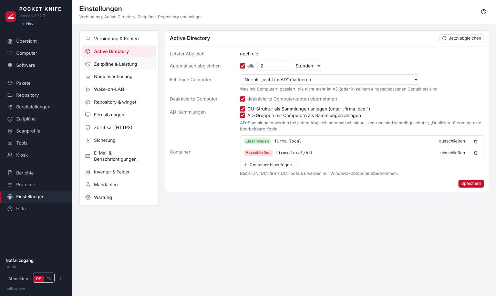

| Bereich | Inhalt |
|---|---|
| Verbindung & Konten | Domänendaten, LDAPS testen, **Abmelden bei Inaktivität**, **Dienstkonto** und optional ein Repository-Konto (vor dem Speichern geprüft, verschlüsselt gespeichert), **Anmeldeverfahren** NTLM/Kerberos mit Test |
| Active Directory | Container ein-/ausschließen (die nächstgelegene Regel gewinnt), Abgleich-Intervall, Umgang mit verschwundenen und deaktivierten Computern (Löschen erst, wenn ein Computer **seit 7 Tagen** im AD fehlt; ist kein Container eingeschlossen oder fehlen plötzlich fast alle Computer, wird nichts geändert), AD-Sammlungen |
| Zeitpläne & Leistung | Heartbeat, parallele Scans/Installationen, Zeitlimits, Aufbewahrung von Protokoll und Verlauf, [Benachrichtigung am Client](#toast), [Meldung bei Neustart](#rebootmsg) |
| Repository & winget | Repository-Pfad und Test, winget-Index, Standard-Bereich, [neue Versionen zurückstellen](#winget-release), automatische Nachinstallation von winget, Offline-Quellen, [Proxyserver](#proxy) |
| Fernsitzungen | Status von guacd, eigene Anmeldung, Tastaturlayout, aktive Sitzungen |
| Sicherung | automatische Sicherung (täglich und vor Updates), Anzahl Versionen, Jetzt sichern, Herunterladen |
| E-Mail & Benachrichtigungen | SMTP-Server mit Testmail, Benachrichtigungen bei Ereignissen (siehe [Benachrichtigungen](#alerts)) |
| Zertifikat (HTTPS) | Zertifikat der Weboberfläche: anzeigen, eigenes hochladen (PFX oder PEM), Anforderung (CSR) erstellen, Sicherungen, selbstsigniert neu erzeugen |
| Inventar & Felder | Scanprofile, benutzerdefinierte Felder (z. B. Inventarnummer, Raum) – auch direkt beim Computer unter **Benutzerdefinierte Felder** anlegbar; dort stehen außerdem freie **Notizen** je Computer (nur in POCKET KNIFE gespeichert, nie vom Computer überschrieben) |
| Mandanten | Mandanten mit eigener Sammlung, eigenem Repository-Ordner und optional [OU-Admins](#ou-admins) |
| Wartung | Status, Datenbankgröße und „Jetzt aufräumen“, AD-Abgleich und Heartbeat sofort, Verbindungstest, Darstellung, Sprache, [Diagnosepaket](#diagnostics) |

**Mandanten:** Pakete und Zeitpläne lassen sich einem Mandanten zuordnen. Hat der Mandant eine Sammlung, werden seine Pakete nur auf deren Computer verteilt. Hat er einen Repository-Ordner, dürfen seine Pakete nur Dateien aus diesem Ordner verwenden (wird beim Speichern geprüft).

## OU-Admins (Mandanten-Admins) {#ou-admins}

Soll ein Kollege nur einen Teil der Domäne betreuen, zum Beispiel die OU Hamburg, wird er **OU-Admin**:

1. Im AD eine Gruppe anlegen, z. B. `PK-OU-Hamburg`, und die Kollegen aufnehmen. Sie gehören **nicht** in die Gruppe der Hauptadmins (`POCKETKNIFE-Admins`).
2. **Einstellungen → Mandanten → Neuer Mandant**: unter **Computer** die Sammlung der OU wählen (eine automatisch angelegte AD-Sammlung oder eine dynamische Sammlung mit Filter „Distinguished Name / OU“), unter **OU-Admins** die Gruppe eintragen (**Wählen …** sucht im AD).
3. Optional **„dürfen eigene Pakete und Zeitpläne anlegen“** einschalten. Den **Repository-Ordner** legt POCKET KNIFE dann selbst an (`Mandanten\Hamburg`) – oder Sie tragen einen eigenen ein, z. B. `Kunden\Hamburg`. Optional ein **Speicherkontingent** in MB.

Danach melden sich die Mitglieder der Gruppe ganz normal an. Unten links steht „OU-Admin: Hamburg“.

| | Hauptadmins (`POCKETKNIFE-Admins`) | OU-Admins |
|---|---|---|
| Computer, Inventar, Software, Protokoll | alle | nur die Computer des Mandanten |
| Aktionen auf Computern (Dienste, Dateien, Fernsitzung, LAPS/BitLocker, Tools ausführen) | alle | nur eigene Computer |
| Pakete (zentrale, die anderer Mandanten und die ein Hauptadmin für den Mandanten angelegt hat) | ändern und verteilen | zentrale und die des eigenen Mandanten ansehen und auf eigene Computer verteilen – Pakete anderer Mandanten sind unsichtbar (ab 2.37); ändern nur die eigenen (siehe [Was gehört wem](#tenant-ownership); Kopie: nur, wenn es die Software nicht schon gibt – Duplikatsperre) |
| Repository | alles | nur der Ordner des Mandanten: hochladen, Ordner, umbenennen, verschieben, löschen (siehe [Repository](#repository)) |
| Eigene Pakete und Zeitpläne | – | nur mit Freigabe beim Mandanten; Dateien nur aus dessen Repository-Ordner; Befehls-/PowerShell-Schritte nur mit eigener Freigabe (siehe [Mandanten absichern](#tenant-security)) |
| Sammlungen | alle | die ihres Bereichs ansehen; eigene anlegen (mit Freigabe beim Mandanten) – enthalten nie mehr als die Computer des Mandanten |
| Zeitpläne | alle | eigene ändern; die des Hauptadmins für den Mandanten ansehen und ausführen; zentrale nur ansehen, nur mit eigenen Computern |
| Bereitstellungen | alle | nur mit eigenen Computern; abbrechen/wiederholen nur, wenn alle Ziele eigene sind |
| Berichte | alle, anlegen und ändern, per E-Mail | nur ansehen und als CSV, nur mit eigenen Computern |
| Einstellungen, Scanprofile, Kiosk-Verwaltung, E-Mail-Versand, Benachrichtigungen, Tools anlegen | ja | nein |

**Sicherheit:** Die Grenzen prüft der Server bei **jeder** Anfrage, nicht nur die Oberfläche. Für OU-Admins ist jede Funktion gesperrt, die nicht ausdrücklich freigegeben ist; fremde Computer werden wie nicht vorhanden behandelt. Ist jemand in beiden Gruppen, gilt Hauptadmin. Der Notfallzugang ist immer Hauptadmin. Mitgliedschaften werden bei der Anmeldung und danach automatisch alle 2 Minuten im Hintergrund neu geprüft – wer im AD aus der Gruppe entfernt wird, verliert den Zugang ohne weiteres Zutun; eine Änderung am Mandanten in POCKET KNIFE wirkt sofort. Welche Computer zur OU gehören, erfährt POCKET KNIFE beim AD-Abgleich (Einstellungen → Active Directory, Standard stündlich; „AD-Abgleich jetzt“ unter Wartung). Ein Mandant mit OU-Admins braucht immer mindestens eine Sammlung (ohne Sammlung gäbe es keine Computer – nie „alle“). **Mehrere Sammlungen** sind möglich (z. B. mehrere OUs, Standorte oder AD-Gruppen): Zusammen ergeben sie den Bereich des Mandanten. **Sammlungen sehen OU-Admins nur aus ihrem Bereich:** die ihres Mandanten samt Unterordnern, andere nur, wenn sie mindestens einen ihrer Computer enthalten (z. B. eine Ausnahme-Gruppe für Paket-Bedingungen), dazu die Standardsammlungen – nie die übrige Domäne und nie die Sammlungen anderer Mandanten.

Weitere Schutzregeln:

- Die Gruppe wird beim Speichern **eindeutig** im AD aufgelöst (erst über den Gruppennamen „sAMAccountName“, der im ganzen AD eindeutig ist) und mit ihrer **SID** gespeichert – das AD muss dafür erreichbar sein. Bei der Anmeldung zählt nur diese Gruppe: eine gleichnamige in einer anderen OU oder eine gelöschte und neu angelegte gibt nie Zugang; Umbenennen oder Verschieben schadet nicht. Ist ein Name mehrdeutig, bitte den vollständigen DN eintragen.
- Mandantenpakete laufen mit demselben Konto wie alle Pakete (ab 2.39: **Ausführung der Pakete**, Standard „Lokales System“). Wer dort auf „Dienstkonto“ umstellt, wird darauf hingewiesen, dass dann auch Pakete von Mandanten mit eigenen Paketen als Dienstkonto laufen. Deinstallationen mit dem Befehl aus der Registry des Computers laufen für alle – auch für Hauptadmins – nie als Dienstkonto, denn diesen Befehl bestimmt, wer auf dem Computer Administrator ist. Dateien aus dem Repository nur mit Repository-Ordner des Mandanten.
- Zeitpläne von OU-Admins: als Sammlung nur die des eigenen Mandanten und eigene Sammlungen. Ein Mandant, der einmal OU-Admins hatte, erreicht ohne Sammlung keinen Computer; Mandanten mit Zeitplänen lassen sich erst löschen, wenn diese umgehängt sind. Jede Änderung an Gruppe, Sammlung oder Rechten eines Mandanten beendet die Sitzungen seiner OU-Admins (sie melden sich neu an).
- Deinstallationsbefehle „für alle merken“, das zentrale VNC-Kennwort und der Kiosk über die OU-Admin-Anmeldung bleiben Hauptadmins bzw. Kiosk-Benutzern vorbehalten.

> **Empfehlung:** OU-Admins sind auf ihren Computern Administratoren. POCKET KNIFE meldet sich dort mit dem domänenweiten Dienstkonto an. Daher: Kerberos statt NTLM verwenden (Einstellungen → Verbindung), das Dienstkonto in die Gruppe „Protected Users“ aufnehmen (dann „Nur Kerberos“ – siehe [WinRM per Gruppenrichtlinie](#winrm-gpo)) und SMB-Signierung per GPO erzwingen. Wer noch strenger trennen will, nimmt je Standort eine eigene POCKET-KNIFE-Instanz mit eigenem Dienstkonto.

### Was gehört wem {#tenant-ownership}

Ein OU-Admin ändert nur, was ihm gehört – alles andere sieht er, damit er Bescheid weiß, kann es aber nicht verändern. So bleibt die Arbeit des Hauptadmins geschützt.

| | OU-Admin darf … |
|---|---|
| **Eigenes** (vom OU-Admin angelegt, kopiert oder importiert) | ändern, löschen, ausführen |
| **Vom Hauptadmin für den Mandanten** angelegte Pakete und Zeitpläne | ansehen, verteilen bzw. ausführen, **als Vorlage kopieren** – ändern nur, wenn der Hauptadmin beim Paket bzw. Zeitplan **„OU-Admins dürfen ändern“** einschaltet |
| **Zentrale** Pakete | ansehen, auf eigene Computer verteilen, als Vorlage kopieren |
| **Zentrale** Zeitpläne | nur ansehen (Badge „zentral“), nur mit den eigenen Computern; zu sehen nur, wenn sie mindestens einen davon erreichen. Starten und ändern nur Hauptadmins |
| **Sammlungen** des Hauptadmins (auch die des Mandanten selbst) | ansehen, als Kopie für den eigenen Bereich anlegen |
| **Berichte** | ansehen, ausführen, als CSV – nur mit eigenen Computern. Eigene Berichte anlegen, Mailversand und Benachrichtigungen nur Hauptadmins |

**Eigene Sammlungen** (nur, wenn beim Mandanten „eigene Pakete“ erlaubt ist): Ein OU-Admin legt dynamische und statische Sammlungen und Ordner auf der obersten Ebene oder in seinen eigenen Ordnern an. Egal, was die Regel sagt: Eine solche Sammlung enthält **nie mehr als die Computer seines Mandanten**. „Ist Mitglied von“ geht nur mit Sammlungen, die er sieht; statische Mitglieder nur aus seinen Computern. Andere Mandanten sehen sie nicht. Als Bereich eines Mandanten (Einstellungen → Mandanten) lässt sie sich nicht wählen – das bleibt eine Sammlung des Hauptadmins. Eine Sammlung, die einem Mandanten als Bereich zugeordnet ist, lässt sich nicht löschen.

**Nach dem Update auf 2.30:** Pakete und Zeitpläne, die ein OU-Admin bereits angelegt oder geändert hatte, erkennt POCKET KNIFE einmalig am Protokoll und lässt sie ihm. Alles andere gilt als vom Hauptadmin angelegt und ist für OU-Admins nur lesbar – bei Bedarf beim Paket bzw. Zeitplan „OU-Admins dürfen ändern“ einschalten.

### Mandanten absichern {#tenant-security}

Ein Mandant soll nur das auf seine Computer bringen, was in **seinem Repository-Ordner** liegt. POCKET KNIFE setzt das in drei Stufen durch:

**1. Dateien nur aus dem eigenen Ordner.** Installieren und Dateikopie holen Dateien bei Mandantenpaketen nur aus dem Repository-Ordner des Mandanten (`Mandanten\<Name>`). Andere Ordner, UNC-Pfade (`\\server\…`) und `..` lehnt der Server beim Speichern ab.

**2. Kein eigener Code ohne Freigabe.** Beim Mandanten gibt es unter „eigene Pakete“ den zusätzlichen Schalter **„dürfen dabei Befehls- und PowerShell-Schritte schreiben“** – standardmäßig **aus**. Dann gilt für OU-Admins:

| Erlaubt | Nicht erlaubt |
|---|---|
| Installieren (MSI, EXE, MSU, **auch .ps1/.cmd als Datei aus dem eigenen Repository-Ordner**), winget, Dateikopie, Registry, Deinstallieren (mit dem erkannten Befehl), Neustart, Nachricht, Warten, Scannen, verschachtelte Pakete | Schritte „Befehl“ und „PowerShell“, eigene Deinstallationsbefehle (im Paket und in der Software-Liste) |

Skripte gehören damit **als Datei ins Repository** – dort sieht und prüft sie die Bruchprüfung (Fingerabdruck) wie jede andere Installationsdatei. Schritte, die ein Hauptadmin geschrieben hat, darf ein OU-Admin unverändert lassen, aber nicht ändern oder neu anlegen. Bestehende Pakete laufen weiter.

**3. Was ein Mandantenpaket im Netz erreicht.** Mandantenpakete laufen auf dem Client mit dem Konto aus **Ausführung der Pakete** – standardmäßig **Lokales System** (ab 2.39 für alle Pakete gleich; die Einstellung „Dienstkonto“ würde auch Mandantenpaketen das Dienstkonto geben). Greift ein Skript oder Installer auf eine Freigabe zu, meldet es sich dort mit dem **Computerkonto** an (z. B. `FIRMA\PC-17$`). Es erreicht also nur, was für „Domänencomputer“, „Authentifizierte Benutzer“ oder „Jeder“ freigegeben ist.

> **Wichtig:** Jedes Installationsprogramm ist ausführbarer Code – auch eine MSI kann im Hintergrund auf Freigaben oder das Internet zugreifen. Die Stufen 1 und 2 legen fest, **woher** der Code kommt; was er **erreicht**, legen die Rechte im Netz fest (Stufe 3). Deshalb zusätzlich:

- **Freigaben prüfen:** Was nicht für alle Rechner gedacht ist, nicht für „Domänencomputer“, „Authentifizierte Benutzer“ oder „Jeder“ freigeben – auf der Freigabe **und** im NTFS. Auch das Repository braucht **keine** Rechte für „Domänencomputer“: POCKET KNIFE liest es mit dem Repository-/Dienstkonto und kopiert die Dateien selbst auf den Client – sonst könnte ein Mandantenskript die Dateien anderer Mandanten lesen.
- **Optional per GPO einschränken**, was Clients erreichen: *Computerkonfiguration → Richtlinien → Windows-Einstellungen → Sicherheitseinstellungen → Windows Defender Firewall mit erweiterter Sicherheit → Ausgehende Regeln* – ausgehendes SMB (TCP 445) nur zu den Dateiservern erlauben, die die Clients brauchen (z. B. Anmeldeskripte, Profile, Druckserver). Vorher in einer Test-OU ausprobieren: Domänencontroller (SYSVOL/NETLOGON) müssen immer erreichbar bleiben.
- **Hinweis beim Speichern:** Enthält ein Mandantenpaket in Befehlen, PowerShell oder Aufrufparametern Zugriffe auf Freigaben (`\\server\…`, `net use`, `New-PSDrive`) oder Downloads (`Invoke-WebRequest`, `curl`, `bitsadmin`, `https://` …), zeigt POCKET KNIFE nach dem Speichern einen Hinweis und schreibt ihn ins Protokoll. Das ist eine **Hilfe beim Prüfen, keine Sperre** – so etwas lässt sich umschreiben. In Skriptdateien im Repository wird nicht gesucht.


## Eigenes Zertifikat {#certificate}

POCKET KNIFE stellt HTTPS selbst bereit – ein Reverse Proxy ist nicht nötig. Beim ersten Start wird ein selbstsigniertes Zertifikat erzeugt; unter **Einstellungen → Zertifikat (HTTPS)** lässt es sich ersetzen. Ein neues Zertifikat ist **sofort aktiv** (ohne Neustart); das bisherige wird gesichert.

**Variante A – fertiges Zertifikat hochladen**

- **PFX / PKCS#12** (`.pfx`, `.p12`) mit Kennwort – enthält Zertifikat, Schlüssel und meist die Kette. Am einfachsten aus der Windows-Zertifikatverwaltung: *Exportieren → Ja, privaten Schlüssel exportieren*.
- **PEM / CER** (`.crt`, `.cer`, `.pem`, DER oder `.p7b`) plus Schlüsseldatei (`.key`, auch verschlüsselt). Zwischenzertifikate optional als eigene Datei.

**Prüfen** zeigt vorab, was installiert würde. Abgelehnt werden: Schlüssel passt nicht, abgelaufen bzw. noch nicht gültig, nicht für Serverauthentifizierung, RSA unter 2048 Bit. Hinweise gibt es, wenn `PK_PUBLIC_HOSTNAME` nicht im Zertifikat steht, Zwischenzertifikate fehlen oder es in weniger als 30 Tagen abläuft.

**Variante B – Anforderung (CSR) für die eigene Zertifizierungsstelle**

1. Namen eintragen (CN und alle Adressen, unter denen POCKET KNIFE aufgerufen wird) → **Anforderung erstellen**. Der Schlüssel entsteht in POCKET KNIFE und verlässt es nicht.
2. CSR herunterladen und einreichen, z. B. bei den Active-Directory-Zertifikatdiensten:

```
certreq -submit -attrib "CertificateTemplate:WebServer" pocketknife.csr pocketknife.cer
```

3. Das ausgestellte Zertifikat im Format **PEM / CER** hochladen – ohne Schlüsseldatei, der Schlüssel aus der Anforderung wird verwendet.

> Damit Browser dem Zertifikat ohne Warnung vertrauen, muss das Stammzertifikat der Zertifizierungsstelle auf den Arbeitsplätzen vertrauenswürdig sein (in einer AD-Umgebung mit Zertifikatdiensten ist das automatisch der Fall). Das aktuelle Zertifikat lässt sich über **Zertifikat herunterladen** z. B. für eine GPO exportieren.

**Zurücksetzen:** Aus einer der letzten fünf Sicherungen wiederherstellen oder ein neues selbstsigniertes Zertifikat erzeugen (z. B. nach Änderung von `PK_PUBLIC_HOSTNAME`). Die Dateien liegen unter `/data/tls` (`server.crt` mit Kette, `server.key`); wer mag, kann sie dort weiterhin von Hand ablegen und den Container neu starten.

## Kerberos statt NTLM {#kerberos}

POCKET KNIFE meldet sich mit dem Dienstkonto per **WinRM** (PowerShell) und **SMB** (Paketkopien, Repository) an. Standard ist **NTLM**. Microsoft hat NTLM abgekündigt; zukunftssicher ist **Kerberos**. Ab Version 2.6 ist Kerberos im Container enthalten und lässt sich ohne Neustart umschalten und vorher testen.

**Nicht betroffen:** LDAPS (einfache Anmeldung über TLS, kein NTLM) und die Anmeldung an der Weboberfläche. **Fernsitzungen per RDP** (guacd/FreeRDP mit NLA) verwenden weiterhin NTLM.

| Verfahren | Verhalten |
|---|---|
| NTLM (wie bisher) | WinRM und SMB nur per NTLM |
| Negotiate | Kerberos, wo möglich – sonst automatisch NTLM (z. B. bei Zugriff per IP-Adresse) |
| Nur Kerberos | kein NTLM-Rückfall; was nicht per Kerberos geht, schlägt mit Hinweis fehl |

**Voraussetzungen**

- Computer mit **vollständigem DNS-Namen** (z. B. `pc-0001.firma.local`, kommt aus dem AD-Abgleich). Kerberos funktioniert nicht mit IP-Adressen. Kurznamen ergänzt POCKET KNIFE um `PK_DOMAIN`.
- **Uhrzeit**: Docker-Host und Domänencontroller dürfen höchstens 5 Minuten auseinanderliegen (NTP auf dem Docker-Host).
- Docker-Host erreicht die Domänencontroller auf **Port 88** (TCP). Die DCs werden per DNS gefunden (`_kerberos._tcp.<domäne>`), sonst in der `.env` `PK_KDC=dc1.firma.local,dc2.firma.local` setzen.
- **Repository-Pfad** mit DNS-Namen, z. B. `\\fs01.firma.local\PAKETE` statt `\\fs01\PAKETE` oder einer IP.
- Das Dienstkonto braucht nichts Besonderes. Bei „Verschlüsselungstyp nicht unterstützt“: im AD „Dieses Konto unterstützt Kerberos AES 256-Bit-Verschlüsselung“ setzen und das Kennwort einmal neu vergeben.
- SPNs müssen **nicht** angelegt werden: Jeder Domänencomputer hat `HOST/<name>`, darauf werden `HTTP` (WinRM) und `cifs` (SMB) abgebildet – auch bei Samba-AD.

**Umstellung Schritt für Schritt**

1. Auf Version 2.6 oder neuer aktualisieren (das Image wird neu gebaut).
2. **Einstellungen → Verbindung & Konten → Anmeldeverfahren**: einen Computer wählen, „nur Kerberos“, **Testen**. Alle Schritte grün und „Der Client meldet: Anmeldung per Kerberos“ = bereit. Der Test ändert nichts an der aktiven Einstellung.
3. Verfahren auf **Negotiate** stellen und speichern – sofort wirksam, ohne Neustart.
4. Einige Tage beobachten (Scans, Bereitstellungen, Repository). Auf einem Client zeigt die Ereignisanzeige (Sicherheit, Ereignis 4624) beim Dienstkonto „Authentifizierungspaket: Kerberos“.
5. Auf **Nur Kerberos** stellen. Wer die Einstellung dauerhaft in der Konfiguration haben möchte: `PK_WINRM_AUTH=kerberos` in der `.env` und in der Oberfläche „wie .env“ wählen.
6. Später kann NTLM für das Dienstkonto per GPO eingeschränkt werden („Netzwerksicherheit: NTLM einschränken“ – zuerst im Überwachungsmodus).

Zurück auf NTLM: in derselben Auswahl „NTLM“ wählen und speichern.

**Typische Meldungen im Test**

| Meldung | Lösung |
|---|---|
| Kerberos-Bibliotheken fehlen | Image neu laden (`sudo sh update.sh`) |
| Kein KDC gefunden / nicht erreichbar | DNS-SRV-Einträge prüfen oder `PK_KDC` setzen; Firewall Port 88 |
| Uhrzeit weicht ab (Clock skew) | NTP auf dem Docker-Host einrichten |
| Kein Dienstprinzipalname (SPN) | Computer per DNS-Namen ansprechen, DNS-Eintrag und Computerkonto prüfen |
| Client meldet NTLM statt Kerberos | Name wird nicht als Domänencomputer erkannt – DNS-Namen prüfen |
| Message stream modified | Das Gerät unter der Adresse kann das Ticket nicht lesen: DNS-Eintrag zeigt auf ein anderes Gerät (veraltete Adresse, doppelter Name) oder die Vertrauensstellung des Computers ist defekt (`Test-ComputerSecureChannel -Repair` auf dem Client). Der Computer erscheint mit gelbem Punkt „nicht bestätigt“. |

**Eigene Kerberos-Konfiguration:** POCKET KNIFE erzeugt die `krb5.conf` aus `PK_DOMAIN` (Realm in Großbuchstaben, abweichend: `PK_KERBEROS_REALM`). Eine eigene Datei `/data/krb5.conf` hat Vorrang.

## Diagnosepaket {#diagnostics}

Unter **Einstellungen → Wartung → Diagnosepaket** erstellt POCKET KNIFE ein ZIP mit Protokoll, Statistiken und Einstellungen der letzten Tage (seit dem letzten Update oder 1–30 Tage, Standard 7). Damit lassen sich Fehler und Auffälligkeiten nachvollziehen, ohne Zugriff auf die Umgebung – z. B. zum Weitergeben an den Entwickler.

**Inhalt**

| Datei | Inhalt |
|---|---|
| `versionen.json`, `aenderungen.md`, `behobene_fehler.txt` | Versionsgeschichte, Änderungen seit der ältesten Version im Zeitraum, behobene Fehler |
| `LIESMICH.txt` | Zeitraum, Version, ob anonymisiert |
| `umgebung.json` | Version, Laufzeitumgebung, Anzahl Computer/Pakete/Sammlungen, Datenbankgröße, Zustand der Zeitpläne |
| `einstellungen.json` | Einstellungen ohne Kennwörter, Schlüssel und Keytab |
| `statistik.json` | Erfolgsquote je Paket, Exitcodes, häufigste Fehler, Scan-Dauer, Warnungen, Kiosk-Anfragen |
| `protokoll.csv`, `fehler.txt` | Protokoll des Zeitraums, Warnungen und Fehler gesondert |
| `bereitstellungen.csv`, `fehlgeschlagen.json` | Bereitstellungen; bei Fehlschlägen das Ende der Ausgabe (höchstens 3000 Zeichen je Schritt) |
| `scans.csv` | Scan-Läufe mit Dauer und Ergebnis |

Kennwörter, der Tresor, Sitzungen, Keytab und Zertifikate sind **nie** enthalten – auch nicht ohne Anonymisierung. Kennwörter in Befehlszeilen von Schritten und Ausgaben (z. B. `PASSWORD=…`, `net use … /user:konto kennwort`, `ConvertTo-SecureString '…'`) werden durch `***` ersetzt.

**Versionen:** Jede Zeile im Paket trägt die Version, unter der sie entstanden ist. `statistik.json` trennt den ganzen Zeitraum von der **laufenden Version** und zeigt Warnungen, Fehler und Ergebnisse je Version. Dazu kommen `versionen.json` (ab wann welche Version lief), `aenderungen.md` (Änderungen von der ältesten Version im Zeitraum bis heute) und `behobene_fehler.txt` (Fehler, die der Selbsttest bei jeder Version erneut prüft). Ein Fehler, der nur unter einer älteren Version auftrat, ist so als vermutlich behoben erkennbar. Nach einem Update empfiehlt sich der Zeitraum **Seit dem letzten Update**; die Karte zeigt, seit wann die laufende Version läuft. Die Versionsgeschichte wird seit 2.22 geführt, frühere Updates werden aus den Startmeldungen im Protokoll nachgetragen – noch ältere Einträge erscheinen als „vor 2.x“.

**Anonymisieren (Standard an):** Namen werden durch feste Platzhalter ersetzt – Computer `PC-001`, Benutzer `USER-001`, Server `SRV-001`, Personen `Person-001`, IP-Adressen `10.99.x.y`, MAC-Adressen `02:00:…`, Mailadressen `user01@firma.local`, Domäne `firma.local` / `FIRMA`, OUs und Gruppen ebenfalls. Gleiche Namen bekommen in jedem Paket denselben Platzhalter; Fehlerbilder bleiben so über mehrere Pakete vergleichbar. Kleine Zusätze zeigen, was für die Fehlersuche zählt, ohne den Namen preiszugeben: `-LANG` (länger als 15 Zeichen), `-UML` (Umlaute), `-SZ` (Sonderzeichen).

Die Zuordnung bleibt **nur in Ihrer Datenbank**. Nennt Ihnen jemand einen Platzhalter („bei PC-017 schlägt Schritt 2 fehl“), finden Sie unter **Platzhalter nachschlagen** den echten Namen; **Zuordnung herunterladen (CSV)** liefert die ganze Liste (wird protokolliert). Diese Datei nicht weitergeben.

> Software-, Paket- und Sammlungsnamen, Exitcodes und Fehlermeldungen von Windows bleiben lesbar – sie werden für die Auswertung gebraucht. Wer in Paketnamen oder eigenen Skripten Namen von Personen verwendet, prüft das Paket vor dem Weitergeben kurz (z. B. `fehler.txt`).

# Sicherheit und Datensicherung {#security}

- Anmeldung nur für Mitglieder der Zugriffsgruppe (auch verschachtelt); Sperre nach wiederholten Fehlanmeldungen.
- Weboberfläche per HTTPS, Cookies `HttpOnly`/`Secure`/`SameSite=Strict`, CSRF-Schutz, strenge Content-Security-Policy ohne externe Quellen.
- Kennwörter (Dienstkonto, Repository-Konto) liegen verschlüsselt in der Datenbank; der Schlüssel ist `/data/pocketknife.key`.
- Pakete laufen standardmäßig als Lokales System – auf den Clients liegt dann nie ein Kennwort. Nur wer unter **Ausführung der Pakete** ausdrücklich „Dienstkonto“ wählt (mit Sicherheitshinweis und Protokolleintrag), gibt das Dienstkonto-Kennwort für die Dauer eines Schritts an eine geplante Aufgabe; es wird als Parameter übertragen und landet nicht in der PowerShell-Protokollierung der Clients.
- **Schutz vor Kontosperre:** Lehnt das AD das Dienstkonto ab, pausiert POCKET KNIFE alle automatischen Zugriffe, bis die Ursache behoben ist („Prüfen & fortsetzen“). Das gilt für NTLM und Kerberos.
- **Fehlanmeldungen an der Oberfläche:** höchstens 8 je Benutzer und IP sowie 30 je IP in 15 Minuten – Schreibweisen wie `FIRMA\admin`, `x\admin` oder `admin@firma.local` zählen gemeinsam.
- **Abmeldung bei Inaktivität:** Ohne Maus- oder Tastatureingabe endet die Sitzung nach 30 Minuten (einstellbar 5–720 Minuten unter Einstellungen → Verbindung & Konten; abschalten lässt sie sich nicht). Eingaben in einer Fernsitzung zählen mit, automatische Aktualisierungen offener Seiten nicht. Kurz vorher erscheint ein Hinweis; offene Fernsitzungen werden mit beendet.
- **Repository-Server ändern:** Wer Server oder Freigabe des Repositorys ändert, bestätigt das mit dem Kennwort des Zugriffskontos – so geht die gespeicherte Anmeldung nie an einen vertippten oder fremden Server. Unterordner derselben Freigabe und eingebundene Ordner (`/repo`) brauchen keine Bestätigung.
- **Container ohne root:** Der Dienst läuft als Benutzer `pocketknife` (UID 10001, `PK_UID`/`PK_GID`), mit schreibgeschütztem Programmdateisystem, ohne Capabilities und `no-new-privileges`. Beim Start werden `/data` und `/backup` einmalig an ihn übergeben. Ein eingebundener Repository-Ordner muss für ihn lesbar sein.
- **Feste Versionen:** Python-Basis-Image (Version und Digest), Debian-Pakete und alle Python-Pakete sind exakt festgeschrieben (siehe [Update](#update)).
- **Laufende Sitzungen** werden im Hintergrund alle 2 Minuten gegen das AD geprüft – auch wenn der Benutzer gerade nichts klickt: Wer deaktiviert oder aus der Zugriffs- bzw. Mandanten-Gruppe entfernt wird, ist danach abgemeldet; wer zusätzlich in eine Mandanten-Gruppe oder in die Zugriffsgruppe kommt, bekommt den erweiterten Bereich; wer Rechte verliert (z. B. einen Mandanten), wird abgemeldet und meldet sich neu an – das beendet auch Fernsitzungen. Eine kurze Störung des AD meldet niemanden ab: Die Sitzung bleibt und wird nach einer Minute erneut geprüft. OU-Admins werden aber spätestens nach 30 Minuten ohne Bestätigung durch das AD abgemeldet. Fehlt die Zugriffsgruppe im AD (gelöscht, umbenannt, mehrdeutig), ist bis zur Korrektur niemand Hauptadmin (außer dem Notfallzugang) – das Protokoll meldet es. Abmelden beendet auch offene Fernsitzungen.
- **LDAPS-Zertifikat:** Das Zertifikat jedes Domänencontrollers wird beim ersten Kontakt gespeichert und **vor** dem Senden eines Kennworts verglichen. Eine Änderung (z. B. Zertifikatserneuerung) wird protokolliert; mit **strikt prüfen** (Einstellungen → Verbindung & Konten) wird die Verbindung bis zur Bestätigung abgelehnt. Mit `PK_LDAP_CA_FILE` (CA der Domäne als PEM, z. B. `/data/ca.pem`) wird das Zertifikat vollständig gegen die CA geprüft. Neue Installationen haben **strikt prüfen** ab 2.13 eingeschaltet; bei bestehenden Installationen bleibt die bisherige Einstellung – empfohlen ist, sie einzuschalten.
- **WinRM über HTTPS:** Mit `PK_WINRM_CA_FILE` (CA als PEM) wird das Zertifikat der Clients geprüft; ohne diese Variable wird es wie bisher nicht geprüft.
- **Anfragegröße:** Anfragen an die Oberfläche sind auf 2 MB begrenzt (Uploads im Explorer 2 GB, winget-Pakete 310 MB, Zertifikate und Paket-Import 20 MB).
- **Fehlermeldungen beim Anmelden** verraten nicht, ob Benutzername oder Kennwort falsch war oder nur die Gruppenmitgliedschaft fehlt; Details stehen im Protokoll.
- **Arbeitsordner auf den Clients** (`C:\Windows\Temp\PocketKnife`): Rechte nur für SYSTEM und Administratoren. Hat ein Benutzer den Ordner vorab selbst angelegt, wird er beiseitegeschoben und neu angelegt (Hinweis im Protokoll).
- **Repository als Ordner** im Container nur unter `/repo` (`PK_REPO_MOUNT`) – das Datenverzeichnis lässt sich nicht als Repository eintragen.
- CSV-Exporte entschärfen Werte, die Excel als Formel ausführen würde.

## Sicherung {#backup}

**Sicherung:** POCKET KNIFE sichert sich selbst – unter **Einstellungen → Sicherung**:

- **täglich** zur eingestellten Stunde (Standard 02:00) und **vor jedem Update** (beim ersten Start einer neuen Version, noch vor den Datenbank-Änderungen)
- **Versionen aufheben:** Standard 10; ältere Sicherungen werden automatisch gelöscht (auch manuelle und „vor Update“)
- **Jetzt sichern**, Liste mit Herunterladen und Löschen
- Inhalt je ZIP: die Datenbank (konsistente Kopie im laufenden Betrieb), `pocketknife.key` und das HTTPS-Zertifikat. Damit lassen sich auch gespeicherte Kennwörter wiederherstellen – den Sicherungsordner deshalb schützen.
- **Herunterladen** über die Oberfläche liefert die Sicherung **ohne** `pocketknife.key` und HTTPS-Schlüssel (Datenbank und Schlüssel bleiben getrennt). Nach einer Wiederherstellung damit Dienstkonto, Repository-Konto und VNC-Kennwort neu eintragen – oder die vollständige ZIP direkt aus dem Sicherungsordner auf dem Docker-Host nehmen.
- Ablage: `PK_BACKUP_PATH` aus der `.env` (Standard `<PK_DATA_PATH>-backup`, z. B. `/opt/pocketknife/data-backup`). Besser ein anderes Laufwerk oder eine eingebundene Netzwerkfreigabe; liegt der Ordner auf demselben Datenträger wie die Datenbank, weist die Seite darauf hin.

**Wiederherstellen:** `docker compose down` → im Datenverzeichnis `pocketknife.db-wal` und `pocketknife.db-shm` löschen → Inhalt der ZIP-Datei dorthin entpacken → `docker compose up -d`.

# Fehlersuche {#troubleshooting}

**Selbsttest:** `docker compose exec pocketknife python3 tools/selftest.py` prüft mit einer temporären Datenbank, dass bereits behobene Fehler nicht zurückgekehrt sind. Er verändert keine Daten.


| Meldung | Ursache / Lösung |
|---|---|
| LDAPS-Verbindung fehlgeschlagen | DC-Namen, Port 636, DNS-Server in der `.env` prüfen; LDAPS auf dem DC aktiv? |
| Dienstkonto gesperrt / 0xC0000234 | Konto im AD entsperren, Kennwort prüfen, dann „Prüfen & fortsetzen“ |
| Kein Zugriff: nicht Mitglied der Gruppe | Benutzer in die Zugriffsgruppe aufnehmen und neu anmelden |
| WinRM-Port nicht erreichbar | WinRM-GPO, Firewall, Computer eingeschaltet? |
| Zugriff verweigert | Dienstkonto ist nicht lokaler Administrator |
| Kopieren schlägt fehl | Port 445 / ADMIN$ auf dem Client, Leserecht auf der Repository-Freigabe |
| winget nicht gefunden | Automatische Nachinstallation einschalten oder Tool „winget prüfen / nachinstallieren“ |
| winget: „Keine passende Aktualisierung“ (`-1978335189`), obwohl eine neuere Version installierbar ist („A newer package version is available … but it does not apply“) | Das Paket gibt im winget-Katalog keinen Installationsbereich an (z. B. MobaXterm); mit festgelegtem Bereich lehnt winget die Aktualisierung ab. Ab 2.30.1 wiederholt POCKET KNIFE den Schritt dann einmal ohne `--scope` (ab 2.31 auch bei „No installed package found“, `-1978335212`, und das Entpacken mit tar.exe danach ebenfalls ohne). Dauerhaft: im Paket den Installationsbereich auf „Standard des Pakets“ stellen |
| winget: „Neuere Version vorhanden, aber mit anderer Installationstechnik“ (POCKET KNIFE-Code 9011) | Installiert ist z. B. die MSI-Version, im Katalog gibt es nur noch eine andere Installationsart (z. B. PowerShell 7) – winget aktualisiert das nicht („install technology is different“). Im Paket erst einen Schritt **Deinstallieren**, dann **Installieren**; oder bei „Zusätzliche Argumente“ `--force` (installiert die neue Version daneben, die alte bleibt und muss danach entfernt werden) |
| winget: „Neuere Version vorhanden, passt aber nicht zu diesem System“ (9012) | Die neue Version setzt laut winget-Katalog eine andere Architektur, Windows-Version oder andere Voraussetzungen voraus. Bisher meldete POCKET KNIFE das als „bereits aktuell“ |
| „Der Prozess wurde ohne Ergebnis beendet“ | Ab 2.31 steht der Grund dabei: Fehlermeldung von PowerShell, Sperre durch Defender (ASR-Regel „Prozesserstellungen durch PSExec- und WMI-Befehle blockieren“, nur wenn sie auf **Blockieren** steht – „Überwachen“ ist nie der Grund), Virenschutz-Fund, Absturz oder AppLocker, letzte Ausgabe. Tools als Dienstkonto (und Pakete aus Versionen vor 2.39) startet POCKET KNIFE als eigenen Prozess über WMI – blockiert eine Schutzsoftware das, das Tool auf „SYSTEM“ stellen |
| „… kann nicht geladen werden. Die Datei … ist nicht digital signiert“ | Eine GPO legt die Ausführungsrichtlinie fest (`Get-ExecutionPolicy -List` zeigt *MachinePolicy RemoteSigned*) und Windows hält die Datei für fremd (Sicherheitszonen, z. B. Intranet-/Sites-Zuordnung). Ab 2.32.2 lädt POCKET KNIFE dann den Inhalt der Datei – für alle PowerShell-Skripte, auch .ps1 aus dem Repository; die Meldung steht nur noch im Protokoll. Code 9013: Windows lehnt ein Skript ab, das dieses Skript selbst aufruft (das lädt POCKET KNIFE nicht nach, sonst liefe der Teil davor doppelt) – das aufgerufene Skript signieren, die Richtlinie prüfen (`Get-ExecutionPolicy -List`) oder seinen Inhalt in den Schritt übernehmen |
| Code 9014 / 9015 / 9016 | Windows ist gehärtet und verhindert die Ausführung: 9014 Virenschutz (AMSI) hat den Inhalt als schädlich eingestuft; 9015 PowerShell läuft im eingeschränkten Sprachmodus (AppLocker/WDAC) und das Skript braucht dort gesperrte Funktionen – den Arbeitsordner `C:\Windows\Temp\PocketKnife` in der Richtlinie zulassen oder den Computer ausnehmen; 9016 AppLocker oder Softwareeinschränkung hat ein Programm gesperrt (welches, steht im Protokoll) |
| Dienstkonto-Schutz wegen eines einzelnen Computers | Ab 2.31 prüft POCKET KNIFE bei „Kennwort falsch“ von einem Computer erst per LDAP, ob das Konto wirklich nicht geht. Ist es in Ordnung, betrifft der Fehler nur diesen Computer (meist ein falscher DNS-Eintrag: unter der Adresse antwortet ein anderes Gerät) – der Schutz bleibt aus |
| Hohe Rechenlast | **Einstellungen → Wartung → Rechenlast** zeigt den Durchschnitt, die Hintergrundaufgaben mit der meisten Rechenzeit und die letzten Spitzen mit dem, was gerade lief (Aufgaben, Scans, Bereitstellungen, Anfragen der Oberfläche) |
| Paketschritt als Dienstkonto startet nicht („Geplante Aufgabe als Dienstkonto konnte nicht angelegt werden“) | Kennwort des Dienstkontos unter Verbindung & Konten prüfen; das Dienstkonto braucht das Recht „Als Batchauftrag anmelden“ (Administratoren haben es standardmäßig) – oder **Ausführung der Pakete** auf „Lokales System“ stellen |
| Windows Update im Paket: „Zugriff verweigert“ (0x80070005) | Lief der Schritt über eine Netzwerkanmeldung (Pakete vor 2.39 als Dienstkonto). Ab 2.39 laufen Pakete als Lokales System bzw. das Dienstkonto mit lokaler Anmeldung – dann geht es |
| Eigener Befehl erreicht keine Freigabe | Als Lokales System meldet sich das Computerkonto an (z. B. `PC-0001$`): der Gruppe „Domänencomputer“ Leserecht geben oder die Datei per „Datei aus dem Repository“ kopieren lassen |
| Warnung „/repo ist nicht lesbar“ | Der Dienst läuft als UID 10001: auf dem Docker-Host `chmod -R o+rX` oder `chown -R 10001` auf den Repository-Ordner |
| PowerShell-Scanner liefert nichts | Scanner-Dialog → Testen; das Profil „PowerShell“ braucht einen Auslöser |
| Fernsitzung: guacd nicht erreichbar | Container `pocketknife-guacd` läuft? `docker compose up -d` |

# Datenschutz {#privacy}

POCKET KNIFE läuft vollständig in Ihrem Netz; Daten liegen nur unter `/data` auf dem Docker-Host (SQLite-Datenbank, Protokolldateien, Zertifikat, winget-Index).

| Was | Wozu | Wie lange |
|---|---|---|
| Inventar der Computer (Hardware, Software, Dienste, Netzwerk, lokale Administratoren, angemeldeter Benutzer) | Verwaltung, Berichte, Softwareverteilung | solange der Computer existiert; beim Löschen sofort weg |
| Daten aus dem Active Directory (Computer, Gruppen, OU) | Abgleich, Mandanten | bis zum nächsten Abgleich |
| Protokoll (wer hat wann was getan, mit Benutzername) | Nachvollziehbarkeit | Standard 90 Tage |
| Scan-Protokoll | Fehlersuche | Standard 14 Tage |
| Bereitstellungen samt Ausgabe, entschiedene Kiosk-Anfragen (Benutzername, Computer, Zeit) | Nachweis, Fehlersuche | Standard 180 Tage |
| Softwareänderungen | Verlauf | Standard 365 Tage |
| Sitzungen | Anmeldung | bis zum Ablauf |

Die Fristen stehen unter **Einstellungen → Zeitpläne & Leistung**. Kennwörter, Schlüssel, LAPS- und BitLocker-Werte liegen nur verschlüsselt in der Datenbank und erscheinen nie im Protokoll oder im [Diagnosepaket](#diagnostics).

**Was das Netz verlässt** – nur, was Sie einschalten: winget-Katalog und winget-Cache (`cdn.winget.microsoft.com` und die Hersteller), der App-Installer für Computer ohne winget (github.com), der Hinweis auf neue Versionen (github.com, einmal täglich, ohne Daten aus Ihrem Netz) und E-Mails an die eingetragenen Empfänger. Die Oberfläche lädt nichts aus dem Internet. Das Diagnosepaket wird nie verschickt – nur heruntergeladen, standardmäßig anonymisiert.

# Lizenz {#license}

Copyright (C) 2026 soleil0815 (helfi.space)

POCKET KNIFE ist freie Software unter der **GNU Affero General Public License, Version 3** (AGPL-3.0-only). Sie dürfen es nutzen – auch im Unternehmen –, weitergeben und ändern. Wer es verändert und weitergibt oder anderen über das Netzwerk zur Verfügung stellt, muss den geänderten Quellcode unter derselben Lizenz anbieten. POCKET KNIFE wird **ohne jede Gewährleistung** bereitgestellt.

- Quellcode und vollständiger Lizenztext: `https://github.com/soleil0815/pocketknife` (Datei `LICENSE`; im Container unter `/opt/pocketknife/LICENSE`)
- Mitgelieferte Fremdkomponenten behalten ihre eigenen Lizenzen, z. B. Apache Guacamole (Apache-2.0, `app/static/vendor/guacamole-LICENSE.txt`) und die Python-Bibliotheken (MIT, BSD, Apache-2.0, LGPL-3.0 – Liste in `requirements.lock`)

## Unterstützen {#support}

POCKET KNIFE ist kostenlos. Wer die Weiterentwicklung unterstützen möchte, kann einen Kaffee spendieren: **„Buy me a coffee“** unten in der Navigation (nur für Administratoren sichtbar) öffnet `https://buymeacoffee.com/soleil0815` in einem neuen Tab. Es wird dabei nichts aus dem Internet geladen, bevor Sie klicken.

# Glossar {#glossary}

| Begriff | Erklärung |
|---|---|
| ADMIN$ | administrative Freigabe `C:\Windows` eines Computers; POCKET KNIFE kopiert Paketdateien dorthin |
| App-Installer | Windows-Paket, das winget enthält |
| Heartbeat | Erreichbarkeitsprüfung aller Computer |
| LAPS | Verwaltung lokaler Administratorkennwörter durch das AD |
| LDAPS | verschlüsselter Zugriff auf das Active Directory (Port 636) |
| Produktcode | eindeutige GUID einer MSI-Installation |
| Scan-Alter | Zeit seit dem letzten erfolgreichen Scan eines Profils |
| WinRM | Windows-Fernverwaltung (PowerShell Remoting), Port 5985/5986 |
