% POCKET KNIFE – Manual
% Inventory and software deployment for Windows computers in an Active Directory domain

# Overview {#overview}

POCKET KNIFE is a web application that inventories the Windows computers in an Active Directory domain (Microsoft AD or Samba AD) and installs, updates and removes software on them. It runs as a Docker container; all data is stored in a SQLite database in the data directory `/data`. The interface loads nothing from the internet – no fonts, scripts or images from third-party servers.

Website: [helfi.space](https://helfi.space)

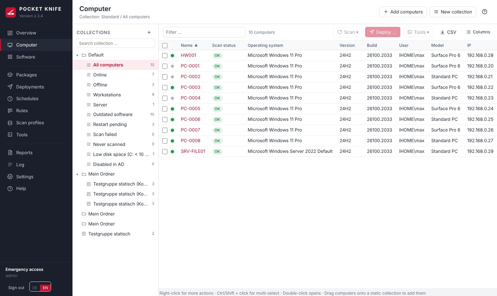

**How POCKET KNIFE works:**

- **Computers** are imported automatically from AD (sync over LDAPS).
- **Scan profiles** use WinRM to read what is installed on the computers and what hardware they have.
- **Collections** group computers – statically by hand or dynamically through filters (e.g. "Firefox outdated").
- **Packages** describe what runs on a computer: installations, commands, scripts, restarts …
- **Deployments** run a package on computers – immediately, at a set time, through **schedules** (packages or winget updates).
- **Tools** are quick one-off actions (ping, restart, gpupdate, custom scripts).

**Terms**

| Term | Meaning |
|---|---|
| Service account | Domain account with local administrator rights on the clients. POCKET KNIFE uses it for LDAPS, WinRM and SMB. |
| Repository | Network share (or mounted folder) containing your installation files. |
| winget | Microsoft's package manager; POCKET KNIFE matches installed software against the winget catalog and can install and update software through it. |
| Heartbeat | Regular check of which computers are reachable. |
| Tenant | Optional separation of packages and schedules, e.g. by customer or site. |

# Installation and Update {#install}

## Domain Prerequisites {#prereq}

1. Create a **service account**, e.g. `svc-pocketknife` (a regular user account whose password never expires).
2. Use a GPO to add the service account to the local **Administrators** group on all clients (*Computer Configuration → Preferences → Control Panel Settings → Local Users and Groups*).
3. Enable and secure **WinRM** through a GPO – step by step in [WinRM by Group Policy](#winrm-gpo).
4. In the client firewall, allow **TCP 5985** (or 5986 for HTTPS) and **TCP 445** **only from the Docker host**. For remote sessions, also allow **TCP 3389** (RDP) or **5900** (VNC).
5. Create the AD group **POCKETKNIFE-Admins** and add the operators (nested groups are supported).
6. **LDAPS** must be enabled on the domain controllers. A self-signed certificate is sufficient – POCKET KNIFE trusts it automatically and logs every change of the fingerprint.
7. For custom packages, create a share, e.g. `\\fs01\PAKETE`, with read access for the service account.

## Set up and secure WinRM by Group Policy {#winrm-gpo}

POCKET KNIFE works on the clients through **WinRM** (Windows Remote Management, PowerShell remoting): inventory, deployments, tools, file explorer and event viewer all use it. Nothing is installed on the client – which means WinRM has to be set up the same way and **securely** everywhere. The simplest and most traceable way is **a dedicated Group Policy** (e.g. "WinRM-Clients") linked to the OUs of the computers POCKET KNIFE should manage. This guide applies to Windows 10/11 and Windows Server 2016 and later; the names are those of the English Group Policy Management Editor.

> **Rule of thumb:** WinRM is only as secure as its settings. The policy makes sure that **only the POCKET KNIFE server** reaches port 5985/5986, that traffic is **always encrypted** and **only domain sign-in** (Kerberos/NTLM) is used, and that nobody weakens the settings locally.

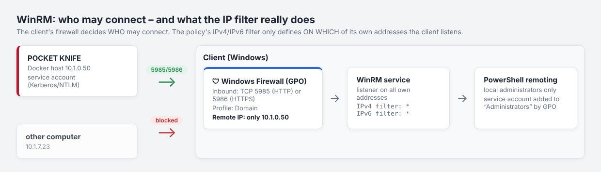

### Step 1: Create the Group Policy

1. Open **Group Policy Management** (`gpmc.msc`) → right-click the OU with the clients → **Create a GPO in this domain, and Link it here** → name e.g. `WinRM-Clients`.
2. Use a separate OU or policy for servers (different maintenance windows, WinRM often already enabled). Include **domain controllers** only deliberately and with a policy of their own.
3. For testing, link a small OU with a few computers first, check it (step 8), then roll it out.

All of the following settings are under **Computer Configuration → Policies**.

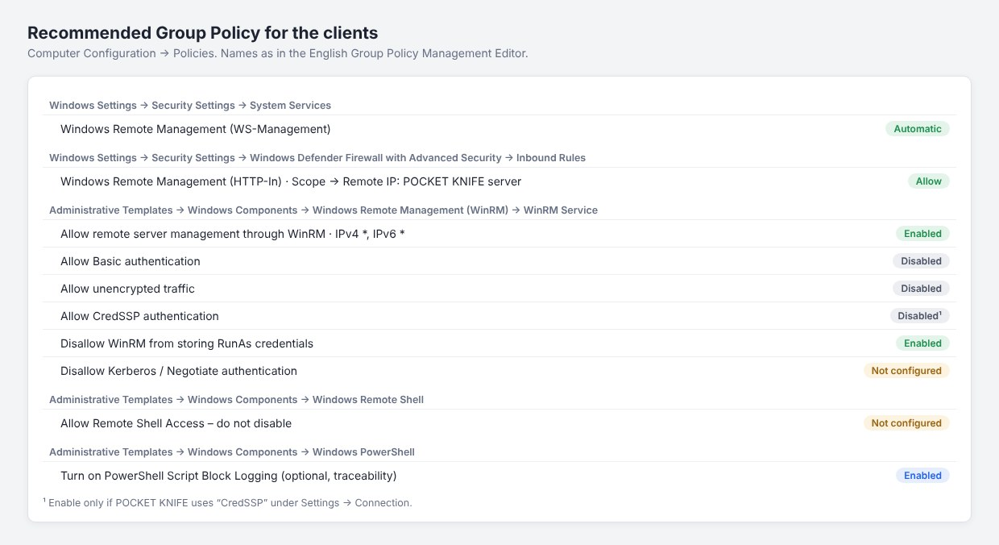

### Step 2: Start the service automatically

*Windows Settings → Security Settings → System Services → **Windows Remote Management (WS-Management)*** → "Define this policy setting" → **Automatic**. Do not change the permissions.

### Step 3: Enable the WinRM listener

*Administrative Templates → Windows Components → Windows Remote Management (WinRM) → WinRM Service → **Allow remote server management through WinRM*** → **Enabled**, IPv4 filter `*`, IPv6 filter `*`.

**Important – a common misunderstanding:** the IPv4/IPv6 filter defines **on which of the client's own addresses** WinRM listens – **not** which computers may connect. `*` is therefore correct (otherwise WinRM stops working after a DHCP address change). Who may connect is controlled by the firewall alone (step 4). An empty filter means: WinRM listens nowhere.

### Step 4: Firewall – only the POCKET KNIFE server may connect

*Windows Settings → Security Settings → **Windows Defender Firewall with Advanced Security** → Inbound Rules* → **New Rule**:

1. **Predefined** → "Windows Remote Management" → choose the rule **Windows Remote Management (HTTP-In)** (for HTTPS a **Port** rule for TCP 5986 instead) → **Allow the connection**.
2. Then open the rule → tab **Scope** → **Remote IP address: These IP addresses** → enter the address of POCKET KNIFE's **Docker host** (all of them with several instances). The clients see the Docker host's address, not the container's.
3. Tab **Advanced** → profile **Domain** only.

The same restriction is recommended for **TCP 445** (SMB: package copies via `ADMIN$`, file explorer) and – only if used – for **TCP 3389** (RDP) and **5900** (VNC). To prevent local administrators from opening ports themselves, set "Apply local firewall rules" to **No** under *Windows Defender Firewall Properties → Domain Profile → Customize settings* – check first whether applications need rules of their own.

### Step 5: Harden the WinRM service

In the same folder as step 3 (*WinRM Service*):

| Setting | Value | Why |
|---|---|---|
| Allow Basic authentication | **Disabled** | Basic sends user and password only Base64-encoded – POCKET KNIFE never needs it |
| Allow unencrypted traffic | **Disabled** | POCKET KNIFE encrypts also over HTTP 5985 (Kerberos/NTLM message encryption); unencrypted would only be a risk |
| Allow CredSSP authentication | **Disabled** – POCKET KNIFE does not use CredSSP | CredSSP passes the credentials on to the client; an attacker with administrator rights on the client could grab them |
| Disallow WinRM from storing RunAs credentials | **Enabled** | no stored passwords in WinRM plug-ins |
| Disallow Kerberos authentication / Disallow Negotiate authentication | **Not configured** | POCKET KNIFE signs in with these – enabling them locks it out |
| Turn On Compatibility HTTP/HTTPS Listener | **Not configured** | legacy ports 80/443, not needed |

Under *Windows Components → Windows Remote Shell* do **not disable** **Allow Remote Shell Access**: it also blocks PowerShell remoting – POCKET KNIFE can then no longer reach the clients.

The *WinRM Client* folder only affects connections that **originate** from the client (e.g. an admin PC with `Enter-PSSession`). It does not matter for POCKET KNIFE; "Disallow Digest authentication" and "Allow Basic authentication: Disabled" do no harm there and are good hardening. Do not set "Trusted Hosts" to `*` – that turns off verification of the remote side with NTLM.

### Step 6: Who may sign in?

By default WinRM only admits **local administrators** (and the group "Remote Management Users"). POCKET KNIFE needs administrator rights; the service account is added to the local group **Administrators** by Group Policy (see [prerequisites](#prereq)), preferably through a domain group, e.g. `PK-Clientadmins`.

- Do **not** set `LocalAccountTokenFilterPolicy`: it is only needed for local accounts and weakens UAC protection for remote access.
- Do not change WinRM's permissions (SDDL) by policy – the firewall (step 4) and the Administrators group are enough.

### Step 7: Choose the authentication method

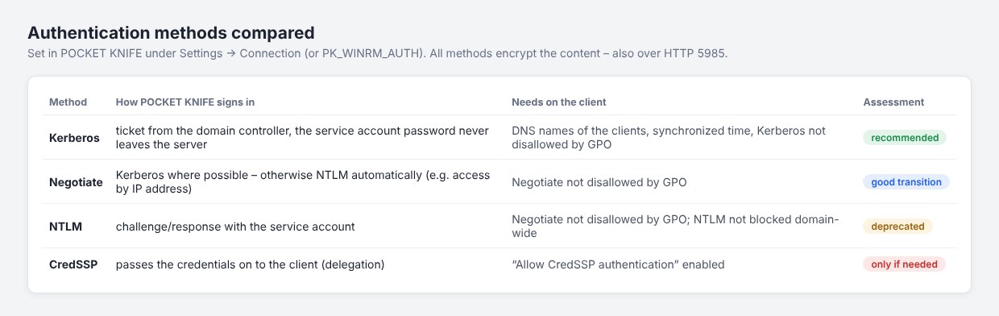

In POCKET KNIFE under **Settings → Connection & accounts → Authentication method**. For new installations: **Negotiate**, and after a few days **Kerberos only** (see [Kerberos instead of NTLM](#kerberos)). Notes:

- **Kerberos** needs the computers by **DNS name** (comes from the AD sync), synchronized time and port 88 to the domain controllers. SPNs do not have to be created.
- If the service account is a member of **"Protected Users"** – highly recommended – **NTLM and CredSSP are blocked for the account**. POCKET KNIFE must then be set to "Kerberos only", the repository must be given with its DNS name and the account must support AES ("This account supports Kerberos AES 256 bit encryption"); otherwise sign-ins fail. Remote sessions via RDP with the service account then do not work (they use NTLM).
- POCKET KNIFE does **not** support **CredSSP** (any more): it would pass the service account's password to every client. Packages do not need it – POCKET KNIFE copies installation files to the client itself.

### Optional: WinRM over HTTPS (5986)

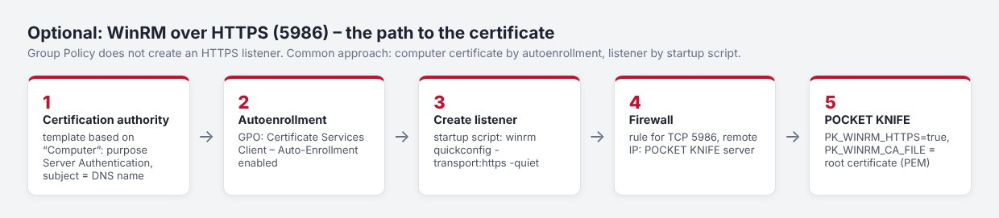

Over HTTP (5985) the content is already encrypted. HTTPS additionally protects the sign-in itself and proves the client's identity to the server by certificate – useful in networks with high protection requirements. Group Policy cannot create an HTTPS listener; the usual way:

1. In the certification authority, a certificate template based on "Computer" with purpose **Server Authentication**, subject = DNS name; Read and Enroll for "Domain Computers".
2. Group Policy: *Windows Settings → Security Settings → Public Key Policies → Certificate Services Client – Auto-Enrollment* → **Enabled**, tick "Renew expired certificates …" and "Update certificates …".
3. Listener by **startup script** (*Windows Settings → Scripts → Startup*), e.g. `winrm quickconfig -transport:https -quiet` – it uses the matching computer certificate. After a certificate renewal the listener must get the new certificate (run the script again or recreate the listener).
4. Firewall rule for **TCP 5986** as in step 4.
5. In POCKET KNIFE (`.env`): `PK_WINRM_HTTPS=true` and `PK_WINRM_CA_FILE=/data/winrm-ca.pem` (root certificate of the CA in PEM format) – POCKET KNIFE then verifies the clients' certificates.

### Optional: logging

- *Windows Components → Windows PowerShell → **Turn on PowerShell Script Block Logging*** – the event log "Microsoft-Windows-PowerShell/Operational" (event 4104) then shows which commands ran via WinRM. That is valuable for traceability; keep in mind that POCKET KNIFE's scripts and those of your packages appear there too (do not write passwords into package scripts).
- "Microsoft-Windows-WinRM/Operational" shows connections and errors, the Security log (event 4624, logon type 3) the service account's sign-ins with the method (Kerberos/NTLM).
- These logs are suitable for central collection (Windows Event Forwarding or a SIEM).

### Step 8: Check

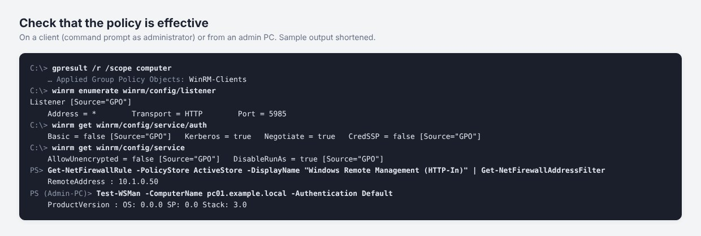

1. On a client: `gpupdate /force`, then `gpresult /r /scope computer` – the policy must be listed under "Applied Group Policy Objects".
2. `winrm enumerate winrm/config/listener` – a listener with `Source="GPO"`; `winrm get winrm/config/service` – `AllowUnencrypted = false`, under `auth` `Basic = false`, each with `[Source="GPO"]`.
3. Firewall: `Get-NetFirewallRule -PolicyStore ActiveStore -DisplayName "Windows Remote Management (HTTP-In)" | Get-NetFirewallAddressFilter` shows the allowed remote address.
4. From **another** computer: `Test-NetConnection pc01 -Port 5985` must **fail** (the firewall works).
5. In POCKET KNIFE: **Settings → Maintenance → Test connection** with a computer name (WinRM, administrator rights, ADMIN$) and **Authentication method → Test**.

### Common errors

| Message / behavior | Cause and fix |
|---|---|
| Timeout, "WinRM connection failed" | firewall: rule missing, wrong profile (network not recognized as "Domain") or wrong remote IP (enter the Docker host's address) |
| "The WinRM client cannot process the request" / connection refused | no listener: the policy from step 3 is not applied or the IPv4 filter is empty |
| 401 / access denied | the service account is not a local administrator, or the authentication method is blocked on the client (Kerberos/Negotiate "disallow" enabled, CredSSP not allowed) |
| Kerberos: "no SPN", "server not found" | access by IP address or short name, DNS record missing or pointing to another computer |
| Worked, stopped after adding to "Protected Users" | NTLM/CredSSP are blocked for the account – switch to "Kerberos only" |
| "The service is configured to not accept any remote shell requests" | *Windows Remote Shell → Allow Remote Shell Access* was disabled – set it back to "Not configured" |

## System requirements and sizing {#sizing}

**Docker host**

- Linux (e.g. Debian 12/13 or Ubuntu 22.04/24.04), 64-bit (amd64 or arm64), VM, physical or a NAS with Docker
- Docker Engine 24 or newer
- **SSD storage** for the data directory (`PK_DATA_PATH`) – the SQLite database writes many small changes during scans
- Domain DNS (`PK_DNS_1`), network access to the clients (WinRM 5985/5986, SMB 445, for remote sessions 3389/5900), the domain controllers (LDAPS 636) and the repository share
- Internet is optional: only for the winget index (`cdn.winget.microsoft.com`) – or upload the index offline; clients download winget packages themselves

**Clients:** Windows 10/11 or Windows Server 2016–2025 with PowerShell 5.1, WinRM enabled, service account as local administrator. winget from Windows 10 1809 / Server 2019.

**Guideline values by environment size**

> These values are estimates based on the program's architecture (one process, SQLite, parallel WinRM connections), not measured in large environments. Start small, watch **Settings → Maintenance** and `docker stats`, and increase as needed.

| Computers | vCPU | RAM (total, incl. guacd) | Storage (SSD) | Parallel scans / installations | Heartbeat |
|---|---|---|---|---|---|
| up to 250 | 2 | 2 GB | 10 GB | 6 / 8 (default) | 5 min |
| 250 – 1,000 | 2 – 4 | 4 GB | 20 GB | 10 / 12 | 5 min |
| 1,000 – 3,000 | 4 | 8 GB | 40 GB | 15 – 20 / 15 – 25 | 10 min |
| 3,000 – 5,000 | 8 | 16 GB | 80 GB | 20 – 30 / 25 – 40 | 15 min |
| more than 5,000 | – | – | – | several instances (e.g. per site/tenant) | – |

Parallel scans and installations and the heartbeat interval are set under **Settings → Inventory** (scans, heartbeat) and **Settings → Packages & Repository → Installations** (changes to parallelism take effect after restarting the container).

**What the resources are used for**

| Area | Requirement |
|---|---|
| Database | roughly 0.5 – 2 MB per computer (software, services, hotfixes, processes, hardware, tasks, history). 1,000 computers ≈ 1 – 2 GB. Shorter retention (log, scan log, deployments) keeps it small. |
| winget index | about 0.5 – 1 GB in the data directory, plus some RAM while it is being read |
| Scans | the work runs on the client; the server mostly waits for WinRM. A full scan takes about 20 – 60 s per computer – with 6 parallel scans roughly 400 – 1,000 computers per hour. More parallelism = faster, but more RAM and more load on DCs and network. |
| Heartbeat | checks with 48 parallel connections; a switched-off computer costs up to about 4.5 s. With many computers choose a longer interval so one run finishes before the next starts. |
| Deployments | repository files flow **through the Docker host** to the client (read SMB → write ADMIN$). 100 computers × 500 MB = 50 GB of network traffic via the host – for large packages plan 1 Gbit/s or more, limit parallelism or use winget (clients then download themselves). |
| Remote sessions (guacd) | about 50 – 150 MB RAM per concurrent RDP/VNC session and noticeable CPU when the picture moves; 10 concurrent sessions ≈ 1 – 1.5 GB and 1 – 2 vCPU extra |

**Tips for large environments**

- Stagger scans with **scan profiles**: the full profile e.g. weekly, "Applications" daily; "Scan age" instead of a fixed time spreads the load.
- Schedules with a **time window** and heartbeat instead of all computers at once.
- Adjust retention under **Settings → Maintenance → Retention & database** (log, scan log, deployments).
- Optionally limit resources in Compose, e.g. `mem_limit: 8g` and `cpus: 4` for the `pocketknife` service.
- **Backup:** put the automatic backup (Settings → Backup) on another drive (`PK_BACKUP_PATH`) and plan about the database size (compressed usually much less) × number of versions.

**Database cleanup:** Old entries are deleted every hour – log (default 90 days), scan log (14 days), deployments including output (180 days; the same period applies to decided kiosk requests with user name and computer), software changes (365 days), expired sessions and leftovers without a reference. The periods are set under **Settings → Maintenance → Retention & database**. Once a day (default 3:00 AM) the **database maintenance** follows: update statistics, write back the WAL file and – if more than 20 % of the file is free – `VACUUM`, which shrinks the file. Size, free share and the last maintenance are shown under **Settings → Maintenance**; **Clean up now** starts the maintenance immediately. Deleted computers lose their inventory data at once, their kiosk requests at the next cleanup. The log files under `/data/logs` rotate at 10 MB (at most 10 files); no period in days applies to them.

## Installation {#setup}

This guide takes you step by step from an empty Docker host to the first sign-in. It applies to any Docker host running Linux: a VM, a server or a NAS with Docker. The [prerequisites in the domain](#prereq) should be in place; you can set up WinRM on the clients ([via Group Policy](#winrm-gpo)) afterwards – installation and the first sign-in do not need it yet.

POCKET KNIFE consists of two containers: **pocketknife** (program and web interface) and **pocketknife-guacd** (remote sessions in the browser). One file, `docker-compose.yml`, starts both; everything you configure goes into the `.env` file next to it.

### Step 1: Prepare the Docker host

- **Docker Engine 24 or newer with Docker Compose v2** – check with `docker version` and `docker compose version`. Processor amd64 (x86_64) or arm64; Docker pulls the matching image.
- **A fixed IP address and a DNS name** for the host, e.g. `pocketknife.firma.local` (A record in the domain's DNS). You will open the interface under this name; the kiosk with Windows sign-in needs exactly this name.
- **Time in sync** with the domain (NTP) – otherwise Kerberos and certificate checks fail.
- **Storage:** the data directory on an SSD (size see [System requirements](#sizing)), backups preferably on another drive.
- **Network:** the Docker host must reach the following (inbound only port 8443 from the operators' workstations):

| Target | Port | Purpose |
|---|---|---|
| DNS servers of the domain | 53 TCP/UDP | resolve names of computers and domain controllers |
| Domain controllers | 636 TCP (LDAPS); 88 TCP/UDP with Kerberos | sign-in, AD sync |
| Clients | 5985 TCP (5986 with HTTPS), 445 TCP | inventory, deployments, files |
| Clients (optional) | 3389 TCP (RDP), 5900 TCP (VNC) | remote sessions |
| File server with the repository | 445 TCP | installation files |
| Internet (optional) | 443 TCP | ready-made image (`ghcr.io`), winget index (`cdn.winget.microsoft.com`), notice of new versions (`api.github.com`) |

It also works without internet: load the images from the release archive (see [Update](#update)) and upload the winget index offline.

### Step 2: Create the folder and files

Everything lives in **one** folder, e.g. `/opt/pocketknife` (on a NAS e.g. `/volume1/docker/pocketknife`). Only three files go there – the program itself lives in the image. The easiest way is to take them from the image of the newest version (with a private registry first once `sudo docker login ghcr.io -u <GitHub user>`, password = token with `read:packages`):

```bash
mkdir -p /opt/pocketknife && cd /opt/pocketknife
sudo sh -c 'docker pull ghcr.io/soleil0815/pocketknife:latest && docker run --rm --entrypoint sh ghcr.io/soleil0815/pocketknife:latest -c "cd /opt/pocketknife/host && tar cf - ." | tar xf -'
cp .env.example .env
```

Alternatively download `docker-compose.yml`, `env.example` (save it as `.env.example`) and `update.sh` in the browser from the release (checksums in `pocketknife-<version>.sha256`).

Afterwards the folder looks like this – `data/` and `data-backup/` are created at the first start:

```
/opt/pocketknife/
├── docker-compose.yml     starts both containers – not edited
├── .env.example           template
├── .env                   your settings
├── update.sh              update by hand (optional)
├── data/                  database, logs, certificate, key
└── data-backup/           automatic backups
```

> **Important:** `docker-compose.yml` and `.env` must be in the **same folder** – the compose file reads the `.env` from there. Please do not change the `docker-compose.yml`: your values belong in the `.env`, your own additions in a `docker-compose.override.yml`.

### Step 3: Fill in the .env

Open the `.env` (e.g. `nano .env`). Every line has the form `NAME=value`, without spaces around the `=`; lines starting with `#` are comments. **These values must be right:**

| Variable | Example | Meaning |
|---|---|---|
| `PK_DOMAIN` | `firma.local` | DNS name of the domain. The AD search base and the sign-in name (`user@firma.local`) are derived from it. |
| `PK_NETBIOS` | `FIRMA` | NetBIOS name of the domain (for `FIRMA\account`). |
| `PK_DNS_1` | `10.0.10.5` | IP address of a **DNS server of the domain** (usually a domain controller) – not the router and not a public DNS, otherwise POCKET KNIFE cannot find the computers. |
| `PK_DNS_2` | `10.0.10.6` | Optional: a **second, different** DNS server. If there is only one, leave it empty or delete the line. |
| `PK_LDAP_SERVERS` | `dc1.firma.local,dc2.firma.local` | Domain controllers with LDAPS, comma-separated. Empty = `PK_DOMAIN`. |
| `PK_ACCESS_GROUP` | `POCKETKNIFE-Admins` | AD group whose members may use POCKET KNIFE (nested groups count). |
| `PK_PUBLIC_HOSTNAME` | `pocketknife.firma.local` | DNS name of the Docker host from step 1 – used in the certificate. |

**These values are usually right but can be adjusted:**

| Variable | Default | When to change? |
|---|---|---|
| `PK_DATA_PATH` | `/opt/pocketknife/data` | another folder, e.g. on a NAS `/volume1/docker/pocketknife/data`. A relative path (`./data`) starts at the folder of `docker-compose.yml`. |
| `PK_BACKUP_PATH` | `<PK_DATA_PATH>-backup` | backups better on another drive or a mounted share. |
| `PK_PORT` | `8443` | if the port is already in use on the host. |
| `PK_TIMEZONE` | `Europe/Berlin` | another time zone. |
| `PK_WINRM_AUTH` | `ntlm` | can be switched and tested later in the interface (Kerberos is recommended, see [Kerberos instead of NTLM](#kerberos)). |
| `PK_REPO_MOUNT` | empty | only if the software repository is mounted as a folder on the host (in the container `/repo`). Otherwise enter a UNC path in the interface later, e.g. `\\fs01.firma.local\PAKETE`. |
| `PK_UID` / `PK_GID` | `10001` | only if mounted folders must belong to a specific user (e.g. on a NAS with share permissions). |
| `PK_BREAKGLASS_USER` / `PK_BREAKGLASS_PASSWORD` | empty | emergency access without AD – only if needed, with a long random password. |

**The service account** (`PK_SERVICE_USER`, `PK_SERVICE_PASSWORD`) does **not** belong in the `.env`: delete the two lines and enter the account after the first sign-in under **Settings → Connection & Accounts** – it is checked there and stored encrypted. The first sign-in does not need it.

All other variables are explained in `.env.example`; schedules, parallelism, retention, repository and winget are set in the interface.

### Step 4: Start

```bash
cd /opt/pocketknife
docker compose up -d      # pulls the image, starts both containers
docker compose ps         # "healthy" after about 1 minute
```

After about a minute `docker compose ps` shows "healthy" for **pocketknife** and "Up" for **pocketknife-guacd**. If the image is in a private registry, run `docker login ghcr.io -u <GitHub user>` once beforehand (password = token with `read:packages`).

On first start POCKET KNIFE creates `data/` and `data-backup/`, the database, the key for stored passwords and a self-signed certificate (`data/tls/`). If `docker compose ps` does not show "healthy", the log shows why:

```bash
docker compose logs -f pocketknife   # Ctrl+C ends the display
```

Optionally run the built-in self-test (takes a few minutes, does not change your data):

```bash
docker compose exec -T -e HOME=/nonexistent pocketknife \
  python3 -I /opt/pocketknife/tools/selftest.py | tail -n 1
```

**Image:** the default is the ready-made image `ghcr.io/soleil0815/pocketknife:latest` (plus `…/pocketknife-guacd:latest`). To stay on a version: `sudo sh update.sh <version>`. Without internet: the archive from the release, see [Update](#update).

### Step 5: First sign-in

1. Open `https://pocketknife.firma.local:8443` in the browser (your `PK_PUBLIC_HOSTNAME` and `PK_PORT`). The first time, the browser warns about the self-signed certificate – confirm; upload your own certificate later under **Settings → Security → Certificate (HTTPS)** (see [Your own certificate](#certificate)).
2. Sign in with an AD account from the access group – as `user`, `FIRMA\user` or `user@firma.local`. DNS and LDAPS are enough for this; the service account is not needed yet.
3. Continue with the [first steps](#firststeps): enter the service account, sync the AD, test the connection to a computer, set up the repository.

### With a container manager (NAS, Portainer, Dockhand …)

Container managers use the same `docker-compose.yml`. What matters:

- **Create the project from the folder:** first create the folder from step 2 with `docker-compose.yml` and a filled-in `.env`, and select it as the project or stack folder ("use existing docker-compose.yml"). If the compose file is only pasted into an input field, the tool often stores it in a folder of its own – then the `.env` is missing there (error `env file … not found`): put the `.env` into exactly that folder.
- **Use absolute paths**, e.g. `PK_DATA_PATH=/volume1/docker/pocketknife/data` – then it is clear where the data lives.
- **Permissions:** in the container the service runs as the user with ID 10001. On a normal Linux server it takes over the data and backup folders itself at start. A mounted repository folder (`PK_REPO_MOUNT`) must be **readable** for it. On a NAS with share permissions of its own (e.g. Synology) that is not enough – see the next section.
- **Port:** if 8443 is taken (e.g. by another application on the NAS), change `PK_PORT`.
- **Updates:** simply through the container manager, preferably at night (see [Update](#update)). Before a new version starts, POCKET KNIFE backs up the database itself.
- **Older Compose versions** (as shipped with some NAS packages) report duplicate DNS entries as an error. Since 2.30 the second DNS server is truly optional; with an older `docker-compose.yml` use the current one (see step 2).

### On a NAS (e.g. Synology) {#setup-nas}

A NAS checks **its own access rights** on its shares (Synology: permissions in File Station). It does not know a user with ID 10001 – POCKET KNIFE may then not write to its data folder and stops at start with "Start abgebrochen – Benutzer 10001:10001 darf hier nicht schreiben" (start aborted – user may not write here). The remedy: POCKET KNIFE runs as **a user of its own on the NAS**.

1. **Create the folders**, e.g. in the share `docker`: `pocketknife` with the subfolders `data`, `data-backup` and – only if the installation files are on the NAS – `repo`. POCKET KNIFE creates the subfolders **inside** `data` (`tls`, `logs` …) itself; please do not create them by hand.
2. **Create a user** (Synology: Control Panel → User & Group → Create), e.g. `pocketknife`: no administrator, long random password, deny all applications, read/write on the share `docker`.
3. **Folder permissions** (File Station → right-click → Properties → Permission → Create, each time "apply to this folder, sub-folders and files"): user `pocketknife` with **read and write** on `data` and `data-backup`, with **read** on `repo`.
4. **Find the IDs:** via SSH `id pocketknife` → e.g. `uid=1027(pocketknife) gid=100(users)`.
5. **In the `.env`** (absolute paths on the NAS volume – otherwise the data ends up on the system partition):

```
PK_DATA_PATH=/volume1/docker/pocketknife/data
PK_BACKUP_PATH=/volume1/docker/pocketknife/data-backup
PK_REPO_MOUNT=/volume1/docker/pocketknife/repo
PK_UID=1027
PK_GID=100
```

`PK_REPO_MOUNT` only if the installation files are on the NAS (then repository path `/repo` in the interface); if they are on a Windows file server, leave the line out and enter the UNC path there.

6. **Create the project** (Synology: Container Manager → Project → Create, path `/volume1/docker/pocketknife`, use the existing `docker-compose.yml`) and start it.

> **Tip:** giving the group "Everyone" write access to `data` works too, but is not recommended – the database and the key for stored passwords are in there.

### Common installation errors {#setup-errors}

| Message or behaviour | Cause and solution |
|---|---|
| `set PK_DNS_1 in the .env (DNS server of the domain)` | `PK_DNS_1` is missing – or the `.env` is not next to `docker-compose.yml`. |
| `env file …/.env not found` | There is no `.env` in the project folder – see container manager above. |
| `services.guacd.dns array items[0,1] must be unique` | Older Compose version and a `docker-compose.yml` before 2.30 with only one DNS server: use the new `docker-compose.yml` (or set `PK_DNS_2` to a second, different DNS server). |
| `port is already allocated` / `address already in use` | The port is in use on the host: change `PK_PORT`. |
| `denied`, `unauthorized` or `not found` when pulling the image | For a private registry run `docker login ghcr.io` first; otherwise check the Docker host's internet access or proxy. |
| Container keeps restarting, log shows "Start abgebrochen – Benutzer … darf hier nicht schreiben" (older versions: `PermissionError … /data/…`) | The service may not write to the data folder. NAS (e.g. Synology): see [On a NAS](#setup-nas). Linux server: `chown -R 10001:10001` on `PK_DATA_PATH` and `PK_BACKUP_PATH`, or use a local folder instead of a network share. Do not create subfolders in `data` by hand. |
| Page not reachable | Open the port in the host's firewall; use `https://` (not `http://`). |
| Sign-in fails although the password is right | Account not in `PK_ACCESS_GROUP`; UPN suffix different from `PK_DOMAIN` (then use `FIRMA\user`); LDAPS (636) not active on the DCs or blocked; `PK_DNS_1` does not point to the domain's DNS. `docker compose logs pocketknife` shows the exact reason. |
| Computer "cannot be resolved" | `PK_DNS_1`/`PK_DNS_2` are not DNS servers of the domain. After changing the `.env`: `docker compose up -d` (applies the new values). |

## Update {#update}

From 2.33 you update POCKET KNIFE like any other container – the program lives completely in the image, the host only holds `docker-compose.yml`, `.env` and the data. **Before a new version starts, POCKET KNIFE backs up its database itself** (backup "vor-<version>", see [Backup](#backup)) and then extends it if necessary – no matter who swapped the image.

**With a container manager (recommended):** Dockhand, Watchtower, Tugtainer & co. update both containers (`pocketknife` and `pocketknife-guacd`) as soon as a new image is available. Preferably set the update time to **night** – a restart in the middle of a deployment interrupts it (POCKET KNIFE cleans up afterwards, see [Restart during a deployment](#deploy-restart)). Once a month on patch day (the second Tuesday) a security update is published (`<version>-s<n>`: same program, updated packages).

**By hand** in the folder with the `docker-compose.yml`:

```bash
sudo sh update.sh               # newest version (or the one pinned in the .env)
sudo sh update.sh 2.33.1        # a specific version – pinned in the .env
sudo sh update.sh latest        # back to "always the newest"
```

`update.sh` remembers the running images, pulls the new ones (POCKET KNIFE and guacd), starts and waits for the health check. If the new version does not start, it offers to start the previous one again – without a download. If the new image brings a newer `docker-compose.yml`, it puts it in place and keeps the previous one as `docker-compose.yml.alt`. It unpacks nothing and builds nothing. `-y` answers all questions with "yes". It also works without the script: `docker compose pull && docker compose up -d`.

**docker-compose.yml:** it changes only rarely. If a new version needs a newer file, POCKET KNIFE shows main admins **⚠ Notice** in the sidebar – a `sudo sh update.sh` then puts it in place (if you only use a container manager, take it from the image as during installation). Since 2.33 guacd comes as `ghcr.io/soleil0815/pocketknife-guacd` – the same official version, checked by POCKET KNIFE and published with the security updates; the file no longer has to change for it.

**Stay on a version or go back:** `sudo sh update.sh <version>` (or in the `.env` `PK_IMAGE=ghcr.io/soleil0815/pocketknife:<version>` and `PK_GUACD_IMAGE=ghcr.io/soleil0815/pocketknife-guacd:<version>`, then `docker compose up -d`). If the newer version already extended the database, restore the backup "vor-<newer version>" (see [Backup](#backup)). If an older version starts on a database that a newer one has already used, POCKET KNIFE says so in the sidebar.

**Without internet:** every release contains an archive of both images per platform (`pocketknife-<version>-amd64.tar.gz`, `-arm64.tar.gz`, checksums in `pocketknife-<version>.sha256`). Copy it to the Docker host and run `sudo sh update.sh pocketknife-<version>-amd64.tar.gz` – it checks the checksum (the `.sha256` must be in the same folder, otherwise it stops), loads the images (`docker load`), pins the version in the `.env` and starts.

**Private registry:** log in once on the Docker host as the user running the updates (root with `sudo`, the container manager's user otherwise): `docker login ghcr.io -u <GitHub user>`, password = **personal access token** with `read:packages`. The token is not stored in the `.env`.

**Where the images come from:** for every version GitHub (workflow `.github/workflows/release.yml`) builds the image for amd64 and arm64, runs the self-test in both, checks both with **Trivy** for known vulnerabilities and only then publishes it, together with guacd under its own name; additionally once a month on patch day (the second Tuesday) with updated packages ("Security update (patch day)").

### Switching from an installation with the program ZIP (up to 2.32) {#update-migrate}

Up to 2.32 the program ZIP was unpacked on the host. That is no longer needed – switch like this:

1. Take the new `update.sh` from the image and run it once (the old one does not know the new way – it would build locally as before) – it switches to the ready-made image, puts the new `docker-compose.yml` in place (the old one stays as `docker-compose.yml.alt`) and removes the update helper of 2.32.9–2.32.12 if it was set up:

```bash
cd /opt/pocketknife
sudo sh -c 'docker pull ghcr.io/soleil0815/pocketknife:latest && docker run --rm --entrypoint cat ghcr.io/soleil0815/pocketknife:latest /opt/pocketknife/host/update.sh > update.sh.neu && sh update.sh.neu'
```

Everything in one command as root: if pulling the image fails (e.g. `denied` – then first `sudo docker login ghcr.io -u <GitHub user>`), nothing else happens. At the end the new script puts itself in place as `update.sh`; `--cleanup` removes the file `update.sh.neu`.

2. Clean up – shows what can go and asks:

```bash
sudo sh update.sh --cleanup
```

Only known program files of earlier versions are deleted (`app/`, `tools/`, `Dockerfile`, `.pk-vorher/`, old ZIPs, version folders like `pocketknife-2.24/` …) and the folder `data/update/` of the former helper. **Never** database, backups, repository, `.env` or `docker-compose.yml` – not even if a folder points to them through a link or data is still inside a version folder. Afterwards `docker-compose.yml`, `.env`, `update.sh` and your data folders remain.

3. From now on update with the container manager or `sudo sh update.sh`, as you like.

## First Steps {#firststeps}

1. **Settings → Connection & Accounts**: enter the service account and click "Check & save", then "Test LDAPS".
2. **Settings → Active Directory**: include or exclude containers and click "Sync now".
3. **Settings → Maintenance → Test connection** with a computer name (WinRM, administrator rights, ADMIN$).
4. **Settings → Packages & Repository**: enter the repository path; under **Settings → Updates & versions → winget** click "Load index now".
5. Computers are now scanned automatically as soon as they are online (profile "Default").

# Using the Interface {#ui}

## Navigation and Language {#navigation}

The left side lists the sections Overview, Computers, Software, Packages, Deployments, Schedules, Scan profiles, Tools, Kiosk, Reports, Log, Settings and Help. At the bottom left, **DE / EN** switches the interface language and **☀ / ☾** switches between light and dark mode; both apply to this browser. "As system" can be restored under **Settings → Maintenance → Appearance**.

To change the width of the collection tree (and the report list), drag its right edge; double-click the edge = default width.

Almost every page has a **?** at the top right that jumps directly to the matching chapter of this help.

## News and updates {#news}

After an update, a discreet **New** appears below the version number at the top left – with security updates **New · Security** with a red dot. One click opens the news: short points per version, marked as **Security**, **New**, **Improved** or **Fixed** (security always at the top). Afterwards the hint disappears; the news remains available via **News** in the same place. POCKET KNIFE remembers per user what they have seen – anyone who missed several updates sees all of them since. All details remain in the CHANGELOG.

**New version available** (main admins only): the POCKET KNIFE server checks GitHub for the newest release once a day – never the browser, and through the proxy server if one is set. If there is a newer version, it shows **↑ 2.28.1 available** (red if it contains security updates). The click shows its news and how to update (container manager or `sudo sh update.sh`, see [Update](#update)); it is logged once. Also here, as **⚠ Notice**: a `docker-compose.yml` that is too old, or a database already used by a newer version.

Settings under **Settings → Maintenance → News and updates**:

| Field | Meaning |
|---|---|
| Check | ask once a day for new versions (can be switched off) |
| Repository | GitHub repository with the releases, e.g. `soleil0815/pocketknife` (or your own fork) |
| Read token | only for a private repository: fine-grained token with read access to the repository ("Contents: Read"). Stored encrypted, never shown, never in the diagnostics package |
| Check now | ask immediately; the status shows the result or the reason (token invalid, repository not found, no connection) |

Without internet access or without a token nothing happens – no error in the interface.

## Tables {#tables}

All lists work the same way:

- **Sort:** click the column header.
- **Move columns:** drag the column header with the mouse – onto the left half of a column = before it, onto the right half = after it. Or in the **Columns** button drag the row by ⠿ or use ▲▼ (left/right) – handy on small screens when the table scrolls sideways.
- **Show/hide columns:** **Columns** button – the window stays open for several changes; "Show all", "Reset" (order, visibility and widths).
- **Column width:** drag the right edge of the column header (content that is too long is shortened with …); **double-click** the edge = automatic width again.
- **Filter:** ▾ in the column header – by values (checkboxes) or text; "(Empty)" and "(Not empty)" are also available. Active filters are indicated by the "Reset column filters" button.
- **Search:** the "Filter …" field above the table searches all columns.
- **Selection:** click selects, **Ctrl**+click adds, **Shift**+click selects a range, **Ctrl+A** selects all. **Double-click** opens.
- **Right-click** shows all actions for the selection.
- **Copy a value:** right-click a cell → **"Copy <column>"** copies the full value – even if it is cut off in the table (e.g. the uninstall command in the software list). With several selected rows all values are copied, one per line. This works in every table.

The browser remembers column order, widths, hidden columns and sorting for each view.

## Keyboard Shortcuts {#keys}

| Key | Action |
|---|---|
| Ctrl+A | select all |
| Del | delete selection (with confirmation) |
| Ctrl+C | copy names of the selection (computer list) |
| Ctrl+H | heartbeat for the selection (computer list) |
| Ctrl+X / Ctrl+C / Ctrl+V | cut / copy / paste collection (collection tree) |
| F2 | rename collection |
| Esc | close dialog or menu |

# Computers and Collections {#computers}

## Computer List {#computerlist}

The **collection tree** is on the left, the computers of the selected collection on the right. A green dot indicates that a computer is online. **Right-click** one or more computers to access: Details, Scan ▸ profile, Heartbeat, Deploy, Tools ▸, Remote Desktop, Add to collection ▸, Remove from collection, Copy name, CSV, "Scanning allowed" and Delete.

Clearing "Scanning allowed" blocks automatic scans for a computer (e.g. for sensitive servers); manual scans remain possible.

**Yellow dot – address not confirmed:** POCKET KNIFE only shows a computer as online if this very computer answers at its address. For a new address (and at the latest after 24 hours) it asks the computer via WinRM for its name and domain. If another device answers (e.g. because DHCP has meanwhile given a switched-off PC's address to a printer or phone), a device outside the domain, or – at a previously different address – a device without WinRM, the computer counts as offline. The dot turns yellow, the computer view names the reason (e.g. “At 10.0.10.77 ‘PRINTER-3F’ answers instead of PC-0004”) and offers “Check again now”. Scans and deployments do not run then – they would hit the wrong device. The built-in collection **“Wrong address”** lists all affected computers; the column “DNS address” (can be shown) displays the currently resolved address.

The cause is almost always an outdated record in the domain's DNS. Remedy: switch the computer on (it registers again), correct the record and permanently enable **DNS scavenging** on the domain controllers. Settings: **Settings → Network & remote access → Name resolution**:

- **DNS cache (min.):** how long a resolved address is valid in POCKET KNIFE; **“Flush DNS cache”** discards all immediately (0 = resolve anew at every heartbeat).
- **Query DNS directly:** ask the domain's DNS servers (default: the domain controllers) directly – bypassing caches on the Docker host. “Test resolution” shows the result and warns if the system returns a different address.
- **Check identity** (on by default) and **Confirm again after (hrs.)**. Devices with a problem are asked again at most hourly; “Check again now” or a manual heartbeat checks immediately.

## Collections {#collections}

There are three types:

- **Folders** structure the tree.
- **Static collections** contain computers selected by hand. You can **drag** computers from the list onto a static collection.
- **Dynamic collections** populate themselves through filters on all scan data.

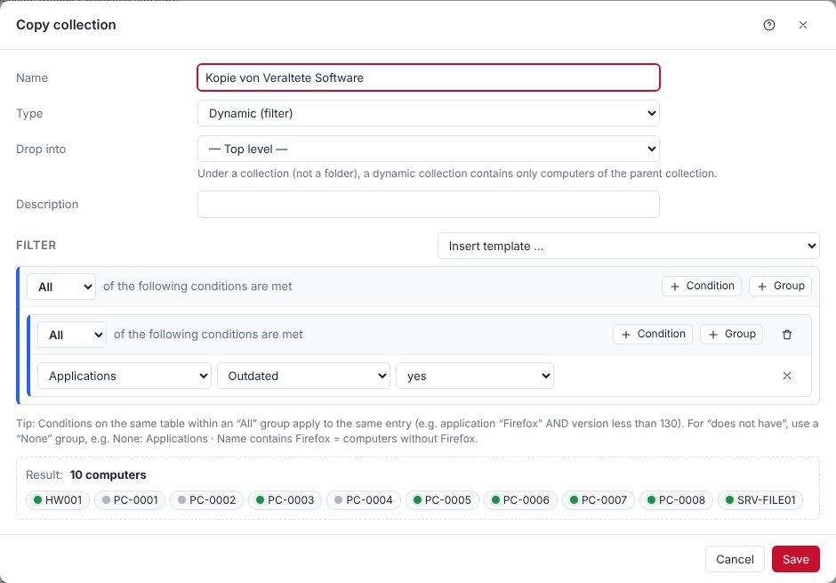

Filters consist of nested groups: **All** (AND), **Any** (OR), **Not all**, **None**. Conditions on the same table within an *All* group refer to the **same** entry.

**Example – "7-Zip missing or outdated"**

```
Any
├── None:   Applications · Name · starts with · 7-Zip
└── All:    Applications · Name · starts with · 7-Zip
            Applications · Version · Version less than · 24.08
```

**Example – "Windows 10 with low disk space"**

```
All
├── Computer · Operating system · contains · Windows 10
└── Disks · Disk · is · C:   and   Disks · Free (GB) · less than · 15
```

A dynamic collection *under* another collection (not under a folder) contains only computers that are also in the parent collection.

**Shortcut – straight from the inventory:** Right-click an entry (e.g. a program, printer, service or hotfix in the computer view, a program in the software overview, a cell in the computer list, or a value on the *General* page such as model or operating system) → **Create dynamic collection**. The options include:

- for programs at the top **"name" installed** and **"name" not installed** – the collection gets a matching name right away, e.g. "PdfCraft installiert" / "PdfCraft nicht installiert" in German or "PdfCraft installed" / "PdfCraft not installed" in English (no prefix like "Applications:"). If the name contains a version number, this applies to any version (`7-Zip*`); "Computers with exactly …" uses the full name,
- *Computers with "name"* – for programs also **any version** (the name without the version number as a pattern, e.g. `7-Zip*`), one specific version or **older than** that version,
- the clicked column (e.g. a printer's driver) on its own or together with the name,
- *Computers without …* (group *None*),
- with several entries selected: with at least one, with all, or without these entries.

The normal collection dialog then opens with the finished filter – adjust name, location and conditions before saving.

**Usage:** Right-clicking in the tree offers Open, Edit, New ▸, Duplicate, Scan collection, Heartbeat, Deploy, Tools, Report, Cut/Copy/Paste, Rename and Delete. Dragging moves a collection; holding **Ctrl** copies it. Default and AD collections are read-only and fixed in place – they can only be expanded and collapsed, not dragged; "Duplicate" or Copy/Paste creates an editable copy.

**Delete protection:** a collection that is still used by another collection (filter "Member of"), a schedule, scan profile, tenant, custom report, report mailing or notification cannot be deleted – the message names where it is used. The same applies to custom fields. Circular references (A refers to B, B to A) are rejected when saving.

**Collections that build on each other:** Up to 12 references in a row are possible (collection A is “member of” B, B of C … – child collections count too); within one collection up to 10 levels of filter groups are possible – both are counted separately. When saving or moving, POCKET KNIFE also checks all collections that build on the changed one: if one of them would stop working, nothing is saved and the message names the affected collection. This way no scan profile or schedule silently loses its targets.

**Regular expressions** in filters: at most 200 characters; nested repetitions such as `(a+)+` or `(a|b)*` and backreferences are not allowed because they can slow evaluation down dramatically.

## Update status for Windows and Office {#updstatus}

**From 2.40.** POCKET KNIFE shows for every computer whether Windows and Office are up to date – **without a fixed target**: every installation is compared with the newest state of **its own** Windows build or Office channel. Windows 11 24H2 with the latest patch for build 26100, Office LTSC 2024 with the newest LTSC 2024 state, Microsoft 365 Apps in the Monthly Enterprise Channel with the newest state of that channel.

| Status | Meaning |
|---|---|
| current | same or newer state than the reference |
| outdated | a newer patch has been out longer than the grace period |
| out of support | version or product is out of support according to the Microsoft lifecycle (e.g. Windows 10, Office 2016/2019/2021) |
| unknown | no data yet (not scanned) – always for MSI Office, because its patches are single KBs |
| no Office | no Office found |

**Reference:**
- **Windows:** build and patch level (UBR, e.g. 26100.7171) from the scan. With **Microsoft comparison** the server fetches the patched builds of the last patch days from Microsoft (Security Update Guide, MSRC) once a day – with their release date. In addition, the newest state that occurs in your own environment counts (from the day it first appears). Without internet access on the server only the latter applies.
- **Office (Click-to-Run):** version and update channel from the registry; compared with the newest version of the same channel in the environment. **MSI Office** (e.g. Office 2016 volume licence) comes from the software list.
- **Grace period** (default 7 days, adjustable): a new patch only counts afterwards – until then computers with the previous state still count as current.

**Ready-made collections:** under **Windows Updates** (Workstations → Windows 11/10 → per version, Server → per version, each with "Current" and "Outdated", plus "Out of support" and "Restart pending") and **Microsoft Office** (per product with "Current"/"Outdated", "Office out of support", "No Office installed"). They fill themselves from the inventory; a new Windows version or Office product gets its own node at the first scan. Known versions are shown even without computers ("0"). The collections cannot be changed, but copied (right click) and used as targets for schedules and deployments.

**Fields for own collections:** Computer → "Windows update status", "Windows edition", "Office update status"; table **Office installations** (product, version, update channel, update status, type, support until). On the computer page update status and Office are under "Operating system", the Office installations under **Office**.

**Settings → Updates & versions → Update status:** grace period, Microsoft comparison, ready-made collections on/off, **Recalculate now**. Computed after every scan and once a day. The lifecycle data (end of support) is built into the program and comes with updates.

## AD Collections {#adcollections}

If enabled under **Settings → Active Directory**, the sync creates the OU structure under an entry named after the domain, plus a "Groups" folder with all AD groups that contain computers. POCKET KNIFE maintains these collections itself; in the tree they can only be expanded and collapsed, not moved.

## Computer View {#computerview}

Double-clicking a computer opens its detail view. The categories are on the left (Computer, Applications, Hardware, Services, Disks, Network Adapters, Scans, Deployments …), the data on the right. The overview shows the operating system, hardware, security (Defender, BitLocker, TPM, firewall) and scan status.

**Signed-in users (from 2.32.6):** Next to each signed-in user it shows whether the session is **locked** (lock screen) or **disconnected** (Remote Desktop closed or user switched – their programs keep running). Without a note the session is active. For online computers POCKET KNIFE queries this live when the view opens, otherwise the last scan applies; the computer list shows it in the "User" column. It is based on `quser` (disconnected) and the lock screen process in the session (locked); on Windows Home without `quser`, "disconnected" is not available.

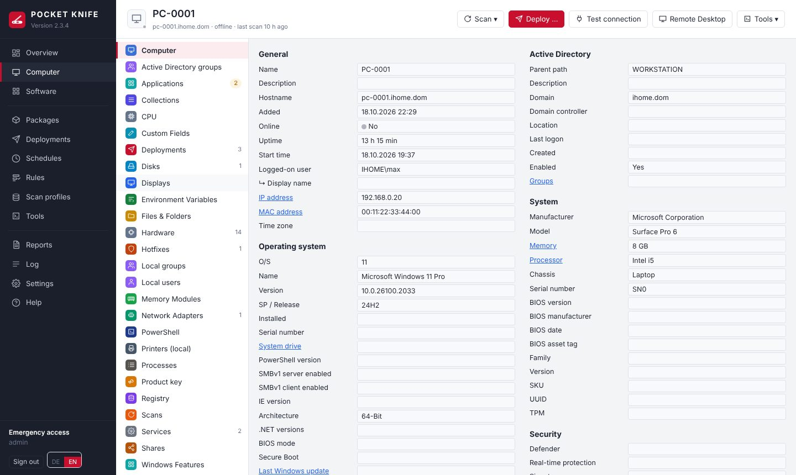

Actions directly on the computer:

| Where | Action |
|---|---|
| Applications | Update (winget), Uninstall now, Create uninstall package (right-click) |
| Services | Start, Stop, Restart, Change startup type |
| Processes | Load live and end |
| Overview → Passwords & Keys | Show LAPS password and BitLocker recovery key (every retrieval is logged) |
| Header | Scan, Deploy, Test connection, Remote Desktop, VNC (from 2.39.6), Tools |

# Scan Profiles and Scanners {#scanning}

## Scan Profiles {#profiles}

A scan profile defines **what** is scanned (scanners), **on which computers** (targets: collections and/or individual computers) and **when** (triggers). Built-in profiles are included for each scanner (Active Directory, Applications, Computer Details, Disks, Displays, Environment Variables, Files & Folders, Hardware, Hotfixes, Memory Modules, Network Adapters, PowerShell, Printers, Registry, Services, Shares, Users & Groups, Windows Features, Scheduled Tasks, WMI, Disk space), as well as **Default**.

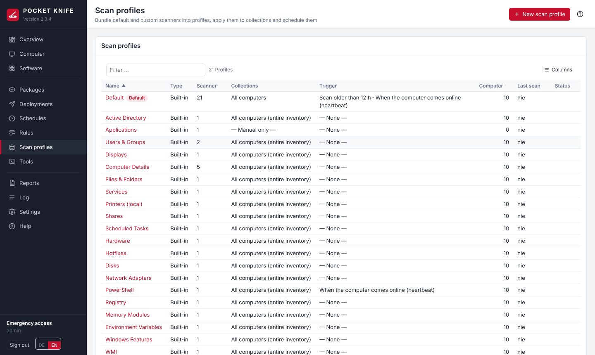

- Built-in profiles cannot be deleted and their scanners cannot be changed; **triggers and targets** can be configured freely. For custom combinations, use **Duplicate**.
- **Targets** (tab in the profile): **All computers**, any collections (including dynamic ones) and/or **individual computers**. The collections appear grouped by folder and in alphabetical order, like the tree on the left (Default, AD, your own folders); **Search collection** filters across all folders, **selected only** shows the selected ones, and they are listed at the top for removal. Collapsed folders show how many are selected inside. The same applies to the targets of schedules. Target computers are the members of the selected collections plus the individually selected ones. New profiles initially target "All computers". Without a target, a profile only runs manually (Scan → choose profile). The **Computers** tab shows which computers the profile currently covers.
- **Default** contains all scanners except Files & Folders, PowerShell, Registry, WMI and Disk space. New computers are scanned with it the first time they come online.
- **Disk space** (optional scanner): determines the folder sizes of the fixed drives as a chart – like the "Analyse disk space" tool, but schedulable. Deliberately **not** in the standard scan because it puts more load on the client; schedule it specifically with its own trigger (e.g. monthly, at night) and collections. The depth is set under **Settings → Inventory**; results appear on the computer under **Disk space** and in the chart.
- After every installation or uninstallation, the **Applications** profile runs automatically (can be changed in the package).

**Triggers**

| Trigger | Meaning |
|---|---|
| Once | at a fixed point in time |
| Interval | every n minutes/hours/days |
| Daily / Weekly / Monthly | at a time of day on specific days |
| Scan age | as soon as the last scan is older than a given period, optionally only within a time window |
| Heartbeat | as soon as a computer is (back) online – from 2.32.8 only a few minutes later (default 3, **Settings → Inventory → Scan after startup**), so that network, services and sign-in are ready. This applies to all automatic scans of a computer that has just started or woken up; manual scans run immediately |

"Catch up on offline computers" scans computers that were offline at the scheduled time as soon as they come online.

## Custom Scanners {#customscanners}

Under **Scan profiles → Custom scanners** you create scanners of type Registry, Files & Folders, WMI or PowerShell. Each custom scanner runs in the built-in profile of its type (e.g. "PowerShell") and additionally in your own profiles. The result appears on the computer in the category of the same name. If there are several scanners, pick one at the top from the **drop-down list** (or ‹ ›) or show them all with "All scanners"; the selection is remembered per category. **Test** runs a scanner immediately on a computer and shows the result.

> **Important:** The built-in "PowerShell" profile initially has no trigger. To run custom PowerShell scanners regularly, set a trigger there (e.g. daily) – or add the scanner to a custom profile that has a trigger.

**Examples**

| Type | Input | Result |
|---|---|---|
| Registry | `HKLM:\SOFTWARE\Firma\Agent` | all values of the key |
| Files & Folders | `C:\Program Files\Firma\*.exe` | size, date, file version |
| Files & Folders | `%SYSTEMDRIVE%\Users\*\ntuser.dat` | one entry per user profile |
| WMI | `SELECT Name, EstimatedChargeRemaining FROM Win32_Battery` | battery level |
| PowerShell | see below | one row per output object |

```powershell
# Version and path of a company application
Get-ItemProperty HKLM:\SOFTWARE\Firma\App | Select-Object Version, InstallPath

# Last boot as text
"Last boot: " + (Get-CimInstance Win32_OperatingSystem).LastBootUpTime

# Local administrators
Get-LocalGroupMember -SID S-1-5-32-544 | Select-Object Name, PrincipalSource
```

Objects become columns, text becomes the "value" column. Write-Host, hashtables and Format-Table are captured; errors appear in the "error" column.

**Paths for "Files & Folders":** Environment variables are resolved on the client – `%SYSTEMDRIVE%`, `%ProgramData%`, `%ProgramFiles%`, `%windir%` or in PowerShell notation `$env:SystemDrive`. The scan runs as the service account or SYSTEM, so `%USERPROFILE%` and `%APPDATA%` point to that account's profile, not the logged-on user's – for all users use `%SYSTEMDRIVE%\Users\*\…`. Wildcards: `*` and `?` for a name on one level, `**` for any number of folder levels (e.g. `%ProgramData%\Firma\**\*.log`). `**` searches everything below and is much slower for large folders like `C:\Users` – where the depth is known, use `*` instead. "Search subfolders recursively" additionally returns all content below.

**Sizes:** POCKET KNIFE shows byte values in readable form as KB, MB, GB or TB (tooltip: exact byte value). Setting per scanner under **Sizes**:

| Setting | Effect |
|---|---|
| detect automatically (default) | columns whose name suggests a size (e.g. `Size`, `Length`, `FreeSpace`, `Capacity`) if all values are plain numbers and at least one is ≥ 1024. Columns like `SizeGB`, `Count` or `Percent` stay unchanged. |
| only these columns | exactly the listed columns (comma-separated, e.g. `Size, FreeSpace`) |
| never convert | values as delivered |

So the script should output bytes rather than already rounded GB values – then sorting, CSV export and filters in dynamic collections are correct. This also applies to the `size` column of the "Files & Folders" scanner.

**Dynamic collection from a size:** right-click a value like "28 GB" → *Create dynamic collection* offers "Size ≥ 27.8 GB" and "Size ≤ 27.9 GB" (instead of the exact byte value); the value can be adjusted in the dialog, e.g. to `20 GB`. In general, numeric comparisons in collections understand units: `500 MB`, `20 GB`, `1.5 TB` (1 GB = 1024³ bytes).

**Sizes in filters and reports:** In the filter editor (collections and custom reports), size columns offer ≥, ≤, >, <, =, ≠ and accept values with a unit (`10 GB`); suggestions are readable thresholds. In custom reports sizes appear as KB/MB/GB and are sorted by size; the CSV export contains the byte value.

```powershell
# Size of user profiles in bytes – displayed automatically as GB/MB
Get-CimInstance Win32_UserProfile -Filter "Special=False" | ForEach-Object {
  [pscustomobject]@{
    Path     = $_.LocalPath
    Size     = (Get-ChildItem $_.LocalPath -Recurse -Force -File -ErrorAction SilentlyContinue | Measure-Object Length -Sum).Sum
    LastUsed = $_.LastUseTime
  }
}
```

# Software {#software}

The software overview combines all installed programs on all computers and shows which version is current in the **winget catalog**. "Outdated" counts the computers with an older version.

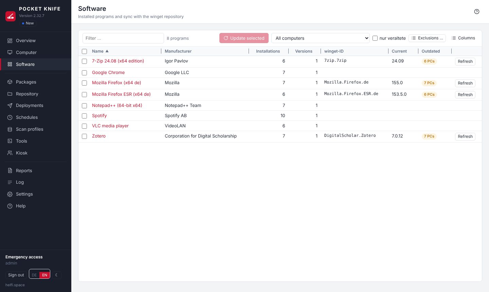

- **Update selected:** select programs (Ctrl/Shift) → button or right-click. For each winget ID, a `winget upgrade` deployment is created for all outdated installations.
- **Detail view (double-click):** all computers with their version; update, deploy or uninstall the selection; set the winget mapping manually or ignore the program.
- **Create uninstall package:** right-click a program. The package removes the program on any computers, collections or on a schedule (see the "Uninstall" step).
- **MSIX apps (from 2.40.1):** programs that Windows installs as an MSIX package (e.g. PowerShell 7 from winget, Windows Terminal) are not in the uninstall registry. The scan additionally reads them from `AppxAllUserStore` – fast, without walking all user profiles, and also under software restriction. They appear with registry hive "MSIX", are matched to the winget ID by their package family name (so "outdated", collections and Update work too) and can be uninstalled (`Remove-AppxPackage -AllUsers`, as Local System). Frameworks, language packs and "sparse" packages (only the Windows 11 context-menu integration of a normal program, e.g. "Notepad++" 1.0.0.0 or "Adobe Acrobat Reader" 26.0.0.1 – from 2.41.2) as well as leftovers of removed apps (marked "EndOfLife" by Windows or package folder deleted, e.g. "MSTeams" 1.0.0.0 – from 2.41.3) are never listed; MSIX apps are matched to a winget ID only by their package family name, never by name; the apps that ship with Windows (Calculator, Photos, Xbox, Store, codecs …) only when the **Hide built-in Windows apps** box under **Settings → Inventory** is unchecked.
- **Update package (from 2.41):** in a program's details (double-click), **Update package** lets you choose an own package. Updates of this winget ID – Auto-Update schedules, "Update", "Update outdated" and deploying with action "upgrade" – then run with this package instead of `winget upgrade` or the winget cache: with all steps in their current state, e.g. first `winget uninstall Microsoft.PowerShell --all-versions`, then the winget installation. This lets you step in when an update fails everywhere at the same point. Without a selection the standard applies again. Only packages without a tenant (they go to every computer); a package used this way can only be deleted after switching back to "Standard". The release delay for new winget versions only applies to `winget upgrade`, not to the own package. Main admins only.
  The same setting is in the package itself: **Package properties → Use for updates** (from 2.41.1) – add winget IDs (search the winget catalog, or click the IDs from the package's winget steps) or remove them with ×; takes effect when saving. Both places always show the same state; a package can serve several winget IDs, a winget ID has at most one update package (adding it to another package moves it there).

**Update-check exclusions** (your own list): programs that should never count as "outdated" – e.g. runtime libraries, driver tools or line-of-business applications whose version the vendor prescribes. Found under **Software → Exclusions …** and **Settings → Updates & versions**; faster via right-click on one or more programs → *Exclude from update check*.

| Field | Example pattern | Effect |
|---|---|---|
| Name | `Microsoft Visual C++*` | all Visual C++ runtime packages |
| Name | `*Runtime*` | everything with "Runtime" in its name |
| Publisher | `Datev*` | all programs of this publisher |
| winget ID | `Oracle.JavaRuntimeEnvironment` | exactly this winget mapping |

`*` stands for any number of characters, `?` for exactly one; case does not matter. When adding, a preview shows which installed programs are affected. Excluded programs are shown as **excluded** in the list, do not count as outdated (overview, collection "Outdated software") and are not updated by winget schedules. The winget mapping stays visible; targeted deployment still works. Remove via the trash icon in the list – the programs are then checked again.

The older **Ignore** in a program's details only removes its winget mapping; these programs are listed in the exclusion list under "Individually ignored programs".
- **Create package from winget:** right-click, if a winget ID is mapped.

The winget mapping takes variants such as ESR, beta or language versions into account. Uncertain mappings are not updated automatically.

## Deferring new winget versions {#winget-release}

**Settings → Updates & versions → winget → New versions** determines when a new version from the winget catalog is distributed:

| Setting | Effect |
|---|---|
| release immediately | as before – the latest version (default) |
| defer by … days | a new version is only distributed after the set number of days; releasing it earlier individually is possible |
| only after release in the package | a new version is only distributed once it is released |

The winget catalog has no release date – counting starts on the day POCKET KNIFE **first sees** the version in the catalog (when loading the winget index). The version found the first time counts as released ("baseline"), so nothing stalls after switching it on.

As long as the latest version is not released:
- **Schedules** (keep software up to date, patch day) only update computers that have an older version than the last released one – and install exactly that one.
- **winget steps in packages, nested packages and the kiosk** install the last released version (`winget --version`). If the same or a newer version is already installed, the step is skipped (never downgrade). A step with a fixed version stays unchanged.
- The **winget cache** only downloads the released version; if it is already in the cache, it stays. Entries with "Do not require the catalog checksum" keep their state (the vendor always delivers the latest there).
- The **Update** button under Software deliberately installs the latest version – it is triggered manually. It never installs a **blocked** version (it then installs the last released one). The "outdated" display still follows the catalog.
- **Changing the rule** (e.g. from "release immediately" to "only after release in the package"): all versions released so far stay released; versions appearing afterwards follow the new rule.

**Release or block individually:** Under **Packages** the **Release** column shows the state of each winget package (e.g. "24.08 instead of 24.09"). Right-click → **Release version … now** releases the latest immediately; **Release …** shows all known versions with "first seen" and state and offers **Release**, **Block** (never distribute a faulty version – also with "release immediately"), **Unblock** and **Withdraw release**. After a release the winget cache downloads the version right away. Everything is logged; main admins only.

## winget cache – updates for computers without winget {#winget-cache}

winget exists only from Windows 10 1809 / Windows Server 2019. For older systems (e.g. Server 2016, 2012 R2) POCKET KNIFE keeps the **current version** of selected programs in the repository – without building packages yourself: **winget cache** in the left bar or **Packages → winget cache …** (main admins only).

- **Add:** on the package page right-click a winget package → **Add to the winget cache** (also several; the column "winget cache" shows the state), in the package at the winget step **Add to the winget cache**, or on the cache page **Add …** (search the winget catalog) or **From inventory …** – lists programs with a reliable winget match that are installed on computers without winget, outdated ones first.
- **Load:** POCKET KNIFE fetches the manifest from the winget catalog just like winget (checked with the checksums from the index), picks the matching installer (architecture, for all users, preferred language), downloads it, checks its SHA-256 and stores it under `winget-cache\<winget ID>\<version>_<checksum>\` in the repository (if the catalog replaces the file for the same version, it gets a folder of its own). POCKET KNIFE creates a package from it in the background with silent switches, success codes and detection ("already installed") – it is not shown in the package list; there the winget package only carries the mark in the column "winget cache".
- **Silent switches:** from the manifest; if missing, POCKET KNIFE uses the same defaults as winget – MSI: `/qn /norestart` (plus `ALLUSERS=1`), Inno Setup: `/VERYSILENT /SUPPRESSMSGBOXES /NORESTART /SP- /ALLUSERS`, Nullsoft: `/S`, WiX Burn: `/quiet /norestart`. If the installer comes inside a ZIP (e.g. paint.net), POCKET KNIFE unpacks it and installs the file named in the manifest. Plain EXE installers without details, MSIX, ZIPs without an installer ("portable") and Store packages are not possible ("Not possible", with the reason) – create your own package for them.
- **Checksum does not match – addresses without a version (e.g. Google Chrome):** some vendors always deliver the newest file under the same address; the checksum in the winget catalog then often does not match (winget itself fails on it too). For such entries right-click → **Do not require the catalog checksum**: POCKET KNIFE then downloads only via HTTPS directly from the vendor (a redirect must stay HTTPS as well; only when the file at the address has changed), remembers the checksum of the downloaded file for the integrity check and takes the product code from the file for MSI. The entry shows "without catalog checksum". Without the comparison with the catalog you rely on HTTPS and the vendor – hence per entry only.
- **Keep current:** once a day (settings → "Automatic") or **Check all**. When a new version appears it is downloaded, the package is switched over and the old version is deleted – only the current version of each program stays in the cache. If the checksum does not match (the vendor replaced the file), the previous version stays and the entry shows "Error".
- **Use:** wherever a winget step would run on a computer without winget – packages, schedules ("Distribute packages" and "winget updates"), nested packages, kiosk, **Update** in the software overview and computer view –, POCKET KNIFE automatically uses the installer from the cache (the result says "from the winget cache"). **Since 2.35.2 also on computers with winget** (cache settings → "Also with winget", on by default): the file then comes from the repository in the LAN instead of from the internet for every computer – much faster, and the internet connection downloads each program only once. With custom winget arguments, installation for one user only, a step that runs as the signed-in user, a different architecture, an installed version that is not older, or when "Update" would hit a program that is not installed, winget is used. Note: winget updates with the installer type the program was installed with (MSI or EXE); the cache always uses the chosen one – if a program exists in both forms it may otherwise appear twice in "Programs and Features". If the file in the cache has been changed, POCKET KNIFE does not use it and writes that to the log ("Reload" helps). If the step demands a different fixed version, it stays "Skipped". The clients need neither winget nor internet. Computers the package does not fit are skipped: the installer requires a newer Windows (MinimumOSVersion), 32-bit Windows with an x64 installer, the program installed in the other architecture or for one user only, or the installed version is not older. While a newer version is not downloaded yet (check running, error), the previous one is used.
- **Clean up:** **Remove** deletes entry, package and folder (if the package is still used in a schedule, another package or the kiosk, POCKET KNIFE says where). **Clean up …** deletes folders in the cache folder that no longer belong to an entry and that nothing else uses – the cache never touches other repository folders. Old versions still needed by a scheduled or running deployment stay until afterwards.
- **Dependencies** (e.g. a Visual C++ runtime) are shown as a hint on the entry – add them to the cache as well.
- **Settings:** folder in the repository (only while the cache is empty; a folder of its own, new or empty, never inside a tenant folder), preferred language, largest file (default 2048 MB), check automatically every day. The POCKET KNIFE server needs access to `cdn.winget.microsoft.com` and the vendors' download addresses (as for the winget index, via the proxy if set).

# Packages {#packages}

A package consists of **steps** in three sections:

| Section | Purpose |
|---|---|
| Preparation | e.g. close program, remove old version |
| Steps | the actual work |
| Finalize | always runs – even after an error (cleanup, scan); only a **restart** does not run after an error (from 2.39.3) |

Each step can be named in the **Label** field at the top (e.g. "Install Wazuh agent"). The label appears in the step list and in the deployment log; if empty, the automatic description is used. A new package starts at the **package properties** with the name.

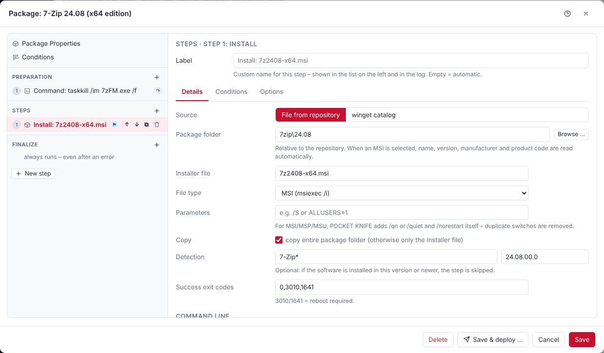

**New package:** Packages → **New package**. The structure is on the left, the settings of the selected entry on the right. You can reorder, duplicate, disable and move steps between sections by dragging, with ↑/↓ or by right-clicking.

**"Notification" column:** A green ✓ in the package list shows that the signed-in user gets a Windows notification after this package – by the same rule as on the client: "always" in the package, or "as in the settings", notifications are switched on there and the package really installs or updates a program (no uninstall, no plain script). The tooltip names the reason.

**Search the repository:** With "File from repository", **Browse …** opens the repository. The search field at the top finds files and folders in the whole repository including subfolders (OU admins: in their tenant folder) – part of the name is enough (`7zip`), with `*` and `?` as patterns (`7z*.msi`). Clicking a file takes over folder and file. The search uses an index of the repository in the **server's memory** (not in the database; 10,000 files ≈ 2–5 MB): matches appear instantly, the index is refreshed in the background after 5 minutes and its age is shown below the search field ("As of: 3 min. ago"). **Re-read** fetches the current state immediately (main admins only). Repositories with more than 200,000 entries are not cached – every search then runs directly on the share (at most 15 seconds).

**Combine packages (from 2.32):** in the package list select several packages → right-click → **Combine into a new package …**. Set the order (↑/↓), enter a name and choose the kind:

- **Nested (recommended):** the new package calls the packages one after another as a "Nested package" step. They stay linked – if you change an original, that also applies in the combined package. Conditions, "Run as" and restart of the single packages still apply.
- **Copy steps:** the steps are copied and are independent of the originals afterwards; "Run as" stays per step as in the original. Packages with conditions of their own cannot be combined this way (the conditions would be lost).

"On error continue with the next package" is off by default. The strongest restart setting of the packages applies to the new package. Packages of different tenants cannot be combined; central packages go with any tenant. A nested package can also be added by hand: in the package **New step → Nested package**. Switch off a single step via right-click → **Disable** (or the **Active** checkbox) without deleting it – it is then shown in grey and skipped.

**Export and import:** **Export** saves the selected packages (without a selection: all shown; also via right-click) as a `*.pkpackages.json` file – e.g. for a second POCKET KNIFE installation or as a backup of single packages. Nested packages are included. The file contains no IDs: collections and scan profiles are matched by name. After choosing the file, **Import …** first shows what will happen (new, as copy, skipped, error) – only **Import** creates the packages. The same checks apply as when saving in the editor; for a tenant, files must be in its repository folder. If a collection used in a condition does not exist, the package is rejected (simply dropping the condition would run it on more computers). Packages contain no passwords; scripts and commands are in the file exactly as in the package.

**Break detection (repository files):** When a package is saved, POCKET KNIFE remembers size, modification date and fingerprint (SHA-256) of every repository file the package uses (with "copy whole folder" also the folder's file list). Packages from before 2.26 get this state at their first check. Checks run every 5 minutes (from the repository index – name, size and date only), before **every** deployment, schedule run, kiosk installation and retry (directly on the share), and with **Check now** in the package. If only the date changed, the fingerprint decides – identical content does not count as a change.

| State | Meaning | Consequence |
|---|---|---|
| ✓ | files unchanged | – |
| ! Deviation | other files in the package folder changed or were added | run continues, note in the log |
| ✕ Break | file or folder missing, or the installation file or the source of a file copy changed | deployments and schedules are **interrupted** (no computer is touched), warning in the log |
| ? | repository not reachable | no break – the run reports the error itself |

The **State** column in the package list shows the result (tooltip with the files), the **Overview** a tile "Packages with a break". In the package, **Repository files** lists every deviation with previous and current state. If the change was intended (e.g. a new version copied over), **Accept new state** confirms the current content – for an MSI, POCKET KNIFE points out when the version in the package no longer matches the file. Missing files are not fixed this way: if they were only moved, **Find file …** finds them by fingerprint ([repair](#repair)), otherwise adjust the package. OU admins see details only for files in their tenant folders; a central package with a break is "currently not available" for them and only a main admin can accept it. Kiosk users only see "currently not available".

**Full check:** Once a week every used file is additionally read completely and its fingerprint compared – this also finds a replacement with the same size and the same date. It runs at night in the time window (default 1 to 6 am), throttled (default 50 MB/s) and one file after the other; if the window ends, it continues the next night. Configurable under **Settings → Packages & Repository → Package break detection**. Load: roughly like copying the used package folders once (network and disks of the file server); the clients notice nothing.

**Moving the repository:** Packages only store the path **inside** the repository (e.g. `7zip\24.08`), never the server. If the repository moves to another server, just change the path under **Settings → Packages & Repository** – all packages keep working, imported ones too. Only paths you wrote into a command or script yourself (`\\server\share\…`) stay as they are; the export points them out.

## Step Types {#steps}

| Step | What happens |
|---|---|
| Install | File from the repository (MSI, MSP, MSU, EXE, CMD/BAT, PS1, REG) or winget. A `.reg` file is applied with `reg.exe import` (like `regedit /s`, but with an exit code). For MSI files, name, version, manufacturer, product code and platform are read automatically when you select the file. |
| Uninstall | searches "Programs and Features" live for the display name (wildcard `*`) and uninstalls silently |
| Command | multi-line, like a .cmd file |
| PowerShell | any script; `exit 1` reports an error |
| Nested package | the steps of another package at this position |
| File copy | file/folder from the repository to e.g. `%ProgramData%\Firma` |
| Registry | set values (REG_SZ, REG_EXPAND_SZ, REG_DWORD, REG_QWORD, REG_MULTI_SZ, REG_BINARY), delete values or keys, create keys – directly in the package, no file needed. **Import from .reg** turns the content of an exported .reg file into entries. 64- or 32-bit view (WOW6432Node) selectable. HKCU entries apply to the executing account – for user settings use *Run as: Logged-on user*. Values named like `Password`, `Secret` or `Token` do not appear in the deployment output (from 2.38.2). |
| Scan | inventory scan with a scan profile |
| Restart | restarts, waits until the computer is back and continues |
| Wait / Message / Sign out | pause, message to all sessions, sign out users |

**Computer name & co. in packages:** The tool variables `$(Computer)` etc. only apply to tools. In package steps (command, PowerShell, paths) use the client's Windows environment variables: `%COMPUTERNAME%`, `%USERDOMAIN%`, `%ProgramData%` in commands or `$env:COMPUTERNAME` in PowerShell. Note: `%USERNAME%` / `$env:USERNAME` is the **executing** account (service account or `SYSTEM`, computer account `PC-0815$`), not the logged-on user – unless *Run as: Logged-on user* is used. In PowerShell, `(Get-CimInstance Win32_ComputerSystem).UserName` returns the logged-on user.

## Conditions {#conditions}

Conditions exist for the whole package and for each step. By default, **everything is selected**; clear only what does not apply:

- **Operating system:** Windows 10, Windows 11, Server 2016–2025
- **Architecture:** 32-bit, 64-bit, ARM64
- **Minimum PowerShell version**, **sign-in status** (always / only when a user is signed in / only when no user is signed in)
- **File** exists/missing/version, **Registry** exists/missing/value/version, **Collection** member/not member

If a package condition is not met, the computer is **skipped**; for a step condition, only that step is skipped.

## Run as {#runas}

| Option | When |
|---|---|
| As in the settings (default) | almost always – with the account from **Settings → Packages & Repository → Package execution**: **Local System** (default) or the **service account** |
| Logged-on user | for programs and settings in the user profile (e.g. per-user installations, HKCU) |

A step additionally has **Same as package**. The brackets always show the account that really runs – POCKET KNIFE never switches anything silently. In the deployment result it is shown in the header line of every step ("… (as Local System …)").

**winget steps** only offer **Local System** (installs for all users, scope "machine") or **Logged-on user** (profile only). winget never runs as the service account, because the App Installer is not registered for it.

**Package execution (from 2.39):** one setting for all packages – the same for main admins and tenants:

- **Local System (recommended, default):** a temporary scheduled task as `SYSTEM`, without a password on the computer. This is a local logon – so **Windows Update** (e.g. PSWindowsUpdate) and installers that refuse a network logon work too. If a custom command opens a share itself (`\\server\share`), the **computer account** logs on there (e.g. `PC-0001$`) – give the group "Domain Computers" read access or let a repository step copy the file. POCKET KNIFE always copies repository files itself.
- **Service account:** a short-lived scheduled task with the service account **and its password** (local logon). It is deleted after every step, also on cancel; whatever an interrupted run leaves behind is removed by the next scan. The password is passed to the computer as a parameter, never in the script text. **Security-critical:** as long as the task exists, the password is on the computer – anyone who is an administrator there can read it and is then an administrator everywhere the service account is. That is why POCKET KNIFE asks before switching, names tenants with their own packages and logs the change. The service account needs the right "Log on as a batch job" on the computers (administrators have it by default).

Scans and tools keep running via the service account (WinRM), independent of this. Tools can be set to "SYSTEM" per tool.

**Migration when updating to 2.39:** up to 2.38 the service account was the default and ran directly over WinRM (network logon – Windows Update then reported "access denied", 0x80070005). On the first start POCKET KNIFE switches all packages that ran as the service account or Local System to **As in the settings**, steps accordingly to **Same as package**; "Logged-on user" stays. Waiting deployments are converted too, finished ones stay unchanged as history. Packages whose own commands open a network path themselves are then listed in the log (category System) for checking.

**PowerShell** is always started by POCKET KNIFE with the full path and fixed switches: `%SystemRoot%\System32\WindowsPowerShell\v1.0\powershell.exe -NoLogo -NonInteractive -NoProfile -ExecutionPolicy Bypass` – for PowerShell steps, .ps1 installers and tools, whether as service account, Local System or user. Your own scripts do not need to handle this (no execution policy, no profile, no prompt). From 2.32.2 POCKET KNIFE first starts PowerShell scripts (PowerShell steps, .ps1 files from the repository, tools, the POCKET KNIFE wrapper on the client) normally as a file. **If Windows refuses the file** – e.g. because a GPO sets the execution policy (*MachinePolicy RemoteSigned*, which `-ExecutionPolicy Bypass` cannot override) and Windows treats the file as foreign because of security zones –, POCKET KNIFE loads its content and runs it. Parameters, `$PSScriptRoot`, `$PSCommandPath` and the exit code stay the same; the log notes it. The script never runs twice: it is only loaded if Windows refused to start this file and nothing has run yet – if Windows only refuses a script that this script calls itself, nothing is reloaded. POCKET KNIFE never bypasses a block by Software Restriction or AppLocker. If the loaded content has a syntax error, the step ends with exit code 1 (as with `-File`). Antivirus, AMSI, AppLocker/WDAC and Constrained Language Mode still apply.

**Errors despite exit code 0 (from 2.39.3):** if PowerShell reports an error in a PowerShell step (e.g. `Get-WindowsUpdate : Access denied`), a script without `$ErrorActionPreference = 'Stop'` keeps running and still ends with exit code 0. Up to 2.39.2 the step then counted as successful – and the restart ran afterwards. Now the step **fails** ("PowerShell reported N errors …"); following steps and a restart in the completion do not run. Deliberately suppressed errors (`-ErrorAction SilentlyContinue`, `try/catch`) do not count. If error messages are normal for a script, set **"Ignore PowerShell error messages"** on the step – then only the exit code counts. Tools as SYSTEM now behave like tools directly over WinRM (errors = exit code 1). For Windows Update with 0x80070005 the message names the cause.

**Hardened Windows:** If a step or tool fails because Windows prevented execution, the result shows a code of its own with a plain-text explanation instead of "exit code 1", followed by the original exit code. A step that succeeded according to its success codes stays successful; winget messages take precedence. **9013** execution policy/signature (e.g. a script called by this script), **9014** antivirus (AMSI), **9015** Constrained Language Mode (AppLocker/WDAC), **9016** program blocked (AppLocker/Software Restriction). If PowerShell runs in Constrained Language Mode, a note at the beginning of the log says so as well.

**Constrained Language Mode:** With Software Restriction, AppLocker script rules or App Control (WDAC), PowerShell allows no .NET calls and no `Add-Type`. From 2.38 POCKET KNIFE does without them: deployments and tools write their scripts with `Set-Content`, registry steps use the registry cmdlets there (32-bit view via `WOW6432Node`), conditions and scanners resolve `%VARIABLES%` themselves, the inventory reads programs via `Get-ItemProperty` and local groups via CIM, own PowerShell scanners run via `Invoke-Expression`. Notifications determine the accounts of the logged-on users via CIM and check the rights of their folder from the SDDL (from 2.38.10). Only the **disk usage analysis** needs full PowerShell and says so clearly. **Test connection** shows the computer's language mode. Your own scripts in packages and tools have to follow the rules of the constrained mode themselves.

The setting applies to the package and can be overridden per step. **Running** shows the exact command executed on the client for each step, e.g.:

```
Scheduled task (without password) as Local System (NT AUTHORITY\SYSTEM):
msiexec.exe /i "C:\Windows\Temp\PocketKnife\<run>\7z2408-x64.msi" /qn /norestart ALLUSERS=1 /l*v "...\pk_msi.log"
```

## Examples {#packageexamples}

**7-Zip from the repository (MSI)**

1. New package → Install → Source "File from repository" → Browse → `7zip\24.08\7z2408-x64.msi`.
2. Name, version, detection and architecture (without x86) are taken from the MSI.
3. Save → Deploy.

**Firefox via winget, closing the old version first**

1. Preparation → Command: `taskkill /im firefox.exe /f`, Options → On error "Continue on error".
2. Steps → Install → Source "winget catalog" → `Mozilla.Firefox` (empty version = always the latest).

**Uninstall Zotero (including per-user installations)**

Right-click "Zotero" in Software → "Create uninstall package …". The step finds Zotero on every computer and calls `helper.exe /S` – for per-user installations, as the respective user.

**Distribute a company configuration**

1. File copy: source `Config\Agent`, destination `%ProgramData%\Firma\Agent`.
2. Command: `reg add "HKLM\SOFTWARE\Firma" /v Konfiguriert /d 1 /f`.
3. Finalize → Scan with the "Registry" profile.

**Archive cannot be extracted (exit code -1978335140):** Some winget packages (e.g. Microsoft GameInput) come as a ZIP archive. As Local System, extraction via the Windows shell often fails. POCKET KNIFE then repeats the step once with `tar.exe` and sets `installBehavior.archiveExtractionMethod = tar` in the winget settings of the Local System account (`…\systemprofile\AppData\Local\Microsoft\WinGet\Settings\defaultState\settings.json`); existing settings are kept. Own settings files that cannot be read stay unchanged.

## Proxy server {#proxy}

For networks without direct internet access: **Settings → Updates & versions → Proxy server**.

| Field | Meaning |
|---|---|
| Proxy address | e.g. `http://proxy.firma.local:8080` – always with `http://`, also for HTTPS targets (the proxy sets up the encrypted connection via CONNECT). Empty = no proxy |
| User / password | optional, only for POCKET KNIFE itself (Basic authentication at the proxy). The password is stored encrypted in the vault and is never in the diagnostics package |
| Clients | optional: winget on the clients also downloads via the proxy |

**POCKET KNIFE itself** downloads the winget catalog through the proxy. Without an entry the container's network configuration applies as before (environment variable `HTTPS_PROXY` in the container, if set). **Save & test** downloads the first bytes of the catalog and shows whether it works; "407" means the proxy requires authentication.

**Clients:** With the check box, POCKET KNIFE sets the winget setting `DefaultProxy` on the client with the next winget deployment (once, afterwards only on a change) and also uses the proxy when installing winget. Clearing the check box removes the setting again – but only if POCKET KNIFE set it itself (marker in the registry: `HKLM\SOFTWARE\PocketKnife`, value `WingetProxy`). **User and password never go to the clients.** If the proxy requires authentication, the clients sign in with their computer account – the proxy must allow Windows authentication (Kerberos/NTLM) for this or let the clients through by IP range without authentication.

## winget on Servers {#wingetbootstrap}

Before every winget step, POCKET KNIFE checks whether winget is present. If it is missing (Windows Server, older Windows 10 builds), the App Installer and its dependencies are installed – **always from the repository**, never by a download on the client (from 2.37). POCKET KNIFE itself downloads the App Installer once into the **Offline source** folder (default `_winget`): when first needed, then once a day, but only for a new version (current release of microsoft/winget-cli, checksum from GitHub; Windows additionally checks the Microsoft signature). **Download now** in the settings fetches it immediately. Without internet: place the files `*.msixbundle`, `*License*.xml` and `DesktopAppInstaller_Dependencies.zip` in the folder yourself. winget is not available before Windows 10 1809 or Server 2019; winget steps are **skipped** there. You configure this under **Settings → Updates & versions → winget**.

# Repository {#repository}

Under **Repository** (left menu) you manage the installation files directly in POCKET KNIFE – nobody needs access to the share for this. Writes always use the repository account (service account) on the server, never the operator's rights. **Prerequisite:** the account has **read and write** access to the share.

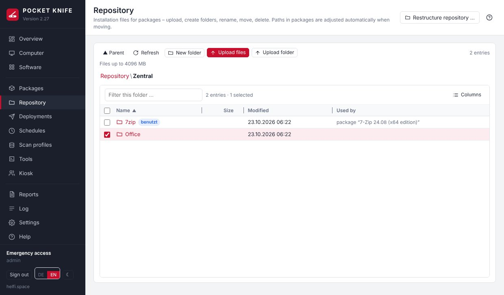

The view works like the file explorer for clients:

- **Open:** double-click or click the folder name; the path at the top jumps back.
- **Select:** click, Ctrl+click (add), Shift+click (range), Ctrl+A.
- **Upload:** **Upload files**, **Upload folder** (with all subfolders) – or simply drag files and folders from the desktop into the list or onto a folder. Large files are sent in 8 MB pieces; if the connection drops, **Resume** appears in the list (also after reloading the page: choose the same file again, it continues where it stopped). POCKET KNIFE cleans up aborted uploads after 24 hours. Data travels from the browser through the POCKET KNIFE server (Docker host) to the file server – large files load both network paths.
- **Move:** drag entries onto a folder or onto a part of the path at the top, **Cut** and **Paste** in the target folder, or right-click → **Move to …**.
- **Right-click:** Move to, Cut, Rename, New folder, Who uses this?, Delete, Copy path.

**Paths in packages follow.** When moving or renaming, POCKET KNIFE adjusts the paths in all affected packages (including disabled steps), as well as tenant folders, scheduled deployments, the winget offline copy and the confirmed state of the break detection – no package breaks. If packages are affected, a **preview** lists each package with old and new path; POCKET KNIFE first creates a **backup** automatically, and if anything goes wrong on the way, everything is rolled back (files and database).

**What is blocked (fool-proofing):**

| Action | blocked if … |
|---|---|
| Delete, overwrite | a package (also a disabled step or a nested package), a scheduled or running deployment, a tenant (its folder) or the winget offline copy uses the file or folder – the message names the packages |
| Rename/move a file **inside** a used package folder | this would silently change the package (e.g. an MST referenced in the arguments) – move the whole folder or adjust the package; the installation file itself may be renamed |
| Moving a central package into a tenant folder | that tenant's admins could change the files there (likewise: saving a central package with files from a tenant folder) |
| OU admin: uploading, creating folders, moving into a folder used by a central package or another tenant | otherwise e.g. a DLL could be placed next to someone else's installation file; if someone puts something there directly on the share, the break detection reports it as a **break** |
| Moving tenant packages out of their tenant folder | tenant packages may only use files from their folder |
| Names | characters such as `\ / : * ? " < > |`, reserved Windows names (`CON`, `NUL`, `COM1` …), trailing dot or space |
| Links (junctions/symlinks) in the path | POCKET KNIFE never writes through a link – the file server would resolve it on its side |

New files in a used package folder are allowed (e.g. an additional configuration); the package then shows "new in package folder" until someone accepts the new state. **Who uses this?** shows the packages for each entry, the column **Used by** is right in the list. Every action is logged (category "Repository") with user and tenant.

**Limits:** maximum file size (default 4096 MB) under **Settings → Packages & Repository → Upload to the repository**; for OU admins additionally the allowed file types (MSI, MSP, MSU, MST, EXE, CMD/BAT, PS1, REG, ZIP, 7Z, CAB, MSIX/APPX, INI/INF, XML/JSON/TXT/CFG, certificates, ISO/WIM and similar) and a **storage quota** per tenant (on the tenant, empty = default from the settings, 0 = unlimited).

**Tenants:** OU admins see and edit only their tenant's folder; they cannot rename, move or delete the folder itself. If a tenant may build its own packages and has no repository folder yet, POCKET KNIFE creates **`Mandanten\<Name>`** itself – one folder per tenant, shared by all its admins; below it they create their own subfolders. Two tenants can never share a folder (not even nested). The repository and its server stay hidden from OU admins.

## Restructure the repository {#restructure}

Tidy up a grown repository before introducing tenant folders – main admins, button **Restructure repository …** at the top right. Recommended structure: one folder for the central packages (e.g. `Zentral`) and `Mandanten` with one subfolder per tenant.

1. **New main folder** – type or pick; if it does not exist it is created.
2. **What goes in?** – tick the existing folders (**Select all** leaves out `Mandanten`).
3. **Preview** – every affected package with old and new path; problems (see table above) are listed at the top, then it cannot run.
4. **Run** – in one go: automatic backup first, everything is rolled back on an error.

## Duplicate block {#duplicates}

The same software should exist only once – either central or with exactly one tenant. When saving, copying and importing a package and when uploading a file, POCKET KNIFE compares:

- the **winget ID** (install or upgrade),
- the **MSI product code** (from the step or from the MSI file),
- the **fingerprint (SHA-256)** of the installation file – also detects renamed copies.

If the same software exists in **another scope** (central, tenant A, tenant B – also between two tenants), it is rejected, naming the existing package: please use that one. OU admins see and deploy central packages and those of their tenant; if the duplicate belongs to another tenant, the message does not name it (the main admin can provide it centrally). Within the same scope it is allowed (e.g. two variants with different arguments). The name alone does not count. Main admins can override (**Save anyway** or **Upload anyway**); this is logged. A duplicate that already existed before 2.27 does not prevent saving other changes; if POCKET KNIFE finds it later (e.g. once the fingerprint is computed), a note is written to the log.

## Find file (repair by fingerprint) {#repair}

If something was moved or renamed outside POCKET KNIFE (e.g. in Windows Explorer), the package shows "file missing" or "folder missing". **Find file …** in the package's **Repository files** section searches the whole repository – candidates by size (from the in-memory index), confirmed by fingerprint; a folder counts as found when all its files are at the new location. **Apply paths** then adjusts all packages that use the old path (with a backup first). OU admins: only within their tenant folder. The index knows newly stored files after 5 minutes at the latest.

# Deployments {#deployments}

**Several packages at once:** in **Packages**, tick several rows (or select with Ctrl/Shift) and click **"Deploy N packages …"** at the top right – or right-click → "Deploy N packages …". In the dialog you can add further packages and change the order by dragging the entries. All packages run as **one** deployment: one after another per computer in this order, never two installations at the same time (otherwise Windows Installer likes to report 1618 "another installation is in progress"). Optionally the remaining packages are skipped for a computer after an error.

Deploy with the **Deploy …** button (computer list, package, software) or by right-clicking. The target is the selected computers or a collection; the time is immediate or scheduled.

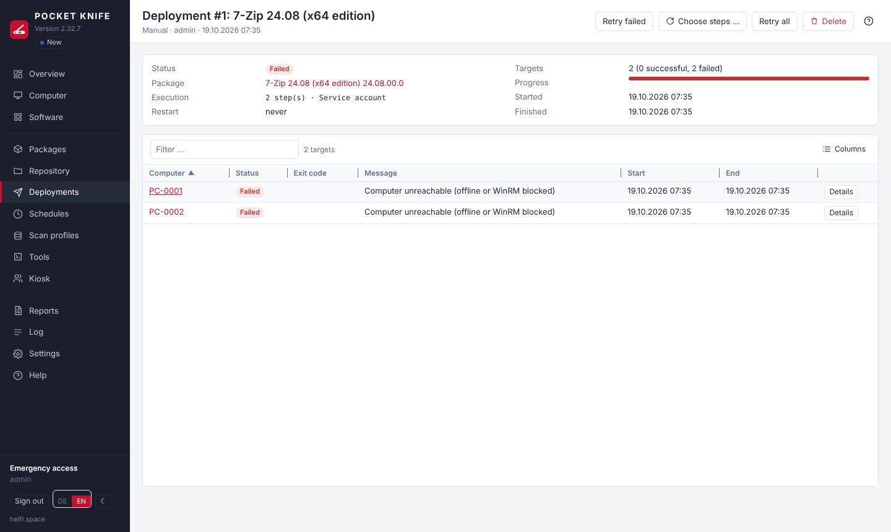

The deployment shows the progress per computer. **Details** opens the result of each step with the exit code and the complete output. The column **Run as** (from 2.39.2) names the account the step really ran with on the computer: Local System, service account, logged-on user – or "service account (WinRM)" for what POCKET KNIFE does directly over WinRM (restart, message, log off, scan). A dash means: nothing ran on the computer (skipped, not run). "Retry failed" repeats the whole package on the computers that did not succeed.

**Package changed since (from 2.35.1):** a deployment remembers the state of the package at its start. If you changed the package afterwards (e.g. corrected a step), a notice at the top of the deployment offers **with the current state of the package** (default) or **with the state of this deployment**. It applies to "Retry failed", "Retry all", "Choose steps …" and "Retry step" – no need to assign the package again. "Choose steps …" then shows the steps of the changed package (new steps without a previous result). If the deployment itself was already a retry of single steps, it stays with these steps – taken from the current package. **From 2.39.1** the current state always applies with **all** settings (run as, restart, time limit, conditions …), also if you had opened the deployment before changing the package; "with the state of this deployment" only applies if you choose it explicitly.

**Retrying individual steps:** If a step failed, the deployment shows the section **Failed steps** – per step with the affected computers and two buttons:

- **Only this step** – runs just this step again (e.g. a service start that failed because of a lock).
- **From this step** – runs this step and all following steps including the finish, i.e. also those that did not run after the error. Successful steps before it are not repeated.

For a single computer, do the same in **Details** via **Retry ▾** next to the failed step. Each retry creates a new deployment; package conditions, "Run as", reboot and scan settings stay as in the original package.

**Choose steps yourself:** **Choose steps …** (at the top of the deployment) lists all steps of the package with their previous result ("2 OK", "1 error"). Tick the steps – failed ones and those not run after a failure are preselected –, then choose the targets: unsuccessful, all or individual computers. A new deployment with only these steps is created, in the package's order and with its conditions and "Run as"; steps disabled in the package run if chosen, finalization steps only if chosen. If the package has "Restart at the end", the restart can be deselected for the retry (default "never" unless an install or restart step is chosen). OU admins can only do this for deployments that exclusively affect their own computers.

| Status | Meaning |
|---|---|
| Successful | all steps succeeded |
| Skipped | a package condition does not apply (e.g. wrong operating system) |
| Failed | a step set to "Stop package" failed, or the computer was not reachable |

## Notification on the client {#toast}

After a **successful installation or update**, the signed-in user sees a Windows notification – e.g. **"7-Zip wurde aktualisiert."** / in English **"7-Zip has been updated."** with **"Installed version: 26.00"** below and a green check mark, sender "Softwareverteilung" (configurable).

- Applies to manual deployments, schedules, winget updates and the kiosk.
- **Installed** or **updated**: winget upgrades and programs that were already in the inventory (in an older version) count as "updated". For winget, POCKET KNIFE takes name and version from the output ("Found 7-Zip … Version 26.00"), otherwise from the package name and version.
- **No notification** if nobody is signed in, if everything was already installed or up to date, for uninstallations and for pure script/registry packages.
- Several signed-in users (e.g. terminal server) each see the notification in their session.
- **Settings → On the client → Notification on the client:** on/off, sender (a changed sender applies from the next notification), language (German/English), **Send test notification** to a computer. Per package under *Package properties → Notification*: as in the settings, always (also script packages) or never.

**Technology:** A short WinRM connection starts a scheduled task *as each signed-in user* (no password, no elevated rights, no visible window) – only this way does the notification appear in their session; as service account or SYSTEM nobody would see it. The display script is stored in `C:\Program Files\PocketKnife` (only administrators can write there); name and version are only passed as data, never as a command. Afterwards the script checks in the notification center whether Windows accepted the notification – if not, it shows it with the sender "Windows PowerShell", which Windows always knows. If the user has switched off notifications from this sender in the Windows settings, that is respected (no fallback). The script is started with `-File` from "Program Files", so it also runs under Software Restriction Policies (SRP), AppLocker or WDAC (constrained language mode) – as long as scripts from "Program Files" are allowed, as in the default rules. Only if a GPO sets the execution policy to AllSigned/Restricted does POCKET KNIFE start it via a short encoded command. The script reports its result itself; if there is no answer, the log says "display script did not start for the user"; POCKET KNIFE resets the folder permissions to the "Program Files" default with every notification. **The result per user is in the log** ("shown", "shown with sender Windows PowerShell", "not shown by Windows – notifications off/Do not disturb/policy" …), also for the test in the settings. The deployment does not wait for it.

> If no notification appears despite a successful test: check whether the user has notifications or "Do not disturb" turned on and whether a GPO disables notifications. As a last resort, turn on **Compatibility** (sender "Windows PowerShell", which is always registered in Windows).

## Message on restart and shutdown {#rebootmsg}

Before POCKET KNIFE restarts or shuts down a computer, Windows shows the signed-in user a message. Its text is set under **Settings → On the client → Message on restart and shutdown**:

- **Sender** – e.g. "Your IT department" instead of "POCKET KNIFE".
- A separate text per occasion: **Restart** and **Shutdown** from the computer menu, **Restart after deployment**, package step **"Restart"** and **Restart from the kiosk**. Empty field = default text (German); below each field an example shows what the message will look like.
- Placeholders: `{absender}` (sender), `{sekunden}` (seconds), `{minuten}` (minutes), `{benutzer}` (kiosk only: who requested the restart). Example: `{absender}: Your computer will restart in {minuten} minutes. Please save your work.`
- A custom text in the package step "Restart" takes precedence (the same placeholders are allowed there).
- At most 400 characters; double quotes become single quotes (Windows limits the message to 512 characters).

## Windows Server {#windows-server}

POCKET KNIFE manages Windows Server just like workstations – via WinRM, which is enabled by default on Windows Server (Windows Admin Center relies on it too). A few things work differently there:

- **Role:** the scan reads whether a computer is a workstation, server or domain controller (field "Role" in collections and reports). The default collection **Domain controllers** groups the DCs – e.g. to exclude them from restart schedules ("is not member of").
- **Restart/shutdown:** if servers or domain controllers are included, the dialog asks explicitly and states the number of signed-in users.
- **Antivirus:** Windows Server has no Security Center – POCKET KNIFE shows Microsoft Defender directly there (even without the PowerShell module "Defender"). Other antivirus products are not visible on servers.
- **Virtual machines:** the scan detects Hyper-V, VMware, KVM/QEMU (e.g. Proxmox), Nutanix AHV, Xen, VirtualBox, Parallels and cloud VMs (field "Virtualization"). On VMs and servers without a monitor there is no longer a warning about displays.
- **Terminal servers:** on servers POCKET KNIFE reads the winget version from the registry instead of going through all user profiles – the scan stays fast even with many profiles.
- **Server Core:** without Explorer, POCKET KNIFE detects signed-in users via `quser` (name without domain).
- **Older servers:** Windows Server 2012 R2 (PowerShell 4) and 2016 are scanned; what is missing there (e.g. `Get-LocalUser`, Defender) is replaced by older methods or left empty. **winget exists only from Windows 10 1809 / Server 2019:** on older systems POCKET KNIFE still shows outdated programs but offers no winget "Update" (schedules and deployments skip these computers or report "Skipped"), and the kiosk shows no packages that install via winget there. Since 2.35 the [winget cache](#winget-cache) updates such programs – or your own package from the repository.

## POCKET KNIFE restarted during a deployment {#deploy-restart}

If the container is restarted (update, Docker host reboot) while something is still running on computers, those targets are marked **“Interrupted (POCKET KNIFE was restarted)”** (failed – schedules catch them up as usual). POCKET KNIFE then cleans up on the computer by itself as soon as it is reachable (checked every 5 minutes):

- **If the installer is still running**, it is **not** killed but waited for – an installer stopped halfway does more damage than one that finishes. Only if it runs longer than the step's time limit is it stopped (as with a normal timeout).
- Afterwards the working folders (`C:\Windows\Temp\PocketKnife\…` including copied installation files) and scheduled tasks (`\POCKETKNIFE\PK_…`) are removed.
- The target's message shows the result, e.g. “– cleaned up on the computer (the interrupted step still finished, exit code 0)”; the log (category “deploy”) lists what was removed.
- **New deployment to the same computer:** it cleans up first and **waits** while the old installer is still running (“Waiting: an installation from an interrupted run is still running on the computer …”) – so two installations never run at the same time (error 1618). Cancelling is possible meanwhile.
- If a computer stays unreachable for 14 days, POCKET KNIFE gives up; leftovers older than 2 days are removed by the next inventory scan anyway.

Tip: install updates preferably when no deployment is running (**Deployments** → status “running”).

# Schedules {#schedules}

Schedules are the one place for everything that is distributed or updated automatically (the former "rules" have been merged into them and were converted during the update). When creating one, choose the **kind**:

| Kind | What happens |
|---|---|
| **Deploy packages** | one or more saved packages, in a fixed order per computer |
| **winget updates** | update outdated software on the targets with `winget upgrade` – all outdated or only specific winget IDs, with exceptions; one deployment per program. IDs and exceptions can be taken from the installed programs with **“Pick from the inventory …”** instead of typing them |

Common to both kinds:

- **Triggers:** Once, Interval, Daily, Weekly, Monthly and **Heartbeat**: serves every target as soon as it is reachable (WinRM answers) and has not been served yet – after power-on or Wake-on-LAN, and for a new schedule or new collection members at the next heartbeat (default every 5 minutes; a manual "Heartbeat" checks immediately). Targets already attempted are not retried continuously – use the wait after failure, other triggers or "Re-serve selected" for that. Without a trigger, the schedule only runs via "Run now". Without a heartbeat trigger, only computers that were offline during an earlier run and were queued are served at power-on.
- **Time window** (optional): weekdays and time, also across midnight (e.g. Mon–Fri 10 PM–5 AM). Runs that become due outside the window are caught up when the window opens; computers coming online outside it are queued. "Run now" ignores the window.
- **Targets:** collections (re-evaluated on every run, including "All computers") and individual computers.
- **Offline computers:** queue them and serve them as soon as they are online (heartbeat) – or skip them.
- **Wait after failure:** a failed computer (with winget: the same program) is retried after X hours at the earliest.
- **Catch up on failures** (default): failed computers are supplied again automatically without waiting for the next date – as soon as they are reachable and the wait time (at least 1 hour) has passed, within the time window, at most "Max. failed attempts" times (three times if 0). If a run could not start at all (e.g. database briefly locked), it is retried every 15 minutes until it succeeds.
- **Target history:** status per computer, "Re-serve selected", "Reset history".
- **Preview:** shows in advance what a run would do now (with winget: which programs on which computers).

Only for **Deploy packages**: skip the remaining packages on error, do not re-serve successful targets, **re-serve after X hours** (e.g. combined with a dynamic collection "7-Zip missing or outdated" – the environment maintains itself), maximum failed attempts.

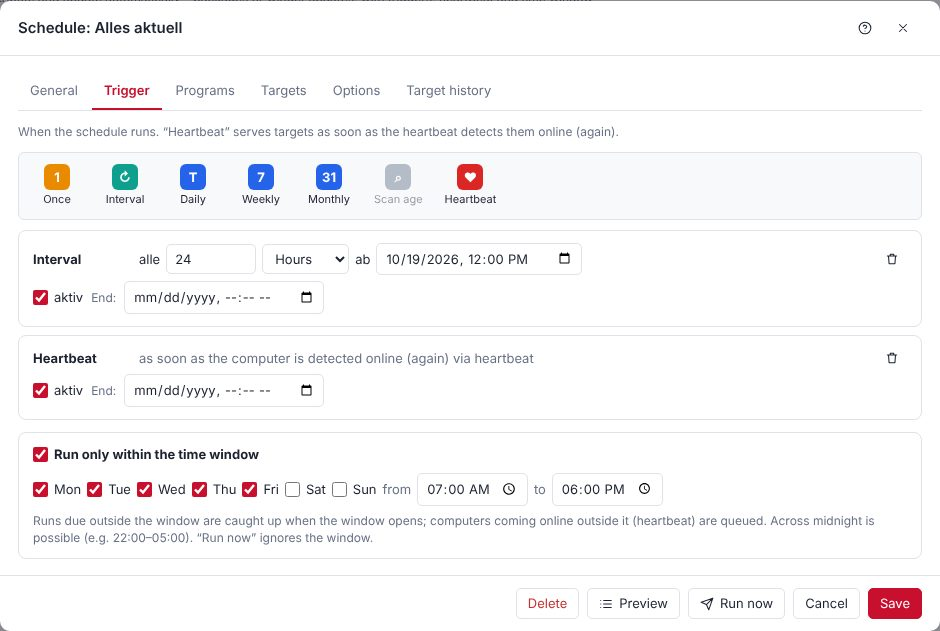

**Example – evening patch day:** kind "Deploy packages", trigger "Weekly, Wednesday 7:00 PM", target "Workstations", packages "Firefox", "7-Zip", "Adobe Reader", queue offline computers. Computers that are off in the evening are served the next time they are turned on.

**Example – always up to date:** kind "winget updates", all outdated, exception `Oracle.JavaRuntimeEnvironment`, triggers "Interval every 24 h" **and** "Heartbeat", time window Mon–Fri 7 AM–6 PM, target "All computers". Computers switched on during the day are updated right away, all others once a day.

# Tools {#tools}

Select computers → **Tools ▾** or right-click → Tools.

**Run command … (from 2.34, Ctrl+Alt+C):** run a PowerShell or CMD command directly on the selected computers without creating a tool first. Choose the type (PowerShell/CMD), "Run as" (service account or SYSTEM), enter the command – multiple lines, with the same variables as tools – and **Run** (or Ctrl+Enter). The output per computer appears in the same window; the window stays open so you can adjust the command and run it again. With several computers POCKET KNIFE asks first. **Save as tool …** opens "New tool" with type, run as and command – just enter name and folder. **History** lists the last 20 commands of this session (until the page is reloaded; they are not stored because a command may contain a password). Every run is in the log with user, type (PowerShell/CMD) and result per computer – POCKET KNIFE does not log the command text itself. Like creating tools, main admins only. **Exit code (from 2.38):** `exit 3` in a PowerShell tool or command arrives as exit code 3, as does the exit code of a program that failed last; before, a tool run as the service account reported "0" then. If a group policy enforces the execution policy AllSigned/Restricted, or if Software Restriction/AppLocker blocks scripts in `%TEMP%` (a probe script shows this beforehand), the tool runs directly as before (then without `exit N`). If one of your own tools already has Ctrl+Alt+C, it keeps it; the shortcut for "Run command" can be changed under **Tools → Keyboard shortcuts …**.

**Files from the repository, time limit, success codes, scan afterwards (from 2.32.7):** If a tool needs a program that is not on the client (e.g. `iperf3.exe`), enter a folder or file from the repository under **Files from the repository**. POCKET KNIFE copies it to the computer itself via the admin share before running, the command runs in that folder (`iperf3.exe -c server -i 1`), and it is cleaned up afterwards. The computer does not need access to any share: a command such as `\\server\share\program.exe` always fails in a WinRM session ("double hop" – the session has no credentials for further shares), and read access for computer accounts or passwords on the client are not a good idea. Tenant folders cannot be used for tools – if a tenant gets the folder later, the tool no longer runs. **Time limit** in seconds (empty = 30 minutes), **success codes** as for packages (empty = 0). **Scan afterwards** (default: no): *On success* or *Always* with a scan profile – per computer after the tool; if a scan is already running, it follows afterwards.

**Keyboard shortcuts (from 2.32.4):** Every tool can have a shortcut – always **Ctrl+Alt**, optionally with **Shift**, plus a letter, a digit or F1–F12. For your own tools you set it in the tool: open the tool, click the **Keyboard shortcut** field and press the combination (Backspace or Delete removes it). If it is already taken, the tool that has it is shown right below. The built-in tools have defaults (e.g. Ctrl+Alt+P Ping & ports, Ctrl+Alt+R Remote desktop, Ctrl+Alt+E Event log, Ctrl+Alt+B Restart/Shut down) which you can change or remove under **Tools → Keyboard shortcuts …**; that is also where you find the overview of all shortcuts. A shortcut starts the tool for the selected computers in the computer list or for the open computer; with several computers POCKET KNIFE asks first. The shortcuts apply to all users. They are off in input fields, dialogs and open menus – AltGr characters such as `{ [ ] } @ €` never start a tool. Menus and the Tools page show the shortcut next to the tool.

| Built-in | |
|---|---|
| Ping & Ports | reachability and open ports |
| Remote Desktop / VNC in browser | remote session in a separate tab |
| Wake-on-LAN | via a reachable computer in the same subnet (relay), several times, checking whether it wakes up – see below |
| Restart / Shut down … | from 2.32.3 in one dialog: choose restart or shutdown and enter the delay (seconds or minutes, 0 = immediately up to 24 hours, default 60 seconds). Signed-in users see the Windows message during that time; for longer delays the default text states minutes, a custom text under **Settings → On the client** applies unchanged. With "immediately" Windows closes open programs without asking. From 2.34: if servers or domain controllers are included, the dialog lists them with the number of signed-in users and only runs after ticking "Yes, the servers too" |
| Cancel restart/shutdown | stops an announced restart or shutdown while the delay is running |
| gpupdate /force | refresh group policies: computer policy and – in the session of each signed-in user – their user policy (e.g. browser bookmarks, drives). The output shows each part separately. If nobody is signed in, user policy applies at the next sign-in |
| Check / install winget | provides winget where it is missing |
| Scan with profile | immediate scan |
| Analyse disk space | folder sizes as a ring chart – see below |
| Files (Explorer) | manage the client's files in the browser – see below |
| Event log | Windows event logs in the browser – see below |


**Wake-on-LAN:** broadcasts do not leave their subnet. The magic packet is therefore sent by a computer that is running and in the same subnet as the target (up to 3 "relays", determined from IP and subnet mask of the last scan), plus the container. From 2.31:

- **Sent several times:** every packet 3× about a second apart (UDP can get lost), to all known MAC addresses – including wired adapters that had no IP at the last scan (e.g. docking station).
- **Waits for the result:** POCKET KNIFE then checks the computer every 10 seconds. The window shows "waiting … 45 s", then "awake after 70 s" or "did not wake up"; after half the waiting time it sends once more – via other computers if there are any. The result is also logged; a computer that woke up triggers the heartbeat triggers at once (scans, schedules).
- **Fixed relays (optional):** under **Settings → Network & remote access → Wake-on-LAN** enter computers that always run (e.g. servers). They send first – so it also works when nobody else in the subnet is online. The number of packets and the waiting time can be set there too.
- **Readiness in the inventory:** the "Network adapters" scanner reads per adapter whether the magic packet is allowed, whether it may wake the computer and the WoL settings of the driver, plus Windows Fast Startup (many adapters do not wake from "shut down" with it). Shown with the computer under **Network adapters**, in the report **Wake-on-LAN readiness** and as the filter "Wake-on-LAN ready" for collections. Windows cannot read the BIOS/UEFI setting.
- **Wake before schedules (optional, off by default):** in the schedule under Options → "wake switched-off targets when running". Applies at a scheduled time, in the time window and with "Run now", not with every heartbeat; woken computers are served as soon as they have started. They are not shut down afterwards.

**Analyse disk space** (Tools ▾ → *Analyse disk space …* or on the computer under **Disks**): shows where the space on a drive or in a folder goes – like TreeSize or WinDirStat, but without installing anything on the client.

- Choose a **path** (drives from the last scan are suggested, also folders like `D:\Data` or `%SystemDrive%\Users`) and a **depth** (3–6 levels), then **Analyse**. The client walks the file system as the service account via WinRM; a drive with a few 100,000 files usually takes less than a minute. The run continues on the server even if you leave the page.
- **Ring chart:** the centre shows the current folder and its size, the inner ring its content, the outer ring one level deeper (same hue, lighter). Grey: grouped small entries ("more folders/files") and files.
- **Zoom:** click a ring segment or a row of the list to open the folder; click the centre, "One level up" or the path at the top to go back. Folders below the chosen depth are only recorded as a total (▸ more) – one click analyses them specifically.
- **List** next to it with exact size, share and file count; right-click: analyse in detail, copy path. Hovering shows path, size and share.
- **Open in Explorer:** the folder icon at the end of each row, the button above the chart or the context menu jumps straight to **Files** – into the folder, or for a file into its folder with the file selected. Clean up right there (delete, move, download).
- Results are saved (the last 8 per computer, selection at the top right).
- Linked folders (junctions, symbolic links) are not followed so that nothing is counted twice. Unreadable folders (e.g. *System Volume Information*) are counted and marked. Hard links (e.g. in `C:\Windows\WinSxS`) count at every occurrence, as in Explorer.

**Custom tools** (Tools → New tool) are PowerShell, commands (CMD) or URLs. Tools keep running on the server even if you close the browser.

**Variables** are replaced with the values of the respective computer before running (in PowerShell, command and URL):

| Variable | Value | Example |
|---|---|---|
| `$(Computer)` | computer name (NetBIOS) | `PC-0815` |
| `$(Host)` | fully qualified DNS name; the computer name if unknown | `pc-0001.firma.local` |
| `$(IP)` | first IP address from the last scan | `10.0.10.25` |
| `$(MAC)` | first MAC address from the last scan (scanner "Network adapters") | `00:11:22:33:44:55` |
| `$(User)` | last detected logged-on user (scan/heartbeat) | `FIRMA\jdoe` |
| `$(Domain)` | the computer's domain from the scan, otherwise the domain from the settings | `CORP` |

Case-sensitive; unknown values are replaced with an empty string. In a **URL** the values are URL-encoded; addresses with `javascript:`, `data:`, `vbscript:` or `blob:` are rejected.

**In PowerShell tools also as variables:** `$PK_Computer`, `$PK_Host`, `$PK_IP`, `$PK_MAC`, `$PK_User`, `$PK_Domain` are available safely quoted – even if a value contains apostrophes or `$` (e.g. a user name). For values that come from users (`$(User)`), prefer `$PK_User` over inserting `'$(User)'` into the text.

```powershell
# Example: flush the DNS cache and reload group policies
ipconfig /flushdns
gpupdate /target:computer /force
```

## Files (Explorer) {#files}

**Tools ▾ → Files (Explorer) …** or on the computer under **Disks**. Access the client's drives via the administrative shares (`\\PC\C$`), without installing anything on the client – the service account is a local administrator there.

- **Browse:** choose a drive (from the last scan) or enter a path at the top; double-click opens folders, the path at the top goes back.
- **Search:** in the open folder, enter a name or pattern in the search field above the list (`setup`, `*.log`) and press **Search** or Enter – the folder and all subfolders are searched (the field does not filter while typing). The search runs **on the client** itself (via WinRM, also with software restriction/AppLocker in Constrained Language Mode); only the matches come back, nothing is stored. Windows filters the names itself – even a whole drive with all subfolders is usually searched within seconds to a few minutes (at most 5 minutes, 300 matches). Matches behind links do not appear twice, unreadable entries are skipped (the number is shown at the top). Clicking a match opens its folder, for a file with the file selected; right-click also offers **Download** and **Copy path**. **End search** or Esc returns to the folder. If WinRM is not reachable, the search runs more slowly via the share (at most 20 seconds).
- **Manage:** right-click entries – **Download** (file), **Copy**/**Cut** and **Paste** in the target folder (on the same computer, whole folders too), **Rename**, **Delete** (multi-select; folders with their content). **New folder** and **Upload** in the toolbar.
- **Hidden items** as in Windows Explorer: hidden folders and files (e.g. `ProgramData`, `$Recycle.Bin`, `desktop.ini`) and – from 2.39.5 – entries without access (e.g. `pagefile.sys`, `hiberfil.sys`, `swapfile.sys`) are hidden by default. The checkbox **Hidden items** in the toolbar shows them with one click (dimmed; the browser remembers the choice), the top right shows how many are hidden. The search also finds hidden entries.
- Links (junctions/symlinks), hidden and locked entries are marked. Everything runs as the service account and is logged. Deleting and overwriting cannot be undone.

Links (junctions/symlinks, e.g. `C:\Users\All Users` → `C:\ProgramData`) are marked with ↗. Opening jumps to the target, deleting removes only the link, not the target.

## Event log {#eventlog}

**Tools ▾ → Event log …**: reads the Windows event logs (System, Application, Security, Setup, Defender) live over WinRM. Filter by level (warning and worse, errors, critical only), search by text/event ID/source, choose the count; click a row for the full message.

# Software Kiosk {#kiosk}

In the kiosk, users install approved software themselves – without administrator rights and without calling IT. It is a separate, simple page: **`https://<pocketknife>:8443/kiosk`** (e.g. as a desktop shortcut via GPO). Users sign in with their normal Windows account – with user name and password or, if set up, automatically via [Sign-in with Windows (SSO)](#kiosk-sso).

**Setting up** under **Kiosk** (navigation):

1. **Settings:** turn the kiosk on and define who may use it – **AD groups** (name or DN, also nested, e.g. "Domain Users") and/or **OUs** (including all sub-OUs). Either one is enough. **"Choose from AD …"** opens an expandable AD tree where you tick entries; groups can also be searched by name. Optional: mail to IT when a request is waiting for approval; maximum number of requests per user in 24 hours (default 10); [Sign-in with Windows (SSO)](#kiosk-sso) (default off).
2. **Catalog → Add software:** choose an existing package and define
   - **Approval:** install immediately or only after approval by an administrator
   - **Icon** (PNG, JPEG, GIF, WebP or ICO, at most 512 KB, ideally 128 × 128 pixels; SVG is not accepted for security reasons) – without an icon the kiosk shows the initials
   - **Category** and **description** for users
   - **Uninstall:** a package that removes the software again (e.g. right-click in "Software" → create uninstall package) – without it the kiosk shows no "Uninstall" button
   - **Only for:** only computers in a collection see the software (e.g. licenses of one department)
   - **Only for groups:** only members of these AD groups (name or DN, nested groups count; “Choose from AD …”) see and order the software – e.g. a graphics program only for the design team. Empty = everyone who may use the kiosk. Applies in addition to “Only for”; POCKET KNIFE checks when showing the catalog and when ordering (result cached for 5 minutes). If AD is not reachable at the moment, such software stays hidden.
3. **Requests:** **approve** or **reject** waiting requests (with a reason the user sees); history of all requests with a link to the deployment.

**What users see and may do:**

- **Only their own computer:** POCKET KNIFE checks live via WinRM which computer the user is signed in to (using the logon data from the inventory, the browser's address and the DNS name). Nothing can be requested for other computers – not even via the API.
- **Only the catalog:** install or request, uninstall (if configured), status per software ("Waiting for approval", "Running", "Done", "Failed"), withdraw own requests as long as they are not running yet.
- **Plan a restart:** if an installation needs a restart (or the last scan reports a pending restart), the kiosk offers "Now (in 2 minutes)", "In 1 hour" or a time on the same day. A notice appears on the computer before the restart; a planned restart can be cancelled. Not possible for **servers** (including terminal servers) and while **other users** are still signed in to the computer.
- **No administration:** kiosk sign-ins have no access whatsoever to the POCKET KNIFE interface (nor to remote sessions). Members of the access group can also use the kiosk for their own computer.

Installations from the kiosk are normal deployments (name "Kiosk: …") – with log, the account from "Run as" and a scan afterwards as usual. Everything is logged under the category "Kiosk". The sign-out when idle also applies in the kiosk.

## Sign-in with Windows (SSO) {#kiosk-sso}

Optional – **off by default**. When turned on, the kiosk signs users in on domain PCs **automatically with their Windows account** (Kerberos, “single sign-on”): no user name, no password. The sign-in form remains as a fallback, e.g. for devices outside the domain.

Windows sign-in applies **only to the kiosk**. Members of the access group also get only the kiosk this way, never the administration – user name and password remain mandatory there.

**How it works:** The browser requests a Kerberos ticket for the kiosk's name (`HTTP/pocketknife.firma.local`) from the DC and sends it along. POCKET KNIFE verifies the ticket with a **keytab** – the key of the account that holds this name (SPN). POCKET KNIFE needs no connection to the DC for this, and no password is transmitted. Who may use the kiosk is then checked exactly as for password sign-in (kiosk groups and OUs, via LDAP with the service account).

**Requirements**

- The kiosk is opened via a **fixed DNS name**, not the IP address – with an HTTPS certificate for that name (see [Your own certificate](#certificate)).
- The clocks of the Docker host and the DCs differ by 5 minutes at most (NTP on the Docker host).
- The realm is `PK_DOMAIN` in upper case (if different: `PK_KERBEROS_REALM` in `.env`).

### Setup step by step

In the example the domain is `firma.local` (NetBIOS `FIRMA`), the kiosk `pocketknife.firma.local`.

1. **DNS:** create an **A record** `pocketknife.firma.local` → IP of the Docker host. No CNAME – otherwise browsers request a ticket for the target name.
2. **Create an account for the name:** a new, normal user account, e.g. `svc-pk-http` – **without any rights**, “Password never expires”, and under *Account → Account options* enable **“This account supports Kerberos AES 256 bit encryption”**. Do not use the service account: `ktpass` sets a new password in the next step.
3. **Register the SPN** (as domain admin):
   ```
   setspn -S HTTP/pocketknife.firma.local FIRMA\svc-pk-http
   setspn -Q HTTP/pocketknife.firma.local
   ```
   `-Q` must show exactly **one** account – a duplicate SPN breaks Kerberos.
4. **Create the keytab** (on a DC):
   ```
   ktpass -princ HTTP/pocketknife.firma.local@FIRMA.LOCAL -mapuser FIRMA\svc-pk-http -crypto AES256-SHA1 -ptype KRB5_NT_PRINCIPAL -pass * -out pocketknife-http.keytab
   ```
   The realm after `@` is in **upper case**. `-pass *` asks for a new password and sets it on the account. The keytab is as secret as a password.
5. **In POCKET KNIFE:** **Kiosk → Settings → Windows sign-in** → choose the keytab file → **Upload**. Tick “Offer Windows sign-in” → **Save** → **Test**. The test checks the keytab (name, realm, encryption), loads the key and resolves the name in DNS. Afterwards delete the keytab file on the DC or lock it away safely.
6. **Allow the browsers (GPO).** Browsers only send a ticket to sites they consider intranet:
   - **Edge and Chrome:** *Computer Configuration → Administrative Templates → Windows Components → Internet Explorer → Internet Control Panel → Security Page → Site to Zone Assignment List*: `https://pocketknife.firma.local` = `1` (Local intranet). In addition the policy **“AuthServerAllowlist”** = `pocketknife.firma.local` (Edge: *HTTP authentication → Configure list of allowed authentication servers*; Chrome likewise in the Chrome templates).
   - **Firefox:** policy **Authentication → SPNEGO** = `https://pocketknife.firma.local` (or `about:config` → `network.negotiate-auth.trusted-uris`).
7. **Shortcut** for users via GPO to `https://pocketknife.firma.local:8443/kiosk` – exactly this name, not the IP.

### How the kiosk behaves

- When opened, the kiosk tries Windows sign-in **once automatically**. If it works, the user is signed in right away.
- If it does not, the form appears with a hint; **“Sign in with Windows”** tries again.
- After **signing out** or the **sign-out due to inactivity**, the kiosk does not sign in again by itself in this tab – use the button.
- If the kiosk is opened via a different name or the IP, it shows the correct address as a link.
- Disabled accounts are rejected. Running sessions are re-checked in AD automatically as usual (every 2 minutes).
- The log (category “auth”) shows “Sign-in … (kiosk, Windows sign-in user@REALM)” or the reason why it failed.

**Security:** The keytab is stored **encrypted** in the database (like the passwords; included in every backup, readable only with `pocketknife.key`). For verification it is decrypted into memory only (`/tmp` is a tmpfs in the container). It can never be retrieved via `/api/settings`. “Remove” deletes it immediately.

### Troubleshooting

| Observation | Cause and solution |
|---|---|
| The browser shows its **own sign-in window** | The site is not allowed as intranet → check the GPO from step 6 (`gpupdate /force`, restart the browser). “Cancel” leads to the normal form. |
| “The browser did **not send a Kerberos ticket**” | Browser not allowed, or opened via IP/another name. |
| “The browser sent **NTLM instead of Kerberos**” | No ticket for the name: SPN missing or duplicate (`setspn -Q`), opened via IP or CNAME. Check on the client: `klist get HTTP/pocketknife.firma.local`. |
| “The ticket **does not match the keytab**” | The password of `svc-pk-http` was changed after `ktpass`, or AES is not enabled for the account → create and upload the keytab again. Then run `klist purge` on the client. |
| “The **clocks** … differ too much” | Set up NTP on the Docker host. |
| “No access: you are not in any kiosk group …” | The ticket is fine, but the user is in no kiosk group/OU. |
| Does not work behind a **reverse proxy** | The proxy must pass the `Authorization` header and the `WWW-Authenticate` response through unchanged. |

# Remote Sessions {#remote}

Computer → **Remote Desktop** (or Tools → VNC in browser) opens the session in a separate tab – no plugin required. You can sign in with your own POCKET KNIFE credentials (the password is kept only encrypted in memory), with different credentials, or on the computer itself. When credentials are passed, POCKET KNIFE only connects with **NLA** (Network Level Authentication, from 2.37) – Windows checks the sign-in before a desktop is created. If the computer belongs to a tenant with OU admins, the dialog warns before using your own sign-in: others are administrators there too and could capture a password that is sent – better use an account that is only valid there. For **VNC** there are “Without password / server prompts”, “With password” and – if stored under **Settings → Network & remote access → Remote sessions** – the **central VNC password** (stored encrypted and then preselected in the dialog; classic VNC only uses the first 8 characters). Within the session: Ctrl+Alt+Del, Windows key, clipboard, full screen, fit to window. This requires the `pocketknife-guacd` container, which starts automatically with `docker compose`.

# Reports and Log {#reports}

**Reports** provide lists such as installed software, outdated software, operating systems, disk space, Windows updates, security status, local administrators, software changes or the deployment history – as a table, CSV (Excel-compatible) or print view.

The **Log** contains all events (sign-ins, scans, deployments, changes) and can be filtered by level, area and text. In addition, POCKET KNIFE writes a rotating file to `/data/logs/`.

## Custom reports {#customreports}

Under **Reports → Custom reports → New report …** you build reports from all collected data yourself – with the same fields as dynamic collections.

| Tab | Contents |
|---|---|
| Data | **Template** (e.g. hardware overview, software per computer, count software, drives below 15 % free, Windows 10 still in use, Defender off) as a starting point, name, description and the **data source**: what a row stands for – a computer, an application, a drive, a printer, a service, a hotfix, a local user, an entry of a custom scanner … |
| Columns | any columns of the computer and the data source, order via ↑/↓, custom label possible |
| Filter | **which rows** (e.g. only applications with "Adobe" in the name, only drives below 20 GB free) and **which computers** (as for collections, with All/Any/Not all/None groups), optionally only one collection |
| Output | **Summarise**: count identical rows (e.g. applications by name + version → "Number of computers"), sorting, maximum rows |
| Preview | runs the report with the current input (first 200 rows) without saving |

Custom reports appear in the report list like the built-in ones – with collection selection, CSV, print and **By e-mail …** (also in a **report e-mail** together with other reports). **Notification …** turns a report into a notification: an e-mail as soon as the report returns rows. Each row is reported only once; if only numbers or dates of a row change (e.g. free space), it counts as the same case. Checks run at an adjustable interval (default 15 minutes). Deleting a custom report removes it from report e-mails and deletes its notification.

**Examples:** "Computers without BitLocker on C:" (source Computer, filter), "Who has software X in which version" (source Applications, row filter name), "Printers per site" (source Printers, columns AD site + printer, summarised), "Profile sizes over 10 GB" (source custom PowerShell scanner).

## Reports by e-mail {#mail}

Under **Reports → E-mail delivery** (or with **By e-mail …** directly from a report) you combine one or more reports into a **report e-mail**:

- **Reports:** any number of existing reports with their parameters (collection, limits …), order via ↑/↓. All of them go into **one** e-mail.
- **Schedule:** once, interval, daily, weekly or monthly – as for scan profiles. Without a trigger the e-mail is only sent with **Send now …** (which can also send to a single test address).
- **Recipients & content:** recipients (empty = default recipients), an introduction, how many rows per report appear as a table in the body (0 = attachment only), a **CSV attachment** per report (Excel-compatible) and **"don't send if all reports are empty"** – e.g. for "Low disk space": an e-mail only when there is something to do.
- **Preview** shows the e-mail exactly as it will be sent.

An SMTP server must be set up (see below). Sending runs in the background; the result is shown in the list and in the log (category **E-mail**).

## Notifications {#alerts}

Under **Settings → E-mail & notifications** you can turn on e-mails for certain events – each type separately; all are **off** by default:

| Notification | When |
|---|---|
| Low disk space | drive below a GB and/or percent limit (optionally only certain drives, only one collection). Value from the last inventory scan. |
| Computer offline for a long time | not seen by the heartbeat for at least N days (computers disabled/removed in AD don't count) |
| Scan failed | the last inventory scan of a computer failed |
| Deployment failed | a deployment failed completely (optionally also partially) – one notification per deployment |
| Service account guard triggered | automatic access was paused because the service account was rejected |
| Backup failed | the automatic database backup failed |
| Repository break | a file of a package changed or is missing ([integrity check](#packages)) – deployments and schedules of the package stop until a main admin clicks **Accept new state**. All-clear once confirmed. Optionally deviations too. |
| Emergency access used | every sign-in via the emergency access and every failed attempt for it |
| Custom report: … | a [custom report](#customreports) returns rows – one notification per custom report |

Checks run every minute. Each case (e.g. "PC-17 drive C:") is reported **only once**; several new cases are combined in one e-mail. Optional: a **reminder** after N hours while the case is open, and an **all-clear** when it is resolved. For disk space a case only counts as resolved once at least 10 % more than the limit is free again – no back and forth around the limit. **What would be reported now?** in the dialog shows the currently matching cases without sending anything. Events (deployments, backups) only count from the moment the notification is turned on.

## Setting up the SMTP server {#smtp}

**Settings → E-mail & notifications → SMTP server:**

| Field | Note |
|---|---|
| SMTP server, port | e.g. `mail.firma.local` or Exchange/Microsoft 365 (`smtp.office365.com`, port 587) |
| Encryption | **STARTTLS** (587), **SSL/TLS** (465) or unencrypted (25, internal relay only) |
| Verify certificate | leave on; only turn off for internal servers with a self-signed certificate |
| User, password | empty = no login (relay by IP). The password is stored encrypted (`pocketknife.key`). |
| Sender, sender name | the sender address must be allowed by the server |
| Default recipients | for reports and notifications without their own recipients |
| Subject prefix | default `[POCKET KNIFE]` – handy for mail rules |

**Send test e-mail** saves the values and sends a test message; errors (login, certificate, port) are shown in plain language. The container needs network access to the SMTP port. Flood protection: at most 120 e-mails per hour.

**Sending cleanly without being flagged as spam:** The most reliable setup is logging in to your own mail server or Microsoft 365 (port 587, STARTTLS, verify certificate) with a dedicated mailbox, e.g. `pocketknife@firma.local`, and **exactly this address as the sender**. Your mail server then signs and sends it like any normal e-mail (SPF/DKIM/DMARC match). POCKET KNIFE never sends directly to the internet; reputation and blacklists only concern your mail server, and the volume is low (at most 120 e-mails per hour).

**E-mail "sent" but nothing arrives?** After the test e-mail POCKET KNIFE shows the full SMTP dialogue and the server's last reply (usually with a queue ID, e.g. `250 2.0.0 Ok: queued as 4F3A2`). If the server replied like that, it took over the e-mail – delivery is then up to the mail server. Common causes: spam folder/quarantine, sender address doesn't exist (non-delivery reports go nowhere), relaying to external recipients not allowed, SPF/DMARC of the sender domain don't match, an anonymous relay discards mail from unknown hosts. With the queue ID or Message-ID the e-mail can be traced in the mail server log (Exchange: message tracking). POCKET KNIFE identifies itself to the server as `PK_PUBLIC_HOSTNAME.PK_DOMAIN` (e.g. `pocketknife.firma.local`).

# Settings {#settings}

The settings are divided into sections (list on the left).

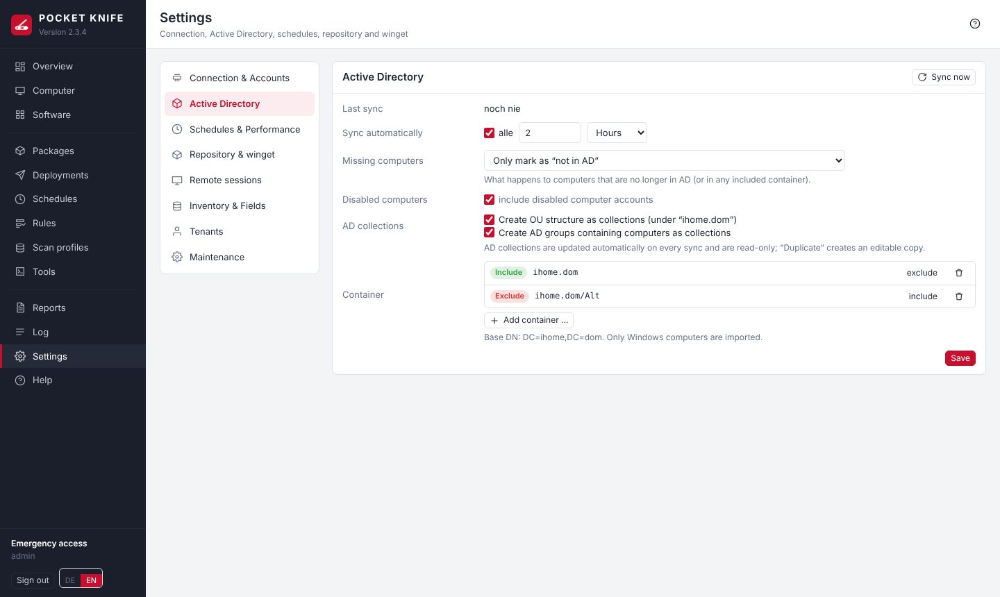

| Section | Contents |
|---|---|
| Connection & Accounts | domain data, Test LDAPS, **service account** and optionally a repository account (checked before saving, stored encrypted), **authentication method** NTLM/Kerberos with test |
| Active Directory | include/exclude containers (the closest rule wins), sync interval, handling of removed and disabled computers (deleted only once a computer has been missing from AD **for 7 days**; if no container is included or suddenly almost all computers are missing, nothing is changed), AD collections |
| Security | check the LDAPS certificate strictly, **sign out when idle**, web interface certificate (HTTPS): view, upload your own (PFX or PEM), create a request (CSR), backups, regenerate self-signed |
| Network & remote access | name resolution & reachability, Wake-on-LAN, remote sessions (guacd status, own credentials, keyboard layout, central VNC password, active sessions) |
| Inventory | heartbeat, scan after startup, parallel scans, scan after deployments, built-in Windows apps, "low disk" limit, disk usage depth, scan profiles, custom fields (e.g. asset number, room) – can also be created directly on a computer under **Custom fields**; free-text **notes** per computer are there too (stored only in POCKET KNIFE, never overwritten by the computer) |
| Updates & versions | [update status](#updstatus) Windows & Office, winget index, default scope, [deferring new versions](#winget-release), automatic installation of winget, offline sources, [proxy server](#proxy), update-check exclusions |
| Packages & Repository | package execution (Local System or service account), parallel installations, timeout, repository path and test, upload to the repository, package break detection |
| On the client | [notification on the client](#toast), [message on restart and shutdown](#rebootmsg) |
| E-mail & notifications | SMTP server with test e-mail, notifications on events (see [Notifications](#alerts)) |
| Tenants | tenants with their own collection, repository folder and optional [OU admins](#ou-admins) |
| Backup | automatic backup (daily and before updates), versions to keep, back up now, download |
| Maintenance | status, database size and "Clean up now", immediate AD sync and heartbeat, connection test, appearance, language, **retention** of log and history, database maintenance, program updates, [diagnostic package](#diagnostics) |

**Search (from 2.42):** the search field above the list searches all sections, e.g. "grace", "VNC" or "proxy" – every card containing the term is shown. Old links to former sections (e.g. "Schedules & Performance") lead to the new place automatically.

**Tenants:** Packages and schedules can be assigned to a tenant. If the tenant has a collection, its packages are distributed only to the computers in that collection. If it has a repository folder, its packages may only use files from that folder (checked on save).

## OU admins (tenant admins) {#ou-admins}

If a colleague should manage only part of the domain, for example the OU Hamburg, make them an **OU admin**:

1. Create a group in AD, e.g. `PK-OU-Hamburg`, and add the colleagues. They do **not** belong in the main admins group (`POCKETKNIFE-Admins`).
2. **Settings → Tenants → New tenant**: under **Computers** choose the OU's collection (an automatically created AD collection or a dynamic collection with the filter "Distinguished Name / OU"), under **OU admins** enter the group (**Choose …** searches AD).
3. Optionally enable **"may create their own packages and schedules"**. POCKET KNIFE then creates the **repository folder** itself (`Mandanten\Hamburg`) – or enter your own, e.g. `Kunden\Hamburg`. Optionally a **storage quota** in MB.

Members of the group then sign in as usual. "OU admin: Hamburg" is shown at the bottom left.

| | Main admins (`POCKETKNIFE-Admins`) | OU admins |
|---|---|---|
| Computers, inventory, software, log | all | only the tenant's computers |
| Actions on computers (services, files, remote session, LAPS/BitLocker, run tools) | all | own computers only |
| Packages (central, those of other tenants and those a main admin created for the tenant) | change and deploy | view central ones and those of the own tenant and deploy to own computers – packages of other tenants are invisible (from 2.37); change only their own (see [What belongs to whom](#tenant-ownership); copy: only if the software does not exist yet – duplicate block) |
| Repository | everything | only the tenant's folder: upload, folders, rename, move, delete (see [Repository](#repository)) |
| Own packages and schedules | – | only if enabled for the tenant; files only from its repository folder; command/PowerShell steps only with a separate approval (see [Securing tenants](#tenant-security)) |
| Collections | all | view those of their scope; create their own (if enabled for the tenant) – never contain more than the tenant's computers |
| Schedules | all | change their own; view and run those the main admin created for the tenant; central ones view only, with own computers only |
| Deployments | all | only with own computers; cancel/retry only if all targets are their own |
| Reports | all, create and change, by e-mail | view and CSV only, with own computers only |
| Settings, scan profiles, kiosk administration, report e-mails, alerts, creating tools | yes | no |

**Security:** The server checks the limits on **every** request, not just the user interface. For OU admins every function is blocked unless explicitly enabled; foreign computers are treated as non-existent. Anyone in both groups is a main admin. The emergency access is always a main admin. Memberships are checked at sign-in and then automatically every 2 minutes in the background – anyone removed from the group in AD loses access without further action; a change to the tenant in POCKET KNIFE takes effect immediately. POCKET KNIFE learns which computers belong to the OU during the AD sync (Settings → Active Directory, hourly by default; "AD sync now" under Maintenance). A tenant with OU admins always needs at least one collection (without one there would be no computers – never "all"). **Several collections** are possible (e.g. several OUs, sites or AD groups): together they form the tenant's scope. **OU admins only see collections from their scope:** those of their tenant including subfolders, others only if they contain at least one of their computers (e.g. an exception group for package conditions), plus the standard collections – never the rest of the domain and never other tenants' collections.

Further safeguards:

- The group is resolved **unambiguously** in AD when saving (first via the group name "sAMAccountName", which is unique across AD) and stored with its **SID** – AD must be reachable for this. At sign-in only this group counts: a group with the same name in another OU, or one deleted and recreated, never grants access; renaming or moving does no harm. If a name is ambiguous, enter the full DN.
- Tenant packages run with the same account as all packages (from 2.39: **Package execution**, default "Local System"). Whoever switches it to "Service account" is told that packages of tenants with their own packages then run as the service account too. Uninstalls using the command from the computer's registry never run as the service account for anyone – main admins included – because whoever is administrator on the computer determines that command. Repository files only with a repository folder for the tenant.
- Schedules of OU admins: only their own tenant's collection and their own collections as collection targets. A tenant that once had OU admins reaches no computers without a collection; tenants with schedules can only be deleted once these are reassigned. Any change to a tenant's group, collection or permissions ends its OU admins' sessions (they sign in again).
- Remembering uninstall commands "for all", the central VNC password and the kiosk via the OU admin sign-in remain reserved for main admins or kiosk users.

> **Recommendation:** OU admins are administrators on their computers. POCKET KNIFE signs in there with the domain-wide service account. Therefore: use Kerberos instead of NTLM (Settings → Connection), add the service account to the "Protected Users" group (then "Kerberos only" – see [WinRM by Group Policy](#winrm-gpo)) and enforce SMB signing via GPO. For even stricter separation, use a separate POCKET KNIFE instance with its own service account per site.

### What belongs to whom {#tenant-ownership}

An OU admin only changes what belongs to them – everything else they can see, so they know what is going on, but cannot change it. This protects the main admin's work.

| | An OU admin may … |
|---|---|
| **Their own** (created, copied or imported by the OU admin) | change, delete, run |
| Packages and schedules **a main admin created for the tenant** | view, deploy or run, **copy as a template** – change only if the main admin enables **"OU admins may change"** on the package or schedule |
| **Central** packages | view, deploy to own computers, copy as a template |
| **Central** schedules | view only (badge "central"), with their own computers only; visible only if they reach at least one of them. Only main admins start and change them |
| The main admin's **collections** (including the tenant's own) | view, create a copy for their own scope |
| **Reports** | view, run, CSV – with own computers only. Creating custom reports, report e-mails and alerts: main admins only |

**Own collections** (only if "own packages" is enabled for the tenant): an OU admin creates dynamic and static collections and folders at the top level or in their own folders. Whatever the rule says, such a collection **never contains more than the tenant's computers**. "Is member of" only works with collections they can see; static members only from their computers. Other tenants do not see them. They cannot be chosen as a tenant's scope (Settings → Tenants) – that remains a main admin's collection. A collection assigned to a tenant as its scope cannot be deleted.

**After updating to 2.30:** packages and schedules an OU admin had already created or changed are recognised once from the log and stay theirs. Everything else counts as created by the main admin and is read-only for OU admins – enable "OU admins may change" on the package or schedule if needed.

### Securing tenants {#tenant-security}

A tenant should only bring to its computers what is in **its repository folder**. POCKET KNIFE enforces this in three levels:

**1. Files only from its own folder.** For tenant packages, Install and File copy take files only from the tenant's repository folder (`Mandanten\<Name>`). The server rejects other folders, UNC paths (`\\server\…`) and `..` when saving.

**2. No own code without approval.** Under "own packages", the tenant has the additional switch **"may write command and PowerShell steps"** – **off** by default. Then, for OU admins:

| Allowed | Not allowed |
|---|---|
| Install (MSI, EXE, MSU, **also .ps1/.cmd as a file from their own repository folder**), winget, File copy, Registry, Uninstall (with the detected command), Restart, Message, Wait, Scan, nested packages | "Command" and "PowerShell" steps, custom uninstall commands (in packages and in the software list) |

Scripts therefore belong **in the repository as files** – there the integrity check (fingerprint) sees and checks them like any other installation file. Steps written by a main admin may be left unchanged by an OU admin, but not changed or added. Existing packages keep running.

**3. What a tenant package reaches on the network.** Tenant packages run on the client with the account from **Package execution** – by default **Local System** (from 2.39 the same for all packages; the setting "Service account" would give tenant packages the service account too). If a script or installer accesses a share, it signs in there with the **computer account** (e.g. `FIRMA\PC-17$`). It therefore only reaches what is shared with "Domain Computers", "Authenticated Users" or "Everyone".

> **Important:** every installer is executable code – an MSI can also access shares or the internet in the background. Levels 1 and 2 determine **where** the code comes from; what it **reaches** is determined by the permissions on the network (level 3). Therefore also:

- **Check shares:** anything not meant for all computers should not be shared with "Domain Computers", "Authenticated Users" or "Everyone" – on the share **and** in NTFS. The repository does **not** need any permissions for "Domain Computers" either: POCKET KNIFE reads it with the repository/service account and copies the files to the client itself – otherwise a tenant script could read other tenants' files.
- **Optionally restrict by GPO** what clients can reach: *Computer Configuration → Policies → Windows Settings → Security Settings → Windows Defender Firewall with Advanced Security → Outbound Rules* – allow outbound SMB (TCP 445) only to the file servers the clients need (e.g. logon scripts, profiles, print servers). Try it in a test OU first: domain controllers (SYSVOL/NETLOGON) must always remain reachable.
- **Notice when saving:** if a tenant package contains access to shares (`\\server\…`, `net use`, `New-PSDrive`) or downloads (`Invoke-WebRequest`, `curl`, `bitsadmin`, `https://` …) in commands, PowerShell or arguments, POCKET KNIFE shows a notice after saving and writes it to the log. This is **a help for reviewing, not a block** – such things can be rewritten. Script files in the repository are not searched.


## Your own certificate {#certificate}

POCKET KNIFE serves HTTPS itself – no reverse proxy is needed. A self-signed certificate is generated on first start; replace it under **Settings → Security → Certificate (HTTPS)**. A new certificate is **active immediately** (no restart); the previous one is backed up.

**Option A – upload a finished certificate**

- **PFX / PKCS#12** (`.pfx`, `.p12`) with password – contains certificate, key and usually the chain. Easiest from the Windows certificate manager: *Export → Yes, export the private key*.
- **PEM / CER** (`.crt`, `.cer`, `.pem`, DER or `.p7b`) plus key file (`.key`, encrypted keys are fine). Intermediate certificates optionally as a separate file.

**Check** shows in advance what would be installed. Rejected are: key does not match, expired or not yet valid, not for server authentication, RSA below 2048 bits. You get a note when `PK_PUBLIC_HOSTNAME` is not in the certificate, intermediates are missing or it expires in less than 30 days.

**Option B – request (CSR) for your own certification authority**

1. Enter the names (CN and every address used to open POCKET KNIFE) → **Create request**. The key is generated inside POCKET KNIFE and never leaves it.
2. Download the CSR and submit it, e.g. to Active Directory Certificate Services:

```
certreq -submit -attrib "CertificateTemplate:WebServer" pocketknife.csr pocketknife.cer
```

3. Upload the issued certificate using the **PEM / CER** format – without a key file; the key from the request is used.

> For browsers to trust the certificate without a warning, the CA's root certificate must be trusted on the workstations (automatic in an AD environment with Certificate Services). **Download certificate** exports the current certificate, e.g. for a GPO.

**Reset:** Restore one of the last five backups or create a new self-signed certificate (e.g. after changing `PK_PUBLIC_HOSTNAME`). The files are in `/data/tls` (`server.crt` with chain, `server.key`); you can still place them there by hand and restart the container.

## Kerberos instead of NTLM {#kerberos}

POCKET KNIFE signs in with the service account via **WinRM** (PowerShell) and **SMB** (package copies, repository). The default is **NTLM**. Microsoft has deprecated NTLM; **Kerberos** is the future-proof option. From version 2.6, Kerberos is included in the container and can be tested and switched without a restart.

**Not affected:** LDAPS (simple bind over TLS, no NTLM) and the web interface sign-in. **Remote sessions via RDP** (guacd/FreeRDP with NLA) still use NTLM.

| Method | Behaviour |
|---|---|
| NTLM (as before) | WinRM and SMB via NTLM only |
| Negotiate | Kerberos where possible – otherwise NTLM automatically (e.g. when connecting by IP address) |
| Kerberos only | no NTLM fallback; anything that cannot use Kerberos fails with a hint |

**Requirements**

- Computers with a **fully qualified DNS name** (e.g. `pc-0001.firma.local`, from the AD sync). Kerberos does not work with IP addresses. Short names are completed with `PK_DOMAIN`.
- **Time**: the Docker host and the domain controllers must be within 5 minutes (NTP on the Docker host).
- The Docker host reaches the domain controllers on **port 88** (TCP). DCs are found via DNS (`_kerberos._tcp.<domain>`); otherwise set `PK_KDC=dc1.firma.local,dc2.firma.local` in the `.env`.
- **Repository path** with a DNS name, e.g. `\\fs01.firma.local\PAKETE` instead of `\\fs01\PAKETE` or an IP.
- The service account needs nothing special. On "encryption type not supported": enable "This account supports Kerberos AES 256 bit encryption" in AD and set the password once more.
- SPNs do **not** have to be created: every domain computer has `HOST/<name>`, which `HTTP` (WinRM) and `cifs` (SMB) map to – Samba AD included.

**Switching step by step**

1. Update to version 2.6 or later (the image is rebuilt).
2. **Settings → Connection & accounts → Authentication**: choose a computer, "Kerberos only", **Test**. All steps green and "The client reports: sign-in via Kerberos" = ready. The test does not change the active setting.
3. Set the method to **Negotiate** and save – effective immediately, no restart.
4. Watch for a few days (scans, deployments, repository). On a client, Event Viewer (Security, event 4624) shows "Authentication Package: Kerberos" for the service account.
5. Switch to **Kerberos only**. To keep it in the configuration permanently: `PK_WINRM_AUTH=kerberos` in the `.env` and "as .env" in the interface.
6. Later, NTLM can be restricted for the service account via GPO ("Network security: Restrict NTLM" – audit mode first).

Back to NTLM: choose "NTLM" in the same list and save.

**Typical messages in the test**

| Message | Solution |
|---|---|
| Kerberos libraries missing | pull the image again (`sudo sh update.sh`) |
| No KDC found / not reachable | check DNS SRV records or set `PK_KDC`; firewall port 88 |
| Clock skew | set up NTP on the Docker host |
| No service principal name (SPN) | address the computer by DNS name, check DNS record and computer account |
| Client reports NTLM instead of Kerberos | name is not recognised as a domain computer – check DNS name |
| Message stream modified | The device at the address cannot read the ticket: the DNS record points to another device (stale address, duplicate name) or the computer's trust relationship is broken (`Test-ComputerSecureChannel -Repair` on the client). The computer appears with a yellow dot "not confirmed". |

**Custom Kerberos configuration:** POCKET KNIFE generates the `krb5.conf` from `PK_DOMAIN` (realm in upper case; if different: `PK_KERBEROS_REALM`). A custom file `/data/krb5.conf` takes precedence.

## Diagnostics package {#diagnostics}

Under **Settings → Maintenance → Diagnostics package**, POCKET KNIFE creates a ZIP with the log, statistics and settings of the last days (since the last update or 1–30 days, default 7). This makes it possible to trace errors and anomalies without access to the environment – e.g. to pass on to the developer.

**Contents**

| File | Contents |
|---|---|
| `versionen.json`, `aenderungen.md`, `behobene_fehler.txt` | version history, changes since the oldest version in the period, fixed errors |
| `LIESMICH.txt` | period, version, whether anonymized |
| `umgebung.json` | version, runtime environment, number of computers/packages/collections, database size, state of the schedulers |
| `einstellungen.json` | settings without passwords, keys and keytab |
| `statistik.json` | success rate per package, exit codes, most frequent errors, scan duration, warnings, kiosk requests |
| `protokoll.csv`, `fehler.txt` | log of the period, warnings and errors separately |
| `bereitstellungen.csv`, `fehlgeschlagen.json` | deployments; for failures the end of the output (at most 3000 characters per step) |
| `scans.csv` | scan runs with duration and result |

Passwords, the vault, sessions, keytab and certificates are **never** included – not even without anonymization. Passwords in command lines of steps and outputs (e.g. `PASSWORD=…`, `net use … /user:account password`, `ConvertTo-SecureString '…'`) are replaced by `***`.

**Versions:** Every line in the package carries the version under which it was created. `statistik.json` separates the whole period from the **running version** and shows warnings, errors and results per version. In addition there are `versionen.json` (since when which version ran), `aenderungen.md` (changes from the oldest version in the period up to today) and `behobene_fehler.txt` (errors the self-test checks again with every version). An error that only occurred under an older version can thus be recognized as probably fixed. After an update, the period **Since the last update** is recommended; the card shows since when the running version has been running. The version history is kept since 2.22; earlier updates are added from the start messages in the log – even older entries appear as "vor 2.x".

**Anonymize (on by default):** names are replaced by fixed placeholders – computers `PC-001`, users `USER-001`, servers `SRV-001`, persons `Person-001`, IP addresses `10.99.x.y`, MAC addresses `02:00:…`, mail addresses `user01@firma.local`, domain `firma.local` / `FIRMA`, OUs and groups as well. The same name gets the same placeholder in every package, so error patterns remain comparable across several packages. Small suffixes show what matters for troubleshooting without revealing the name: `-LANG` (longer than 15 characters), `-UML` (umlauts), `-SZ` (special characters).

The mapping stays **only in your database**. If someone gives you a placeholder ("step 2 fails on PC-017"), **Look up placeholder** finds the real name; **Download mapping (CSV)** returns the whole list (this is logged). Do not pass this file on.

> Software, package and collection names, exit codes and Windows error messages stay readable – they are needed for the analysis. If you use names of persons in package names or your own scripts, briefly check the package before passing it on (e.g. `fehler.txt`).

# Security and Backup {#security}

- Sign-in only for members of the access group (including nested membership); lockout after repeated failed sign-ins.
- Web interface over HTTPS, cookies `HttpOnly`/`Secure`/`SameSite=Strict`, CSRF protection, strict Content Security Policy without external sources.
- Passwords (service account, repository account) are stored encrypted in the database; the key is `/data/pocketknife.key`.
- Packages run as Local System by default – then no password is ever stored on the clients. Only whoever explicitly chooses "Service account" under **Package execution** (with a security notice and a log entry) hands the service account password to a scheduled task for the duration of a step; it is passed as a parameter and does not end up in the clients' PowerShell logging.
- **Account lockout protection:** If AD rejects the service account, POCKET KNIFE pauses all automatic access until the cause is fixed ("Check & continue"). This applies to NTLM and Kerberos.
- **Failed sign-ins to the interface:** at most 8 per user and IP and 30 per IP within 15 minutes – spellings like `FIRMA\admin`, `x\admin` or `admin@firma.local` count together.
- **Sign-out when idle:** without mouse or keyboard input the session ends after 30 minutes (adjustable 5–720 minutes under Settings → Connection & Accounts; it cannot be turned off). Input in a remote session counts, automatic refreshes of open pages do not. A notice appears shortly before; open remote sessions are ended as well.
- **Changing the repository server:** whoever changes the server or share of the repository confirms this with the password of the access account – so the stored credentials never go to a mistyped or foreign server. Subfolders of the same share and mounted folders (`/repo`) need no confirmation.
- **Container without root:** the service runs as user `pocketknife` (UID 10001, `PK_UID`/`PK_GID`), with a read-only program file system, without capabilities and with `no-new-privileges`. On start, `/data` and `/backup` are handed over to it once. A mounted repository folder must be readable for it.
- **Pinned versions:** Python base image (version and digest), Debian packages and all Python packages are pinned exactly (see [Update](#update)).
- **Active sessions** are checked against AD in the background every 2 minutes – even if the user is not clicking anything: anyone disabled or removed from the access or tenant group is signed out; anyone additionally added to a tenant group or to the access group gets the extended scope; anyone who loses rights (e.g. a tenant) is signed out and signs in again – this also ends remote sessions. A brief AD disruption signs nobody out: the session stays and is checked again after one minute. OU admins, however, are signed out after at most 30 minutes without confirmation by AD. If the access group is missing in AD (deleted, renamed, ambiguous), nobody is a main admin until it is fixed (except the emergency access) – the log reports it. Signing out also ends open remote sessions.
- **LDAPS certificate:** each domain controller's certificate is stored on first contact and compared **before** a password is sent. A change (e.g. certificate renewal) is logged; with **strict check** (Settings → Connection & accounts) the connection is refused until confirmed. With `PK_LDAP_CA_FILE` (domain CA as PEM, e.g. `/data/ca.pem`) the certificate is fully validated against the CA. New installations have **strict check** enabled from 2.13; existing installations keep their setting – enabling it is recommended.
- **WinRM over HTTPS:** with `PK_WINRM_CA_FILE` (CA as PEM) the clients' certificate is validated; without this variable it is not validated, as before.
- **Request size:** requests to the web interface are limited to 2 MB (Explorer uploads 2 GB, winget packages 310 MB, certificates and package import 20 MB).
- **Sign-in error messages** do not reveal whether the user name or password was wrong or only the group membership is missing; details are in the log.
- **Working folder on the clients** (`C:\Windows\Temp\PocketKnife`): permissions for SYSTEM and Administrators only. If a user created the folder beforehand, it is moved aside and recreated (note in the log).
- **Repository as a folder** in the container only under `/repo` (`PK_REPO_MOUNT`) – the data directory cannot be set as repository.
- CSV exports neutralise values that Excel would execute as a formula.

## Backup {#backup}

**Backup:** POCKET KNIFE backs itself up – under **Settings → Backup**:

- **daily** at the configured hour (default 2:00 AM) and **before every update** (on the first start of a new version, before any database changes)
- **Versions to keep:** default 10; older backups are deleted automatically (including manual and "before update" ones)
- **Back up now**, list with download and delete
- Each ZIP contains: the database (consistent copy while running), `pocketknife.key` and the HTTPS certificate. This also restores stored passwords – so protect the backup folder.
- **Download** via the interface delivers the backup **without** `pocketknife.key` and the HTTPS key (database and key stay separate). After restoring from it, re-enter the service account, repository account and VNC password – or take the full ZIP directly from the backup folder on the Docker host.
- Location: `PK_BACKUP_PATH` from the `.env` (default `<PK_DATA_PATH>-backup`, e.g. `/opt/pocketknife/data-backup`). Preferably another drive or a mounted network share; if the folder is on the same drive as the database, the page points this out.

**Restore:** `docker compose down` → delete `pocketknife.db-wal` and `pocketknife.db-shm` in the data directory → extract the ZIP there → `docker compose up -d`.

# Troubleshooting {#troubleshooting}

**Self-test:** `docker compose exec pocketknife python3 tools/selftest.py` checks with a temporary database that previously fixed bugs have not returned. It does not change any data.


| Message | Cause / Solution |
|---|---|
| LDAPS connection failed | Check the DC names, port 636 and DNS servers in the `.env`; is LDAPS enabled on the DC? |
| Service account locked / 0xC0000234 | Unlock the account in AD, check the password, then click "Check & continue" |
| No access: not a member of the group | Add the user to the access group and sign in again |
| WinRM port not reachable | WinRM GPO, firewall, is the computer turned on? |
| Access denied | The service account is not a local administrator |
| Copy fails | Port 445 / ADMIN$ on the client, read access to the repository share |
| winget: "No applicable update" (`-1978335189`) although a newer version can be installed ("A newer package version is available … but it does not apply") | The package does not state an installation scope in the winget catalogue (e.g. MobaXterm); with a fixed scope winget rejects the update. From 2.30.1 POCKET KNIFE then repeats the step once without `--scope` (from 2.31 also for "No installed package found", `-1978335212`, and the extraction with tar.exe afterwards also without). Permanently: set the installation scope of the package to "Package default" |
| winget: "Newer version available, but with a different install technology" (POCKET KNIFE code 9011) | Installed is e.g. the MSI version, the catalogue only has another installer type (e.g. PowerShell 7) – winget does not upgrade that ("install technology is different"). In the package first add an **Uninstall** step, then **Install**; or `--force` under "Additional arguments" (installs the new version alongside, the old one stays and must be removed afterwards) |
| winget: "Newer version available, but it does not fit this system" (9012) | According to the winget catalogue the new version needs a different architecture, Windows version or other requirements. Previously POCKET KNIFE reported this as "already up to date" |
| "The process ended without a result" | From 2.31 the reason is shown: error output of PowerShell, block by Defender (ASR rule "Block process creations originating from PSExec and WMI commands", only if set to **Block** – "Audit" is never the reason), antivirus detection, crash or AppLocker, last output. Tools as the service account (and packages from versions before 2.39) run as a process of their own started via WMI – if security software blocks that, set the tool to "SYSTEM" |
| "… cannot be loaded. The file … is not digitally signed" | A GPO sets the execution policy (`Get-ExecutionPolicy -List` shows *MachinePolicy RemoteSigned*) and Windows treats the file as foreign (security zones, e.g. intranet/site-to-zone assignment). From 2.32.2 POCKET KNIFE then loads the file's content – for all PowerShell scripts, including .ps1 files from the repository; the message only appears in the log. Code 9013: Windows refuses a script that this script calls itself (POCKET KNIFE does not reload it, otherwise the part before would run twice) – sign the called script, check the policy (`Get-ExecutionPolicy -List`) or move its content into the step |
| Code 9014 / 9015 / 9016 | Windows is hardened and prevents execution: 9014 antivirus (AMSI) classified the content as malicious; 9015 PowerShell runs in Constrained Language Mode (AppLocker/WDAC) and the script needs functions blocked there – allow the working folder `C:\Windows\Temp\PocketKnife` in the policy or exempt the computer; 9016 AppLocker or Software Restriction blocked a program (which one is in the log) |
| Service account protection because of a single computer | From 2.31, on "wrong password" from one computer POCKET KNIFE first checks via LDAP whether the account really fails. If it is fine, the error only concerns this computer (usually a wrong DNS entry: another device answers at the address) – the protection stays off |
| High CPU load | **Settings → Maintenance → CPU load** shows the average, the background tasks with the most CPU time and the latest peaks with what was running (tasks, scans, deployments, requests of the interface) |
| winget not found | Enable automatic installation or use the "Check / install winget" tool |
| Package step as service account does not start ("Could not create the scheduled task as the service account") | check the service account's password under Connection & Accounts; the service account needs the right "Log on as a batch job" (administrators have it by default) – or set **Package execution** to "Local System" |
| Windows Update in a package: "access denied" (0x80070005) | The step ran over a network logon (packages before 2.39 as service account). From 2.39 packages run as Local System or as the service account with a local logon – then it works |
| Custom command cannot reach a share | As Local System the computer account logs on (e.g. `PC-0001$`): give the group "Domain Computers" read access or have the file copied with "File from the repository" |
| Warning "/repo is not readable" | The service runs as UID 10001: on the Docker host `chmod -R o+rX` or `chown -R 10001` the repository folder |
| PowerShell scanner returns nothing | Scanner dialog → Test; the "PowerShell" profile needs a trigger |
| Remote session: guacd not reachable | Is the `pocketknife-guacd` container running? `docker compose up -d` |

# Privacy {#privacy}

POCKET KNIFE runs entirely in your network; data is only stored under `/data` on the Docker host (SQLite database, log files, certificate, winget index).

| What | Why | How long |
|---|---|---|
| Computer inventory (hardware, software, services, network, local administrators, signed-in user) | management, reports, software deployment | as long as the computer exists; removed immediately on deletion |
| Data from Active Directory (computers, groups, OU) | sync, tenants | until the next sync |
| Log (who did what and when, with user name) | traceability | default 90 days |
| Scan log | troubleshooting | default 14 days |
| Deployments with output, decided kiosk requests (user name, computer, time) | evidence, troubleshooting | default 180 days |
| Software changes | history | default 365 days |
| Sessions | sign-in | until they expire |

The retention periods are under **Settings → Maintenance → Retention & database**. Passwords, keys, LAPS and BitLocker values are stored only encrypted in the database and never appear in the log or the [diagnostics package](#diagnostics).

**What leaves the network** – only what you enable: winget catalog and winget cache (`cdn.winget.microsoft.com` and the vendors), the App Installer for computers without winget (github.com), the notice about new versions (github.com, once a day, without data from your network) and e-mails to the configured recipients. The interface loads nothing from the internet. The diagnostics package is never sent – only downloaded, anonymized by default.

# License {#license}

Copyright (C) 2026 soleil0815 (helfi.space)

POCKET KNIFE is free software under the **GNU Affero General Public License, version 3** (AGPL-3.0-only). You may use it – also in companies –, redistribute and modify it. Anyone who modifies it and distributes it or makes it available to others over a network must offer the modified source code under the same license. POCKET KNIFE comes **without any warranty**.

- Source code and full license text: `https://github.com/soleil0815/pocketknife` (file `LICENSE`; in the container at `/opt/pocketknife/LICENSE`)
- Bundled third-party components keep their own licenses, e.g. Apache Guacamole (Apache-2.0, `app/static/vendor/guacamole-LICENSE.txt`) and the Python libraries (MIT, BSD, Apache-2.0, LGPL-3.0 – list in `requirements.lock`)

## Support {#support}

POCKET KNIFE is free. If you would like to support its development, you can buy me a coffee: **"Buy me a coffee"** at the bottom of the navigation (visible to administrators only) opens `https://buymeacoffee.com/soleil0815` in a new tab. Nothing is loaded from the internet before you click.

# Glossary {#glossary}

| Term | Explanation |
|---|---|
| ADMIN$ | administrative share `C:\Windows` of a computer; POCKET KNIFE copies package files there |
| App Installer | Windows package that contains winget |
| Heartbeat | reachability check of all computers |
| LAPS | management of local administrator passwords through AD |
| LDAPS | encrypted access to Active Directory (port 636) |
| Product code | unique GUID of an MSI installation |
| Scan age | time since the last successful scan of a profile |
| WinRM | Windows Remote Management (PowerShell Remoting), port 5985/5986 |
